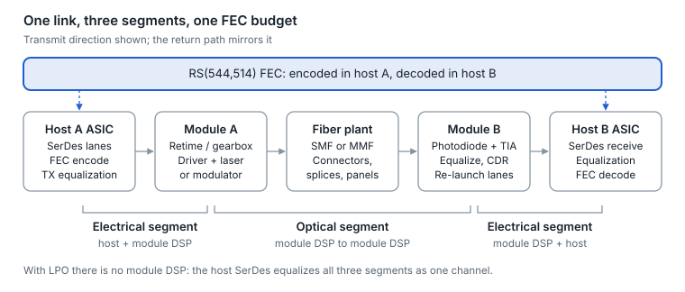
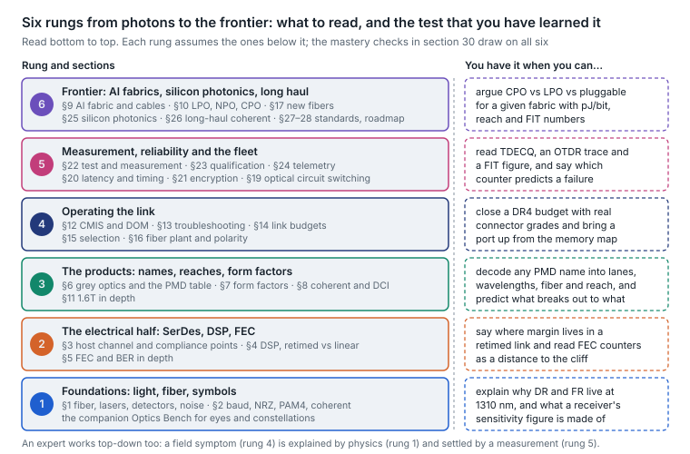

# Optical Transceivers: Technical Mastery Guide

A vendor-neutral, standards-first mastery guide to optical transceivers for Ethernet networks: physics, signaling, FEC, the product landscape from grey optics to coherent and co-packaged optics, operations, test, reliability, silicon photonics, long-haul transmission, standards and roadmap. Thirty sections, 84 diagrams, a 168-term glossary and 57 worked mastery checks.

Snapshot of the living guide at document revision 346, exported October 19, 2026; content reflects the industry as of October 2026. Diagrams are rendered from the guide's own figure sources and switch between light and dark versions with your GitHub theme.

**Read it as a site:** [clsulliv155.github.io/optics_guide](https://clsulliv155.github.io/optics_guide/) — the same guide as a topic-by-topic app with search, a glossary filter and the mastery checks, deployed from `site/` on every push to `main`.

## Contents

**Start here**

- [How to use this guide](#how-to-use-this-guide)

**Foundations**

- [1. Physics foundations](guide/01-physics-foundations.md)
- [2. Signaling and modulation](guide/02-signaling-and-modulation.md)
- [3. Electrical interface and SerDes](guide/03-electrical-interface-and-serdes.md)
- [4. DSPs and signal conditioning](guide/04-dsps-and-signal-conditioning.md)
- [5. Forward error correction](guide/05-forward-error-correction.md)

**Products**

- [6. Grey (IM-DD) optics](guide/06-grey-im-dd-optics.md)
- [7. Form factors](guide/07-form-factors.md)
- [8. Coherent optics and DCI](guide/08-coherent-optics-and-dci.md)
- [9. AI fabric and next-gen optics](guide/09-ai-fabric-and-next-gen-optics.md)
- [10. Optics packaging: pluggable, LPO, XPO, NPO and CPO](guide/10-optics-packaging-pluggable-lpo-xpo-npo-and.md)
- [11. 1.6T in depth](guide/11-1-6t-in-depth.md)

**Operations**

- [12. Management and diagnostics](guide/12-management-and-diagnostics.md)
- [13. Troubleshooting and operations](guide/13-troubleshooting-and-operations.md)
- [14. Link budgets made intuitive](guide/14-link-budgets-made-intuitive.md)
- [15. Selection framework](guide/15-selection-framework.md)

**Deep dives**

- [16. Fiber plant design](guide/16-fiber-plant-design.md)
- [17. Fiber frontiers: hollow-core, multi-core and few-mode](guide/17-fiber-frontiers-hollow-core-multi-core-and.md)
- [18. Advanced coherent and DCI](guide/18-advanced-coherent-and-dci.md)
- [19. Optical circuit switching](guide/19-optical-circuit-switching.md)
- [20. Latency and timing](guide/20-latency-and-timing.md)
- [21. Link encryption and physical-layer security](guide/21-link-encryption-and-physical-layer-security.md)
- [22. Test and measurement](guide/22-test-and-measurement.md)
- [23. Interoperability, qualification and reliability](guide/23-interoperability-qualification-and.md)
- [24. Fleet telemetry and predictive analytics](guide/24-fleet-telemetry-and-predictive-analytics.md)
- [25. Silicon photonics and optical engines](guide/25-silicon-photonics-and-optical-engines.md)
- [26. Long-haul coherent transmission: how it works and what limits it](guide/26-long-haul-coherent-transmission-how-it.md)

**Reference**

- [27. Standards and ecosystem map](guide/27-standards-and-ecosystem-map.md)
- [28. Roadmap as of October 2026](guide/28-roadmap-as-of-october-2026.md)
- [29. Glossary](guide/29-glossary.md)
- [30. Mastery checks](guide/30-mastery-checks.md)

## How to use this guide

An optical link is a chain of conversions: bits become electrical symbols, symbols become light, light becomes current, current becomes bits again. Every topic in this guide exists to keep errors low at each hop for the least power and cost. Sections 1–5 are the physics and signal-processing core, 6–11 the product landscape built on it, 12–15 the operator's toolkit, and 16–26 deeper topics, from new fiber types and silicon photonics to long-haul coherent transmission.

**Scope.** Vendor-neutral and standards-first (IEEE 802.3, OIF, the MSAs), Ethernet-centric. The depth target is correct mental models: where a formula appears, it makes an intuition precise rather than asking to be derived.

**Three questions that decode any optic**

1. **Lanes.** How many electrical lanes face the host, how many optical lanes face the fiber, and at what rate each? A 400G QSFP-DD DR4 has 8 × 50G electrical and 4 × 100G optical lanes, so a gearbox must sit between them.
2. **Encoding.** How does each lane carry bits: NRZ (1 bit per symbol), PAM4 (2 bits per symbol), or coherent QAM on two polarizations (8 or more bits per symbol)?
3. **Recovery.** What cleans the signal up, and where: host SerDes equalization, a module DSP, FEC on the host, FEC inside the module, or several of these?

**Four relationships used everywhere**

- Bit rate = symbol rate (baud) × bits per symbol × polarizations.
- Port speed = lanes × lane rate.
- Reach ends for one of two reasons: too little light arrives (loss), or the light arrives but the symbols have smeared into each other (distortion and noise).
- Lost margin shows up first as rising corrected FEC errors, long before a link drops. Healthy-but-degrading and broken look very different in the counters.

<picture>
  <source media="(prefers-color-scheme: dark)" srcset="figures/fig-01-dark.svg">
  
</picture>

*Figure 1 — link anatomy · 5 elements, 3 segments*

A retimed link is equalized in three separate segments, but its Reed-Solomon FEC runs end to end, so errors from all three share one budget.

**Companion lab.** Optics Bench, an interactive lab that accompanies the guide, turns five of these ideas into instruments: NRZ and PAM4 eyes side by side at the same bit rate, coherent constellations against OSNR, a link-budget calculator with the PMD figures from [section 6](guide/06-grey-im-dd-optics.md), a PMD-name and lane-rate decoder, and Mach-Zehnder vs ring modulators ([section 25](guide/25-silicon-photonics-and-optical-engines.md)).

**Pros and cons for AI networks.** Sections where an AI fabric faces a real technology choice close with an “AI networks: pros and cons” callout, and [section 9](guide/09-ai-fabric-and-next-gen-optics.md) opens with a map of all of them by network tier.

### A learning path

The sections can be read in order, but an expert's knowledge is layered rather than sequential: every operational question rests on a product fact, every product fact on an electrical or optical constraint, and every constraint on a few numbers from physics. The ladder below groups the guide into six such layers, with the sections to read and a test for each. Read bottom to top the first time; afterwards, enter at the rung where your question lives and climb down until the explanation holds.

<picture>
  <source media="(prefers-color-scheme: dark)" srcset="figures/fig-02-dark.svg">
  
</picture>

*Figure 2 — drawn for this guide · the thirty sections grouped into six rungs*

Each rung's test is a question that the sections on that rung answer with numbers rather than adjectives; the mastery checks in [section 30](guide/30-mastery-checks.md) draw on all six.
