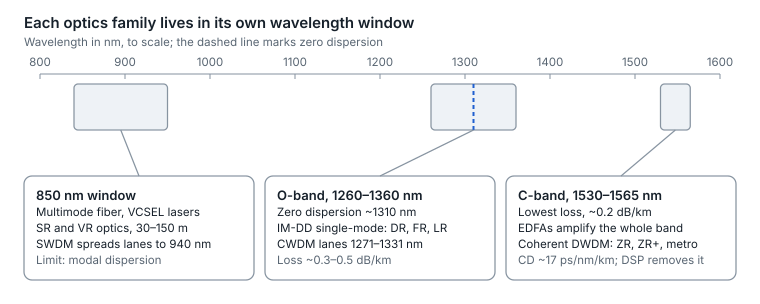
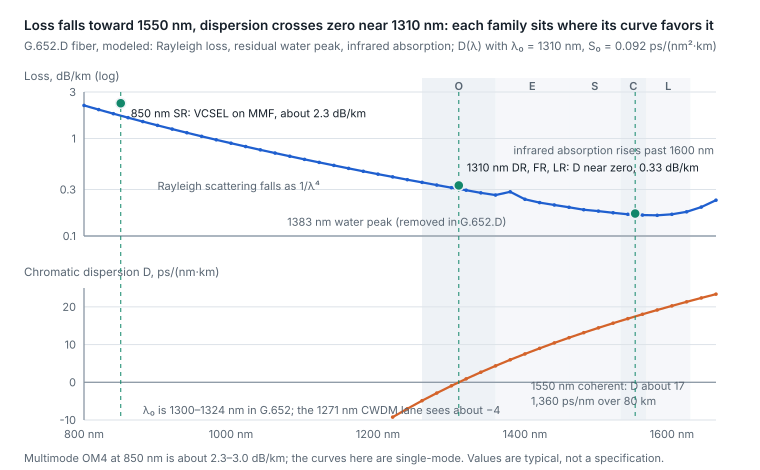
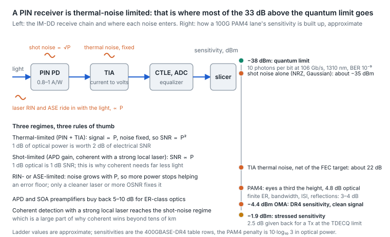

# 1. Physics foundations

Two things end every optical link: too little light arrives (loss), or light arrives but the symbols have smeared together (dispersion, bandwidth limits, noise). Every choice of fiber, wavelength, laser and detector trades between those two limits.

## Fiber: multimode vs single-mode

|  | Multimode (MMF) | Single-mode (SMF) |
| --- | --- | --- |
| Core diameter | 50 µm | \~9 µm |
| Grades | OM3, OM4, OM5 | OS2 (ITU-T G.652.D) |
| Wavelengths | 850 nm (OM5 is specified from 846 to 953 nm for SWDM) | O-band \~1310 nm, C-band \~1550 nm |
| Light source | VCSEL | DFB, EML, silicon photonics, tunable lasers |
| What limits reach | Modal dispersion: many light paths arrive at different times | Attenuation, then chromatic dispersion as baud rises |
| Reach at 100G per lane | \~50–100 m | 500 m–10 km IM-DD; 80 km+ coherent |
| Cost profile | Cheapest optics, costlier cable, short reach | Costlier optics (falling fast), cheap cable, any reach |

Multimode reach shrinks with every speed step, while single-mode parallel optics (DR) have become cheap. That is why new data-center builds increasingly run single-mode almost everywhere.

## Wavelength windows

- **O-band (1260–1360 nm).** Chromatic dispersion in standard SMF is near zero around 1310 nm, so intensity-modulated pulses stay sharp. Nearly all IM-DD single-mode optics (DR, FR, LR) live here.
- **CWDM vs LAN-WDM inside the O-band.** CWDM spaces four lanes 20 nm apart (1271, 1291, 1311, 1331 nm), which keeps lasers cheap. LAN-WDM packs lanes much closer to 1310 nm, so the outer lanes see less dispersion; it is used where 10 km reach matters.
- **C-band (1530–1565 nm).** Lowest loss (\~0.2 dB/km) and the band where erbium-doped fiber amplifiers (EDFAs) work, so DWDM and coherent live here. Dispersion is large (\~17 ps/nm/km), which a coherent DSP removes electronically.
- **850 nm (MMF).** VCSEL territory; SWDM spreads lanes across 850–940 nm on OM5.

<p align="center"><picture>
  <source media="(prefers-color-scheme: dark)" srcset="../figures/fig-03-dark.svg">
  
</picture></p>

*Figure 1.1 — wavelength windows · 800–1600 nm, to scale*

Grey single-mode optics sit where dispersion vanishes; coherent sits where loss is lowest and amplifiers work, and lets its DSP handle the dispersion.

## Impairments in plain terms

| Impairment | What happens | Who it hurts most | Countermeasure |
| --- | --- | --- | --- |
| Attenuation | Power decays with distance (\~0.3–0.5 dB/km O-band, \~0.2 dB/km C-band) and at every connector and splice | Everyone | Shorter spans, clean connectors, amplifiers in C-band |
| Chromatic dispersion (CD) | Wavelengths within a pulse travel at different speeds, so symbols spread into their neighbors | IM-DD at high baud, away from 1310 nm | Stay near 1310 nm; coherent DSP compensation |
| Modal dispersion | Light paths in MMF arrive at different times | MMF only | Better grade (OM4/OM5), shorter reach |
| Polarization mode dispersion (PMD) | The two polarizations drift apart in time, randomly | Long spans at high baud | Coherent adaptive equalizer |
| Reflections and MPI | Light bounces between connectors and interferes with itself | PAM4 (closely spaced levels) | Clean or angled (APC) connectors, fewer mated pairs |
| Nonlinearity | At high launch power the fiber itself distorts the signal | Amplified long-haul | Optimal launch power |
| Noise | Receiver thermal/shot noise; amplifier ASE noise | Everyone; ASE in amplified coherent | Sensitive receivers (APD), OSNR planning |

## Fiber in numbers: attenuation, dispersion and nonlinearity

The table above says what each impairment does. An expert also carries the numbers, because the numbers decide which family of optic lives where.

**Attenuation.** Three mechanisms shape the loss curve: Rayleigh scattering from the glass's frozen-in density fluctuations, which falls as 1/λ⁴ and dominates below 1500 nm; the hydroxyl absorption peak at 1383 nm, which G.652.D "low water peak" fiber suppresses so that the E-band is usable; and infrared absorption by the silica lattice, which climbs steeply past 1600 nm and sets the far edge of the L-band. Typical G.652.D fiber is about 0.33 dB/km at 1310 nm and 0.18–0.20 dB/km at 1550 nm (ITU-T G.652.D itself allows 0.4 and 0.3 dB/km; vendor cable specifications are typically 0.34–0.38 and 0.20–0.25); multimode at 850 nm is 2.3–3.0 dB/km (TIA-568.3 specifies 3.0 dB/km for OM3, OM4 and OM5 alike; ISO/IEC 11801 allows 3.5). That is why the C-band owns long haul, and why multimode reach is measured in tens of meters once baud is high.

**Chromatic dispersion.** For G.652 fiber ITU-T gives the dispersion coefficient as

```math
D(\lambda) = \frac{S_0}{4}\left(\lambda - \frac{\lambda_0^{4}}{\lambda^{3}}\right)
```

with the zero-dispersion wavelength λ₀ anywhere between 1300 and 1324 nm and the slope S₀ at most 0.092 ps/(nm²·km). The numbers that follow: about −4 ps/(nm·km) at the 1271 nm CWDM lane, +2 at 1331 nm and +17 at 1550 nm; over 10 km the outer CWDM lanes accumulate 40–50 ps/nm at the lane centers and nearly 60 at the lane edge on worst-case fiber, and 80 km at 1550 nm accumulates about 1,360 ps/nm. Two consequences matter for IM-DD. First, a 53 GBd PAM4 signal occupies about 0.3 nm of spectrum at 1310 nm, so 50 ps/nm smears each symbol by roughly 15 ps against an 18.8 ps unit interval: that is why IEEE held 100G-per-lane CWDM4 to 6 km (400GBASE-LR4-6, and reached 10 km at 100G per lane only with the single-wavelength 100GBASE-LR1; the 100G Lambda MSA's 400G-LR4-10 keeps the same CWDM lanes and gets to 10 km by budgeting the full −59 to +33 ps/nm and relaxing TDECQ to 3.9 dB), and why 800GBASE-LR4, at 200G per lane with an 8.8 ps symbol (113.4375 GBd with the inner FEC) and a spectrum about 0.65 nm wide, moved to LAN-WDM lanes huddled around λ₀. Second, because a photodiode detects power, dispersion turns the two sidebands of an intensity-modulated signal against each other and carves notches into the channel response, the first at

```math
f_{\text{null}} = \sqrt{\frac{c}{2\,D\,L\,\lambda^{2}}}
```

At 1310 nm and 40 ps/nm the first null sits at 47 GHz, close to the 53 GHz Nyquist frequency of a 200G-per-lane signal; at 1550 nm after 80 km it sits at 6.8 GHz. That one formula is why no high-baud IM-DD optic runs at 1550 nm beyond a few kilometers, and why coherent detection, which recovers the optical field and undoes dispersion digitally, takes over there.

**Polarization mode dispersion.** G.652.D specifies a link design value of 0.2 ps/√km and modern cable typically measures 0.1 or better, so a 1,000 km route accumulates about 3 ps: irrelevant for data-center IM-DD, tracked easily by a coherent DSP, and a real limit only on old fiber (0.5–2 ps/√km) at 10G NRZ beyond a few tens of kilometers.

**Mode field, cutoff and bandwidth.** G.652.D's mode field diameter is 8.6–9.2 µm (±0.4) at 1310 nm and about 10.4 µm at 1550 nm; a mode-field mismatch at a splice or connector is a loss, which is why G.657.A2 bend-insensitive fiber keeps the same MFD so that it splices to G.652.D without penalty. The cable cutoff wavelength is at most 1260 nm: below it the fiber carries a second mode, which is why the O-band, and the 1271 nm CWDM lane's lower edge, start there. Multimode fiber's equivalent figure is effective modal bandwidth, 2,000 MHz·km for OM3 and 4,700 MHz·km for OM4 and OM5 at 850 nm (OM5 adds 2,470 at 953 nm), and that bandwidth-distance product is what caps 100G-per-lane VCSEL links at tens of meters.

**Nonlinearity.** The Kerr effect makes the refractive index rise with intensity, n = n₀ + n₂·I, with n₂ about 2.6 × 10⁻²⁰ m²/W and an effective area of about 80 µm² in G.652 (110–130 µm² in terrestrial G.654.E large-effective-area fiber and up to about 150 µm² in G.654.B and G.654.D submarine fiber, which is why those routes use them). The nonlinear phase a channel picks up scales with launch power × effective length ÷ effective area, and it shows up as self-phase modulation on one channel and as cross-phase modulation and four-wave mixing between WDM channels. Two scattering effects have thresholds: stimulated Brillouin scattering reflects a narrow-linewidth continuous-wave laser back toward its source once it exceeds roughly +5 to +10 dBm on a long span, which is why coherent transmitters and external laser sources dither or broaden their lines; stimulated Raman scattering moves power from shorter to longer wavelengths across the C+L band, a few dB of tilt at high total power, which line systems pre-compensate. None of this touches a 500 m DR link at +1 dBm per fiber; all of it governs [section 26](26-long-haul-coherent-transmission-how-it.md).

<p align="center"><picture>
  <source media="(prefers-color-scheme: dark)" srcset="../figures/fig-04-dark.svg">
  
</picture></p>

*Figure 1.2 — modeled from ITU-T G.652.D parameters (λ₀ 1310 nm, S₀ 0.092 ps/nm²·km) and typical loss mechanisms · 800–1660 nm*

The two curves between them explain the product map: VCSELs at 850 nm accept 2–3 dB/km because the link is 100 m; grey single-mode optics sit at 1310 nm because dispersion vanishes there and a photodiode cannot undo it; coherent sits at 1550 nm because loss is lowest and EDFAs work there, and its DSP removes the 17 ps/(nm·km).

Sources: [G.652 attribute tables](https://stl.tech/wp-content/uploads/2023/03/Selection_of_different_ITU-T_G.652-Final.pdf), [802.3cu dispersion by lane](https://www.ieee802.org/3/cu/public/May19/anslow_3cu_02a_0519.pdf), [400G-LR4-10 MSA](https://gigalight.com.cn/file/400G-LR4-10-MSA.pdf), [OM3 and OM4 attenuation](https://my.fluke.com/en-us/article/KA-05286), [G.654.E white paper](https://global-sei.com/fttx/optical-fibers/resource/pdf/TR-23076A_White%20Paper_ITU-T%20G.654.E%20fiber,%20PureAdvance.pdf).

## Lasers and modulators

There are two ways to put data on light: swing the laser's drive current directly, or leave the laser on and modulate its output with a separate device. Direct modulation is cheaper; external modulation is cleaner and faster. [Section 25](25-silicon-photonics-and-optical-engines.md) shows how the silicon photonic versions are built.

| Source | Modulation | Where it is used | Trade-off |
| --- | --- | --- | --- |
| VCSEL (850 nm) | Direct | SR/VR multimode | Cheapest, lowest power; MMF only |
| DML (directly modulated DFB) | Direct | 10G/25G-lane LR, 100G CWDM4 | Cheap, but chirp limits speed and reach |
| EML (DFB + electro-absorption modulator) | External, integrated | 100G and 200G-lane DR/FR/LR | Low chirp, high bandwidth; one laser per lane |
| Silicon photonics (CW laser + Mach-Zehnder or ring modulator) | External, on silicon | DR4/DR8 parallel, co-packaged optics | One laser can feed several lanes; scales like a chip |
| Thin-film lithium niobate (TFLN) | External Mach-Zehnder | Emerging for 200G/lane and up, coherent | Very high bandwidth, low drive voltage |
| Tunable laser (ITLA) | Feeds a coherent IQ modulator | Coherent DWDM | Narrow linewidth, tunable across the C-band |

**Chirp** is the wavelength wobble a laser shows when its current swings. Combined with dispersion it smears pulses, which is why directly modulated lasers run out of road at high baud and long reach.

## Detectors

- **PIN photodiode + TIA.** The standard IM-DD receiver: the photodiode turns photons into current, the transimpedance amplifier turns current into voltage.
- **APD (avalanche photodiode).** Internal gain buys several dB of sensitivity for ER-class grey optics, at higher cost and temperature sensitivity.
- **Square-law detection.** A photodiode measures power only; phase and polarization are invisible to it. So IM-DD can equalize the intersymbol interference that dispersion causes (an FFE or MLSE in the DSP does exactly that), but it cannot invert dispersion itself: beyond a few tens of ps/nm, double-sideband intensity modulation plus dispersion produces nulls in the detected spectrum that no equalizer can restore, which is why IM-DD reach is dispersion-capped. A coherent receiver adds a local laser so that mixing converts phase into measurable intensity, and its DSP can then undo dispersion exactly.

## Receivers and noise: what a sensitivity figure is made of

A receiver's sensitivity is not one number from one source. It is the quantum limit of light plus a stack of penalties, and knowing which penalty dominates tells you what a better receiver could buy.

**Responsivity.** A photodiode converts light to current at R = ηqλ/hc, which caps at 1.06 A/W at 1310 nm and 1.25 A/W at 1550 nm for perfect quantum efficiency; germanium and InGaAs PINs reach 0.8–1.0 A/W, and GaAs at 850 nm about 0.5. One microwatt of light is therefore about one microamp of current, and a −10 dBm signal about 100 µA: small, which is why the transimpedance amplifier (TIA) that follows is the component that decides the noise.

**Three noises, three regimes.**

- **Thermal (circuit) noise** from the TIA is fixed by its bandwidth and design, typically 10–15 pA/√Hz input-referred, which over the roughly 30 GHz bandwidth of a 53 GBd linear TIA is about 2 µA rms. A PIN receiver is thermal-limited: signal current grows with power P but the noise does not, so electrical SNR grows as P², and 1 dB of optical power is worth 2 dB of SNR. Every DR, FR and SR module lives here.
- **Shot noise** is the light's own granularity, with variance 2qIB, so it grows as √P. A receiver reaches the shot-noise regime only when something lifts the signal above the circuit noise: avalanche gain in an APD, an optical preamplifier (SOA or EDFA), or coherent mixing with a strong local oscillator. There SNR grows as P, 1 dB optical is 1 dB electrical, and sensitivity can approach the physics.
- **Intensity noise that rides in with the light** (laser RIN, amplifier ASE, multipath interference from reflections) scales with P itself, so more power does not help: it sets an error floor that only a quieter source, a higher OSNR or fewer reflections can lower.

**The ladder from the quantum limit to a real module.** Ideal on-off keying with a photon-counting receiver needs about 10 photons per bit for a BER of 10⁻⁹; at 106.25 Gb/s and 1310 nm (photon energy 1.52 × 10⁻¹⁹ J) that is 0.16 µW, or −38 dBm. Shot noise with a Gaussian decision in an NRZ receiver already costs a few dB (about −35 dBm). The TIA's thermal noise adds 20 dB and more, the single biggest step. PAM4 costs a further 4.8 dB of optical power (9.5 dB of electrical SNR), because its three eyes are each a third of the height; the FEC-era BER target of 2.4 × 10⁻⁴ gives about 2.5 dB of that back. Finite extinction ratio, receiver bandwidth, residual ISI and reflections take another 3–4 dB. The result is a specified sensitivity of about −4.4 dBm OMA outer for a clean signal in 400GBASE-DR4 (−4.6 for FR4, −6.8 for LR4-6): some 33 dB above the quantum limit, almost all of it electronics. The standard then lets the receiver give back 2.0–2.5 dB for a transmitter at the TDECQ limit (the sensitivity row relaxes 1 dB per dB of stressed eye closure above a 0.9–1.4 dB floor), which is where the stressed sensitivity figures of −1.9, −2.6 and −4.8 dBm come from.

<p align="center"><picture>
  <source media="(prefers-color-scheme: dark)" srcset="../figures/fig-05-dark.svg">
  
</picture></p>

*Figure 1.3 — computed in this subsection (quantum limit, shot noise) with IEEE 400GBASE-DR4 receiver rows · approximate ladder*

Three practical readings follow. An APD or SOA-preamplified receiver buys back 5–10 dB, which is how ER-class grey optics reach 40 km. Coherent detection with a strong local oscillator reaches the shot-noise regime, which, with the DSP's dispersion compensation, is most of why coherent wins beyond tens of kilometers. And because a PIN receiver's SNR scales with P², the first dB of lost margin on a grey link costs twice what it seems: a connector that eats 1 dB of light has taken 2 dB of electrical SNR from the slicer.

Sources: [400GBASE-DR4 receiver rows](https://www.ieee802.org/3/bs/public/17_09/dawe_3bs_03_0917.pdf), [FR4 and LR4-6 rows](https://grouper.ieee.org/groups/802/3/cu/public/cu_adhoc/cu_archive/cole_3cu_adhoc_050520_v4.pdf), [PAM4 modulation penalty](https://www.ieee802.org/3/ad_hoc/ngepon/public/15jan/ngepon_0115_houtsma_01.pdf), [quantum and shot-noise limits](https://labsites.rochester.edu/agrawal/wp-content/uploads/2019/10/opt428c.pdf), [53 GBd linear TIA noise](https://macom.com/products/product-detail/MATA-05819B).


---

[← Start here](../README.md) · [Contents](../README.md#contents) · [2. Signaling and modulation →](02-signaling-and-modulation.md)
