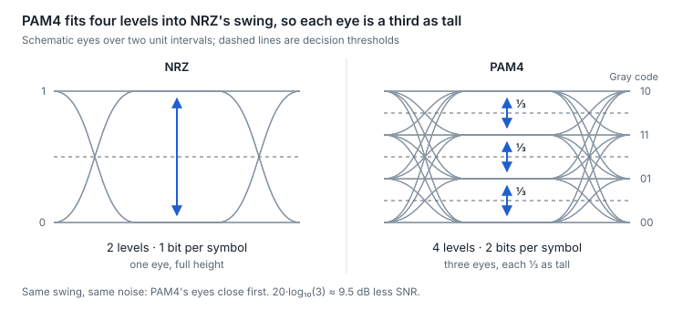

# 2. Signaling and modulation

PAM4 carries 2 bits per symbol instead of NRZ's 1, halving the symbol rate for a given bit rate, but each eye is one-third as tall, costing about 9.5 dB of SNR. The industry took that trade at 50G per lane because doubling the baud instead would have pushed lasers, drivers and copper channels past their bandwidth.

## Baud is not bit rate

- **Symbol rate (baud, GBd)** is how many times per second the signal changes state. Bit rate = baud × bits per symbol.
- **Bandwidth follows baud, not bits.** The frequency that matters is Nyquist = baud ÷ 2. A 100G PAM4 lane at 53.125 GBd needs about 26.6 GHz of bandwidth; the same 100G as NRZ would need about 53 GHz.
- So adding bits per symbol buys bit rate without buying bandwidth. The price is SNR, and the receipt is the FEC and DSP that every PAM4 link now carries.

## NRZ vs PAM4

|  | NRZ (PAM2) | PAM4 |
| --- | --- | --- |
| Levels | 2 | 4 |
| Bits per symbol | 1 | 2 |
| Eyes | 1 | 3, stacked |
| Eye height at the same swing | Full | One-third |
| SNR penalty vs NRZ | — | \~9.5 dB (20·log₁₀ 3) |
| FEC | RS(528,514) mandatory on SR, LR, ER, SR4, CR4, KR4 and CWDM4; negotiated on short copper and backplane (CR-S, KR-S); none on LR4 and ER4 | Mandatory |
| Linearity demand | Low: drivers can simply switch | High: levels must stay evenly spaced |
| Typical lane rates | 10G, 25G | 50G, 100G, 200G |

The intuition for 9.5 dB: the same peak-to-peak swing is now split into three gaps. Noise that used to be harmless now pushes a symbol across a decision threshold.

<picture>
  <source media="(prefers-color-scheme: dark)" srcset="../figures/fig-06-dark.svg">
  
</picture>

*Figure 2.1 — NRZ vs PAM4 eyes · schematic, same swing*

Gray coding (right) means neighboring levels differ in one bit, so the most common PAM4 error costs one bit, not two. The Optics Bench lab shows the same eyes with real noise and bandwidth limits.

**PAM4-specific concepts**

- **Gray coding.** Levels map to 00, 01, 11, 10, so the most likely error (landing on an adjacent level) corrupts one bit, not two.
- **Level linearity (R\_LM, level separation mismatch ratio: at least 0.95 in most PAM4 PMDs).** Nonlinear drivers or TIAs squeeze the outer or inner eyes. A PAM4 link can fail on linearity with plenty of optical power.
- **TDECQ (transmitter and dispersion eye closure, quaternary).** The PAM4 transmitter quality metric, in dB, lower is better. It asks how much noise the transmitter's signal could still tolerate after a reference equalizer, compared with an ideal transmitter. It replaced eye masks because a raw PAM4 eye is often closed before equalization yet perfectly usable after it.
- **OMA vs average power.** Optical modulation amplitude is the power difference between the outer levels; receivers care about OMA. DOM reports average power, so a module can show healthy Rx power while its OMA, and therefore its eye, is poor.
- **MPI sensitivity.** Reflections that re-enter the signal path beat against it and add noise that scales with signal amplitude, worst on the outer levels; with eyes one-third the height, PAM4 tolerates far less reflection than NRZ, which is why PAM4 PMDs tabulate the maximum discrete reflectance against the number of connectors (for 400GBASE-DR4-2: −25 dB for one, −41 dB for ten).

## Lane rates in practice

| Nominal lane | Modulation | Symbol rate | Line rate | FEC that fills the overhead |
| --- | --- | --- | --- | --- |
| 10G | NRZ | 10.3125 GBd | 10.3125 Gb/s | 64b/66b coding only |
| 25G | NRZ | 25.78125 GBd | 25.78125 Gb/s | RS(528,514) on most PMDs; none on 100G LR4/ER4 |
| 50G | PAM4 | 26.5625 GBd | 53.125 Gb/s | RS(544,514) |
| 100G | PAM4 | 53.125 GBd | 106.25 Gb/s | RS(544,514) |
| 200G electrical, and 500 m optical | PAM4 | 106.25 GBd | 212.5 Gb/s | RS(544,514) |
| 200G optical, 2 km and longer | PAM4 | 113.4375 GBd | 226.875 Gb/s | RS(544,514) + inner Hamming(128,120) |

The step from 106.25 to 113.4375 GBd on 2 km-plus 200G lanes is the overhead of an extra FEC layer added inside the module ([section 5](05-forward-error-correction.md)). The odd-looking numbers all come from the same recipe: 100 Gb/s of payload, 256b/257b transcoding, RS(544,514) overhead, then PAM4 halves the baud.

## After PAM4: the 400G-per-lane question

IEEE 802.3 chartered a 400 Gb/s per lane study group in March 2026; its PAR was approved on 25 September 2026 and the P802.3dv Task Force now covers 400G, 800G and 1.6T over electrical links and single-mode fiber up to 500 m, with submission for approval projected for September 2029 ([study g](https://grouper.ieee.org/groups/802/3/400GPL/index.html)[roup page](https://grouper.ieee.org/groups/802/3/400GPL/index.html)). The leading candidates are PAM4 at roughly 224 GBd and PAM6 at roughly 174 GBd ([comparison](https://ieee802.org/3/400GPL/public/2605/fan_x_400GPL_01a_2605.pdf)). It is the NRZ-to-PAM4 trade again: more levels lower the baud and ease component bandwidth, but squeeze the eyes further and cost more SNR.

## The coherent modulation family

A coherent receiver measures the optical field, not just its power, so it can use four dimensions: in-phase and quadrature amplitude on each of two polarizations. Each step to a denser constellation buys bits per symbol but needs more OSNR, so reach falls.

| Format | Bits per symbol, per polarization | Dual-polarization total | Typical use |
| --- | --- | --- | --- |
| DP-QPSK | 2 | 4 | 100G long haul; low-rate modes of multi-rate pluggables |
| DP-8QAM | 3 | 6 | Intermediate rates (300G modes) |
| DP-16QAM | 4 | 8 | 400ZR (\~60 GBd), 800ZR (\~120 GBd) |
| DP-64QAM, shaped | Up to 6 | Up to 12 | High-capacity metro transponders |

**Probabilistic constellation shaping (PCS)** sends inner constellation points more often than outer ones. That moves performance closer to the Shannon limit and lets one transceiver trade capacity against reach in fine steps instead of jumping between formats.

Worked example: DP-16QAM carries 8 bits per symbol. At about 60 GBd that is roughly 480 Gb/s gross, which carries 400GbE plus FEC and framing overhead. That is 400ZR.

---

[← 1. Physics foundations](01-physics-foundations.md) · [Contents](../README.md#contents) · [3. Electrical interface and SerDes →](03-electrical-interface-and-serdes.md)
