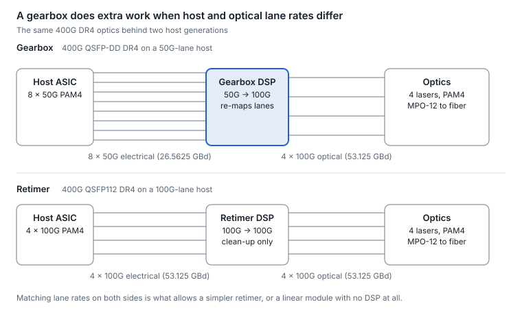
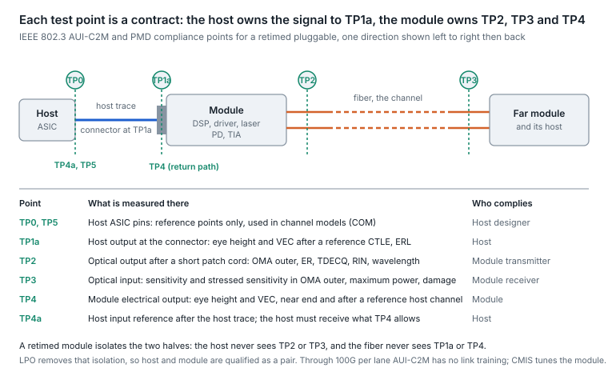

# 3. Electrical interface and SerDes

The host SerDes lane rate is the clock of the whole industry. Each doubling (25G, 50G, 100G, 200G) brought a new switch-silicon generation, a new form-factor family and a new set of optics, because the module must present exactly the lanes the host drives.

## What a SerDes is

A SerDes (serializer/deserializer) is the high-speed I/O block on a switch ASIC, NIC or GPU that turns wide parallel data into a few very fast serial lanes. Switch capacity is simply SerDes count × lane rate: 512 lanes × 100G = 51.2 Tb/s; 512 × 200G = 102.4 Tb/s. 102.4 Tb/s silicon with 512 × 200G SerDes has been shipping in production volume since March 2026 ([announcement](https://investors.broadcom.com/news-releases/news-release-details/broadcom-now-shipping-worlds-first-1024-tbps-switch-production)).

## The host channel and equalization

Between the SerDes and the module sit package traces, PCB traces, the cage connector and the module's edge fingers. Copper attenuates high frequencies far more than low ones, so the signal arriving at the module is smeared. SerDes and DSPs fight back with equalizers:

- **FFE (feed-forward equalizer) at the transmitter.** Pre-distorts the signal so the channel's smearing cancels it.
- **CTLE (continuous-time linear equalizer) at the receiver.** Boosts the high frequencies the channel attenuated.
- **DFE (decision-feedback equalizer).** Subtracts the echo of symbols already decided; powerful, but an early wrong decision propagates.
- **ADC + DSP receivers.** At 100G and 200G per lane, receivers digitize the signal and equalize numerically, which is why "SerDes" and "DSP" increasingly blur together.

At 200G per lane the host channel is so lossy that designs add retimers, route signals over flyover twinax cables above the board instead of through it, or move the optics next to the chip (co-packaged optics, [section 10](10-optics-packaging-pluggable-lpo-xpo-npo-and.md)).

## AUI naming: reading the electrical interface

IEEE calls the electrical interface between host and module an AUI (attachment unit interface). C2M means chip-to-module, the host-to-pluggable link; C2C means chip-to-chip. The OIF publishes matching electrical specs called CEI (for example CEI-112G-VSR for 100G-lane host-to-module links).

| AUI | Lanes × rate | Port speed | Lane modulation |
| --- | --- | --- | --- |
| CAUI-4 | 4 × 25G | 100G | NRZ |
| 100GAUI-2 | 2 × 50G | 100G | PAM4 |
| 100GAUI-1 | 1 × 100G | 100G | PAM4 |
| 200GAUI-4 | 4 × 50G | 200G | PAM4 |
| 400GAUI-8 | 8 × 50G | 400G | PAM4 |
| 400GAUI-4 | 4 × 100G | 400G | PAM4 |
| 800GAUI-8 | 8 × 100G | 800G | PAM4 |
| 200GAUI-1 / 400GAUI-2 / 800GAUI-4 | 1 / 2 / 4 × 200G | 200G / 400G / 800G | PAM4 |
| 1.6TAUI-8 | 8 × 200G | 1.6T | PAM4 |

## Gearboxes and retimers

- **Retimer.** Same number of lanes in and out at the same rate; it recovers the clock and data and re-launches a clean signal. Example: a 400G QSFP112 DR4 module, 4 × 100G electrical to 4 × 100G optical.
- **Gearbox.** Changes lane count and rate. Example: a 400G QSFP-DD DR4 module on a 50G-lane host, 8 × 50G electrical to 4 × 100G optical.
- **Why it matters.** Gearboxes add power and latency, and they are the reason one "400G DR4" can behave differently in two hosts. When electrical and optical lane rates match, the module can be simpler, and linear designs without any DSP become possible.

<picture>
  <source media="(prefers-color-scheme: dark)" srcset="../figures/fig-07-dark.svg">
  
</picture>

*Figure 3.1 — gearbox vs retimer · lane mapping*

The optical side is identical in both rows; only the host lane rate, and therefore the work the module DSP does, changes.

## SerDes generations at a glance

| Host lane rate | Typical switch capacity | Signature ports | Era |
| --- | --- | --- | --- |
| 10G NRZ | 0.64–1.28 Tb/s | 10G SFP+, 40G QSFP+ | \~2010–2014 |
| 25G NRZ | 3.2–6.4 Tb/s | 25G SFP28, 100G QSFP28 | \~2015–2018 |
| 50G PAM4 | 12.8–25.6 Tb/s | 200G QSFP56, 400G QSFP-DD/OSFP | \~2018–2021 |
| 100G PAM4 | 25.6–51.2 Tb/s | 400G QSFP112, 800G QSFP-DD800/OSFP | \~2021–2025 |
| 200G PAM4 | 51.2–102.4 Tb/s | 800G and 1.6T OSFP / QSFP-DD1600 | 2025 onward |

## Copper and link training

Passive DAC cables have no electronics, so the host SerDes must equalize the whole copper path. That is why copper links use auto-negotiation and link training: the two SerDes exchange settings to tune their equalizers to the specific cable. Optical modules terminate the electrical channel inside the module, so the optical link itself does not train. Confusing the two is a common cause of copper link failures.

## Electrical channel specs: why a host link can fail with good optics

IEEE judges a host electrical channel with three numbers, and a port that fails them eats the same FEC budget a dirty connector would.

- **Insertion loss at Nyquist.** Channel attenuation at baud ÷ 2: 26.56 GHz for 100G lanes, 53.125 GHz for 200G lanes. For 100G lanes, 802.3ck recommends at most 28 dB for a backplane (KR1) and 20 dB for chip-to-chip ([802.3ck values](https://grouper.ieee.org/groups/802/3/ck/public/21_05/sun_3ck_01b_0521.pdf)). At 200G, 802.3dj's 200GBASE-CR1 cable budget is 40 dB die to die at 53.125 GHz (11.5 dB per host plus 17 dB of cable assembly) ([proposal](https://www.ieee802.org/3/dj/public/23_09/diminico_3dj_01a_2309.pdf)).
- **COM (channel operating margin).** A simulation that runs a reference transmitter and receiver, with reference equalization, over the measured channel and reports how far the signal stands above noise, residual ISI and crosstalk, in dB. 802.3ck requires at least 3 dB for KR1 and chip-to-chip channels.
- **ERL (effective return loss).** Reflections weighted by how much they would still hurt after equalization; 802.3ck sets a channel minimum of 9.7 dB.

**The operational lesson.** If the same optic is clean in one port and errored in another, suspect the host channel: a long trace to a far cage, a worn connector, or a marginal flyover cable. That is why 200G systems add retimers or flyover cables, and why [section 5](05-forward-error-correction.md) says host FEC counters alone cannot convict an optic.

## Compliance points: who owns which test point

Every electrical and optical number in a PMD or AUI clause is tied to a test point (TP), and each test point is a contract boundary. Knowing them tells you which party a failing measurement convicts.

| Point | Where it is | What is specified there | Who must comply |
| --- | --- | --- | --- |
| TP0, TP5 | Host ASIC transmitter and receiver pins | Reference points used in channel models (COM); not measured in production | Host designer |
| TP1a | Host output at the module connector (AUI-C2M) | Eye height and vertical eye closure (VEC) after a reference CTLE, effective return loss, transition time | Host |
| TP2 | Optical output after a 2–5 m patch cord | OMA outer, average power, extinction ratio, TDECQ, RIN, wavelength, SMSR | Module transmitter |
| TP3 | Optical input | Sensitivity and stressed sensitivity in OMA outer (with the SECQ of the stressed signal), maximum receive power and OMA, damage threshold, aggressor OMA | Module receiver |
| TP4 | Module electrical output into the host | Eye height and VEC at the module connector (near end) and after one reference host channel (far end) | Module |
| TP4a | Host input after its own trace | What the host receiver must accept | Host |

<picture>
  <source media="(prefers-color-scheme: dark)" srcset="../figures/fig-08-dark.svg">
  
</picture>

*Figure 3.2 — IEEE 802.3 Annex 120E/120G AUI-C2M and PMD clause test points · retimed module, one direction*

**Why it matters in a retimed module.** The DSP breaks the link into three independently specified segments: host to module (TP1a to TP4a in one direction), fiber (TP2 to TP3) and module to host (TP4 to TP4a). The host never sees the optical eye and the fiber never sees the host trace, so a module can be optically perfect and still fail in a port whose channel exceeds the AUI-C2M budget of the previous subsection, and a port can be electrically perfect while the far transmitter's TDECQ is out of specification. Linear (LPO) modules remove that isolation: there is no TP2 a linear module can pass on its own, so host and module are qualified as a pair, and the host's equalizer is what makes the optical eye.

**Measurement notes.** The TP2 patch cord is short, so a transmitter is measured without fiber penalties; dispersion is accounted for on the receiver side, which is why stressed receiver sensitivity at TP3 includes a dispersion-equivalent impairment. TDECQ at TP2 is measured through a reference receiver filter and equalizer ([section 22](22-test-and-measurement.md)), so an optic with a pleasant-looking eye on a wideband scope can still fail, and one with a visibly closed eye can pass because the reference equalizer reopens it. AUI-C2M at 100G per lane and below has no link training: the host sets the module's input equalization and output emphasis through CMIS and nothing adapts on its own except what the DSP does internally. 802.3dj adds in-band training for its 200G-per-lane interfaces, and OIF's CMIS out-of-band link training (CMIS-LT, approved in 2026) adds a management-channel way to tune each lane in each direction for any module type, with linear optics as the main driver.

Sources: [AUI-C2M test points](https://grouper.ieee.org/groups/802/3/ck/public/19_03/sun_3ck_03_0319.pdf), [TP4 near-end and far-end limits](https://grouper.ieee.org/groups/802/3/ck/public/19_11/sun_3ck_01b_1119.pdf), [CMIS-LT white paper](https://oiforum.com/wp-content/uploads/OIF-WP-CMIS-LT-01.0.pdf), [802.3dj in-band training](https://ieee802.org/3/dj/public/24_07/brown_3dj_01_2407.pdf).

---

[← 2. Signaling and modulation](02-signaling-and-modulation.md) · [Contents](../README.md#contents) · [4. DSPs and signal conditioning →](04-dsps-and-signal-conditioning.md)
