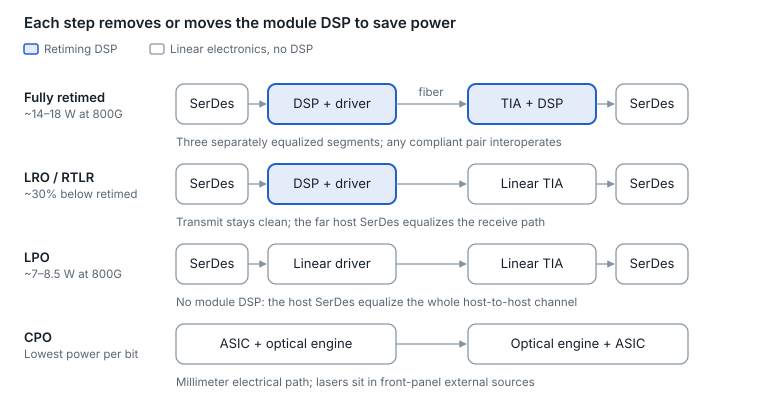
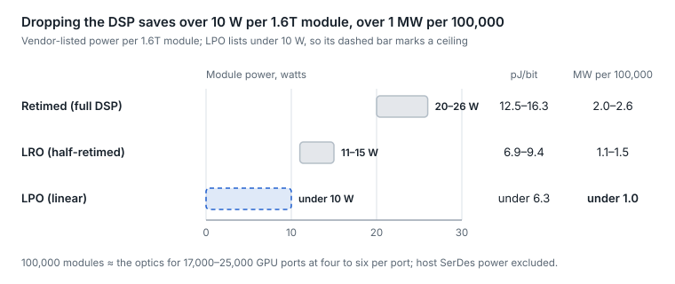
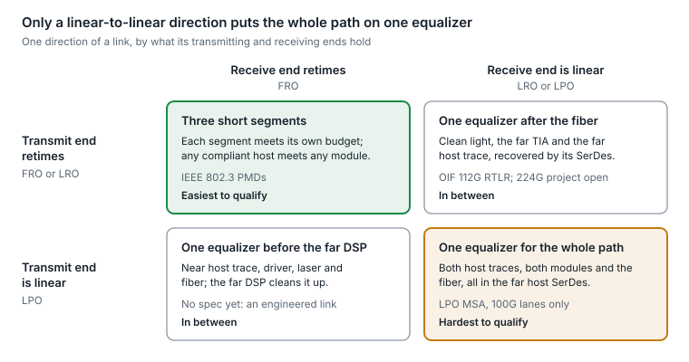
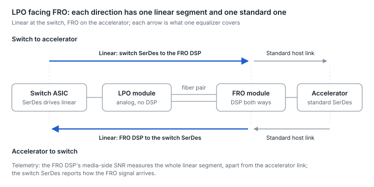
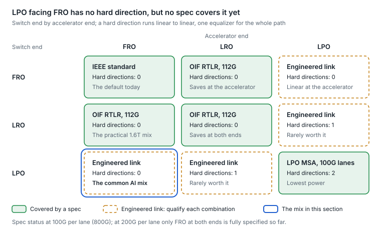
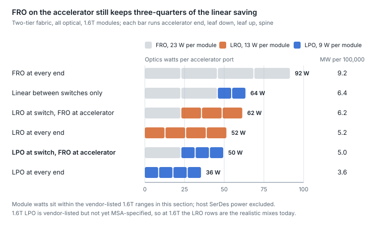
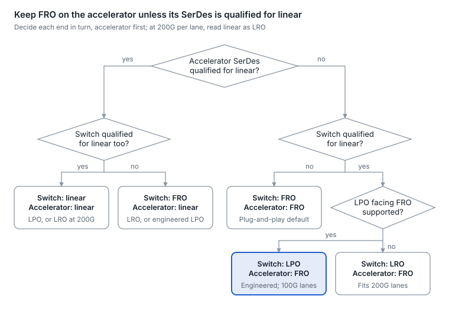

# 4. DSPs and signal conditioning

A module DSP is a small mixed-signal computer that recovers clean symbols from a distorted signal and re-launches them, and it is the single largest power consumer in a pluggable. That is why the industry's next-generation designs either remove it (LPO), keep half of it (LRO), or move the optics next to the host so the host's SerDes can do the work (CPO).

## Inside a PAM4 DSP

A retimed IM-DD module has two independent signal paths, each with its own equalizer:

1. **Host-side receiver.** Takes the electrical lanes from the host: CTLE, ADC, FFE, clock and data recovery (CDR). Output: clean symbols.
2. **Lane mapping.** Retimer (lanes in = lanes out) or gearbox (8 × 50G to 4 × 100G, for example).
3. **Line-side transmitter.** DAC plus pre-emphasis and pre-distortion that compensate the laser and driver's limited bandwidth and nonlinearity.
4. **Line-side receiver.** After the photodiode and TIA: ADC, FFE, often DFE or MLSE (maximum-likelihood sequence estimation, which decides on sequences of symbols rather than one at a time and copes with heavy smearing), then CDR.
5. **Host-side transmitter.** Re-launches clean electrical lanes toward the host.
6. **Optional inner FEC.** At 200G per lane on 2 km-plus links, the DSP adds and removes an inner FEC layer ([section 5](05-forward-error-correction.md)).
7. **Telemetry.** Per-lane SNR, pre-FEC BER estimates and histograms, exposed to the host through CMIS ([section 12](12-management-and-diagnostics.md)).

The key property: a retimed module splits the end-to-end link into three separately equalized segments (host to module, module to module over fiber, module to host). Each segment only needs to meet its own budget, so any compliant host interoperates with any compliant module.

## Retimed vs LRO vs LPO vs CPO

<picture>
  <source media="(prefers-color-scheme: dark)" srcset="../figures/fig-09-dark.svg">
  
</picture>

*Figure 4.1 — module architectures · where the DSP sits*

Moving down the rows, the module DSP shrinks and then disappears; its work moves to the host SerDes, or, with CPO, mostly becomes unnecessary because the electrical path is millimeters long.

| Architecture | DSP location | Power (800G, vendor figures) | Interoperability | Reach today | Diagnostics |
| --- | --- | --- | --- | --- | --- |
| FRO, fully retimed (DSP) | In the module, both directions | \~14–18 W | Plug-and-play against standards | 500 m to 10 km+ | Full per-segment telemetry |
| LRO / RTLR (half-retimed) | In the module, transmit path only; receive path linear | \~30% below retimed | Host receiver must handle the far module's linear output | Short reach | Partial |
| LPO (linear pluggable) | None in the module; linear driver and TIA only | \~7–8.5 W | Validated per host-and-module pairing | 500 m DR; 500 m FR4 variant | Limited; host SerDes sees one long channel |
| CPO (co-packaged) | None; optical engine sits beside the switch ASIC | Lowest per bit | Integrated system, not pluggable | 500 m to 2 km class | Platform-dependent |

Power figures are vendor-reported, not independent measurements ([LPO module](https://convergedigest.com/fs-launches-800g-lpo-module/?amp=1), [LRO demo](https://convergedigest.com/eoptolink-demos-1-6t-lro-optical-transceivers/)).

- **LPO.** Without a DSP, the host SerDes must equalize the entire path: host trace, module driver, laser, fiber, photodiode, TIA, far-end trace. The gains are power, latency and cost. The costs are tighter host requirements, interoperability that must be tested per pairing, and less visibility into which segment is degrading. The LPO MSA released a 100G-per-lane DR specification in March 2025 and a 400G-FR4-LPO (500 m) specification in September 2025 ([March 2025](https://www.globenewswire.com/news-release/2025/03/25/3048840/0/en/LPO-MSA-Announces-Release-of-Specification-for-Linear-Pluggable-Optical-Modules.html), [September 2025](https://www.globenewswire.com/news-release/2025/09/25/3156688/0/en/LPO-MSA-Announces-Release-of-400G-FR4-LPO-Specification-for-Linear-Pluggable-Optical-Modules.html)).
- **LRO.** Keeps a DSP on the transmit side, where cleaning up the laser drive matters most, and leaves the receive side linear. It roughly halves the DSP's work while keeping the optical signal standards-clean. The OIF formalized the idea as RTLR (retimed transmitter, linear receiver) in a 112G implementation agreement published in late 2025 ([announcement](https://secure.businesswire.com/news/home/20251118198285/en/OIF-Publishes-Implementation-Agreement-for-112-Gbs-Retimed-Transmitter-Linear-Receiver-RTLR-Electrical-and-Optical-Interface-Advancing-Energy-Efficiency)).
- **The 200G-per-lane problem.** Linear designs get harder as baud rises, because the host channel loss and the optics' bandwidth limits both grow. Expect retimed modules to remain the default at 200G per lane, with linear variants confined to the shortest, best-controlled links.

## AI networks: pros and cons

A non-blocking AI back-end fabric needs four to six transceivers for every GPU-facing port ([section 9](09-ai-fabric-and-next-gen-optics.md)), so module power multiplies into megawatts, and every watt saved in the optics is a watt available for GPUs. That arithmetic is the whole case for linear optics; the case against it is operational.

<picture>
  <source media="(prefers-color-scheme: dark)" srcset="../figures/fig-10-dark.svg">
  
</picture>

*Figure 4.2 — module power by architecture · 1.6T, vendor-listed*

At OFC 2026, 1.6T modules were in volume production and at least one supplier showed retimed, half-retimed and linear versions of the same module, so this is now a design choice rather than a roadmap question.

| Option | Pros in an AI fabric | Cons in an AI fabric | Best fit |
| --- | --- | --- | --- |
| Retimed (full DSP) | Plug-and-play against IEEE PMDs, so any compliant host meets any compliant module; reaches 2 km and beyond with inner FEC; per-segment telemetry shows whether the host, the fiber or the far end is degrading | Highest power (about 20–26 W at 1.6T) and the most heat in the cage; the DSP adds latency and cost to every port | Mixed-vendor fabrics, links over 500 m, and anywhere fast fault isolation matters more than watts |
| LRO (half-retimed) | About 30% less power than retimed (about 11–15 W at 1.6T); the transmit side stays standards-clean, so qualification is easier than for LPO | The receive side relies on the host SerDes; diagnostics are partial; fewer suppliers, and the OIF agreement covers only 112G lanes so far | Short leaf-to-spine links where power matters but per-pair LPO qualification costs too much |
| LPO (linear) | Lowest module power (under 10 W at 1.6T), latency and cost; fewer active parts to fail | The host SerDes must equalize the whole link, so every host-and-module pair needs qualification; margins shrink at 200G per lane; no DSP telemetry to separate a dirty connector from an aging laser or a weak host lane | Single-vendor or tightly controlled clusters with links of 500 m or less, where power and latency dominate |

**Bottom line.** LPO trades watts for operational risk. It pays off where one team controls the host, the module and the fiber plant, and it costs more than it saves where vendors are mixed, links are long, or troubleshooting speed is what keeps training jobs running. Compare system power, not module power: linear modules work only with host SerDes built to drive them.

Sources: [OFC 2026 module status](https://www.hengtongglobal.com/info/ofc-2026-optical-modules-whats-real-whats-next-103451285.html), [LPO MSA interoperability and its diagnostic concerns](https://lightwaveonline.com/home/article/55141192/lpo-msa-achieves-multi-vendor-interoperability); power figures as in the table above.

## FRO and mix-and-match: linear at one end, retimed at the other

FRO (fully retimed optics) is the name now used for the conventional module with a DSP in both directions, set beside LRO and LPO. The two ends of a link are bought and qualified separately, so they need not match. A fabric can put linear optics where the watts pile up, on switch faceplates, and keep FRO at the accelerator, where plug-and-play and diagnostics matter most.

- **FRO.** A DSP on transmit and on receive. The module meets the IEEE optical spec on its own, whatever host it sits in.
- **LRO, also called TRO (transmit-retimed).** A DSP on transmit only. The light it sends stays standards-clean; the host SerDes recovers what arrives.
- **LPO.** No DSP. The module is analog, and the host SerDes equalizes in both directions.

**Judge each direction, not the link.** Each direction is its own path from one host's transmitter to the other host's receiver, cut into shorter segments wherever a DSP sits. What decides the difficulty is how much of that path a single equalizer must cover.

<picture>
  <source media="(prefers-color-scheme: dark)" srcset="../figures/fig-11-dark.svg">
  
</picture>

*Figure 4.3 — one direction of a link · transmit end by receive end, schematic*

A mixed LPO-to-FRO link uses the two in-between cells, one per direction; LPO at both ends uses the bottom-right cell twice.

**The result: LPO facing FRO has no linear-to-linear direction.** Its host receives clean light through one linear receiver, exactly the LRO case, and its own transmit signal is cleaned up by the far DSP rather than a far host SerDes. That makes it easier than LPO at both ends, but the linear transmit direction has no spec at any lane rate, and its margin depends on the switch SerDes and trace. That is why the LPO MSA calls LPO-to-retimed an engineered link outside its specs, with support on its roadmap and no date. At ECOC 2025, multi-vendor 800G links mixed linear and retimed optics, and OIF showed retimed, half-retimed and unretimed optics working together; neither names an LPO-to-FRO link.

<picture>
  <source media="(prefers-color-scheme: dark)" srcset="../figures/fig-12-dark.svg">
  
</picture>

*Figure 4.4 — LPO facing FRO · both directions, schematic*

Each direction's linear segment ends at one equalizer: the FRO's DSP going out, the switch SerDes coming back.

**Every pairing at a glance.** Pairings with no linear-to-linear direction need the least qualification. At 100G per lane, LPO at both ends is the only LPO pairing a spec covers, and an LPO end facing FRO or LRO is an engineered link. At 200G per lane, only FRO at both ends is fully specified so far.

<picture>
  <source media="(prefers-color-scheme: dark)" srcset="../figures/fig-13-dark.svg">
  
</picture>

*Figure 4.5 — end pairings · switch end by accelerator end*

The two cells pairing LPO with FRO are the only engineered links with no hard direction.

**Linear at the switch, FRO on the accelerator.** This mix suits AI back-ends, for four reasons:

- **The heat sits on the switch.** A 64-port 1.6T switch carries about 1.5 kW of FRO optics on its faceplate, against about 0.8 kW with LRO or under 0.6 kW with LPO. An accelerator port carries one module beside an accelerator drawing around a kilowatt or more.
- **Accelerator SerDes stay on a standard channel.** FRO keeps the accelerator or NIC SerDes on an ordinary host-to-module link, so no linear qualification for each accelerator, NIC or server generation. LPO needs "capable ASICs and well-designed transmission lines", in the LPO MSA's words.
- **Diagnostics stay at the expensive end.** The FRO's DSP reports host-side and media-side SNR at the end where a flap stalls a training job, so the accelerator's host link is measured apart from the fiber path.
- **Switch-to-switch links can go fully linear.** Where leaf and spine share one platform and links stay at 500 m or less, LPO at both ends is the case the LPO MSA covers at 100G per lane; at 200G per lane, use LRO at both ends.

<picture>
  <source media="(prefers-color-scheme: dark)" srcset="../figures/fig-14-dark.svg">
  
</picture>

*Figure 4.6 — optics power per accelerator port · by mix, 1.6T, two-tier*

Keeping FRO at the accelerator gives up one module's saving in four; with LRO on the switch ports as well, the mix keeps about half the all-linear saving (30 of 56 W).

The reverse mix, linear at the accelerator and FRO at the switch, fits when the accelerator vendor qualifies its own ports for linear and the switch side is mixed or has long traces. With switch-to-switch links linear either way, both mixes draw the same watts; linear at the switch wins on faceplate heat and on how few host types need qualifying.

**At 200G per lane.** Linear transmit is the hard half at 224G, because optical nonlinearity grows and host SerDes swing is limited, so a retimed transmitter is the usual fix (dense NPO, [section 10](10-optics-packaging-pluggable-lpo-xpo-npo-and.md)). Expect LRO, not LPO, on switch ports facing FRO on accelerators. Transmit-only 3 nm DSPs with 802.3dj-compliant optical outputs are offered for 1.6T TRO and LRO modules. OIF launched CEI-224G-Linear and EEI-224G-RTLR projects in 2024, and no published agreement for either turned up as of October 2026; the LPO MSA lists 200G as a roadmap item.

<picture>
  <source media="(prefers-color-scheme: dark)" srcset="../figures/fig-15-dark.svg">
  
</picture>

*Figure 4.7 — choosing each end · decision flow*

Each end is its own decision, and the accelerator comes first because it has the most host types to qualify for linear.

**In operations.**

- **Qualify the trio.** For LPO facing FRO, qualify switch port, LPO module and FRO module together, because the FRO's DSP must recover that host's linear transmit signal. Check each vendor's support list: at least one switch vendor's 800G LPO guidance requires LPO at both ends.
- **Read telemetry per direction.** Going out, the FRO's media-side SNR measures the whole linear segment, switch SerDes to FRO front end, apart from the accelerator's host link. Coming back, the switch SerDes reports the FRO's signal as received. With LPO at both ends, each direction is measured only end to end.
- **Swap like for like.** Replacing either end with another type turns a qualified pairing into a new one. The host must recognize the module type to load linear or retimed SerDes settings, so record each link's pairing, not just each port's optic.
- **Keep mixes to 500 m-class PMDs.** FEC still runs end to end in the host ([section 5](05-forward-error-correction.md)). But 2 km-plus 200G PMDs add an inner FEC inside the module DSP, and a linear receiver has nothing to decode it with.

**AI networks: pros and cons**

| Mix | Pros in an AI fabric | Cons in an AI fabric | Best fit |
| --- | --- | --- | --- |
| FRO at both ends | Plug-and-play against IEEE PMDs; full telemetry in both directions; any reach, including inner-FEC links | Highest optics power and faceplate heat | Mixed vendors, links over 500 m, fast fault isolation |
| Linear between switches only | At 100G per lane, LPO at both ends is the case the LPO MSA covers; one platform at each end makes qualification a one-time job | Access links to accelerators stay at full power | One switch vendor, many server types |
| Linear at the switch, FRO on the accelerator | About three-quarters of the all-linear saving; accelerator ends stay plug-and-play and observable | An engineered link for each switch, LPO and FRO trio until specs cover it; not every switch supports LPO facing a retimed end; no 200G LPO spec yet | AI back-ends with one switch platform and several accelerator generations |
| LRO at the switch, FRO on the accelerator | IEEE-compliant transmit at both ends; the practical form at 1.6T today | About half the all-linear saving; linear receive is specified only at 112G so far | 200G-lane fabrics |
| Linear at every end | Lowest power and latency | Every host and module pair qualified, accelerators included; the least telemetry | Systems sold and validated as one unit |

**Bottom line.** Choose optics per end and judge them per direction. LPO facing FRO has no linear-to-linear direction, so it is easier than LPO at both ends, but its linear transmit direction has no spec and stays an engineered link. Linear switch ports with FRO accelerators keep three-quarters of the all-linear saving where LPO is specified, at 100G per lane (800G). At 1.6T the realistic mix today is LRO at the switch, which keeps about half.

Sources: [FRO, LRO and LPO at the Ethernet Alliance, October 2026](https://convergedigest.com/tef26-ethernet-physical-layer-specs-fro-lro-lpo-update/), [FRO, LRO and LPO defined](https://www.nokia.com/blog/evolving-pluggable-optics-to-reduce-power-consumption/), [LPO MSA FAQ on retimed far ends and host needs](https://www.lpo-msa.org/home/faqs.html), [LPO MSA 100G-per-lane specification](https://www.globenewswire.com/news-release/2025/03/25/3048840/0/en/LPO-MSA-Announces-Release-of-Specification-for-Linear-Pluggable-Optical-Modules.html), [OIF 112G RTLR, and retimed, half-retimed and unretimed optics at ECOC 2025](https://convergedigest.com/oif-publishes-112-gb-s-rtlr-interface-spec-targeting-lower-power-optical-link/), [mixed linear and retimed 800G links, ECOC 2025](https://ethernetalliance.org/blog/2025/10/27/ecoc-2025-interoperability-at-800g-is-given-advancing-toward-1-6t/), [OIF CEI-224G-Linear launch, 2024](https://www.businesswire.com/news/home/20240613908066/en/OIF-Q2-Technical-and-MAE-Committees-Meeting-Wraps-with-CEI-224G-Linear-Project-Launch-New-CMIS-White-Papers-and-Requirements-for-Energy-Efficient-Interfaces), [OIF EEI-224G-RTLR launch, 2024](https://www.businesswire.com/news/home/20240828707601/en/OIF-Concludes-Successful-Q3-%E2%80%9824-Technical-and-MAE-Committees-Meeting-with-Launch-of-Three-New-Projects-to-Advance-Networking-Technologies), [transmit-only DSP for TRO and LRO](https://cn.marvell.com/content/dam/marvell/en/public-collateral/dsp/marvell-ara-t-1-6t-transmit-retimed-pam4-product-brief.pdf), [LPO at both ends in one vendor's guidance](https://www.networkworld.com/article/4141412/cisco-lpo-not-a-panacea-but-plays-strategic-role-in-ai-networks.html), [book-ended and engineered links](https://credosemi.com/blogs/lro-lpo-silicon-photonics/), [802.3dj inner FEC applies to 2 km-plus PMDs](https://grouper.ieee.org/groups/802/3/dj/public/25_01/brown_3dj_03b_2501.pdf). Module power uses the vendor-listed 1.6T ranges above.

## Inside a coherent DSP

A coherent DSP does far more work, because it reconstructs the full optical field.

1. **Four ADCs** digitize the in-phase and quadrature components of both polarizations.
2. **Chromatic dispersion compensation.** A large static filter undoes the fiber's dispersion, which is why coherent links need no dispersion-compensating fiber.
3. **Polarization demultiplexing and PMD compensation.** An adaptive 2 × 2 equalizer tracks the polarization state as it wanders and separates the two data streams.
4. **Carrier recovery.** Removes the frequency offset and phase noise between the transmit laser and the receiver's local laser.
5. **Symbol decision and soft-decision FEC decoding.**
6. **Transmit side.** FEC encoding, constellation mapping, pulse shaping (which keeps the channel spectrally narrow so it fits its DWDM slot), and DACs driving the IQ modulator.

Coherent DSPs report the link's physics directly: estimated CD in ps/nm, differential group delay, OSNR or electrical SNR, frequency offset and pre-FEC BER. Those values make coherent links unusually easy to diagnose once you know where to look.

## Power and process

DSP power falls with each CMOS node (7 nm, 5 nm, now 3 nm). Even so, a 1.6T DSP-based module lists at roughly 20–26 W ([vendor figures](https://www.businesswire.com/news/home/20251222728263/en)). Multiplied across tens of thousands of ports in an AI cluster, that is megawatts, which is the economic force behind LPO, LRO and CPO.

---

[← 3. Electrical interface and SerDes](03-electrical-interface-and-serdes.md) · [Contents](../README.md#contents) · [5. Forward error correction →](05-forward-error-correction.md)
