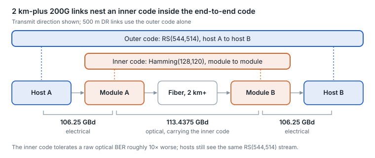
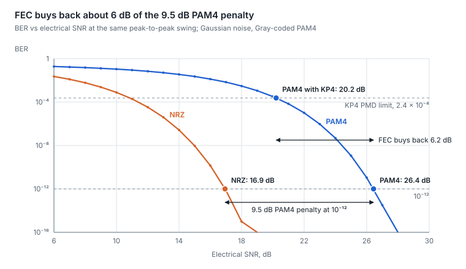
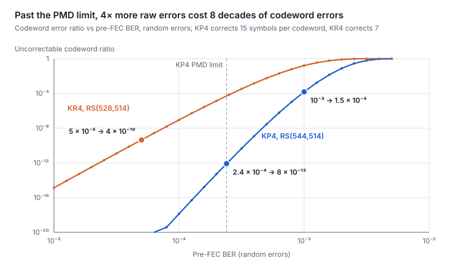
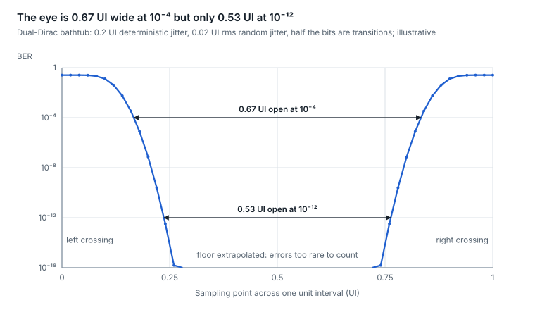
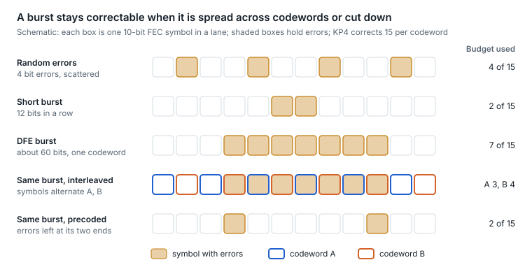

# 5. Forward error correction

Every PAM4 Ethernet link is designed to run with errors: the optical PMD may deliver a raw bit error ratio of about 2.4 × 10⁻⁴, and RS(544,514) FEC corrects it to effectively error-free. Mastery means reading how far a link sits from that threshold, not whether it currently has errors.

## How Reed-Solomon FEC thinks

- The transmitter groups data into codewords of 10-bit symbols and appends parity symbols. The receiver can repair a limited number of bad symbols per codeword.
- **RS(528,514), "KR4".** 14 parity symbols, corrects up to 7 symbols per codeword. Used with 25G NRZ lanes (100G SR4, CWDM4, CR4). The CWDM4 MSA, for example, requires a pre-FEC BER of 5 × 10⁻⁵ with this code ([spec](http://www.cwdm4-msa.org/wp-content/uploads/2015/12/CWDM4-MSA-Technical-Spec-1p1-1.pdf)).
- **RS(544,514), "KP4".** 30 parity symbols, corrects up to 15 symbols per codeword. Mandatory on every PAM4 Ethernet lane (50G, 100G, 200G). IEEE optical specs are written to a BER of 2.4 × 10⁻⁴ at the PMD ([802.3bs analysis](https://www.ieee802.org/3/bs/public/15_07/anslow_3bs_04_0715.pdf)).
- **Symbols, not bits.** One corrupted symbol costs the same whether 1 or 10 of its bits flipped, so RS codes handle short bursts well. Long bursts, such as those error-propagating DFEs can produce, are what break them, which is why codeword symbols are spread round-robin across PCS lanes and, from 802.3bs on, two codewords (four at 200G per lane in 802.3dj) are symbol-interleaved.
- **Latency.** RS(544,514) processing adds on the order of 100 ns ([802.3dj presentation](https://www.ieee802.org/3/dj/public/23_01/23_0206/wangz_3dj_01a_230206.pdf)), one reason AI scale-up fabrics care which FEC is used.

## The insight that matters operationally: FEC is end to end

In a retimed IM-DD module the DSP does not decode the KP4 code. The near-end host encodes, the far-end host decodes, and every error made anywhere in between lands in the same codewords: the near host's electrical channel, the optical link, and the far host's electrical channel. The FEC-input budget, about 3.2 × 10⁻⁴ for random errors, is shared: 2.4 × 10⁻⁴ is the optical sub-link's allocation, and each electrical segment gets a small slice of about 10⁻⁵.

Two consequences:

1. Rising corrected-codeword counts on a host port do not prove the optic is bad. A marginal host trace, connector or cage can consume the same budget.
2. To find the guilty segment, compare the host's FEC counters with the module's own media-side telemetry (per-lane SNR and pre-FEC BER estimates via CMIS), and swap one element at a time.

## Reading FEC counters

| Counter | What it means | Healthy pattern |
| --- | --- | --- |
| Corrected codewords | Codewords that had errors and were repaired | Non-zero and steady is normal for PAM4 |
| Uncorrectable codewords | Codewords with more than 15 bad symbols; frames are lost | Zero. Any increment is a real problem |
| Symbol-error histogram (bins 0–15) | How many codewords had N bad symbols | Counts collapse to zero well before bin 15 |
| Pre-FEC BER (derived) | Raw error ratio before correction | Orders of magnitude below 2.4 × 10⁻⁴ |

The histogram is the best single margin indicator. A healthy link shows codewords with 0, 1, perhaps 2–3 bad symbols. A tail creeping toward bins 10–15 means the link is close to dropping frames even while uncorrectable counts are still zero.

## 200G per lane: concatenated FEC

At 200G per lane, 2 km-plus optical links (DR-2, FR4, LR4) cannot meet a 2.4 × 10⁻⁴ raw BER economically. IEEE 802.3dj therefore adds an inner extended Hamming (128,120) code inside the module, decoded with soft information, beneath the end-to-end RS(544,514) outer code; a small padding overhead is why the lane lands at 113.4375 GBd rather than 113.33. The inner code tolerates a raw BER roughly an order of magnitude worse, at the cost of raising the optical lane from 106.25 to 113.4375 GBd. The 500 m PMDs (DR1, DR2, DR4, DR8 and 800GBASE-FR4-500) skip the inner code ([802.3dj baseline](https://www.ieee802.org/3/dj/public/23_09/ran_3dj_01a_2309.pdf)).

<picture>
  <source media="(prefers-color-scheme: dark)" srcset="../figures/fig-16-dark.svg">
  
</picture>

*Figure 5.1 — concatenated FEC at 200G per lane · 2 km and longer*

The hosts bracket the outer code and the modules bracket the inner one, so most of the optical segment's errors are corrected before the host ever counts them.

This changes the troubleshooting model: on 2 km-plus 200G links, the module now terminates one FEC layer, so the optical segment's health is visible mainly through module telemetry, not host counters.

## Coherent FEC

Coherent links use much stronger FEC, with soft-decision decoding and overheads around 15–21%, tolerating raw BERs around 10⁻². Unlike IM-DD, the coherent module terminates the host's FEC and applies its own across the fiber.

| Code | Where it is used | Character |
| --- | --- | --- |
| CFEC (concatenated FEC) | OIF 400ZR | Staircase outer + Hamming inner; lower power, shorter reach |
| oFEC (open FEC, from Open ROADM) | OpenZR+, 800ZR | Stronger, \~15% overhead; longer reach |
| KP4 + BCH concatenated | 800LR | Low latency (\~55 ns) for campus links |

Figures from OIF project presentations ([800ZR/800LR](https://www.oiforum.com/wp-content/uploads/OFC2023_OIF_800ZR_800LR_Josef-Berger.pdf)).

## BER in depth: from SNR to lost frames

BER is a probability set by the signal-to-noise ratio at the receiver's decision point. Three numbers make it operational. PAM4 needs about 9.5 dB more SNR than NRZ for the same BER. KP4 FEC turns a raw 2.4 × 10⁻⁴ into roughly one bad codeword in 10¹². And the margin between a healthy pre-FEC reading and that limit is smaller in dB than the decades suggest.

**Four error ratios, four layers.**

- **BER.** Errored bits over bits sent; pre-FEC is the raw ratio, post-FEC what survives correction.
- **SER.** Errored PAM4 symbols over symbols. Gray coding makes most symbol errors a single bit error, so PAM4 BER is about half its SER.
- **FEC symbol errors.** RS(544,514) counts 10-bit symbols, so one to ten bit errors inside one symbol cost the same. The symbol-error histogram (above) counts these.
- **CER and FLR.** Codewords the FEC could not correct, and frames lost as a result. IEEE 802.3bs set an objective of a BER of 10⁻¹³ or better at the MAC, "or the frame loss ratio equivalent"; one IEEE analysis equates that to an FLR of 6.2 × 10⁻¹¹.

Host-reported pre-FEC BER is derived from corrected symbols or bits, and platforms differ in which they count, so compare trends on one platform rather than absolute values across platforms.

**BER vs SNR: why PAM4 needs FEC.** With Gaussian noise, BER falls with the eye opening divided by the noise. PAM4's three eyes are each a third the height of NRZ's one eye at the same swing, which costs 20·log₁₀3 ≈ 9.5 dB of SNR.

<picture>
  <source media="(prefers-color-scheme: dark)" srcset="../figures/fig-17-dark.svg">
  
</picture>

*Figure 5.2 — BER vs SNR · NRZ and PAM4, computed*

Without FEC, PAM4 needs 26.4 dB to reach 10⁻¹²; with KP4 it needs only 2.4 × 10⁻⁴, at 20.2 dB. Those 6.2 dB are KP4's coding gain, not a smaller modulation penalty: PAM4 with KP4 still needs about 3.3 dB more than uncoded NRZ, and NRZ with KP4 would need only 10.9 dB.

**The FEC cliff.** RS(544,514) repairs up to 15 bad symbols per codeword. With random errors, the chance of 16 or more falls so steeply that post-FEC performance has a cliff, not a slope. One IEEE analysis found that random errors need a FEC-input BER below about 3.2 × 10⁻⁴ for an FLR of 6.2 × 10⁻¹¹, the 10⁻¹³ equivalent. 802.3bs gave the optical PMD 2.4 × 10⁻⁴ of that budget and left the rest to the electrical interfaces, so 2.4 × 10⁻⁴ is the optics' share, not the point where the FEC breaks. On 200G-per-lane PMDs that add the inner FEC (200GBASE-DR1-2, the DR2-2, DR4-2 and DR8-2 variants, 800GBASE-FR4 and 800GBASE-LR4), the 802.3dj draft sets the PMD limit at 2 × 10⁻³ instead, so judge their media-side BER against that.

<picture>
  <source media="(prefers-color-scheme: dark)" srcset="../figures/fig-18-dark.svg">
  
</picture>

*Figure 5.3 — the FEC cliff · KP4 and KR4, computed*

At 10⁻⁴ KP4 leaves about one bad codeword in 10¹⁸; at 10⁻³ it is one in about 6,500, so a link a few times past the limit drops frames continuously.

**Pre-FEC BER as margin in dB.** Because the BER curve is so steep near the limit, decades of BER are worth little SNR. The table converts readings into margin, computed for Gray-coded PAM4 with Gaussian noise.

| Pre-FEC BER | Decades below 2.4 × 10⁻⁴ | Electrical SNR margin | Optical margin, thermal-noise-limited |
| --- | --- | --- | --- |
| 1 × 10⁻⁴ | 0.4 | 0.6 dB | 0.3 dB |
| 1 × 10⁻⁵ | 1.4 | 1.8 dB | 0.9 dB |
| 1 × 10⁻⁶ | 2.4 | 2.8 dB | 1.4 dB |
| 1 × 10⁻⁸ | 4.4 | 4.2 dB | 2.1 dB |
| 1 × 10⁻¹⁰ | 6.4 | 5.3 dB | 2.7 dB |
| 1 × 10⁻¹² | 8.4 | 6.2 dB | 3.1 dB |

A link reading 10⁻⁶ looks two and a half decades clean, yet it is only about 1.4 dB of optical power from the limit, roughly one dirty connector. The optical column assumes a thermal-noise-limited receiver, where 1 dB of optical power is 2 dB of electrical SNR. Reflections (MPI) and laser noise (RIN) flatten the curve into an error floor, so extra power buys even less. This is why [section 14](14-link-budgets-made-intuitive.md) budgets in dB and [section 24](24-fleet-telemetry-and-predictive-analytics.md) trends pre-FEC BER: they are one margin on two scales.

**Bathtub curves: BER across the eye.** Sweep the sampling point across the eye and BER traces a bathtub: steep walls at the crossings and a floor in the middle. Random jitter is unbounded, so the eye narrows as the target BER falls. In the dual-Dirac model, total jitter is the deterministic part plus the random jitter's spread at the target BER, about 14 times its standard deviation at 10⁻¹². Instruments measure the walls down to a practical depth and extrapolate the rest. For PAM4, each of the three eyes has its own bathtub; the BER is the sum over all three, so the worst eye dominates. Links with KP4 run near 10⁻⁴, not 10⁻¹², which is why 802.3 specifies PAM4 transmitter jitter at about that depth (J4u) and as an rms value (JRMS) rather than as total jitter at 10⁻¹².

<picture>
  <source media="(prefers-color-scheme: dark)" srcset="../figures/fig-19-dark.svg">
  
</picture>

*Figure 5.4 — bathtub curve · dual-Dirac model, computed*

The walls are the jitter's tails: random jitter keeps eating into the eye as the target BER falls, so an eye that looks open on a scope is narrower at 10⁻¹², the depth NRZ links were judged at.

**Burst errors: when the random assumption breaks.** The cliff above assumes independent errors. A decision-feedback equalizer (DFE) subtracts the echo of past symbols, so one wrong decision can push the next ones wrong too, a burst. Ethernet has three defenses.

- **10-bit FEC symbols absorb short bursts.** A burst of up to 10 bits that sits inside one symbol costs one symbol of the 15.
- **Codeword interleaving.** 200GBASE-R and 400GBASE-R (802.3bs) symbol-interleave two codewords, so a long burst splits between them. 50GBASE-R and Clause 91 100G PHYs do not; 802.3ck kept Clause 91 as the default for 100G-per-lane backplane and copper links and added an interleaved FEC (Clause 161) that either end can request. In one IEEE analysis with a 0.75 chance of error propagation and an FLR target of 6.2 × 10⁻¹⁰, interleaving tolerated a FEC-input BER of 2.3 × 10⁻⁴, against 5.9 × 10⁻⁵ without it.
- **Precoding and DFE limits.** With 1/(1+D) precoding, a typical DFE burst decodes to two errored symbols, but each random error also becomes two; the same analysis found it cut the slicer-output limit for random errors from 3.8 × 10⁻⁴ to 1.7 × 10⁻⁴ (3.3 × 10⁻⁴ at the FEC input), at an FLR of 6.2 × 10⁻¹⁰. 802.3ck's channel-compliance model also caps its reference receiver's first DFE tap at 0.85, which bounds bursts in the model, not in real SerDes.

<picture>
  <source media="(prefers-color-scheme: dark)" srcset="../figures/fig-20-dark.svg">
  
</picture>

*Figure 5.5 — burst errors vs FEC symbols · schematic*

A burst is dangerous because it lands on top of the random errors already in the same codeword; interleaving and precoding both keep any one codeword's share small.

A symbol-error histogram whose high bins are heavier than a random spread predicts points to bursts: an equalizer with error propagation, in the host SerDes or the module DSP, or short transient events, rather than Gaussian noise.

**How long a BER test must run.** To claim a BER at confidence CL with no errors seen, a test needs −ln(1 − CL)/BER bits: 3.0/BER at 95% and 4.6/BER at 99%. Allowing 1, 2 or 3 errors raises the 95% factor to 4.7, 6.3 or 7.8.

| Target BER | Bits, 95% confidence, zero errors | Time on a 106.25 Gb/s lane | Time on a 212.5 Gb/s lane |
| --- | --- | --- | --- |
| 2.4 × 10⁻⁴ (KP4 PMD limit) | 1.3 × 10⁴ | 0.1 µs | 0.06 µs |
| 10⁻⁸ | 3.0 × 10⁸ | 2.8 ms | 1.4 ms |
| 10⁻¹² | 3.0 × 10¹² | 28 s | 14 s |
| 10⁻¹³ (MAC objective) | 3.0 × 10¹³ | 4.7 min | 2.4 min |
| 10⁻¹⁵ | 3.0 × 10¹⁵ | 7.8 h | 3.9 h |

Pre-FEC BER can be proved in milliseconds. The 10⁻¹³ post-FEC objective takes minutes per lane to bound, and a healthy link's true post-FEC BER is far lower still, so it is bounded or inferred from the cliff, never measured.

**Where to read BER.**

- **Host FEC counters:** corrected and uncorrectable codewords, the symbol-error histogram and derived pre-FEC BER (above).
- **Module telemetry:** CMIS VDM pre-FEC BER and SNR, host side and media side ([section 12](12-management-and-diagnostics.md)).
- **Out of service:** a BERT with PRBS31Q or SSPRQ patterns, lane by lane ([section 22](22-test-and-measurement.md)).
- **Coherent:** pre-FEC BER near 10⁻² and Q margin (sections 18 and 26).
- **Streaming:** OpenConfig pre-FEC BER paths for module and port ([section 24](24-fleet-telemetry-and-predictive-analytics.md)).

**In operations.**

- **Alarm in dB, not decades.** Use the margin table to set thresholds: two decades below the limit is less than 1.5 dB of optical margin.
- **Treat any uncorrectable codeword as real.** On the cliff, one bad codeword means the link is at the edge or bursting.
- **Read the histogram's shape.** A binomial spread is noise (optics, fiber, connectors); a heavy tail with a clean average is bursts (an equalizer with error propagation, host or module, or transients).
- **Compare both directions and both ends.** FEC is end to end, so the host, the module and the far end all share the budget.
- **Size tests to the claim.** A few seconds of PRBS proves the pre-FEC BER, never a post-FEC one.

**Bottom line.** BER is SNR in disguise. Read pre-FEC BER as dB of margin, expect a cliff past 2.4 × 10⁻⁴ rather than a slope, and remember that a link several decades below the limit can still be one dirty connector away from it.

Sources: [802.3bs BER objective](https://www.ieee802.org/3/bs/Objectives_16_0317.pdf), [RS(544,514) limits, FLR equivalence and bursts](https://www.ieee802.org/3/bs/public/15_07/anslow_3bs_04_0715.pdf), [RS(544,514) with precoding and interleaving](https://www.ieee802.org/3/cd/public/July16/anslow_3cd_01_0716.pdf), [802.3dj PMD BER baseline with the inner FEC](https://www.ieee802.org/3/dj/public/23_11/welch_3dj_04_2311.pdf), [802.3ck Clause 91 and interleaved FEC options](https://ieee802.org/3/ck/public/20_01/gustlin_3ck_01_0120.pdf), [DFE tap limits in the 100G-per-lane reference receiver](https://grouper.ieee.org/groups/802/3/ck/public/19_09/gustlin_3ck_01a_0919.pdf), [precoding and error propagation](https://ieee802.org/3/ck/public/19_03/lu_3ck_02_0319.pdf), [BER confidence levels](https://www.lightwaveonline.com/home/article/16649006/calculating-statistical-confidence-levels-for-errorprobability-estimates), [dual-Dirac and bathtub curves](https://www.tek.com/en/documents/primer/dual-dirac-scope-histograms-and-bertscan-measurements). SNR margins, codeword error ratios and test times are computed here, assuming Gaussian noise and random errors.

## AI networks: pros and cons

In AI fabrics FEC shows up as latency and power. 100 ns of FEC equals about 20 m of fiber, and inside a hall propagation delay is small, so the code can be the largest latency term on the link ([section 20](20-latency-and-timing.md)).

| Option | Pros in an AI fabric | Cons in an AI fabric | Best fit |
| --- | --- | --- | --- |
| End-to-end KP4 only (500 m DR) | Standard 106.25 GBd lanes; no extra FEC power or latency in the module | Needs a raw BER of 2.4 × 10⁻⁴ or better, which caps 200G-per-lane links near 500 m | Leaf-to-spine inside one hall |
| KP4 plus inner Hamming (802.3dj, 2 km and longer) | Tolerates roughly ten times worse raw BER, so 2 km DR-2 and FR4 links close at 200G per lane | 6.8% higher line rate (113.4375 GBd), more DSP power, and about 15 ns for the inner code plus 26–280 ns for its convolutional interleaver, depending on MAC rate (1.6T lowest, 200G highest), unless the interleaver is bypassed | Spine to super-spine across a campus |
| Same KP4, less interleaving (scale-up) | UALink keeps RS(544,514) but allows 1-way or 2-way codeword interleaving to cut FEC latency, and adds link-level replay; UEC avoids inner-FEC PHYs and adds link-level retry | Needs very short, clean links, with little margin for dirty connectors or aging lasers | Inside a scale-up pod, on copper or co-packaged optics |

**Bottom line.** Buy reach with inner FEC only on the links that need it; inside a hall, 500 m optics without it save power and latency on every port.

---

[← 4. DSPs and signal conditioning](04-dsps-and-signal-conditioning.md) · [Contents](../README.md#contents) · [6. Grey (IM-DD) optics →](06-grey-im-dd-optics.md)
