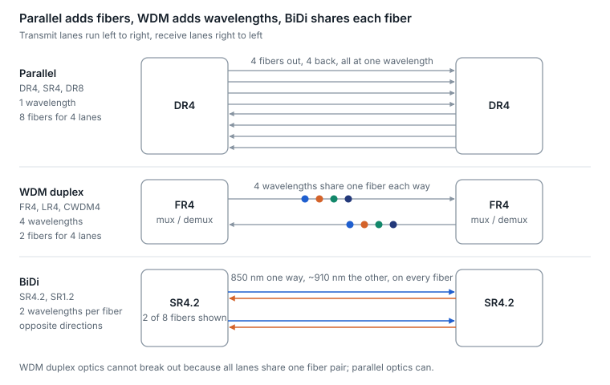
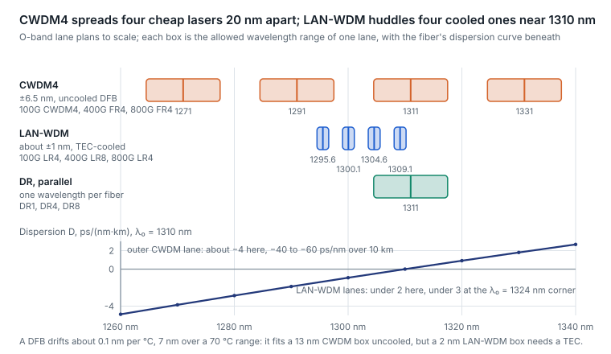
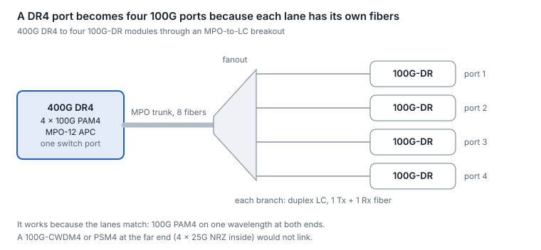
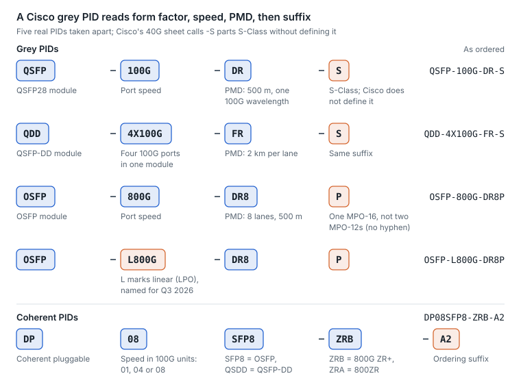
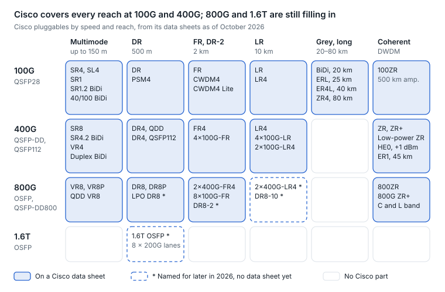
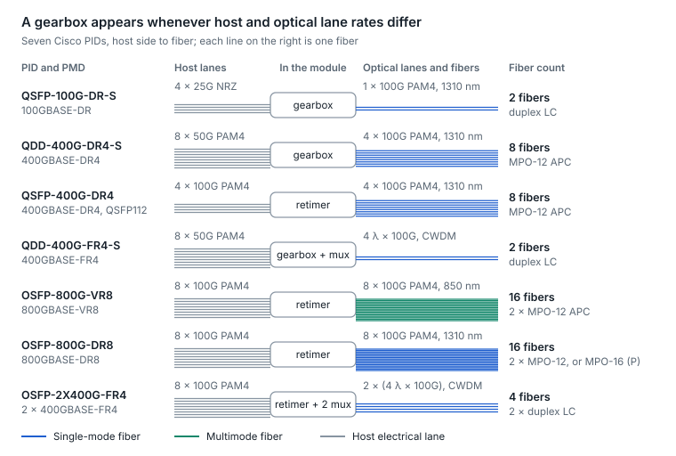
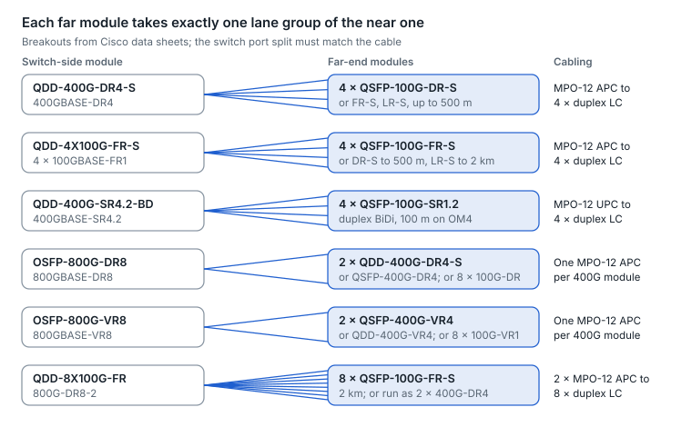

# 6. Grey (IM-DD) optics

A PMD name tells you almost everything: 400GBASE-DR4 means 400 Gb/s Ethernet, DR reach class (500 m single-mode), 4 optical lanes. "Grey" means a fixed, non-tunable wavelength that does not need a DWDM line system; IM-DD (intensity modulation, direct detection) is the technique behind it.

## The naming decoder

| Code | Medium | Typical reach |
| --- | --- | --- |
| CR | Twinax copper (DAC) | A few meters at 25–100G per lane, about 1 m at 200G |
| KR | Backplane copper | Board and backplane traces |
| VR | Multimode | 30–50 m |
| SR | Multimode | 60–150 m depending on fiber grade |
| DR | Single-mode | 500 m |
| DR-2, FR | Single-mode | 2 km |
| LR | Single-mode | 10 km (LR4-6 = 6 km) |
| ER | Single-mode | 30–40 km |
| ZR | Single-mode, coherent DWDM at 400G and up | 80 km and beyond |

- **The digit after the code** is the number of optical lanes: wavelengths for FR/LR, fiber pairs for SR/DR.
- **".2"** means two wavelengths per fiber (400GBASE-SR4.2 runs bidirectionally on 8 fibers).
- **"-6", "-10", "-2", "-20"** mark a reach variant in km (LR4-6, DR4-2).
- **IEEE vs MSA vs product names.** IEEE names read "400GBASE-FR4". MSA names drop "BASE" (100G-CWDM4, 100G-PSM4, 100G-LR1-20). Product names such as "2×FR4" or "DR4+" are not standards; they describe two engines in one module, or a reach-extended variant.

## The PMD reference table

| PMD | Lanes | Fiber and connector | Reach | Max channel loss |
| --- | --- | --- | --- | --- |
| 100GBASE-SR4 | 4 × 25G NRZ | MMF, MPO-12 (8 fibers used) | 70 m OM3 / 100 m OM4 | 1.8 / 1.9 dB |
| 100GBASE-SR1 | 1 × 100G PAM4 | MMF, duplex LC | 60 m OM3 / 100 m OM4 | \~1.8 dB |
| 400GBASE-SR4 | 4 × 100G PAM4 | MMF, MPO-12 | 60 m OM3 / 100 m OM4 | \~1.8 dB |
| 400GBASE-SR8 | 8 × 50G PAM4 | MMF, MPO-16 | 70 m OM3 / 100 m OM4 | — |
| 400GBASE-SR4.2 (BiDi) | 8 × 50G, 850 + \~910 nm per fiber | MMF, 8 fibers | 70 / 100 / 150 m (OM3 / OM4 / OM5) | 1.8 / 1.9 / 2.0 dB |
| 100GBASE-DR | 1 × 100G PAM4 | SMF, duplex LC | 500 m | 3.0 dB |
| 100GBASE-FR1 | 1 × 100G PAM4 | SMF, duplex LC | 2 km | 4.0 dB |
| 100GBASE-LR1 | 1 × 100G PAM4 | SMF, duplex LC | 10 km | 6.3 dB |
| 100G-CWDM4 (MSA) | 4 × 25G NRZ, CWDM | SMF, duplex LC | 2 km | 5.0 dB |
| 100GBASE-LR4 | 4 × 25G NRZ, LAN-WDM | SMF, duplex LC | 10 km | 6.3 dB |
| 400GBASE-DR4 | 4 × 100G PAM4 | SMF, MPO-12 APC (Tx fibers 1–4, Rx 9–12) | 500 m | 3.0 dB |
| 400GBASE-FR4 | 4 λ × 100G, CWDM | SMF, duplex LC | 2 km | 4.0 dB |
| 400GBASE-LR4-6 | 4 λ × 100G, CWDM | SMF, duplex LC | 6 km | 6.3 dB |
| 800G DR8 | 8 × 100G PAM4 | SMF, MPO-16 APC or 2 × MPO-12 APC | 500 m | 3.0 dB |
| 800G 2×FR4 | 2 × (4 λ × 100G) | SMF, two duplex LC | 2 km | 4.0 dB per FR4 |
| 800GBASE-DR4 | 4 × 200G PAM4 | SMF, MPO-12 APC | 500 m | — |
| 800GBASE-FR4 / LR4 | 4 λ × 200G | SMF, duplex LC | 2 km / 10 km | — |
| 1.6TBASE-DR8 | 8 × 200G PAM4 | SMF, MPO-16 APC | 500 m | — |

Loss and reach figures are from IEEE task-force baselines and MSA specifications, for example [100GBASE-SR4](https://www.ieee802.org/3/bm/public/jul14/interim/king_03_0714_optx.pdf), [400GBASE-SR4.2](https://www.ieee802.org/3/cm/public/July18/king_3cm_01a_0718.pdf), [100GBASE-DR / 400GBASE-DR4](https://www.ieee802.org/3/cd/public/Nov16/traverso_3cd_01a_1116.pdf), [100G-FR1](https://www.ieee802.org/3/cu/public/May19/welch_3cu_01a_0519.pdf), [400GBASE-LR4-6](https://www.ieee802.org/3/cu/public/Sept19/lewis_3cu_02a_0919.pdf), [100GBASE-LR4](https://www.ieee802.org/3/ba/public/jul08/cole_01_0708.pdf) and the [CWDM4 MSA](http://www.cwdm4-msa.org/wp-content/uploads/2015/12/CWDM4-MSA-Technical-Spec-1p1-1.pdf). Figures marked \~ are pre-publication baselines. The 200G-per-lane PMDs are from IEEE 802.3dj, in final ballot as of October 2026.

## Three architectures, one choice

- **Parallel (SR4, DR4, DR8).** One wavelength, one fiber per lane per direction. The simplest optics, the most fibers, and the natural choice for breaking out to lower-speed ports.
- **WDM duplex (CWDM4, FR4, LR4).** Several wavelengths multiplexed onto one fiber pair. Fewer fibers and reach to 10 km, but a mux and demux inside the module and no breakout.
- **BiDi.** Two wavelengths travel in opposite directions on each fiber. Its main purpose is reusing an existing duplex multimode plant at a higher speed.

<picture>
  <source media="(prefers-color-scheme: dark)" srcset="../figures/fig-21-dark.svg">
  
</picture>

*Figure 6.1 — optic architectures · fibers and wavelengths per 4 lanes*

Fiber count, not reach, is often the deciding factor: parallel optics are simplest but need four times the fibers of a WDM duplex link.

## Wavelength plans: CWDM4, LAN-WDM and why cooling decides

Every WDM-duplex grey optic sits on one of two O-band plans, and the choice is about temperature as much as dispersion.

| Plan | Lane centers (nm) | Spacing | Allowed drift | Laser | Used by |
| --- | --- | --- | --- | --- | --- |
| CWDM4 | 1271, 1291, 1311, 1331 | 20 nm | ±6.5 nm, a 13 nm box | Uncooled DFB or EML | 100G CWDM4, 400GBASE-FR4 and LR4-6, 800G 2×FR4 and 800GBASE-FR4 |
| LAN-WDM | 1295.56, 1300.05, 1304.58, 1309.14 | about 4.5 nm (800 GHz) | about ±1 nm | TEC-cooled DFB or EML | 100GBASE-LR4 and ER4, 200GBASE-LR4 and ER4, 400GBASE-LR8 and ER8 (an eight-lane grid reaching down to 1273.54 nm), 800GBASE-LR4 |
| Parallel (DR) | 1311 on every fiber | none | ±6.5 nm | Uncooled; in silicon photonics one laser can feed several lanes | DR1, DR4, DR8 |

<picture>
  <source media="(prefers-color-scheme: dark)" srcset="../figures/fig-22-dark.svg">
  
</picture>

*Figure 6.2 — IEEE 802.3 CWDM4 and LAN-WDM lane plans; D(λ) from G.652 with λ₀ = 1310 nm · O-band to scale*

**The arithmetic of drift.** A DFB's wavelength moves about 0.1 nm per °C, so an uncooled laser wanders 7 nm over a 0–70 °C case range. That fits inside a 13 nm CWDM box but not inside a 2 nm LAN-WDM box, which is why every LAN-WDM optic carries a thermoelectric cooler (TEC) holding its lasers near a fixed temperature, at a cost of roughly 0.5–1 W and a control loop. The TEC is also why LAN-WDM optics tolerate hot chassis less gracefully: when the cooler saturates, the wavelength walks toward the edge of the mux passband and power drops before any temperature alarm fires.

**The arithmetic of dispersion.** CWDM's outer lanes at 1271 and 1331 nm sit 20–40 nm from λ₀ (up to 53 nm at the lane edge against the worst-case λ₀) and see about −4 and +2 ps/(nm·km); the four-lane LAN-WDM grid sits within 15 nm of 1310 nm and sees at most about 3 ps/(nm·km) even at the λ₀ = 1324 nm corner (IEEE budgets −28 ps/nm over 10 km for its lowest lane). At 100G per lane IEEE held CWDM4 to 6 km (400GBASE-LR4-6) and reached 10 km only with the single-wavelength 100GBASE-LR1; at 200G per lane, where the symbol is 8.8 ps (113.4375 GBd with the inner FEC) and the signal about 0.65 nm wide, 800GBASE-LR4 adopted the four-lane LAN-WDM grid with a 3.9 dB TDECQ limit, while 800GBASE-FR4 stayed on CWDM for 2 km.

**Inside the module.** A WDM optic adds a multiplexer on the transmit side and a demultiplexer on the receive side, usually thin-film filters or an arrayed-waveguide grating, each costing on the order of 1–2 dB per pass that the transmitter's power budget absorbs; the receive demux must also be wide enough to pass a lane that has drifted to the edge of its box. An optical isolator in front of each laser keeps reflections from connectors out of the cavity, where they would raise RIN; reflections are also why single-mode PAM4 optics specify APC connectors and limit discrete reflectance in the plant.

**Operations.** A LAN-WDM optic reports laser temperature and, through VDM, TEC current; a TEC current climbing toward its limit on a hot day is the earliest warning of a wavelength walk. CWDM optics report temperature only, and their failure mode at the hot corner is power or TDECQ, not wavelength.

Sources: [10 km PMD lane plans](https://www.ieee802.org/3/dj/public/adhoc/optics/0423_OPTX/stassar_3dj_optx_01a_230427.pdf), [800GBASE-LR4 baseline](https://www.ieee802.org/3/dj/public/23_11/rodes_3dj_01a_2311.pdf), [802.3cu dispersion by lane](https://www.ieee802.org/3/cu/public/May19/anslow_3cu_02a_0519.pdf).

## Breakout: the lane-matching rule

A high-speed port can split into several lower-speed ports only when each optical lane on one end matches a whole port on the other, in rate and in modulation.

| Port optic | Can break out to | Cannot break out to |
| --- | --- | --- |
| 400G DR4 (4 × 100G PAM4) | 4 × 100G-DR or 100G-FR1 | 100G-PSM4 or CWDM4 (4 × 25G NRZ inside) |
| 800G DR8 (8 × 100G PAM4) | 8 × 100G-DR, or 2 × 400G-DR4 | Anything with 25G or 50G lanes |
| 800G 2×FR4 | 2 × 400G-FR4 | 100G ports (lanes are wavelength-multiplexed) |
| 1.6T DR8 (8 × 200G PAM4) | 8 × 200G-DR1, or 2 × 800G-DR4 | 100G-lane optics |

Breakout needs three things to agree: the host's port-split configuration, the module's selected application ([section 12](12-management-and-diagnostics.md)), and a fiber path that maps each transmit lane to the right far-end receiver.

<picture>
  <source media="(prefers-color-scheme: dark)" srcset="../figures/fig-23-dark.svg">
  
</picture>

*Figure 6.3 — 400G DR4 breakout · MPO-12 to 4 × duplex LC*

Each far-end module receives one DR4 lane unchanged; the breakout is purely a fiber re-mapping, plus a port-split setting on the host.

## Same connector, no link: classic interop traps

- **100G on duplex single-mode comes in at least three incompatible flavors.** LR4 (LAN-WDM, 4 × 25G NRZ), CWDM4 (CWDM, 4 × 25G NRZ) and FR1/LR1 (one 100G PAM4 wavelength) all use duplex LC and none talk to each other.
- **APC vs UPC.** Single-mode parallel optics use angled (APC) MPO ferrules to suppress reflections, which PAM4 is sensitive to. Mating APC to flat UPC causes high loss and can damage end faces.
- **MPO-12 vs MPO-16.** Different key offsets: they do not mate by design.
- **Multimode patch on single-mode optics, or the reverse.** Light passes, links may even come up briefly, then errors climb. Check the jacket color and the label, not just the connector.

## Connectors and polarity

- **LC duplex.** The default for duplex optics.
- **MPO-12 / MPO-16.** Multi-fiber push-on connectors for parallel optics; a 4-lane module uses 8 of the 12 fibers.
- **Very-small-form-factor (VSFF) connectors (SN, MDC, CS).** Fit two to four duplex connections in one module face, enabling breakout without fanout cables.
- **Polarity.** Every transmit fiber must land on a receive position at the far end. Parallel optics usually expect a key-up-to-key-up trunk that flips fiber order (commonly called Type B or Method B). Wrong polarity means lanes see darkness, not low power.

## AI networks: pros and cons

Two choices decide most of an AI cluster's grey optics bill: multimode or single-mode, and parallel fibers or wavelengths.

| Option | Pros in an AI fabric | Cons in an AI fabric | Best fit |
| --- | --- | --- | --- |
| Multimode SR (VCSEL) | Lowest cost and power per port; relaxed alignment and simple installation; 800G eSR8 showed multi-vendor interoperability in June 2026, and 1.6T SR8 modules have been demonstrated over 30 m of OM4; IEEE P802.3ds targets 30 m and 50 m at 200G per lane | Reach shrinks with each lane-rate step (about 100 m at 100G per lane, about 30 m at 1.6T); the multimode plant may not carry to the next generation | NIC-to-leaf links within a row, and active optical cables |
| Single-mode DR, FR, LR | 500 m to 10 km on one fiber type that carries across generations; DR breaks out to lower-speed ports; almost all 1.6T optics shipping in 2026 are DR-type | More power and cost per port than SR; tighter connector cleanliness | Leaf-to-spine and anything leaving the row |
| Parallel (DR4, DR8) | One wavelength and simple optics; breakout to 4 or 8 lower-speed ports; lowest cost at 500 m or less | 4 to 8 fiber pairs per port, MPO trunks, polarity management and more end faces to keep clean | Leaf-to-spine in one hall with plenty of fiber |
| Wavelength-multiplexed (FR4, 2×FR4) | One or two fiber pairs per port; 2 km reach; duplex patching | Mux and demux loss and four wavelength-specific lasers per group raise power and cost; no lane-level breakout | Across buildings, or where fiber and duct space are scarce |

**Bottom line.** Inside one hall, parallel single-mode (DR4 or DR8) is the AI default because breakout and cost win. WDM earns its premium only where fiber is scarce or links leave the building, and multimode survives where links stay inside a row.

Sources: [multimode status, July 2026](https://www.lightcounting.com/research-note/july-2026-vcsel-technology-advances-as-standards-and-applications-expand-449), [1.6T shipments by type](https://cignal.ai/2026/06/datacom-optical-component-revenue-doubles-to-7-7-billion-in-1q26/).

## Cisco optics by speed: 100G to 1.6T

This is the guide's one vendor-specific section: Cisco's pluggable optics as its data sheets list them in October 2026, by speed and reach. Data sheets describe the optic, not the host, so confirm each PID and minimum software release for a platform in Cisco's Transceiver Module Group (TMG) compatibility matrix.

**Reading a Cisco PID.** A grey PID reads form factor, then speed, then PMD, then a suffix. Coherent PIDs follow a separate scheme that starts with DP.

<picture>
  <source media="(prefers-color-scheme: dark)" srcset="../figures/fig-24-dark.svg">
  
</picture>

*Figure 6.4 — Cisco PID anatomy · grey and coherent*

Grey PIDs read left to right in that order; coherent PIDs pack the speed and form factor into their first eight characters.

**The map.** Cisco covers every reach class at 100G and 400G. At 800G the data-sheet set is VR8, DR8 and 2 km parts, with LPO, 10 km and NIC-style variants named for later in 2026. At 1.6T, only the platform and the optic family are announced so far.

<picture>
  <source media="(prefers-color-scheme: dark)" srcset="../figures/fig-25-dark.svg">
  
</picture>

*Figure 6.5 — Cisco pluggables · speed by reach class, October 2026*

Solid cells ship on a Cisco data sheet today; dashed cells are named for later in 2026; the 1.6T cell is a family without published PIDs.

**What is inside each variant.** The host lanes, the DSP and the fibers decide what a variant can break out to and what it can face at the far end.

<picture>
  <source media="(prefers-color-scheme: dark)" srcset="../figures/fig-26-dark.svg">
  
</picture>

*Figure 6.6 — inside seven Cisco PIDs · host lanes to fibers*

Parallel parts use one fiber pair per optical lane, so DR8 and VR8 need 16 fibers; WDM parts fold four lanes onto one pair.

**100G, QSFP28.** Every part has an IEEE 802.3bm host interface (CAUI-4, 4 × 25G NRZ). The single-wavelength parts (SR, DR, FR, LR, ERL) carry one 100G PAM4 lane using on-board PAM4 DSP and FEC.

| PID | PMD | Reach | Fiber, connector | Optics inside | Max W |
| --- | --- | --- | --- | --- | --- |
| QSFP-100G-SL4 | Cisco short link | 30 m OM4 | MMF, MPO-12 | 4 × 25G NRZ, 850 nm | 2.5 |
| QSFP-100G-SR4-S | 100GBASE-SR4 | 100 m OM4 | MMF, MPO-12 | 4 × 25G NRZ, 850 nm | 3.5 |
| QSFP-100G-SR-S | 100GBASE-SR1 | 100 m OM4 or OM5 | MMF, duplex LC | 1 × 100G PAM4, 850 nm | 3.5 |
| QSFP-100G-SR1.2 | 100G SR BiDi | 100 m OM4, 150 m OM5 | MMF, duplex LC | 2 × 50G PAM4 at 855 and 908 nm | 3.9 |
| QSFP-40/100-SRBD | 40/100G SR BiDi | 100 m OM4 | MMF, duplex LC | 855 and 908 nm; runs at 40G or 100G | 3.5 |
| QSFP-100G-PSM4-S | 100G-PSM4 (MSA) | 500 m | SMF, MPO-12 | 4 × 25G NRZ, 1310 nm | 3.5 |
| QSFP-100G-DR-S | 100GBASE-DR | 500 m | SMF, duplex LC | 1 × 100G PAM4, 1310 nm | 4.3 |
| QSFP-100G-FR-S | 100GBASE-FR1 | 2 km | SMF, duplex LC | 1 × 100G PAM4, 1310 nm | 4.3 |
| QSFP-100G-CWDM4-S | 100G-CWDM4 (MSA) | 2 km | SMF, duplex LC | 4 λ × 25G NRZ, CWDM | 3.5 |
| QSFP-100G-SM-SR | CWDM4 Lite, 10–60 °C | 2 km | SMF, duplex LC | As CWDM4; interoperates with CWDM4-S | 3.5 |
| QSFP-100G-LR-S | 100GBASE-LR1 | 10 km | SMF, duplex LC | 1 × 100G PAM4, 1310 nm | 4.0 |
| QSFP-100G-LR4-S | 100GBASE-LR4 (-I: industrial temperature) | 10 km | SMF, duplex LC | 4 λ × 25G NRZ, LAN-WDM | 4.0 |
| QSFP-100G-ERL-S | ER-Lite; meets 100G-LR1-20 | 25 km | SMF, duplex LC | 1 × 100G PAM4, 1310 nm | 4.0 |
| QSFP-100G-B20U4-I / -B20D4-I | 100G BiDi, an up and down pair | 20 km | One SMF, simplex LC | NRZ, 1296–1309 nm one way and 1274–1287 nm the other; host RS-FEC required | 5 |
| QSFP-100G-ER4L-S | ER4-Lite (-4W40-I: industrial) | 30 km; 40 km with host FEC | SMF, duplex LC | 4 λ × 25G NRZ, LAN-WDM | 4.5 |
| QSFP-100G-ZR4-S | Cisco ZR4, engineered link | 80 km | SMF, duplex LC | 4 λ, LAN-WDM; host FEC required | 5.5 |

**400G, QSFP-DD and QSFP112.** QSFP-DD 400G parts take 8 × 50G (400GAUI-8), the 2 × 100G parts take 2 × CAUI-4, and QSFP112 parts take 4 × 100G (400GAUI-4) at 9 W rather than 12 W. The optics are the same; the port decides which you buy.

| PID | Form | PMD | Reach | Fiber, connector | Optics inside | Max W |
| --- | --- | --- | --- | --- | --- | --- |
| QDD-400G-SR8-S | QSFP-DD | 400GBASE-SR8 | 100 m OM4 | MMF, MPO-16 APC | 8 × 50G PAM4, 850 nm | 12 |
| QDD-400G-SR4.2-BD | QSFP-DD | 400GBASE-SR4.2 | 100 m OM4, 150 m OM5 | MMF, MPO-12 UPC | 4 fiber pairs, 855 and 908 nm at 50G | 12 |
| QDD-400G-BD | QSFP-DD | 400G duplex BiDi (no IEEE PMD named) | 70 m OM4, 100 m OM5 | MMF, duplex LC | 4 λ, 850–940 nm, both ways on one pair | 12 |
| QDD-400G-VR4 | QSFP-DD | 400GBASE-VR4 | 50 m OM4 or OM5 | MMF, MPO-12 APC | 4 × 100G PAM4, 850 nm | 12 |
| QSFP-400G-VR4 | QSFP112 | 400GBASE-VR4 | 50 m | MMF, MPO-12 APC | 4 × 100G PAM4, 850 nm | 9 |
| QDD-400G-DR4-S | QSFP-DD | 400GBASE-DR4 | 500 m | SMF, MPO-12 APC | 4 × 100G PAM4, 1310 nm | 12 |
| QSFP-400G-DR4 | QSFP112 | 400GBASE-DR4 | 500 m | SMF, MPO-12 APC | 4 × 100G PAM4, 1310 nm | 9 |
| QDD-4X100G-FR-S | QSFP-DD | 4 × 100GBASE-FR1 | 2 km | SMF, MPO-12 APC | 4 × 100G PAM4, 1310 nm | 12 |
| QDD-4X100G-LR-S | QSFP-DD | 4 × 100GBASE-LR1 | 10 km | SMF, MPO-12 APC | 4 × 100G PAM4, 1310 nm | 12 |
| QDD-400G-FR4-S | QSFP-DD | 400GBASE-FR4 | 2 km | SMF, duplex LC | 4 λ × 100G, CWDM | 12 |
| QSFP-400G-FR4 | QSFP112 | 400GBASE-FR4 | 2 km | SMF, duplex LC UPC | 4 λ × 100G, CWDM | 9 |
| QDD-400G-LR4-S | QSFP-DD | 400G-LR4; meets 400GBASE-LR4-6 | 10 km | SMF, duplex LC | 4 λ × 100G, CWDM | 12 |
| QDD-2X100-LR4-S | QSFP-DD | 2 × 100GBASE-LR4 | 10 km | SMF, dual duplex CS | 2 × (4 λ × 25G NRZ) | 8 |
| QDD-400G-LR8-S | QSFP-DD | 400GBASE-LR8 | 10 km | SMF, duplex LC | End of sale August 2023; replaced by QDD-400G-LR4-S | 13 |
| QDD-2X100-SR4-S, QDD-2X100-CWDM4-S | QSFP-DD | 2 × 100G SR4 or CWDM4 | 100 m or 2 km | MPO-24 or dual duplex CS | End of sale June 2026, no replacement | 5 or 7 |

**800G, OSFP and QSFP-DD800.** All take 8 × 100G PAM4 host lanes (800GAUI-8; QDD-2X400G-FR4 is listed as 2 × 400GAUI-4). The P suffix marks the single MPO-16 version of a part that otherwise uses two MPO-12s.

| PID | Form | PMD | Reach | Fiber, connector | Optics inside | Max W |
| --- | --- | --- | --- | --- | --- | --- |
| OSFP-800G-VR8 | OSFP | 800GBASE-VR8 | 30 m OM3, 50 m OM4 | MMF, dual MPO-12 APC | 8 × 100G PAM4, 850 nm | 16 (typical 12.9) |
| OSFP-800G-VR8P | OSFP | 800GBASE-VR8 | 30 m OM3, 50 m OM4 | MMF, MPO-16 APC | 8 × 100G PAM4, 850 nm | 16 |
| QDD-800G-VR8 | QSFP-DD800 | 800GBASE-VR8 | 30 m OM3, 50 m OM4 | MMF, dual MPO-12 APC (the sheet's note says UPC; confirm in TMG) | 8 × 100G PAM4, 850 nm | 15 |
| OSFP-800G-DR8 | OSFP | 800GBASE-DR8 | 500 m | SMF, dual MPO-12 APC | 8 × 100G PAM4, 1310 nm | 16–17 (typical 14.2) |
| OSFP-800G-DR8P | OSFP | 800GBASE-DR8 | 500 m | SMF, MPO-16 APC | 8 × 100G PAM4, 1310 nm | 16–17 |
| QDD-8X100G-FR | QSFP-DD800 | 800G-DR8-2 | 2 km | SMF, dual MPO-12 APC | 8 × 100G PAM4, 1310 nm; can also run as two 400GBASE-DR4 | 17 |
| OSFP-2X400G-FR4 | OSFP | 2 × 400GBASE-FR4 | 2 km | SMF, dual duplex LC UPC | 2 × (4 λ × 100G), CWDM | 14.5 (typical 13.2) |
| QDD-2X400G-FR4 | QSFP-DD800 | 2 × 400G-FR4 | 2 km | SMF, dual duplex LC UPC | 2 × (4 λ × 100G), CWDM | 17 |

- **Named for later in 2026, not yet on a data sheet.** Cisco's Cisco Live 2026 optics session lists more 800G parts. They are an LPO DR8 (OSFP-L800G-DR8P, marked new for Q3 2026, under 8 W) and 2 km and 10 km DR8s (OSFP-800G-DR8-2, OSFP-800G-DR8-10, QDD-800G-DR8-10). It also lists 2 × LR4 (OSFP-2X400G-LR4, QDD-2X400G-LR4), QDD-800G-DR8, and flat-top OSFP-RHS versions for NICs (OSFPR-800G-VR8, OSFPR-800G-DR8).
- **LPO pairing.** The same session says links interoperate when the interface type matches, 800GBASE-DR8 with 800GBASE-DR8 or 800G-LPO-DR8 with 800G-LPO-DR8. Plan Cisco LPO facing LPO; [section 4](04-dsps-and-signal-conditioning.md) covers why LPO facing a retimed end is an engineered link. The session also gives under 5 W for an LPO VR8 at 50 m, but names no PID for it.

**1.6T, OSFP.** Cisco announced 1.6T OSFP optics with Silicon One G300 in February 2026, for the N9364F-SG3 with 64 × 1.6T OSFP ports. The Cisco Live 2026 session marks them new for Q3 2026, built on Cisco silicon photonics for liquid- and air-cooled platforms, with 2 × 800G, 4 × 400G and 8 × 200G breakout. As of mid-October 2026 no 1.6T PID or data sheet is published, so check the compatibility matrix before planning part numbers.

**Coherent, 100G to 800G.** [Section 8](08-coherent-optics-and-dci.md) explains the modes; this is the Cisco part list.

| PID | Standard | Form | Rates | Reach, amplified / unamplified | Tx power |
| --- | --- | --- | --- | --- | --- |
| QDD-400G-ZR-S | OIF 400ZR | QSFP-DD | 400G | 120 km point-to-point | −10 dBm worst case |
| QDD-400G-ZRP-S | OpenZR+ | QSFP-DD | 400, 300, 200, 100G | Over 120 km, set by the line system | About −8 dBm at 400G |
| DP04QSDD-E26-A1 | 400ZR, low power | QSFP-DD | 400G | 120 km / 35 km | Above −10 dBm |
| DP04QSDD-E36-A1 | OpenZR+, low power | QSFP-DD | 400, 300, 200, 100G | Over 1,000 km / 45 km | Above −10 dBm |
| DP04QSDD-HE0 (-HK9 adds OTN) | ZR+ modes, high Tx | QSFP-DD | 400, 300, 200, 100G | Up to 1,200 km, point-to-point or through ROADMs | +1 dBm |
| DP04QSDD-ER1 | 400ZR and OpenZR+ protocols, fixed wavelength | QSFP-DD | 400G | 45 km unamplified | — |
| DP04CFP2-D15 | Coherent BiDi, 400ZR-oFEC, 200ZR, 100ZR | CFP2 | 400, 200, 100G | — | About −12 dBm at 400G |
| DP08QSDD-ZRA-A2, DP08SFP8-ZRA-A2 | OIF 800ZR | QSFP-DD, OSFP | 800G; 400G OpenZR+ | 120 km / 75 km | Over +1 dBm (C-band) |
| DP08QSDD-ZRB-A2, DP08SFP8-ZRB-A2; -LRB-A2 for L-band | 800G ZR+, OpenROADM | QSFP-DD, OSFP | 800, 600, 400G | Over 1,000 km / 80 km | Over +1 dBm (C-band; L-band not stated) |
| DP01QS28-MX1-A1, -MX2-A1 | 100ZR (802.3ct, G.709.2) | QSFP28 | 100G QPSK | 500 km / 160 km | −5 dBm, or 0 dBm for MX2 |

No Cisco 1.6T coherent pluggable was announced as of October 2026.

**Breakout with Cisco PIDs.** A breakout works when each far-end module receives exactly one lane group of the near module (the lane-matching rule above).

<picture>
  <source media="(prefers-color-scheme: dark)" srcset="../figures/fig-27-dark.svg">
  
</picture>

*Figure 6.7 — Cisco breakouts · switch module to far-end modules*

Breakout reach is the shorter of the two ends: a DR4 lane feeding an FR-S still stops at 500 m.

**Where they plug in, Nexus 9000.**

| Platform | Ports | Optics |
| --- | --- | --- |
| Nexus 9300-GX (N9316D-GX, N93600CD-GX) | 16 × 400G QSFP-DD; or 8 × QSFP-DD plus 28 × QSFP28 | 400G QSFP-DD and 100G QSFP28 |
| Nexus 9300-GX2 (9364D-GX2A, 9348D-GX2A, 9332D-GX2B) | 32 to 64 × 400G QSFP-DD | 400G; 4 × 100G and 2 × 200G breakout |
| Nexus 9500 (N9K-X9716D-GX) and 9400 (N9K-X9400-8D) | 16 or 8 × 400G QSFP-DD per card | 400G; 4 × 100G breakout on the X9716D-GX; 9400 breakout not stated |
| N9364E-SG2-O, N9364E-SG2-Q (Silicon One G200) | 64 × 800G OSFP, or 64 × 800G QSFP-DD800 | 800G; 2 × 400G and 8 × 100G breakout |
| N9364E-SG2X-O (Silicon One G200) | 64 × 800G OSFP | 800G retimed and OSFP 800G LPO; 2 × 400G, 4 × 200G, 8 × 100G breakout |
| N9364F-SG3 (Silicon One G300) | 64 × 1.6T OSFP | 1.6T OSFP |

**In operations.**

- **Check host support per PID, not per speed.** The platform data sheets name no optics; the TMG compatibility matrix gives the supported PIDs and minimum release per platform.
- **Dual MPO-12 or one MPO-16.** The OSFP VR8 and DR8 come both ways, with the same optics inside; QDD-800G-VR8 is dual MPO-12 only. Pick the version that matches the trunk plant.
- **APC or UPC.** APC MPO: the 800G parallel parts, the 400G SR8, VR4, DR4 and 4X100G-FR/LR, and QSFP-100G-PSM4-S. UPC: every other 100G part, including the SR4-S and SL4 MPOs, plus QDD-400G-SR4.2-BD, QDD-2X100-SR4-S (MPO-24) and all LC and CS parts. A mismatch is the classic trap described above.
- **Breakout is a host setting too.** The NX-OS breakout map must match the module's selected application ([section 12](12-management-and-diagnostics.md)) and the fiber mapping.
- **Read the data sheets critically.** The current 400G and 800G sheets label some VR parts as SR or DR in their ordering tables. Trust the PMD and connector columns, and confirm in the compatibility matrix.
- **-S suffix.** No Cisco sheet defines it. The 40G sheet calls these parts S-Class and lists per-part limits, such as Ethernet rate only and no FCoE; newer PIDs drop the suffix.

**Bottom line.** For AI back-ends on Nexus today, the core set is 800G OSFP DR8, with VR8 inside a row and breakout to 400G DR4 or 100G DR. OSFP-2X400G-FR4 or QDD-8X100G-FR covers 2 km, and 800G LPO and 1.6T OSFP arrive on the SG2X and G300 platforms as their PIDs publish.

Sources: Cisco data sheets for [100G QSFP28](https://www.cisco.com/c/en/us/products/collateral/interfaces-modules/transceiver-modules/datasheet-c78-736282.html), [400G QSFP-DD](https://www.cisco.com/c/en/us/products/collateral/interfaces-modules/transceiver-modules/datasheet-c78-743172.html), [400G QSFP112](https://www.cisco.com/c/en/us/products/collateral/interfaces-modules/400g-qsfp-transceiver-modules-ds.html), [800G OSFP](https://www.cisco.com/c/en/us/products/collateral/interfaces-modules/transceiver-modules/osfp-800g-transceiver-modules-ds.html), [800G QSFP-DD800](https://www.cisco.com/c/en/us/products/collateral/interfaces-modules/transceiver-modules/qsfp-dd800-transceiver-modules-ds.html), [400G ZR and ZR+](https://www.cisco.com/c/en/us/products/collateral/interfaces-modules/transceiver-modules/datasheet-c78-744377.html), [low-power 400G ZR and ZR+](https://www.cisco.com/c/en/us/products/collateral/interfaces-modules/transceiver-modules/qsfp-dd-400g-zr-zr-coh-lp-optics-ds.html), [400G high-power](https://www.cisco.com/c/en/us/products/collateral/interfaces-modules/transceiver-modules/400g-qsfp-dd-high-power-optical-module-ds.html), [its reach](https://bxin.cisco.com/c/en/us/products/collateral/interfaces-modules/transceiver-modules/nb-06-400g-coherent-pluggable-aag-cte-en.html), [400G ER1](https://www.cisco.com/c/en/us/products/collateral/interfaces-modules/transceiver-modules/nb-06-400g-qsfp-dd-er1-opti-mod-ds-cte-en.html), [400G CFP2 BiDi](https://www.cisco.com/c/en/us/products/collateral/interfaces-modules/transceiver-modules/400g-digital-coherent-bidi-cfp2-ds.html), [800G ZR and ZR+](https://www.cisco.com/c/en/us/products/collateral/interfaces-modules/transceiver-modules/qsfp-dd-osfp-800g-zr-zr-plus-coherent-optics.html), [100ZR](https://www.cisco.com/c/en/us/products/collateral/interfaces-modules/transceiver-modules/qsfp28-100g-zr-high-tx-coherent-optics-module-ds.html), [40G, for the -S suffix](https://www.cisco.com/c/en/us/products/collateral/interfaces-modules/transceiver-modules/data_sheet_c78-660083.html); end-of-sale notices for [QDD-400G-LR8-S](https://www.cisco.com/c/en/us/products/collateral/interfaces-modules/transceiver-modules/qdd-lr8-s-400g-qsfp-trans-mod-eol.html), [QDD-2X100-SR4-S](https://www.cisco.com/c/en/us/products/collateral/interfaces-modules/transceiver-modules/qdd-2x100-sr4-s-400g-qsfp-dd-transceiver-module-eol.html) and [QDD-2X100-CWDM4-S](https://www.cisco.com/c/en/us/products/collateral/interfaces-modules/transceiver-modules/qdd-2x100-cwdm4-s-qsfp-dd-transceiver-module-eol.html); [Cisco Live 2026 optics session](https://www.ciscolive.com/c/dam/r/ciscolive/global-event/docs/2026/pdf/BRKOPT-2699.pdf); [G300 and 1.6T OSFP announcement](https://newsroom.cisco.com/c/r/newsroom/en/us/a/y2026/m02/cisco-announces-new-silicon-one-g300.html); [N9364F-SG3 and 800G LPO](https://blogs.cisco.com/datacenter/networking-for-the-agentic-era-cisco-unveils-new-innovations-in-scale-and-simplicity); platform data sheets for [N9364E-SG2](https://www.cisco.com/c/en/us/products/collateral/switches/nexus-9000-series-switches/nexus-9364e-sg2-switch-ds.html), [N9364E-SG2X](https://www.cisco.com/c/en/us/products/collateral/networking/cloud-networking-switches/nexus-9000-switches/n9364e-sg2x-switches-ds.html), [9300-GX](https://www.cisco.com/c/en/us/products/collateral/switches/nexus-9000-series-switches/nexus-9300-gx-series-switches-ds.html), [9300-GX2](https://www.cisco.com/c/en/us/products/collateral/switches/nexus-9000-series-switches/datasheet-c78-743854.html), [9500](https://www.cisco.com/c/en/us/products/collateral/switches/nexus-9000-series-switches/datasheet-c78-736677.html) and [9400](https://www.cisco.com/c/en/us/products/collateral/switches/nexus-9000-series-switches/nexus9400-series-switches-ds.html).

---

[← 5. Forward error correction](05-forward-error-correction.md) · [Contents](../README.md#contents) · [7. Form factors →](07-form-factors.md)
