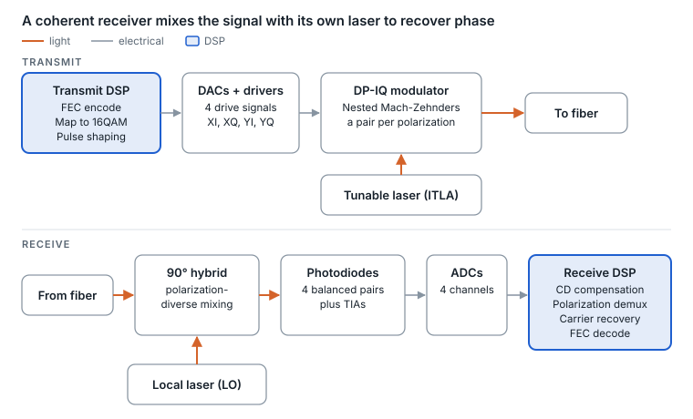
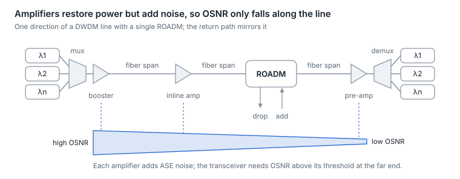

# 8. Coherent optics and DCI

Coherent optics mix the incoming light with a local laser, which lets a DSP recover amplitude, phase and polarization. That one trick unlocks three things IM-DD cannot do: undo dispersion electronically, pack 8 or more bits into each symbol, and tune to any DWDM channel, so a single wavelength carries 400G–1.6T over tens to hundreds of kilometers.

## Why coherent, in one table

|  | Grey IM-DD | Coherent |
| --- | --- | --- |
| What the receiver sees | Optical power only | Full field: I, Q, two polarizations |
| Bits per symbol | 1–2 per lane | 4–8+ per wavelength |
| Dispersion handling | Avoid it (stay near 1310 nm, short reach) | Compensate it in the DSP |
| Wavelength | Fixed, O-band | Tunable across the C-band, and the L-band for some 800G ZR+ parts (DWDM) |
| Amplification | Not used | EDFAs extend reach |
| Cost and power per module | Lower | Higher, falling fast |
| Sweet spot | Inside the building and campus, ≤ 10 km | DCI and metro, 40 km and beyond |

## Anatomy of a coherent pluggable

- **Transmit.** A narrow-linewidth tunable laser feeds a dual-polarization IQ modulator: nested Mach-Zehnder modulators driven by the DSP's DACs, one pair for each polarization.
- **Receive.** The incoming light and a local-oscillator laser enter a polarization-diverse 90° optical hybrid. Balanced photodiodes and TIAs produce four electrical signals (XI, XQ, YI, YQ), which four ADCs hand to the DSP ([section 4](04-dsps-and-signal-conditioning.md)).
- **DCO vs ACO.** A digital coherent optic carries its DSP inside the module and presents a plain Ethernet electrical interface. An analog coherent optic leaves the DSP on the host card. Pluggable DCOs now dominate.

<picture>
  <source media="(prefers-color-scheme: dark)" srcset="../figures/fig-28-dark.svg">
  
</picture>

*Figure 8.1 — coherent pluggable · transmit and receive paths*

Light stays light until the photodiodes; from there on, everything that makes coherent work happens in the receive DSP.

## The standards and MSA landscape

| Spec | Rate and format | Reach and line system | FEC | Status |
| --- | --- | --- | --- | --- |
| OIF 400ZR | 400G, DP-16QAM, \~60 GBd | 80–120 km amplified on a 75 or 100 GHz grid; unamplified single-wavelength mode (\~11 dB budget) | CFEC | First release 2020; v2.0 Nov 2022 |
| OpenZR+ MSA | 100/200/300/400G, QPSK to 16QAM | Metro and regional; v3.0 adds high-power (0 dBm) modes for ROADM networks | oFEC | v3.0 Sep 2023 |
| OIF 800ZR | 800G, DP-16QAM, \~118 GBd | 80–120 km amplified, single span; 150 GHz channels | oFEC (\~15%) | Published Nov 2024 |
| OIF 800LR | 800G, DP-16QAM, \~124 GBd | Up to 10 km, unamplified, fixed wavelength | KP4 + BCH (\~21%), low latency | Published Apr 2025 |
| IEEE 802.3dj coherent PMDs | 800G, single wavelength | 10 km (LR1), 20 km (ER1-20), 40 km (ER1) | — | In final ballot, Oct 2026 |
| OIF 1600ZR | 1.6T, 16QAM, \~235 GBd (project-stage figure) | Up to 120 km amplified | oFEC | Published Sep 2026 |

Sources: [400ZR IA](https://www.oiforum.com/wp-content/uploads/OIF-400ZR-02.0.pdf), [OpenZR+ documents](https://openzrplus.org/documents/), [800ZR release](https://www.semiconductor-today.com/news_items/2024/nov/oif-011124.shtml), [800LR release](https://www.silicon.co.uk/press-release/oif-releases-800lr-coherent-implementation-agreement-enabling-interoperable-low-power-high-capacity-10-km-optical-solutions), [800ZR/LR parameters](https://www.oiforum.com/wp-content/uploads/OFC2023_OIF_800ZR_800LR_Josef-Berger.pdf), [802.3dj objectives](https://www.ieee802.org/3/dj/projdoc/objectives_P802d3dj_240314.pdf), [1600ZR release](https://www.semiconductor-today.com/news_items/2026/sep/oif-100926.shtml), [1600ZR project report](https://www.gazettabyte.com/home/2025/1/18/oif-adds-a-short-reach-design-to-its-1600zr-zr-portfolio.html). IEEE's own 400GBASE-ZR project (802.3cw) was withdrawn in 2024 ([project page](https://www.ieee802.org/3/cw/index.html)), so the OIF 400ZR agreement is the interoperability reference at 400G.

- **"ZR" vs "ZR+".** ZR means a low-power, standardized, point-to-point DCI profile with low launch power (about −10 dBm for 400ZR). "ZR+" means more reach: stronger FEC, multi-rate operation, and in high-power variants about 0 dBm launch power to survive ROADMs and amplifier cascades ([OIF OFC 2024 demo slides](https://www.oiforum.com/wp-content/uploads/400ZRplus_booth_slides_OFC2024-Final-rev-1.pdf)).
- **Coherent-lite.** Simplified, lower-power coherent for 2–20 km campus links, sometimes in the O-band. Its future depends on how far PAM4 can stretch: an analyst view from July 2026 is that 800LR saw little deployment once 200G-per-lane PAM4 matured ([Cignal AI](https://cignal.ai/2026/07/coherent-lite-technology-applications-and-forecast-2q26/)).

## DWDM in five ideas

1. **The grid.** ITU-T G.694.1 defines channel center frequencies. Fixed grids use 12.5, 25, 50 or 100 GHz spacing; flexible grids place channel centers on a 6.25 GHz grid and allocate slot widths in 12.5 GHz multiples.
2. **Channel width follows baud.** A \~60 GBd 400ZR signal fits a 75 GHz slot; a \~118 GBd 800ZR needs about 150 GHz. Doubling the rate per wavelength does not double fiber capacity.
3. **Fiber capacity.** The C-band holds about 64 × 75 GHz channels, so 64 × 400ZR is roughly 25.6 Tb/s per fiber pair ([demo report](https://www.lightwaveonline.com/optical-tech/transmission/article/14178135/@lightwaveonline)).
4. **The line system.** Passive mux/demux combine channels; EDFAs amplify all of them at once; ROADMs use wavelength-selective switches to add, drop or route individual channels without converting them to electrical.
5. **OSNR is the coherent budget.** Optical signal-to-noise ratio is signal power against amplifier noise (ASE). Every amplifier adds noise, so doubling the number of identical spans costs about 3 dB of OSNR. Denser formats need more OSNR, which is why reach falls as rate per wavelength rises.

<picture>
  <source media="(prefers-color-scheme: dark)" srcset="../figures/fig-29-dark.svg">
  
</picture>

*Figure 8.2 — DWDM line system · schematic, OSNR qualitative*

A ROADM lets individual wavelengths leave or join without converting the rest to electrical; its filters add a small penalty each time a channel passes through.

## IP over DWDM

Putting coherent pluggables directly in routers and switches removes the separate transponder shelf: the router port is the DWDM transmitter. It saves power, space and cost, and it moves wavelength management into the IP team's world, which is an operational decision as much as a technical one.

## Grey vs coherent: the decision

| Distance | Fiber situation | Usual answer |
| --- | --- | --- |
| ≤ 2 km | Plenty of fiber | Grey: DR or FR |
| 2–10 km | Plenty of fiber | Grey LR; coherent-lite where PAM4 runs out |
| 10–40 km | Few fibers or leased | Grey ER struggles at 100G+ per lane; coherent increasingly wins |
| 40–120 km | DCI, amplified | 400ZR / 800ZR / 1600ZR |
| > 120 km or ROADM network | Shared line system | High-power ZR+ / OpenZR+, or embedded transponders |

Fiber scarcity tips the decision earlier: if a fiber pair is expensive, DWDM multiplies what each pair carries, and that favors coherent even at short distances. Beyond about 120 km, reach is set by amplifier noise, fiber nonlinearity and the margins operators hold back; [section 26](26-long-haul-coherent-transmission-how-it.md) explains each.

## AI networks: pros and cons

AI training increasingly spans buildings and sites, which brings two coherent decisions into the fabric: how to run 2–10 km campus links, and how to connect sites.

| Option | Pros in an AI fabric | Cons in an AI fabric | Best fit |
| --- | --- | --- | --- |
| 200G-per-lane PAM4 (DR-2, FR4, LR4) | Lowest power and cost per bit up to 10 km; the same DSP family, management and spares as the optics inside the hall | Reach stops near 10 km with shrinking margin; dispersion and reflections limit it; no wavelength multiplication of the fiber | Campus links on owned fiber |
| Coherent-lite (800LR class) | Large margin and tolerance of fiber impairments; a path to more capacity per fiber | More power and cost than PAM4 at the same rate; little deployment once 200G PAM4 matured (analyst view, July 2026) | Where PAM4 runs out of margin or fiber pairs run out |
| ZR and ZR+ pluggables in routers and switches | No transponder shelf, so less power, space and cost; multi-vendor (400ZR, 800ZR, OpenZR+, with 1600ZR specified in September 2026); high-power ZR+ crosses ROADM networks | Less reach and capacity per wavelength than embedded transponders; 20 W-plus ports need the right cages and airflow; optical operations move to the IP team | Metro links between AI sites, up to about 1,000 km with 800G ZR+ in field trials |
| Embedded transponders | Highest rate and reach per wavelength: up to 1.6T at about 200 GBd, and 800G beyond 1,500 km in field trials | Separate shelves with more power and space; vendor-specific line systems and management | Regional, long-haul and subsea links between AI regions ([section 26](26-long-haul-coherent-transmission-how-it.md)) |

**Bottom line.** Keep PAM4 as far as it reaches inside the campus, use ZR and ZR+ pluggables for metro distances between AI sites, and save embedded transponders for regional and long-haul spans where reach and spectral efficiency decide the cost.

---

[← 7. Form factors](07-form-factors.md) · [Contents](../README.md#contents) · [9. AI fabric and next-gen optics →](09-ai-fabric-and-next-gen-optics.md)
