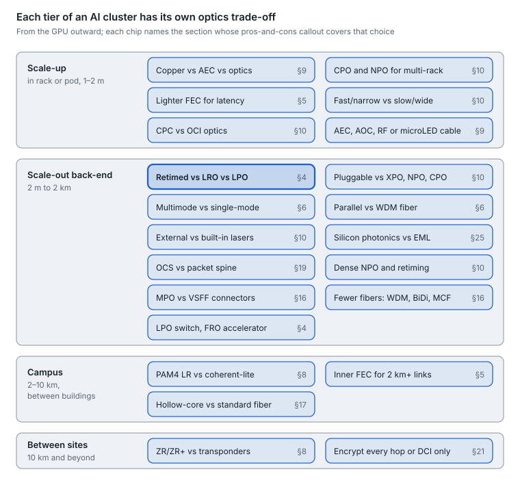
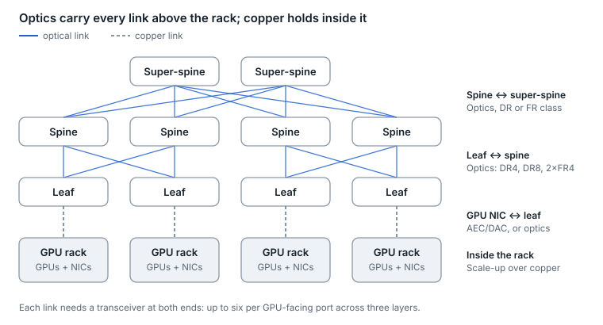
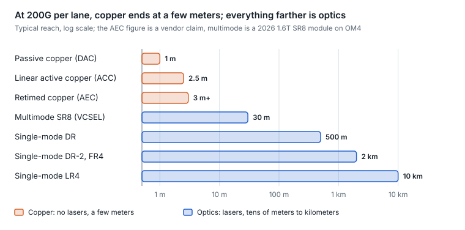
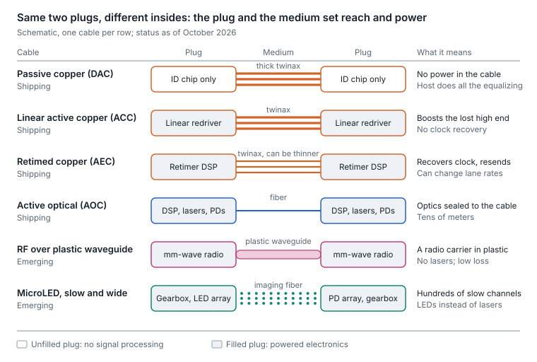
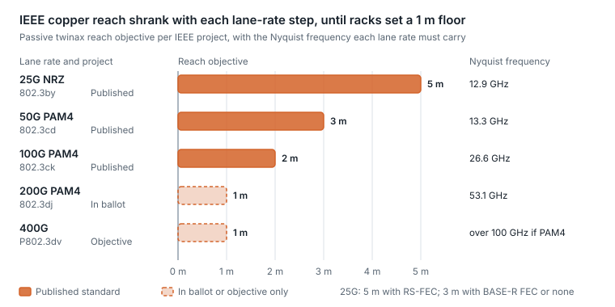
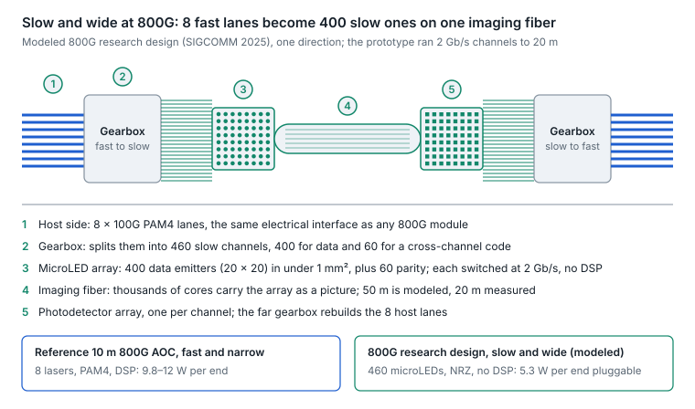
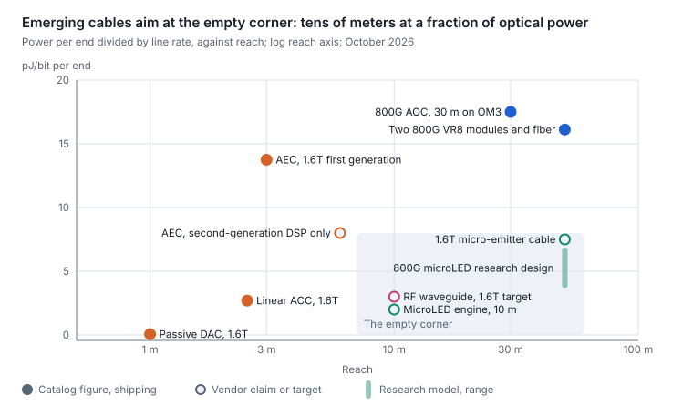
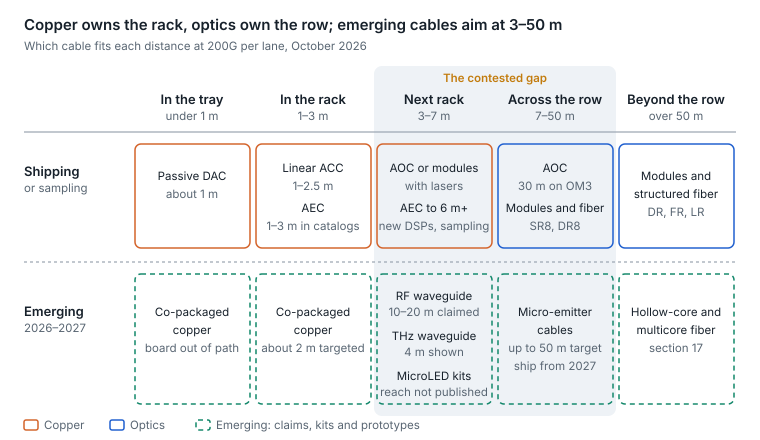
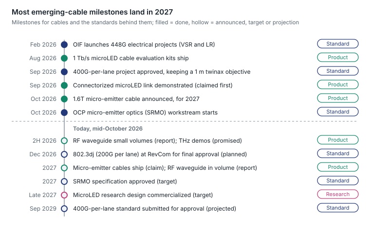

# 9. AI fabric and next-gen optics

AI clusters turned optics into a first-order cost, power and reliability problem: a non-blocking fabric needs several transceivers for every GPU-facing port, and a single flapping link can stall a training job across thousands of GPUs. The industry's four answers are faster lanes (200G now, 400G next), fewer DSPs (LPO, LRO), shorter electrical paths (CPO), and copper wherever it still reaches.

## The trade-offs at a glance

Every tier of an AI cluster faces its own optics trade-off, and the sections that cover each one close with an “AI networks: pros and cons” callout.

<picture>
  <source media="(prefers-color-scheme: dark)" srcset="../figures/fig-30-dark.svg">
  
</picture>

*Figure 9.1 — AI network trade-offs · by tier, with the section for each*

Read from the GPU outward: close to the GPU, latency and power dominate; farther out, reach, fiber count and interoperability decide.

## Three networks, three media

| Network | What it connects | Typical reach | Dominant media |
| --- | --- | --- | --- |
| Scale-up | GPUs inside a rack or pod, with memory-semantic links | \~1–2 m today | Copper: backplanes, cable cartridges, DAC; optics is the next frontier for multi-rack pods |
| Scale-out (back-end) | GPU NICs to leaf to spine, RDMA traffic | 2 m to 2 km | AEC or DAC in the rack; DR4/DR8/2×FR4 optics at 400G–1.6T beyond it |
| Front-end | Storage, management, users | Data-center scale | Conventional data-center optics |

**Why the optics count explodes.** Every link has a transceiver at each end. A non-blocking three-tier fabric has three link layers per GPU-facing port (host to leaf, leaf to spine, spine to super-spine), so each port implies about six transceivers if every layer is optical, or four if the host-to-leaf hop is copper.

<picture>
  <source media="(prefers-color-scheme: dark)" srcset="../figures/fig-31-dark.svg">
  
</picture>

*Figure 9.2 — AI back-end fabric · three switch layers, schematic*

When the NIC-to-leaf hop fits on copper, the optics count per port drops from six to four, which is why in-rack leaf placement and AEC reach matter so much to cluster cost.

## 200G per lane: the current generation

- **Standards.** IEEE 802.3dj (200G-per-lane electrical and optical, 800GbE and 1.6TbE) is in its final ballot recirculation as of October 2026, with submission targeted for later that month and approval at the December 2026 RevCom meeting ([agenda](https://www.ieee802.org/3/dj/public/26_09/agenda_3dj_b_2609.pdf)). Its PMD family spans 200G to 1.6T: DR (500 m), DR-2 (2 km), FR4 (2 km), LR4 (10 km), coherent LR1/ER1, plus CR copper and KR backplane.
- **Modules.** 1.6T OSFP modules (DR8 and 2×FR4 on 200G lanes; see [section 11](11-1-6t-in-depth.md)) entered volume shipment in 2026, with analysts expecting a steep ramp alongside continued 800G growth ([LightCounting](https://lightcounting.com/newsletter/en/february-2026-pam4-and-coherent-dsps-updated-april-2026-381)).
- **Silicon.** 102.4 Tb/s switches (512 × 200G) in production make 64 × 1.6T or 128 × 800G ports per switch the new building block.

## Copper's shrinking reach

Higher baud means more loss per meter of twinax, so copper reach roughly halves with each lane-rate doubling.

| Medium | What is inside | Reach at 100G/lane | Reach at 200G/lane |
| --- | --- | --- | --- |
| DAC (passive) | Twinax only; host SerDes does all equalization | \~2–3 m | \~1 m |
| ACC / linear active copper | Linear redriver at the ends | Longer than DAC | \~1–2.5 m |
| AEC (active electrical cable) | Retiming DSP in each connector | \~7 m | \~3 m+ (vendor claim) |
| AOC (active optical cable) | Optics permanently attached | Tens of meters | Tens of meters |

Sources: [802.3dj objectives](https://www.ieee802.org/3/dj/projdoc/objectives_P802d3dj_240314.pdf), [AEC claims](https://convergedigest.com/marvell-launches-1-6t-and-800g-aec-dsps/), [200G cable catalog](https://docs.nvidia.com/networking/display/800g200gpam4list). The 100G DAC figure is approximate.

## AI networks: pros and cons

The first decision in any AI rack is how far copper can go, because every copper hop removes two transceivers.

<picture>
  <source media="(prefers-color-scheme: dark)" srcset="../figures/fig-32-dark.svg">
  
</picture>

*Figure 9.3 — reach by medium at 200G per lane · log scale*

| Option | Pros in an AI fabric | Cons in an AI fabric | Best fit |
| --- | --- | --- | --- |
| Passive copper (DAC) | No power in the cable; lowest cost and latency; no lasers, so very reliable | About 1 m at 200G per lane; thick cables crowd racks; the host SerDes does all the equalization | Inside a rack or tray: GPU to switch tray, NIC to top-of-rack |
| Active copper (ACC, AEC) | About 1–2.5 m with linear redrivers, or about 3 m and beyond with retimed AEC (vendor claim), on thinner cable; still no lasers; vendors claim 25–50% less power than active optical cables | The retimer in each plug draws power and adds latency; still meters, not tens of meters | Adjacent racks; NIC-to-leaf when the leaf sits in the row |
| Optics (pluggable, linear or co-packaged) | Tens of meters to kilometers; light, dense cabling; the only option for multi-rack scale-up and for every switch tier above the leaf | Highest power and cost per link; lasers are the leading failure source; more connector end faces to keep clean | Anything beyond a few meters |

**Bottom line.** Use copper wherever it reaches: each copper hop takes two transceivers, and their lasers, out of the power and failure budget. Every lane-rate step shortens copper, which is why the 400G-per-lane generation pushes optics into the scale-up domain.

Sources: copper reach as in the table above; [AEC power claim](https://www.asteralabs.com/?p=29753); [1.6T SR8 reach](https://www.lightcounting.com/research-note/july-2026-vcsel-technology-advances-as-standards-and-applications-expand-449).

## Cable technologies: from passive copper to slow-and-wide light

At 200G per lane, passive copper stops at about 1 m and pluggable optics start at tens of meters. The 1–50 m between them, where most AI rack and row links fall, is now contested by seven cable types, as of October 2026. Four ship today: passive copper, linear active copper, retimed copper and active optical cables (AOCs so far only at 100G per lane). Three are emerging, with first products or product demonstrations expected in 2026–2027: RF over plastic waveguide, terahertz waveguide and micro-emitter (microLED) "slow and wide" optical cables.

<picture>
  <source media="(prefers-color-scheme: dark)" srcset="../figures/fig-33-dark.svg">
  
</picture>

*Figure 9.4 — cable anatomy · seven types, schematic*

Every row has the same two plugs and the same host interface; what changes is the electronics in each plug and the medium between them. Terahertz waveguide cables follow the RF row's pattern at higher carrier frequency.

**The family at a glance, October 2026**

| Cable | Inside each plug | Reach at 200G per lane | Power per end (1.6T unless noted) | Status |
| --- | --- | --- | --- | --- |
| Passive copper (DAC) | ID memory only; the host SerDes drives the whole channel | IEEE objective at least 1 m; one 1.6T data sheet lists 1 m at 26 AWG, and one large AI vendor lists none at 200G per lane | Under 0.1 W | Shipping |
| Linear active copper (ACC, also LACC) | A linear redriver per lane; no clock recovery | Catalogs list 1–2.5 m; vendors claim 3–4 m | About 1.8–4.3 W (about 1.1–2.7 pJ/bit; the low end is a vendor claim) | Shipping |
| Retimed copper (AEC) | A retimer DSP; can also change lane rate and count | Catalogs list 1–3 m; second-generation claims exceed 6 m | 22 W typical and 27 W maximum in one catalog (about 14–17 pJ/bit); a second-generation DSP alone claims 12.8 W | 1.6T in catalogs; second generation sampling |
| Active optical (AOC) | A full optical module at each end (DSP or linear driver, lasers and photodiodes), with the fiber bonded in | 800G: 30 m on OM3 in one data sheet; VR8-class optics reach 50 m on OM4 | 800G: up to 14 W (about 17.5 pJ/bit) | 800G shipping; no shipping 1.6T AOC found |
| RF over plastic waveguide | A millimeter-wave radio chip; each plastic core carries two 224G carriers | Claims range from 10 m (2025) to 10–20 m | Target about 3 pJ/bit (claim) | Evaluation kits; small volumes reported for the second half of 2026 |
| Terahertz waveguide | A radio chip with carriers near 1 THz on thin dielectric guides | 4 m demonstrated; 20 m projected | Not published | Prototype; product demonstrations promised for late 2026 |
| Micro-emitter (microLED) optical | A gearbox, a microLED array and a photodiode array: hundreds of slow channels over a multicore fiber bundle | Evaluation kits (reach not published); one 1.6T cable targets up to 50 m | One 1.6T design claims 12 W (about 7.5 pJ/bit); a modeled 800G research design needs 5.3 W as a pluggable (3.1 W co-packaged) | Evaluation kits now; first product announced for 2027 |

Reach and power in the last three rows are vendor claims or research models, not measured products. The pJ/bit figures divide the stated power per end by the line rate.

**Why copper keeps getting shorter**

- **Loss rises with frequency.** Twinax loses more per meter as frequency rises, through skin effect and dielectric loss. Since the move to PAM4 at 50G, each lane-rate doubling doubles the frequency the cable must carry: about 26.6 GHz at 100G, 53.1 GHz at 200G, and over 100 GHz if 400G stays PAM4.
- **IEEE reach objectives shrank with each step, then stopped.** Twinax objectives went from 5 m at 25G per lane (with RS-FEC) to 3 m at 50G, 2 m at 100G and 1 m at 200G. The 400G-per-lane project (P802.3dv, approved September 2026) keeps 1 m, because 1 m is the shortest useful rack link: a mid-rack switch to the top or bottom of the rack, plus slack.
- **802.3dj trades host loss against cable loss.** It does not fix a cable length. It sets a 40 dB end-to-end loss budget and four cable-assembly loss classes (19, 24, 29 and 34 dB), so a low-loss host leaves more of the budget for the cable.
- **Thicker wire buys reach at the cost of bulk.** One 1.6T DAC at 26 AWG is 10.5 mm across with a 90 mm bend radius. One 800G (8 × 100G) AEC line uses 34 AWG (6.4 mm) for 1–3 m, stepping through 32 and 30 AWG to 28 AWG (10.9 mm) for 4–6 m.

<picture>
  <source media="(prefers-color-scheme: dark)" srcset="../figures/fig-34-dark.svg">
  
</picture>

*Figure 9.5 — IEEE twinax reach by lane rate · project objectives*

The ladder stops shrinking at 1 m because the rack sets the floor; anything longer than that at 400G per lane will need active electronics or optics.

**Active copper: linear or retimed**

- **Linear (ACC).** A redriver boosts the high frequencies the cable lost but does not recover the clock. The host SerDes still equalizes the whole channel, so a cable works only with hosts it was tuned for: one catalog's 1.6T splitter cables, when plugged into one switch model, can link only to one NIC model. Latency added is under 100 ps (claim).
- **Retimed (AEC).** A DSP in each plug recovers the clock and sends a clean signal, so each host drives only the short channel to its own plug, as with an optical module. AECs can change lane rate and count for breakouts, run link training and report telemetry through CMIS. The costs are power and latency, tens of nanoseconds in earlier generations; no figure is published for 1.6T.
- **The power surprise.** First-generation 1.6T AECs draw 22 W typical per end in one catalog, about two-thirds of the 33.5 W the same catalog lists for its 1.6T (2 × 800G) twin-port optical module. Second-generation 3 nm DSPs claim 12.8 W for the DSP and more than 6 m (sampling, October 2026).

**Active optical cables**

- **What they are.** An AOC is two optical modules with the fiber bonded in. One 800G AOC data sheet lists VCSEL multimode, 8 × 106.25G, 30 m on OM3 and up to 14 W per end. Two 800G VR8 modules plus fiber reach 50 m on OM4 at 12.9 W typical per end. Linear (no-DSP) and half-retimed (retimed transmit, linear receive) 800G AOCs were shown in OIF interoperability demonstrations at ECOC 2024.
- **Why use one.** It costs less than two modules plus fiber, because only electrical testing is needed at the factory.
- **Why not.** One failed end replaces the whole cable, and lengths are fixed. Lasers remain a reliability weak point: the microLED research paper below puts short-reach optical links at a few hundred FIT, against under 10 for passive copper. At 1.6T, the 200G-per-lane multimode PHY is still in IEEE P802.3ds, and no shipping 1.6T AOC was found.

**Slow and wide cables: micro-emitters and fiber bundles**

[Section 10](10-optics-packaging-pluggable-lpo-xpo-npo-and.md) introduced slow and wide at the package. The same idea now reaches cables. The plug splits the host's few fast lanes into hundreds of slow channels and sends each on its own microLED through a multicore "imaging" fiber, the kind endoscopes use. Each channel runs at a few Gb/s with on-off NRZ signaling. There are no lasers and no DSP. The host's Ethernet FEC still runs; the research design adds only a lightweight Hamming-style code across channels, not a second FEC. Added latency is a few nanoseconds (research estimate).

<picture>
  <source media="(prefers-color-scheme: dark)" srcset="../figures/fig-35-dark.svg">
  
</picture>

*Figure 9.6 — slow-and-wide 800G cable · modeled research design, schematic*

The host sees an ordinary 800G module. In each direction the cable uses 460 light sources: 400 carry data and 60 carry a cross-channel error-correcting code.

- **A peer-reviewed research design (SIGCOMM 2025).**
  - **Prototype.** Measured 2 Gb/s per channel at 20 m with a BER below 10⁻⁶, and below 10⁻¹² to 10 m.
  - **Modeled 800G design.** 400 data channels on a 20 × 20 microLED array under 1 mm², plus 60 parity channels. It reaches 50 m in simulation and draws 5.3 W per end as a pluggable (3.1 W co-packaged). The paper's reference 10 m 800G AOC draws 9.8–12 W (data sheets list up to 14 W), so the saving is 56–68%.
  - **Timeline.** Its owners expect commercialization with partners in late 2027.
- **Evaluation kits.** One startup ships 1 Tb/s kits: 335 microLED channels at up to 3 Gb/s each over a multicore fiber bundle (August 2026). It showed a connectorized version in an MPO-form-factor connector in September 2026.
- **A first product announcement.** A retimer vendor announced a 1.6T micro-emitter cable on 12 October 2026, shipping in 2027. Its claims:
  - up to 50 m, at 12 W per end, about 30% below the vendor's own AEC baseline;
  - spare channels with hitless failover;
  - a 100-million-hour MTBF target;
  - ten times lighter than an AEC.
- **Other paths.**
  - An LED maker showed a 10 m engine at 3 Gb/s or more per channel and under 2 pJ/bit (claim), and targets a market launch in 2027.
  - A thin-film micro-VCSEL array (850 nm) showed error-free 32 Gb/s NRZ over a connectorized multicore fiber, claiming multimode-fiber compatibility (private demonstration, September 2026). It is still slow and wide, with fewer, faster channels.

**Why LEDs.** A microLED has no lasing threshold and needs no wavelength control. It comes from display-industry manufacturing, and spare channels turn a dead emitter into a remap inside the cable rather than a link down. The research design's reliability model projects under 20 FIT per link, against a few hundred for short-reach optics. That is a model, not field data.

**What limits them**

- **Dispersion.** A microLED's spectrum is over 10 nm wide, against under 1 pm for a laser, and visible light disperses strongly in silica. That bounds reach to tens of meters, and measured reach (20 m) still trails modeled reach (50 m).
- **Channel speed.** Each LED runs at a few Gb/s, so 1.6T needs hundreds of channels and a gearbox to map 200G host lanes onto them. In the research design the whole digital back end, gearbox included, draws only 0.4 W per end; the host electrical interface (2.4 W pluggable, 0.2 W co-packaged) costs more.
- **Bundles and connectors.** Multicore bundles stiffen quickly as they grow, and a connectorized link, claimed as the first, was shown only in September 2026.
- **No standard yet.** An Open Compute Project workstream, Short-Reach Micro-Emitter Optics (SRMO), started on 12 October 2026 and targets approval in 2027. It has published no technical parameters, and no IEEE or OIF project covers these links.

**RF and terahertz over plastic waveguide**

These cables modulate a radio carrier and guide it through a plastic (dielectric) core instead of sending light or a baseband electrical signal. Loss per meter is far lower than twinax at the same data rate, and neither uses lasers; the millimeter-wave chips are 28 nm CMOS.

- **Millimeter wave.**
  - **Construction.** A 1.6T cable has eight metal-clad plastic cores. Each core can carry 448 Gb/s as two 224G carriers at about 90 and 225 GHz, so eight cores give about 3.6 Tb/s in total. That is enough for 1.6T each way if four cores serve each direction, one carrier per 200G host lane; the sources do not state the split. The cable is 8.1 mm across, about half the volume of an AEC.
  - **Claims.** 10–20 m reach, about a third of optics' power (target about 3 pJ/bit), and latency far below DSP optics.
  - **Status.** Evaluation kits. A press report, not confirmed by the company, puts small-volume shipments to a cloud provider in the second half of 2026 and volume in 2027.
- **Terahertz.** Carriers near 1 THz run over guides about 200 µm across, with as little as 0.3 dB/m of loss. It was demonstrated over 4 m in April 2025; 20 m is projected, and first product demonstrations were promised for late 2026.
- **No MSA covers either.** Both vendors plan pluggable cables first; the terahertz parts had not yet been integrated into a pluggable as of December 2025.

**Inside the box: flyover and co-packaged copper**

- **Why the cable moves inward.** At 200G per lane, board traces (about 1.1 dB per inch in a host model proposed to 802.3dj) eat the loss budget. So the long run moves into twinax: flyover cables from a connector beside the ASIC to the front panel, or co-packaged copper at the package ([section 10](10-optics-packaging-pluggable-lpo-xpo-npo-and.md)).
- **Status.** A 102.4T switch package with co-packaged copper (512 × 200G lanes through substrate-level cable connectors) was shown physically at OFC 2025. Copper channel modeling for AI systems (SFF-TA-1043) is under way in SNIA SFF, and no shipping co-packaged-copper switch was found.
- **448G.** A member study at an OIF 448G workshop (April 2025) targeted about 2 m end to end for a scale-up channel and modeled cables only up to 1.6 m. It found negative COM margin and suggested an inner FEC to recover it. It concluded that attaching cable directly at the package might be the only viable option.

<picture>
  <source media="(prefers-color-scheme: dark)" srcset="../figures/fig-36-dark.svg">
  
</picture>

*Figure 9.7 — reach vs energy per bit · catalog figures, claims and models*

The emerging cables sit in the empty corner of the chart: tens of meters at a fraction of today's optical power. Every one of those points is a claim or a model.

<picture>
  <source media="(prefers-color-scheme: dark)" srcset="../figures/fig-37-dark.svg">
  
</picture>

*Figure 9.8 — where each cable competes · by distance, October 2026*

Where each cable competes: copper owns the rack, optics own the row and beyond, and every emerging cable aims at the 3–50 m between them.

**AI networks: pros and cons**

| Option | Pros in an AI fabric | Cons in an AI fabric | Best fit |
| --- | --- | --- | --- |
| Passive copper (DAC) | Near-zero power and latency; no lasers; cheapest | About 1 m at 200G per lane; thick, stiff cables block airflow; the host SerDes carries the whole channel | Inside a tray, or the shortest in-rack runs |
| Linear active copper (ACC) | A few watts per end; under 100 ps of added latency (claim) | Tuned to particular hosts; no clock recovery, so host and cable are qualified together; 1–2.5 m in catalogs | In-rack links on one qualified host and cable pairing |
| Retimed copper (AEC) | Isolates each host from the cable channel; breakout and lane-rate options; CMIS telemetry; no lasers | First-generation 1.6T draws optics-class power; adds latency; still only a few meters | NIC to switch and switch to switch within a rack or to the next rack |
| Active optical cable (AOC) | Tens of meters; cheaper than two modules plus fiber | The whole cable is replaced on any failure; fixed lengths; lasers remain; no shipping 1.6T AOC found | Row-scale links that do not need structured cabling |
| RF over plastic waveguide | Reach beyond copper at a fraction of optics' power (claim); no lasers | Not yet in volume; a single supplier; no MSA; reach claims vary from 10 to 20 m | Adjacent-rack scale-up, once qualified |
| Micro-emitter (microLED) optical | Very low energy per bit (claims and models); spare channels absorb emitter failures; no DSP and nanosecond latency | Not yet a product; dispersion limits reach to tens of meters; new connectors and bundles; no standard yet | Row-scale scale-up from 2027, if the claims hold |

**Bottom line.** Copper stays the default wherever it reaches, because it has no lasers to fail. At 200G per lane that means about 1 m passive and a few meters active. From a few meters to 50 m, today's answer is an AOC or two modules and fiber. The emerging cables all target that gap with the same bet: replace lasers and DSPs with radio chips or many slow LEDs. Treat their reach and power as claims until independent measurements and a standard exist.

**In operations**

- **Copper links take longer to come up.** CR PHYs auto-negotiate (Clause 73) and run link training. Training timers grew with each generation, from 0.5 s at 25G to 3 s at 50G and 12 s at 100G, and an early 200G draft set a 60 s auto-negotiation retry timer that was expected to change. Allow for slow link-up after a reseat before calling it a failure.
- **Know which copper is in the port.** A DAC, an ACC and an AEC look alike in the rack. The module's CMIS memory reports its media interface technology, and linear cables carry host-compatibility lists. Check both before swapping one for another.
- **Budget an AEC like an optic.** At 22 W typical and 27 W maximum per end, a 1.6T AEC counts against the port's power class and thermal budget just as an optical module does.
- **Bulk is a cooling problem.** Thick 26 AWG bundles with a 90 mm bend radius block airflow. Prefer thinner-gauge active cables where intake space is tight.
- **New cables bring new telemetry.** For micro-emitter cables, ask for spare-channel counts and per-channel error counters. For every emerging cable, qualify each host and cable pairing, since none has a compliance specification yet.
- **Count flaps, not just errors.** In AI training one link flap can stall a job, so track flaps per cable type during qualification.

<picture>
  <source media="(prefers-color-scheme: dark)" srcset="../figures/fig-38-dark.svg">
  
</picture>

*Figure 9.9 — cable and standards milestones · 2026–2029*

Filled dots have happened; hollow ones are announcements, targets or projections, to check as each date arrives.

**What to watch as these emerge**

- **IEEE 802.3dj** (200G per lane, at least 1 m of twinax) is in its final IEEE SA recirculation ballots and targets approval at the December 2026 RevCom meeting.
- **IEEE P802.3dv** (400G per lane, still at least 1 m of twinax) started in September 2026 and projects submission for final approval in September 2029.
- **OIF CEI-448G** projects (VSR chip-to-module and LR backplane, launched February 2026) will set 448G electrical channel budgets; twinax reach at 400G per lane is set in IEEE P802.3dv.
- **IEEE P802.3ds** (200G per lane on multimode fiber) is what 1.6T VCSEL AOCs need.
- **Second half of 2026.** Small-volume RF waveguide shipments (press report) and terahertz product demonstrations (promised).
- **2027.** The first micro-emitter cable shipments (announced), the OCP SRMO specification (target), and commercialization of the microLED research design (late 2027, target).

Sources: [802.3dj objectives](https://grouper.ieee.org/groups/802/3/dj/projdoc/objectives_P802d3dj_240314.pdf), [802.3dj RevCom plan](https://www.ieee802.org/email/stds-802-lmsc/msg01115.html), [802.3dj September 2026 motions](https://www.ieee802.org/3/dj/public/26_09/motions_3dj_2609.pdf), [802.3ck objectives](https://ieee802.org/3/ck/P802_3ck_Objectives_2018mar.pdf), [802.3cd objectives](https://grouper.ieee.org/groups/802/3/cd/P802d3cd_objectives_v4.pdf), [802.3by cable types](https://www.ieee802.org/3/by/public/May15/brown_3by_04_0515.pdf), [P802.3dv](https://standards.ieee.org/ieee/802.3dv/12772), [P802.3dv PAR](https://www.ieee802.org/3/400GPL/public/2607/Draft_P802.3dv_PAR_260715.pdf), [P802.3dv objectives](https://www.ieee802.org/3/400GPL/public/project_docs/400GPL_Objectives_260917.pdf), [why 1 m at 400G per lane](https://www.ieee802.org/3/400GPL/public/2605/kochuparambil_400GPL_01c_2605.pdf), [802.3dj cable-assembly classes](https://ieee802.org/3/dj/public/25_11/heck_3dj_02_2511.pdf), [802.3dj host trace loss proposal](https://ieee802.org/3/dj/public/24_07/ran_3dj_01b_2407.pdf), [copper link-training timers](https://ieee802.org/3/dj/public/25_05/lusted_3dj_01_2505.pdf), [200G cable catalog with AEC, linear-cable and optics power](https://docs.nvidia.com/networking/display/800g200gpam4list), [second-generation 1.6T AEC DSP](https://investor.marvell.com/news-events/press-releases/detail/1039/marvell-bolsters-connectivity-portfolio-with-new-3-2t-protocol-aware-retimer-and-second-generation-1-6t-aec-dsp), [1.6T DAC data sheet](https://resource.naddod.com/files/2026-08-20/osfp-1-6t-dacf-datasheet-017896.pdf), [AEC wire gauges](https://supplychain.molex.com/content/dam/molex/molex-dot-com/en_us/pdf/product-briefs/987652-7861.pdf), [linear redriver claims](https://www.semtech.com/technology/copperedge), [4 m linear redriver claim](https://convergedigest.com/nubis-intros-linear-redriver-for-extending-copper-cable-to-4m-at-200gbps-per-lane/), [800G AOC data sheet](https://www.china-tscom.com/products/800g-osfp-active-optical-cable), [800G VR8 data sheet](https://www.cisco.com/c/en/us/products/collateral/interfaces-modules/transceiver-modules/osfp-800g-transceiver-modules-ds.html), [AOC trade-offs](https://docs.nvidia.com/networking/display/cableovdev/dacs,+laccs,+aocs,+and+transceiver+interconnects), [linear and half-retimed AOC demonstration](https://oiforum.com/wp-content/uploads/OIF_PLL_Demo_TE_Connectivity_ECOC24.pdf), [P802.3ds](https://www.ieee802.org/3/200GMMF/index.html), [CMIS 5.2](https://www.oiforum.com/wp-content/uploads/OIF-CMIS-05.2.pdf), [microLED research paper](https://www.microsoft.com/en-us/research/wp-content/uploads/2025/08/benyahya25mosaic.pdf), [its commercialization target](https://news.microsoft.com/source/features/innovation/using-inexpensive-microleds-microsoft-networking-innovation-aims-to-make-datacenters-more-efficient/), [microLED evaluation kits](https://www.hpcwire.com/off-the-wire/avicena-ships-1-tbps-lightbundle-evaluation-kits-for-ai-infrastructure/), [connectorized microLED link](https://www.semiconductor-today.com/news_items/2026/sep/avicena-170926.shtml), [1.6T micro-emitter cable announcement](https://s205.q4cdn.com/511065572/files/doc_news/Credo-Unveils-1-6T-ZeroFlap-Active-Light-Cable-Industrys-First-Row-Scale-Wide-Parallel-Optical-Interconnect-for-AI-Data-Centers-2026.pdf), [SRMO launch](https://s205.q4cdn.com/511065572/files/doc_news/Credo-Launches-Short-Reach-Micro-Emitter-Optics-SRMO-Standardization-for-AI-Data-Center-Scale-Up-and-Scale-Out-Applications-2026.pdf), [SRMO workstream](https://www.opencompute.org/projects/semi-private-workstreams/short-reach-micro-emitter-optics-srmo/), [microLED limits](https://www.computer.org/publications/tech-news/trends/microled-photonic-ai), [LED-maker microLED engine](https://www.microled-info.com/ams-osram-demonstrates-optical-interconnect-engine-based-its-microled), [its 2027 launch target](https://www.ledinside.com/node/view/35945), [micro-VCSEL arrays](https://compoundsemiconductor.net/article/125405/Ams_Osram__to_unveil_thin_film_VCSEL_for_AI_scale_up), [RF and terahertz waveguide cables](https://spectrum.ieee.org/rf-over-fiber), [RF waveguide targets](https://lightcounting.com/newsletter/en/october-2025-optics-and-ethernet-for-scale-up-networks-were-hot-topics-at-ocp-global-summit-434), [RF waveguide shipment report](https://udn.com/news/story/7252/9690163), [terahertz demonstration plans](https://www.citybiz.co/article/860669/attotude-raises-52m-series-c-to-scale-terahertz-connectivity-for-ai-infrastructure/), [co-packaged copper switch demonstration](https://blog.samtec.com/post/100t-architecture-with-samtec-pluggable-cpc-marvell-200g-serdes/), [SFF copper channel work](https://www.snia.org/sites/default/files/Preview/2026/SFF%20TWG%202026%20SNIA%20Preview-Final.pdf), [448G scale-up channel study](https://www.oiforum.com/wp-content/uploads/Meta_LR_Scale-up_channel_448G_feasibility.pdf), [OIF 448G projects](https://www.oiforum.com/oif-q1-meeting-launches-projects-to-advance-secure-module-management-and-new-448g-electrical-interface-work/). Power per bit is computed here from stated watts; all emerging-cable figures are vendor claims or research models.

## Co-packaged and near-packaged optics

CPO, NPO, XPO and the other packaging choices now have their own section ([section 10](10-optics-packaging-pluggable-lpo-xpo-npo-and.md)).

## The 400G-per-lane horizon

The next step is P802.3dv: 400G per lane for 400G, 800G and 1.6T Ethernet over copper and single-mode fiber up to 500 m, targeting completion around 2029 ([PAR](https://www.ieee802.org/3/400GPL/public/2607/Draft_P802.3dv_PAR_260715.pdf)). Modulation (PAM4 vs PAM6), whether pluggables survive at that rate, and how much CPO takes over are the defining open questions of the late 2020s.

## Reliability is now a network metric

- Synchronous training stalls on the slowest or broken link, so a link flap can force a whole job back to its last checkpoint.
- Operators therefore track per-link flap counts, FEC margin trends and module temperature as capacity-planning signals, and pull optics on degrading margin before they fail.
- Laser type, operating temperature and burn-in screening drive failure rates. One reason silicon photonics is attractive is that one well-cooled laser can feed several lanes.

## Also on the horizon

- **Optical circuit switches** reconfigure fabric topology with mirrors instead of packets. They favor bidirectional or WDM optics that tolerate the switch's insertion loss ([section 19](19-optical-circuit-switching.md)).
- **Hollow-core fiber** carries light mostly through air, cutting latency by about a third, which matters for distributed training across data-center campuses ([section 17](17-fiber-frontiers-hollow-core-multi-core-and.md)).

---

[← 8. Coherent optics and DCI](08-coherent-optics-and-dci.md) · [Contents](../README.md#contents) · [10. Optics packaging: pluggable, LPO, XPO, NPO and CPO →](10-optics-packaging-pluggable-lpo-xpo-npo-and.md)
