# 10. Optics packaging: pluggable, LPO, XPO, NPO and CPO

The same optical engine can sit in five places relative to the switch ASIC, and moving it closer shortens the electrical path. A shorter path needs less equalization, so the SerDes and DSP shrink and power per bit falls; the price is serviceability, thermal complexity and multi-vendor freedom. [Section 25](25-silicon-photonics-and-optical-engines.md) opens up the engine itself.

<picture>
  <source media="(prefers-color-scheme: dark)" srcset="../figures/fig-39-dark.svg">
  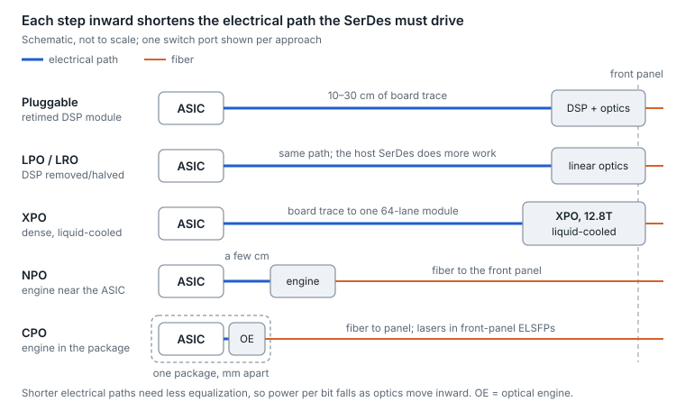
</picture>

*Figure 10.1 — optics packaging spectrum · schematic*

The top three rows keep the optics at the faceplate as replaceable modules; the bottom two move them beside or onto the ASIC and run fiber to the panel instead.

## The five approaches side by side

| Approach | Where the optics sit, and the electrical path | Cooling and power | Serviceability | Status, Oct 2026 |
| --- | --- | --- | --- | --- |
| Retimed pluggable | Front-panel cage; \~10–30 cm of board trace or flyover cable; DSP in the module | Air; \~20–26 W for a 1.6T module | Hot-swap one port at a time; any compliant vendor | Mainstream at 800G and 1.6T |
| LPO / LRO | Same cage and path; DSP removed (LPO) or kept only on transmit (LRO) | Air; under 10 W (LPO) to \~11–15 W (LRO) at 1.6T | Hot-swap, but each host and module pairing must be qualified | LPO MSA specs since 2025; 1.6T LPO and LRO modules listed in 2026 |
| XPO | Front panel, one large module carrying 64 × 200G lanes (12.8 Tb/s) | Liquid cold plate, up to \~400 W per module | Hot-swap, but one module is eight 1.6T ports' worth | MSA announced Mar 2026; demos at OFC 2026; no released spec or shipping product found |
| NPO (near-packaged) | Optical engine on the board or an interposer next to the ASIC; a few cm (up to \~15 cm); fiber to the panel | Liquid cooling in the OIF project; lasers often external | Engine replaceable without replacing the switch ASIC | OIF 12.8T NPO module project launched May 2026; pilots in 2026, deployments expected from 2027 |
| CPO (co-packaged) | Optical engines on the ASIC's package substrate; millimeters (≤ \~5 cm); fiber to the panel; lasers in front-panel ELSFPs | Lowest power per bit; switch-level cooling | Lasers hot-swap; engines do not | 51.2T and 102.4T CPO Ethernet switches in production |

Sources: [XPO announcement](https://www.arista.com/en/company/news/press-release/23697-pr-20260311), [XPO lanes and density](https://www.marvell.com/blogs/marvell-joins-xpo-msa-to-accelerate-innovation-in-ai-optical-modules.html), [XPO ecosystem status](https://convergedigest.com/xpo-ecosystem-takes-shape-as-vendors-target-12-8t-modules/), [OIF 12.8T NPO project](https://www.businesswire.com/news/home/20260604899827/en/OIF-Q2-Meeting-Advances-Management-for-Path-Startup-Encryption-Near-Package-Optics-and-High-Density-Connector-Interfaces), [NPO deployment outlook](https://www.lightcounting.com/research-note/july-2026-co-packaged-and-near-packaged-optics-cponpo), [1.6T LPO](https://www.nokia.com/optical-networks/ice-d-1600g-dr8-lpo/), [1.6T LRO](https://www.jabil.com/dam/jcr:35daa182-ceec-4ce9-a961-79dbb15025db/Jabil_1.6T%20LRO%20DR8-DR8+%20Optical%20Transceiver%20Datasheet_04.pdf). Power figures are vendor-listed.

## Why distance is the lever

- **Loss sets SerDes power.** At 200G per lane, every centimeter of board trace costs signal. A host SerDes driving a pluggable must equalize a long, lossy channel; one driving a co-packaged engine sees a channel of about 10 dB, and one driving an NPO engine about 13 dB ([OIF channel classes, XSR and XSR+](https://gazettabyte.com/tag/hugo-saleh)).
- **Energy per bit follows.** A \~30 W pluggable carrying 1.6 Tb/s works out to roughly 19 pJ/bit. CPO vendors claim 65–70% lower optics power, or 3.5–5× better efficiency per port; these are vendor claims ([102.4T CPO](https://investors.broadcom.com/news-releases/news-release-details/broadcom-announces-tomahawkr-6-davisson-industrys-first-1024), [CPO efficiency](https://www.optics.org/news/nvidia-reveals-plan-to-scale-ai-factories-with-co-packaged-optics)).
- **Density follows too.** Faceplate area, not silicon, limits how many pluggables fit a 1RU switch. XPO answers by packing eight ports into one liquid-cooled module (about 204.8 Tb/s per rack unit, by its sponsors' figures); NPO and CPO answer by moving the optics off the faceplate entirely.

## XPO: the pluggable answer to density

XPO (eXtra-dense Pluggable Optics) is a multi-source agreement announced in March 2026 for a large, liquid-cooled pluggable with 64 electrical lanes at 200G, or 12.8 Tb/s per module. One XPO occupies the faceplate of roughly eight OSFPs and is meant to carry DR, FR, LR, SR and coherent ZR/ZR+ optics. It keeps the pluggable model (replaceable modules from multiple vendors) while accepting liquid cooling at up to \~400 W per module. As of October 2026 it is at the demonstration stage, and adoption depends on switch silicon built around it.

## NPO: the middle path

Near-packaged optics put the optical engine on a high-performance substrate or interposer beside the ASIC rather than on the ASIC's own package. That keeps most of CPO's electrical benefit while letting the engine be tested, sourced and replaced separately, and it keeps the most failure-prone part away from the hottest chip. Some in the industry describe NPO as a practical way to implement co-packaging rather than an alternative to it. The OIF started a 12.8T NPO module implementation agreement in May 2026, covering 6.4T and 12.8T engines at 200G per lane with liquid cooling and laser-source definitions.

- **On-board optics (COBO)** is the older relative: optics on the main board near the chip, with a longer electrical path than NPO.

## What NPO hardware looks like

No NPO engine specification has been published yet: the OIF project began in May 2026, and a socketed-engine MSA formed in March 2026 has not released one. The picture below is assembled from their published scopes and from 2026 demonstrations, so read the drawings as schematics rather than as any one product.

<picture>
  <source media="(prefers-color-scheme: dark)" srcset="../figures/fig-40-dark.svg">
  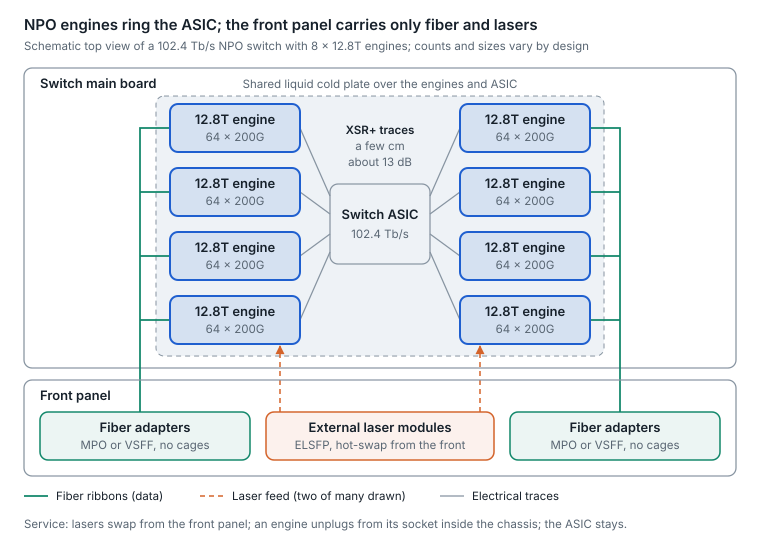
</picture>

*Figure 10.2 — NPO switch · schematic top view, 102.4T example*

The front panel loses its transceiver cages. What remains is fiber adapters and slots for external laser modules, with fiber running inside the chassis from each engine to the panel.

**The engine**

- **Capacity.** 3.2 Tb/s engines are in early deployments. The socketed-engine MSA defines 6.4 Tb/s as 32 × 200G lanes, with a roadmap to 12.8 Tb/s and 448G lanes; the OIF project covers 6.4T and 12.8T engines at 200G per lane.
- **What is inside.** The same parts as a CPO engine ([section 25](25-silicon-photonics-and-optical-engines.md)): a photonic IC with modulators and detectors, an electronic IC with drivers and TIAs, and a fiber attach unit. The difference is the engine's own substrate, which plugs into a socket or high-density connector instead of being soldered to the ASIC package.
- **Light.** Most designs take continuous-wave light over fiber from external laser modules at the front panel, as CPO does. At least one engine shown in September 2026 builds its lasers in: 7.2 Tb/s as 36 × 200G channels, driven linearly with no DSP. A 3.2T line shown in March 2026 uses VCSELs, for multimode links.
- **Cooling.** Liquid. The OIF project defines cooling and power delivery alongside the electrical, optical and mechanical interfaces.

<picture>
  <source media="(prefers-color-scheme: dark)" srcset="../figures/fig-41-dark.svg">
  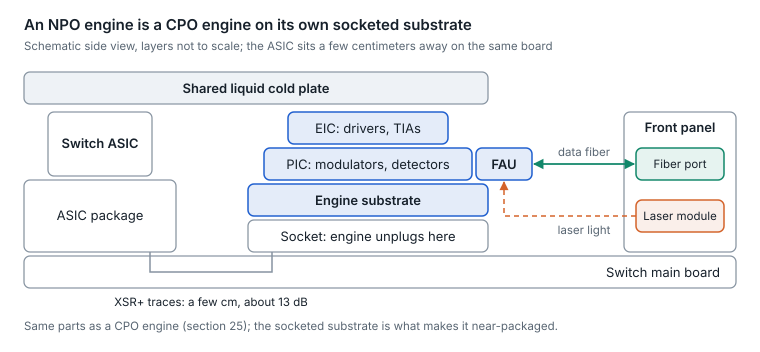
</picture>

*Figure 10.3 — NPO engine · schematic side view, layers not to scale*

The ASIC and the engine share the board, often under one cold plate. Only the socket separates the engine from the switch, and that is what makes it replaceable.

**The system**

- **Layout.** Engines ring the ASIC a few centimeters away. A 102.4 Tb/s switch needs 16 × 6.4T or 8 × 12.8T engines.
- **Electrical path.** An XSR+ class channel of about 13 dB, compared with about 10 dB for CPO, so the host SerDes drives the engine directly with no retimer or module DSP.
- **Front panel and fiber.** Fiber adapters (MPO or very-small-form-factor) and laser-module slots replace transceiver cages. The internal fiber from every engine to the panel becomes a design and service item of its own.
- **Service model.** Lasers swap from the front panel, an engine unplugs from its socket inside the chassis, and the ASIC stays. With pluggables you swap one port at the faceplate; with CPO only the lasers are replaceable.

<picture>
  <source media="(prefers-color-scheme: dark)" srcset="../figures/fig-42-dark.svg">
  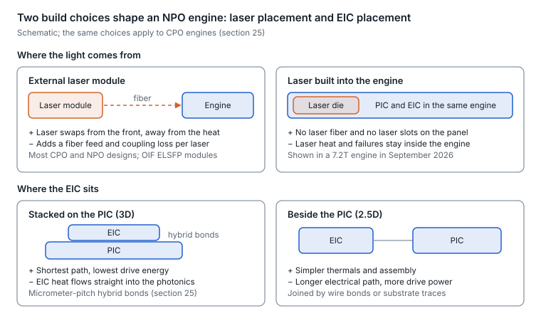
</picture>

*Figure 10.4 — NPO engine build choices · laser and EIC placement*

External lasers and a stacked EIC are the common pairing today; built-in lasers trade front-panel serviceability for fewer fibers and connectors.

**Status, October 2026**

- Two large cloud operators beta-tested 3.2T NPO configurations in mid-2026 and plan 6.4T variants for 2027; wider deployment is expected from about 2027.
- Specifications in progress: the OIF NPO implementation agreement, the socketed-engine MSA, and open engine specifications from an OCP initiative due in Q4 2026 ([section 27](27-standards-and-ecosystem-map.md)).
- Not yet public: engine dimensions, the connector type, the number of lasers per engine and the fiber count per engine.

Sources: [socketed-engine MSA](https://convergedigest.com/open-cpx-msa-pluggable-optical-engine-architecture/), [OIF NPO project scope](https://convergedigest.com/oifsnew-projects-autonomous-path-startup-1-6t-macsec-and-12-8t-npo/), [7.2T engine with built-in lasers](https://www.malaymail.com/news/money/mediaoutreach/2026/09/17/huawei-unveils-the-industrys-first-npo-optical-engine-with-built-in-light-source-hi-one-leading-the-way-in-high-speed-optical-interconnect-technology-innovation/488427), [its expo showing](https://letsdatascience.com/news/huawei-showcases-72tbps-near-packaged-optics-module-9a19904f), [NPO as an interim step, 3.2T VCSEL line and beta tests](https://xenospectrum.com/en/near-packaged-optics-npo-cpo-interim-architecture-2026/), [NPO vs CPO overview](https://www.tomshardware.com/tech-industry/near-packaged-optics-gains-ground-aso-the-industry-hedges-against-co-packaged-optics-growing-pains), [CPO vs NPO vs XPO](https://www.kad8.com/server/optical-first-data-centers-cpo-vs-npo-vs-xpo-in-2026/).

## External or built-in lasers: pros and cons

Lasers are the least reliable and most heat-sensitive part of an engine, so where they sit decides efficiency, serviceability and what a failure costs. Nearly every CPO design keeps them outside in front-panel ELSFP modules. NPO reopens the question, because the engine itself is replaceable.

<picture>
  <source media="(prefers-color-scheme: dark)" srcset="../figures/fig-43-dark.svg">
  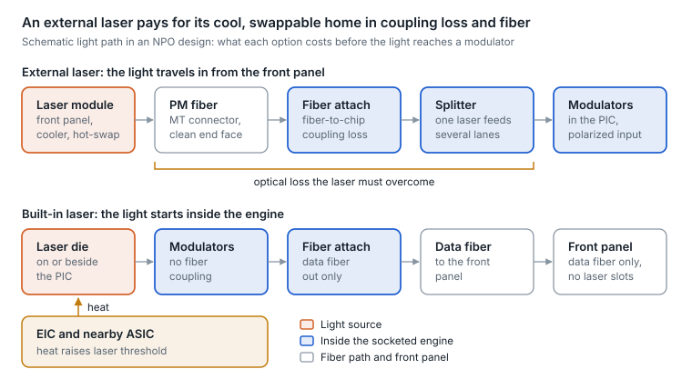
</picture>

*Figure 10.5 — laser light path · external vs built-in, schematic*

The external laser keeps the light source cool and swappable; the built-in laser skips the connector, the coupler, the splitter and the PM fiber, but sits next to the heat.

|  | External laser (ELSFP) | Built-in laser |
| --- | --- | --- |
| Laser temperature | + Front-panel airflow, away from the ASIC and EIC; one 8-laser module is rated for a 0–70 °C case | − Sits near the hottest parts; threshold and slope efficiency worsen exponentially with temperature, and dense laser arrays heat each other |
| Power and loss budget | − Light crosses a connector, a fiber-to-chip coupler and often a splitter, so lasers run at high power (over 20 dBm per lane in current modules) | + No coupling loss on the source; a 2021 model found built-in designs drew less system power even though each laser was less efficient |
| Serviceability | + The most failure-prone part hot-swaps from the front panel without touching the engine | − A laser failure means an engine swap: a socket change inside the chassis, not a front-panel hot-swap |
| Failure blast radius | − One laser often feeds several lanes through a splitter, so a failure takes out a group | + Can be one laser per lane, though the engine is the replaceable unit |
| Fiber and front panel | − Adds polarization-maintaining fiber and laser slots on the panel; high power makes connector cleanliness critical | + No laser fiber or laser slots; the panel and fiber attach carry only data |
| Engine build, yield and test | + The engine is passive photonics plus the EIC, with no III-V material; lasers can be cooled, higher power and shared | − III-V bonding or attach lowers yield, complicates burn-in and narrows the supplier base |
| Ecosystem | + OIF ELSFP is a published, multi-vendor agreement | − Each design is proprietary |
| Operations | − One more managed device per engine group; correlate laser output with the engine's receive power | + Self-contained; triages more like a pluggable |

**Why NPO shifts the balance.** CPO's strongest argument for external lasers is that a dead laser should not strand a whole switch. A socketed NPO engine weakens it: a built-in laser failure costs an engine swap, and an engine a few centimeters from the ASIC can be cooled on its own, so the heat penalty is smaller than on the ASIC package. That is likely why the first NPO engine shown with built-in lasers (September 2026, a vendor claim) took that route. What does not change is the size of the outage: an engine swap takes 6.4–12.8 Tb/s offline in a maintenance window, while a laser swap is a front-panel hot-swap.

<picture>
  <source media="(prefers-color-scheme: dark)" srcset="../figures/fig-44-dark.svg">
  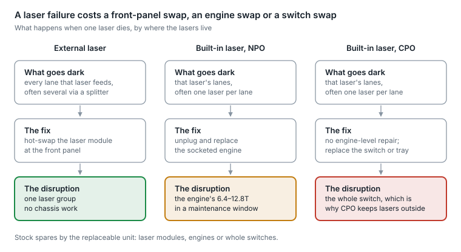
</picture>

*Figure 10.6 — cost of a laser failure · by where the lasers live*

**Rule of thumb.**

- **Choose external lasers** for fleet-scale front-panel operations, multi-vendor laser sourcing, or when the engine cannot be kept cool.
- **Choose built-in lasers** when power per bit and fiber and connector count dominate, the engine has liquid cooling, and engine-level spares and maintenance windows are acceptable.

The modeling figures come from a 2021 study aimed at 51.2 Tb/s switches: cooled external lasers reached about 125 mW against about 75 mW for built-in lasers running uncooled at 70 °C, cooling built-in lasers improved link budgets by 2–4 dB, and at 70 °C built-in designs needed backup lasers to hold about a 1% annual failure rate. Vendor claims, such as 66% lower power and 10× reliability for one built-in-laser engine (against its own earlier design) or 4× fewer lasers from sharing external ones, are not independently verified.

Sources: [external vs integrated light sources, JLT 2021](https://ee.stanford.edu/~jmk/pubs/ext.vs.integ.light.sources.jlt.4-21.pdf), [thermal scaling of hybrid laser arrays](https://ieeephotonics.org/announcements/ieee-study-shows-thermal-scaling-analysis-of-large-hybrid-laser-arrays-for-co-packaged-optics/), [OIF ELSFP 2.0](https://www.oiforum.com/wp-content/uploads/OIF-ELSFP-02.0.pdf), [8-laser ELSFP datasheet](https://resource.naddod.com/files/2026-09-03/elsfp-mt12-8l-datasheet-018021.pdf), [built-in-laser engine](https://www.malaymail.com/news/money/mediaoutreach/2026/09/17/huawei-unveils-the-industrys-first-npo-optical-engine-with-built-in-light-source-hi-one-leading-the-way-in-high-speed-optical-interconnect-technology-innovation/488427), [shared external lasers in production](https://storagereview.com/news/nvidia-spectrum-x-ethernet-photonics-enters-full-production-with-4x-fewer-lasers-and-a-five-vendor-cpo-supply-chain).

## Dense NPO: when the engine needs retiming

NPO keeps most of CPO's power saving only if the ASIC's SerDes can drive each engine directly, with no retimer in between. That works inside an electrical budget of about 13 dB, and packing more engines around the ASIC pushes some of them outside it.

<picture>
  <source media="(prefers-color-scheme: dark)" srcset="../figures/fig-45-dark.svg">
  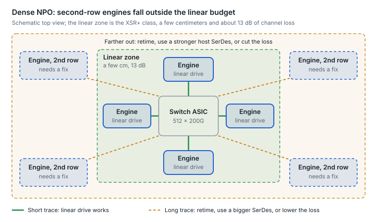
</picture>

*Figure 10.7 — dense NPO layout · linear zone vs second row, schematic*

The inner engines get short traces and can run linear; the second row needs one of the fixes in the flow further down.

**The budgets that decide it**

| Interface class | Reach and loss | What it connects |
| --- | --- | --- |
| CEI-112G-XSR (CPO) | About 50 mm, about 10 dB | ASIC die to an engine on the same package |
| CEI-112G-XSR+ (NPO) | Up to 150 mm, 13 dB | ASIC to an engine a few centimeters away |
| CEI-224G-XSR | Up to about 50 mm of package-substrate trace | Die to die and die to engine (in development) |
| CEI-224G-VSR | 200 mm host, 20 mm module, one connector | Chip to module: pluggable, NPO or CPO |
| CEI-224G-MR and LR | 500 mm; 1,000 mm with two connectors | Chip to chip; backplane and copper cable |
| CEI-224G-Linear and EEI-224G-RTLR | Projects | Fully linear and half-retimed optics for LPO, NPO and CPO |

**Why density makes it harder**

- **Escape geometry.** A 102.4 Tb/s ASIC must route 512 × 200G lanes to 16 × 6.4T or 8 × 12.8T engines. Only so many engines fit in the inner ring; the rest sit farther out and need more routing layers.
- **224G halves the reach.** Doubling the lane rate roughly doubles the Nyquist frequency, to about 56 GHz, and board loss per centimeter rises roughly in step, so the same 13 dB covers about half the trace length it did at 112G.
- **The socket is a tax.** The socket or connector that makes an NPO engine replaceable adds loss and reflections that CPO does not pay, and tighter lane pitch adds crosstalk.
- **448G tightens it again.** OIF's 448G electrical work so far covers only the VSR and LR classes.

<picture>
  <source media="(prefers-color-scheme: dark)" srcset="../figures/fig-46-dark.svg">
  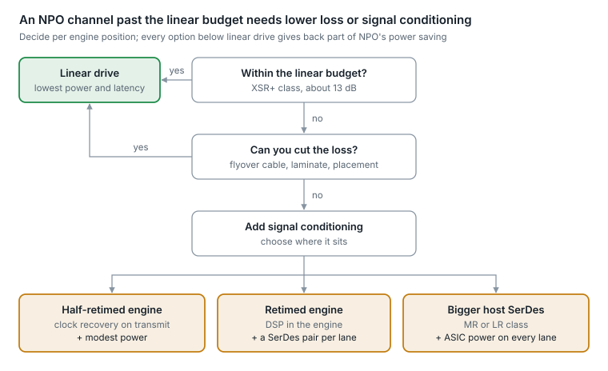
</picture>

*Figure 10.8 — closing a long NPO channel · decision flow*

**What each fix costs**

- **The yardstick.** Every 1 pJ/bit on a 102.4 Tb/s switch is about 100 W.
- **Retimed engine.** A retimer puts another SerDes pair on every lane; OIF's 224G framework notes that removing one repeater halves the SerDes count per switch port. A full DSP also brings back part of the pluggable's latency.
- **Bigger host SerDes.** No retimer, but the ASIC pays: one 224G long-reach SerDes was demonstrated at about 4 pJ/bit across a 48 dB channel.
- **Cut the loss.** Flyover cable from the package to the engines, lower-loss laminate or a shared substrate keeps linear drive and its power saving, at the cost of mechanical complexity.

**Where it stands, October 2026**

- Linear NPO exists at 200G per lane: one 7.2 Tb/s engine (36 × 200G) drives its optics linearly with no optical DSP.
- Pure linear drive is harder at 224G because optical nonlinearity grows, so hybrid designs add gain control and clock recovery, moving toward half-retimed.
- OIF's CEI-224G-Linear and EEI-224G-RTLR projects cover the fully linear and half-retimed cases; the OIF 12.8T NPO agreement, which will fix the engine's electrical interface, is not yet published.

**In operations.** A linear NPO link is one long equalized channel from the ASIC's SerDes, through the engine and fiber, to the far end, so the host SerDes counters are the only per-lane view, and a dirty connector, an aging laser and a weak lane look alike. Retimed engines restore segment-by-segment telemetry; it is the same trade as LPO against retimed pluggables ([section 4](04-dsps-and-signal-conditioning.md)).

**Bottom line.** Dense NPO stays linear and low-power only if every engine fits inside a budget of roughly 13 dB, and both density and 224G shrink that budget. Expect linear or half-retimed inner engines, and flyover cable, retimed engines or bigger host SerDes for the rest, each giving back part of the power saving.

Sources: [XSR and XSR+ channel classes](https://gazettabyte.com/?p=145945), [OIF CEI-224G projects](https://www.oiforum.com/technical-work/hot-topics/common-electrical-i-o-cei-224g/), [OIF current work](https://www.oiforum.com/technical-work/current-work/), [CEI-224G framework](https://www.oiforum.com/wp-content/uploads/OIF-FD-CEI-224G-01.0.pdf), [CEI-224G-Linear](https://convergedigest.com/oif-advances-cei-224g-linear-project/?amp=1), [224G linear drive](https://www.synopsys.com/articles/224g-serdes-ip-linear-drive-optics.html), [224G long-reach SerDes](https://www.marvell.com/blogs/224g-long-range-serdes-scale-up-scale-inside.html), [linear 7.2T engine](https://www.malaymail.com/news/money/mediaoutreach/2026/09/17/huawei-unveils-the-industrys-first-npo-optical-engine-with-built-in-light-source-hi-one-leading-the-way-in-high-speed-optical-interconnect-technology-innovation/488427).

## CPO: the end point

Co-packaged optics place optical engines on the same package substrate as the switch ASIC, so the electrical path shrinks to millimeters and the pluggable DSP disappears.

- **The laser problem.** Lasers are the least reliable, most heat-sensitive part, so CPO keeps them in front-panel external laser source modules, standardized by the OIF as ELSFP (v2.0, January 2025) ([spec](https://www.oiforum.com/wp-content/uploads/OIF-ELSFP-02.0.pdf)).
- **What is shipping.** 51.2T CPO Ethernet switches are deployed; 102.4T CPO switches have sampled since late 2025, and a GPU-fabric vendor's CPO Ethernet switches entered full production in August 2026 ([production report](https://storagereview.com/news/nvidia-spectrum-x-ethernet-photonics-enters-full-production-with-4x-fewer-lasers-and-a-five-vendor-cpo-supply-chain)).
- **Reliability data.** The early fear was that a failed engine would strand a switch. One hyperscaler reported about 15 million CPO device-hours with roughly 5× the MTBF of pluggables, and later too few failures to compute an MTBF at all ([report](https://convergedigest.com/pecc-summit-metas-drew-alduino-on-ai-networking-reliability-walls/)).
- **Scale-up next.** GPU vendors have shown photonics for multi-rack scale-up domains, where copper's \~1 m reach at 200G per lane runs out.
- **What you give up.** Engines cannot be swapped at the faceplate; the supply chain concentrates around the switch vendor; and fault isolation tools are less mature than for pluggables.

## Fast and narrow vs slow and wide

There are two ways to move a given bandwidth off a chip. **Fast and narrow** runs a few lanes at the highest rate the electronics allow (200G PAM4 per lane today, 400G next), with DSP equalization and FEC. **Slow and wide** runs many more lanes at a modest rate, typically 16–64 Gb/s NRZ, with little or no equalization and no FEC, and gets its bandwidth from lane count: many wavelengths per fiber, many fibers, or a wide parallel electrical interface.

<picture>
  <source media="(prefers-color-scheme: dark)" srcset="../figures/fig-47-dark.svg">
  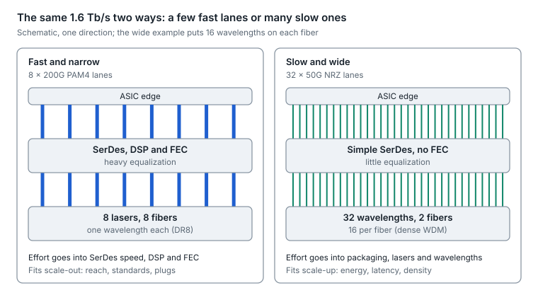
</picture>

*Figure 10.9 — fast and narrow vs slow and wide · 1.6 Tb/s, schematic*

Both carry 1.6 Tb/s in the drawing. Fast and narrow spends its effort in the SerDes and DSP; slow and wide spends it in packaging, lasers and fiber count.

|  | Fast and narrow | Slow and wide |
| --- | --- | --- |
| Lane rate | 200G PAM4 now, 400G next | 16–64 Gb/s NRZ per lane or wavelength; current optical I/O runs 32–56 Gb/s |
| What makes it work | Faster SerDes, DSP equalization, FEC | Lane count: dense WDM (8–16 wavelengths per fiber), parallel fibers or micro-LED arrays, advanced packaging |
| Energy and latency | Higher pJ/bit; the DSP and FEC add latency | Lower pJ/bit; no FEC, latency in nanoseconds |
| Reach | Meters to kilometers, on IEEE PMDs | Short: package to rack scale (one micro-LED design targets about 10 m) |
| Shoreline density | Limited by SerDes area and package escape | High with 2.5D and 3D packaging; one 3D-stacked engine spreads I/O across the whole die |
| Interoperability | Standard Ethernet PMDs from many vendors | Mostly proprietary; the OCI MSA and UCIe-based chiplets are the first open steps |
| Where it fits in AI | Scale-out: NICs, leaf, spine, between buildings | Scale-up: GPU to GPU and GPU to memory inside a pod |

**Examples, October 2026**

- **Fast and narrow.** 1.6T modules on 8 × 200G lanes are the volume product, and 400G-per-lane DSPs are sampling ([section 25](25-silicon-photonics-and-optical-engines.md)).
- **Slow and wide, by wavelength.** Optical I/O chiplets with ring-based dense WDM run 32 Gb/s NRZ per wavelength with no FEC. One 3D-stacked CPO engine runs 16 wavelengths per fiber at 56 Gb/s NRZ (800 Gb/s per fiber), or 106/112 Gb/s PAM4 (1.6 Tb/s per fiber), with availability claimed for 2026.
- **Slow and wide, by fiber count.** A micro-LED prototype drives hundreds of 10 Gb/s channels through a multicore imaging fiber, about 3 Tb/s at under 1 pJ/bit over about 10 m.
- **In between.** The OCI MSA's 200G PHY uses 4 wavelengths at 53 GBd NRZ per direction rather than one 200G PAM4 lane ([section 27](27-standards-and-ecosystem-map.md)).
- **Electrically.** UCIe runs 4–64 GT/s per lane (64 GT/s since UCIe 3.0, August 2025). Standard 2D packages allow about 25 mm at a 100–130 µm bump pitch; 2.5D cuts the pitch to 25–55 µm with about 2 mm of reach and much higher shoreline density.

**Bottom line.** Fast and narrow wins where reach, standards and multi-vendor plugs matter, which is the scale-out network. Slow and wide wins where energy, latency and shoreline density matter over short reach, which is the scale-up domain. The two meet in CPO and NPO engines, which can be built either way.

Sources: [serial vs parallel optical PHYs](https://www.synopsys.com/articles/224g-serdes-ip-linear-drive-optics.html), [UCIe over optics](https://ytyuted.substack.com/p/ep25-ucie-over-optics), [WDM optical I/O](https://compoundsemiconductor.net/article/112506/Super-fast_optical_interconnects), [3D-stacked CPO engine](https://www.businesswire.com/news/home/20250331315231/en/Lightmatter-Announces-Passage-L200-the-Fastest-Co-Packaged-Optics-for-AI), [micro-LED links](https://spectrum.ieee.org/tsmc-microled-optical-interconnects), [OFC 2026 status](https://www.hengtongglobal.com/info/ofc-2026-optical-modules-whats-real-whats-next-103451285.html). Shoreline and energy figures are vendor or analyst claims.

## Scale-up from the package: CPC and OCI

Scale-up links (GPU to GPU, and GPU to scale-up switch inside a pod) are moving their connection point from the faceplate to the package. Two concepts lead. Co-packaged copper (CPC) keeps copper but plugs it in at the package, and the OCI MSA defines an open optical PHY for the links copper cannot reach.

<picture>
  <source media="(prefers-color-scheme: dark)" srcset="../figures/fig-48-dark.svg">
  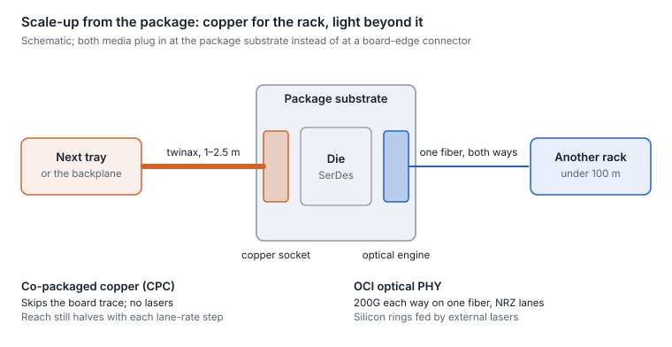
</picture>

*Figure 10.10 — CPC and OCI · scale-up from the package, schematic*

Inside the rack, copper wins on cost and has no lasers to fail; once a link leaves the rack, it needs light.

**Co-packaged copper (CPC)**

- **What it is.** A twinax cable assembly that plugs into a socket on or beside the ASIC's package substrate, next to the SerDes, instead of a connector at the board's edge. The signal skips the lossy board trace and runs in cable to the front panel, a backplane or the next tray. Compression-mount, solderless sockets keep the cable field-replaceable.
- **Why now.** At 224G the board trace is the weakest part of the channel. A long-reach 224G SerDes demonstrated in 2026 ran 2.5 m of cable (two 0.75 m co-packaged cables and a 1 m backplane), 48 dB bump to bump, at about 4 pJ/bit with a bit error ratio around 10⁻¹¹.
- **One socket, two media.** Package sockets are being designed to take either copper or optics. One connector supplier shows CPC and CPO on the same substrate of 95 mm or less, with 16- and 64-pair sockets around the chip for 1,024 off-chip lanes, and claims about 5 dB less loss than near-packaged connections (vendor claim).
- **Limits.** Copper reach still halves with each lane-rate step. The 448G work is weighing PAM4 against PAM6, with 336G PAM4 as a fallback, and 448G co-packaged cable systems are prototypes. No industry standard defines CPC yet.

**OCI: an open optical PHY for scale-up**

- **What it defines.** A 200G-per-direction link on one fiber: 4 wavelengths × 53.125 GBd NRZ each way, the forward group at 1308.0–1314.9 nm and the reverse group at 1327.7–1334.8 nm, for links under 100 m with a budget good to about 500 m ([section 27](27-standards-and-ecosystem-map.md)).
- **Why it looks this way.** It is slow and wide in miniature: NRZ lanes need little equalization and no heavy DSP, four wavelengths share each direction, and sending both directions on one fiber halves the fiber count. The reference design uses silicon micro-ring modulators fed by ELSFP external lasers.
- **Where it goes.** A second generation doubles to 400G per direction, with 3.2 Tb/s per fiber on the longer roadmap, in pluggable, on-board, co-packaged and chiplet form factors; UALink can run over it.

<picture>
  <source media="(prefers-color-scheme: dark)" srcset="../figures/fig-49-dark.svg">
  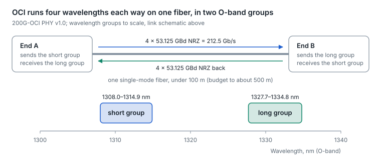
</picture>

*Figure 10.11 — OCI bidirectional link · wavelength groups to scale*

The two wavelength groups sit about 13 nm apart, so a simple filter at each end separates what it sends from what it receives.

**AI networks: pros and cons**

| Option | Pros in an AI fabric | Cons in an AI fabric | Best fit |
| --- | --- | --- | --- |
| Board-routed copper (DAC or AEC at the faceplate) | Mature, standard and cheapest | Board trace plus connector loss limits reach at 224G; AEC retimers add power | In-rack links at today's rates |
| Co-packaged copper (CPC) | Takes the board out of the channel, so long-reach SerDes copper reaches about 1–2.5 m; no lasers; the cable is field-replaceable at the package | No standard yet; cable bulk around the package; reach halves again at 448G | Tray-to-tray and in-rack scale-up at 224G |
| OCI optics | Open, multi-vendor PHY; NRZ lanes with little DSP and low latency; one bidirectional fiber per link; tens of meters | New ecosystem; external lasers and ring control loops to manage; first specification only | Multi-rack scale-up pods |
| CPO or NPO optics on 200G PAM4 lanes | Highest bandwidth per fiber pair today; shares the Ethernet optics supply chain | PAM4 lanes need KP4 FEC and more equalization, adding latency | Scale-out, and scale-up links that bridge into the Ethernet fabric |

**Bottom line.** Inside a rack, CPC stretches copper by taking the board out of the channel. Across racks, OCI gives scale-up an open optical PHY built for low power and latency rather than reach. Watch for package sockets that accept either medium, because that is how one switch or GPU design can serve both.

Sources: [co-packaged copper](https://www.molex.com/en-us/blog/future-of-co-packaged-copper), [co-packaged interconnects at DesignCon 2026](https://blog.samtec.com/post/innovations-in-co-packaged-interconnects-for-224-gbps-pam4-and-beyond/), [224G long-reach SerDes over co-packaged copper](https://www.marvell.com/blogs/224g-long-range-serdes-scale-up-scale-inside.html), [OCI MSA formation](https://www.businesswire.com/news/home/20260312254951/en/Optical-Scale-up-Consortium-Established-to-Create-an-Open-Specification-for-AI-Infrastructure-Led-by-Founding-Members-AMD-Broadcom-Meta-Microsoft-NVIDIA-and-OpenAI), [200G-OCI PHY write-up](https://convergedigest.com/?p=110366), [OCI MSA](https://www.oci-msa.org).

## AI networks: pros and cons

In an AI fabric the packaging decision comes down to power at cluster scale, how much fails together, and who can supply the parts.

| Option | Pros in an AI fabric | Cons in an AI fabric | Best fit |
| --- | --- | --- | --- |
| Retimed pluggable | Multi-vendor sourcing; hot-swap one port at a time; mature tooling and telemetry | Highest power per bit (about 14 W per 800G, roughly 17.5 pJ/bit); faceplate area limits ports per rack unit | The default, and any fabric that mixes vendors or generations |
| LPO or LRO pluggable | Keeps the pluggable model at roughly half the module power or less ([section 4](04-dsps-and-signal-conditioning.md)) | Per-pairing qualification; tight margins at 200G per lane | Short links in tightly controlled clusters |
| XPO | 12.8T per liquid-cooled module, about eight OSFPs' worth, while keeping pluggable sourcing | Demonstration stage; one module failure takes out eight ports' worth of traffic; liquid cooling at the faceplate | Future high-density pluggable switches |
| NPO | Most of CPO's electrical benefit, with socketed, field-replaceable engines and a path to multi-sourcing | The Open CPX specification was published in September 2026, and products are pre-production; an engine swap needs a maintenance window; fiber management inside the chassis | 2027-onward switches that want CPO-class power with serviceability |
| CPO | Lowest power per bit (vendor claims of about 4.4–6.9 pJ/bit); fewer lasers; positive production reliability data (about 5× pluggable MTBF at one hyperscaler) | Engines are not field-replaceable; supply concentrates around the switch vendor; fault-isolation tools are less mature | Large single-vendor AI fabrics at 102.4T and beyond |

**Bottom line.** Pluggables stay the default while AI fabrics mix vendors and generations. CPO wins where one vendor owns the whole switch and power is the binding constraint. NPO and XPO are the two bets on keeping serviceability while closing the power gap.

## Choosing among them

- **Need multi-vendor optics and per-port replacement:** retimed pluggables.
- **Short, controlled links and a power target:** LPO or LRO, after qualifying the exact host and module pair.
- **Faceplate density at 1.6T and beyond, while keeping pluggables:** watch XPO and the 400G-per-lane USFP.
- **Lowest power per bit at scale, accepting switch-level integration:** CPO, with NPO as the more serviceable middle ground.

---

[← 9. AI fabric and next-gen optics](09-ai-fabric-and-next-gen-optics.md) · [Contents](../README.md#contents) · [11. 1.6T in depth →](11-1-6t-in-depth.md)
