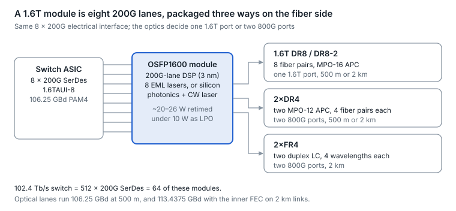

# 11. 1.6T in depth

A 1.6T port is eight 200G PAM4 lanes: the host drives 8 × 212.5 Gb/s, and the module carries them on eight fiber pairs (DR8), two groups of four fiber pairs (2×DR4), or two groups of four wavelengths (2×FR4). A 102.4 Tb/s switch therefore offers 64 × 1.6T ports, or 128 × 800G when each module is split in two.

<picture>
  <source media="(prefers-color-scheme: dark)" srcset="../figures/fig-50-dark.svg">
  
</picture>

*Figure 11.1 — 1.6T module anatomy · three fiber-side variants*

DR8 and 2×DR4 are the same optics with different connectors; 2×FR4 swaps parallel fibers for wavelengths so it can run over duplex single-mode.

## The arithmetic

- **Lanes.** 8 × 200G. Each electrical lane runs 106.25 GBd PAM4 (212.5 Gb/s with RS(544,514) overhead).
- **Optical lane rate.** 106.25 GBd on 500 m DR links; 113.4375 GBd on 2 km-plus links that add the inner Hamming code inside the module ([section 5](05-forward-error-correction.md)).
- **Switch math.** 512 × 200G SerDes = 102.4 Tb/s = 64 × 1.6T. The same silicon can also be built with 1,024 × 100G SerDes, which is where 16-lane 1.6T modules come in ([102.4T launch](https://www.servethehome.com/broadcom-tomahawk-6-launched-for-1-6tbe-generation/)).
- **Per-GPU vs per-port.** 2026 GPU platforms advertise 1.6 Tb/s of scale-out bandwidth per GPU, but one leading NIC's datasheet lists 800G per port, so "1.6T per GPU" can mean two 800G ports ([NIC datasheet](https://www.pny.com/en-eu/file%20library/professional/datasheet/mellanox/pny-connectx-datasheet-connectx-9.pdf)). Check which one a design means.

## Host interfaces: 8 lanes or 16

IEEE 802.3dj defines an 8-lane 1.6T attachment interface as the main option and allows a 16-lane one ([objectives](https://www.ieee802.org/3/dj/projdoc/objectives_P802d3dj_240314.pdf)). A 16 × 100G host can drive 200G-lane optics through a gearbox module: one OSFP-XD 1.6T DR8 listing pairs 16 × 106.25G host lanes with 8 × 212.5G optical lanes at about 22 W ([datasheet](https://www.atoptechnology.com/1-6t-osfp-xd-dr8/)). Most 1.6T deployment, though, pairs 8 × 200G hosts with OSFP1600 modules.

## The 1.6T module family

| Variant | Optical lanes | Connector | Reach | Splits into |
| --- | --- | --- | --- | --- |
| 1.6T DR8 | 8 × 200G, one wavelength; MPO-16 or dual MPO-12 | MPO-16 APC | 500 m | 8 × 200G-DR1, or 2 × 800G-DR4 |
| 1.6T DR8-2 (DR8+) | 8 × 200G | MPO-16 or dual MPO-12 APC | 2 km | Same as DR8 |
| 2×DR4 | 2 × (4 × 200G) | Two MPO-12 APC | 500 m or 2 km | 2 × 800G |
| 2×FR4 | 2 × (4 wavelengths × 200G) | Two duplex LC | 2 km | 2 × 800G-FR4 |
| 1.6T LPO / LRO DR8 | 8 × 200G, linear or half-retimed | As DR8 | 500 m class | As DR8 |
| 1.6T AEC (copper) | 8 × 200G electrical, retimed | — | Up to \~2 m | — |

Sources: [DR8 / 2×DR4 datasheet](https://www.jabil.com/dam/jcr:f58ac2a3-a351-4d67-9f26-ce0806353a3e/Jabil_1.6T%20DR8-DR8+-2xDR4-2xDR4+%20Transceiver%20Datasheet_06.pdf), [DR8, DR8-2 and 2×FR4 modules](https://convergedigest.com/ecoc24-eoptolinks-1-6t-osfp-transceivers-2km-without-fec/), [retimed and LPO 1.6T](https://www.lightwaveonline.com/home/product/55355627/source-photonics-16t-imdd-retimed-lpo-optics-transceivers-based-on-inp-pic), [1.6T AEC](https://www.lightwaveonline.com/directory/subsystems/optical-transceivers-transponders/product/55401182/fiberstamp-technology-pte-ltd-16t-osfp-to-16t-osfp-active-copper-cable).

- **Standards vs products.** IEEE 802.3dj's 1.6T optical objectives cover 8 fiber pairs at 500 m and 2 km; there is no 1.6T FR or LR objective. 2×FR4 modules are two 800G FR4 engines in one shell.
- **Laser technology.** Both EML and silicon photonics designs ship ([section 25](25-silicon-photonics-and-optical-engines.md) compares them); one analyst firm reports that almost all 1.6T optics shipping in 2026 are DR-type silicon photonics ([Cignal AI](https://cignal.ai/2026/06/datacom-optical-component-revenue-doubles-to-7-7-billion-in-1q26/)).
- **Form factors.** OSFP1600 dominates, in finned-top and riding-heatsink versions; QSFP-DD1600 is specified; OSFP-XD carries 16-lane hosts and is the path to 3.2T.

## Power and thermal

| 1.6T module type | Listed power |
| --- | --- |
| DSP-retimed (DR8, 2×FR4) | \~20–26 W |
| Half-retimed (LRO) | \~11–15 W |
| Linear (LPO) | under 10 W |

Vendor-listed figures ([DSP and LRO](https://blog.semtech.com/webinar-recap-low-power-1.6t-datacom-transceivers-and-the-path-to-3.2t), [LRO datasheet](https://www.jabil.com/dam/jcr:35daa182-ceec-4ce9-a961-79dbb15025db/Jabil_1.6T%20LRO%20DR8-DR8+%20Optical%20Transceiver%20Datasheet_04.pdf), [LPO](https://www.nokia.com/optical-networks/ice-d-1600g-dr8-lpo/)). 3 nm DSPs for 8 × 200G claim over 20% lower module power than the previous node ([3 nm DSP](https://www.marvell.com/company/newsroom/marvell-unveils-industrys-first-3nm-1-6tbps-pam4-interconnect-platform.html)). A switch with 64 retimed 1.6T modules spends well over a kilowatt on optics alone, which is the case for LPO, LRO, NPO and CPO in [section 10](10-optics-packaging-pluggable-lpo-xpo-npo-and.md).

## Coherent 1.6T

- **1600ZR.** The OIF published the 1600ZR implementation agreement on 9 September 2026: one wavelength carrying a 1.6TbE client over up to 120 km of single-span amplified DWDM, with interop demos planned ([announcement](https://picmagazine.net/article/125334/OIF_defines_16T_coherent_interface)). Project-stage figures pointed to about 235 GBd 16QAM with oFEC.
- **1600ZR+.** In progress since January 2024, aimed at roughly 1,000 km ([OIF 1600G page](https://www.oiforum.com/technical-work/hot-topics/1600g-coherent/)).
- **Coherent-lite at 1.6T.** O-band and C-band designs target 2–20 km campus links, but strong 200G PAM4 has slowed adoption ([section 8](08-coherent-optics-and-dci.md)).

## Status and what comes next

- **Volume.** One analyst firm expects more than 10 million 1.6T units in 2026, with shipments growing about 50% quarter on quarter in early 2026 (Cignal AI, above).
- **Standard.** IEEE 802.3dj, which defines the 1.6TBASE-R PCS and PMDs, was not yet approved as of early October 2026; submission for approval was planned for October, targeting the December 2026 standards board meeting ([PAR extension](https://www.ieee802.org/3/dj/public/26_05/PAREx_3dj_2605_draft3.pdf)). Today's modules are built to the near-final drafts.
- **Next.** 3.2T arrives either as 16 × 200G (OSFP-XD's future option, or XPO at 64 lanes) or 8 × 400G (P802.3dv, PAR approved September 2026; a 16-lane 400G-per-lane USFP pluggable was announced in October 2026); 400G-per-lane DSPs have already been announced, and analysts expect nearly half of 1.6T-plus-3.2T transceivers over the next five years to use 400G lanes. XPO targets 12.8T per module.

---

[← 10. Optics packaging: pluggable, LPO, XPO, NPO and CPO](10-optics-packaging-pluggable-lpo-xpo-npo-and.md) · [Contents](../README.md#contents) · [12. Management and diagnostics →](12-management-and-diagnostics.md)
