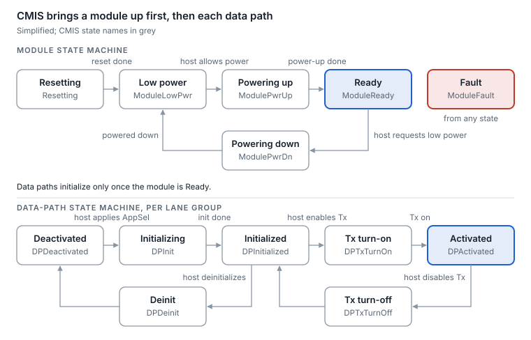
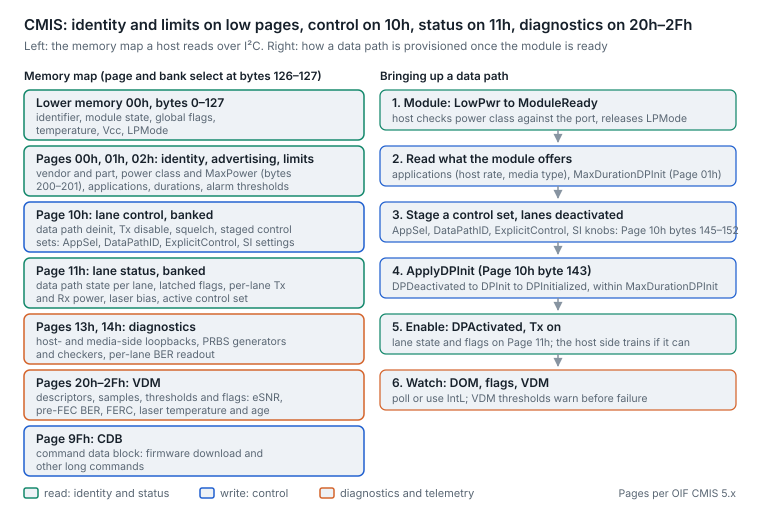

# 12. Management and diagnostics

Every pluggable carries a small management memory map that the host reads over a two-wire (I²C-style) bus. SFP-class modules use SFF-8472, QSFP28-era modules use SFF-8636, and everything 400G and newer uses CMIS, now at version 5.4 (May 2026) under the OIF ([IA list](https://www.oiforum.com/technical-work/implementation-agreements-ias/)). Knowing which map a module speaks tells you what you can see and control.

## The management specs

| Spec | Used by | What it adds |
| --- | --- | --- |
| SFF-8472 | SFP, SFP+, SFP28 | Digital diagnostics (DOM/DDM) with alarm and warning thresholds |
| SFF-8636 | QSFP+, QSFP28 | The same for four lanes, with per-lane values |
| CMIS | QSFP-DD, OSFP, QSFP112, SFP-DD and beyond | Module and data-path state machines, application selection, VDM telemetry, firmware upgrade, many lanes via banks |
| C-CMIS | Coherent modules | CMIS extensions for coherent: tuning, CD, OSNR and SNR estimates, laser frequency |

Identifier byte values that say which module type is plugged in are defined in SFF-8024.

## DOM basics (every generation)

- **Five monitors.** Module temperature, supply voltage, laser bias current, Tx optical power and Rx optical power, per lane where the module has lanes.
- **Four thresholds per monitor.** High alarm, high warning, low warning, low alarm, written by the module vendor. Warnings mean "drifting"; alarms mean "out of spec".
- **Latched flags.** On QSFP (SFF-8636) and CMIS modules a flag stays set until read and drives the interrupt line, so a short excursion is still caught. On the SFP family (SFF-8472) the flags are live and clear on their own, so only polling catches an excursion.
- **Accuracy.** SFF-8472 allows about ±3 dB on optical power readings ([summary](https://www.analog.com/en/resources/technical-articles/meet-sff8472-resolution-and-accuracy-goals-with-internal-calibration.html)), so DOM power is excellent for trends and lane-to-lane comparisons and weak as an absolute meter.
- **Average, not OMA.** DOM reports average optical power (SFF-8472 lets a module declare OMA instead, A0h byte 92 bit 3, so check it before comparing dBm); for PAM4 eye quality, use the module's SNR or BER telemetry.

## CMIS concepts worth mastering

1. **Module state machine.** Low power → powering up → Ready (or Fault). A module stuck in low-power mode often means the host has not granted its power class.
2. **Data-path state machine.** Each data path (a group of lanes forming one port) moves from deactivated through initialization to activated. Per-port problems after breakout often sit here.
3. **Applications (AppSel codes).** The module advertises the host-interface and media-interface pairs it supports, for example "400GAUI-8 to 400GBASE-DR4" or "4 × 100GAUI-2 to 4 × 100GBASE-DR". The host selects one per data path. Breakout and speed changes are application changes.
4. **VDM (versatile diagnostics monitoring).** Per-lane media-side SNR, pre-FEC BER (current, minimum, maximum, average), errored-frame counts, laser temperature and more. VDM is how you see the optical segment's health separately from the host's FEC counters.
5. **CDB (command data block).** A command channel used mainly for module firmware upgrades. Module firmware is now a real operational variable.
6. **Built-in test.** Many modules offer host-side and media-side loopbacks and PRBS generators and checkers, which let you isolate the electrical and optical segments without test equipment.

<picture>
  <source media="(prefers-color-scheme: dark)" srcset="../figures/fig-51-dark.svg">
  
</picture>

*Figure 12.1 — CMIS module and data-path state machines · simplified*

A port that never comes up is usually stuck in one of these boxes: low power (power class not granted) or a data path that never leaves initialization (unsupported application).

## CMIS in depth: the memory map and the bring-up sequence

The concepts above become concrete once you can picture the memory map a host reads over I²C, and the order in which it must write it.

**The memory map.** Lower memory (bytes 0–127) is always visible: management-interface revision, module state, global and lane-flag summaries, temperature, supply voltage and the page and bank select registers at bytes 126–127. Everything else is paged. Upper pages 00h, 01h and 02h hold identity and advertising: vendor, part and serial numbers, date code, power class and maximum power (page 00h bytes 200–201), the application descriptors (host interface, media interface, lane counts), the durations the module needs for each state transition, and the alarm and warning thresholds. Page 10h is control, banked per group of eight lanes: data-path deinit, transmitter disable and squelch, and the staged control sets (bytes 145–152 for control set 0: AppSel, data-path ID, the explicit-control bit, and the signal-integrity settings when explicit control is on). Page 11h is its mirror for status: data-path state per lane, latched flags with their masks, per-lane receive and transmit power and laser bias, and the active control set the module is really using. Pages 13h and 14h hold the built-in test engines: host- and media-side loopbacks, PRBS generators and checkers, and per-lane error counts. Pages 20h–2Fh are VDM, and page 9Fh is the CDB command window.

**Bringing a data path up.**

1. **Power.** The module starts in low power after reset. The host reads its power class and MaxPower, checks that the cage can supply and cool it, and releases LPMode (a pin or a software bit) so the module can move to ModuleReady.
2. **Discover.** The host reads the advertised applications and the transition durations (MaxDurationDPInit and its siblings). A module that does not advertise the host's intended application cannot be made to run it; this is where a 400G module refuses a 4 × 100G breakout.
3. **Stage.** With the data path deactivated, the host writes a control set: which application, which lanes form the data path and, if it takes explicit control, the host-side equalizer settings. Nothing takes effect yet.
4. **Apply.** The host sets ApplyDPInit (page 10h byte 143) for the lanes. The module validates the staged set, reports per-lane acceptance or rejection codes, and moves the data path from DPDeactivated through DPInit to DPInitialized within the advertised duration. A rejected set is the commonest silent cause of a port that never comes up after a configuration change.
5. **Activate.** The host enables the transmitter; the data path goes to DPActivated and light appears. Lane state and the latched flags on page 11h are now meaningful.
6. **Watch.** Flags are latched, so a transient fault stays visible until read; the interrupt pin tells the host something changed. VDM thresholds warn before failure.

<picture>
  <source media="(prefers-color-scheme: dark)" srcset="../figures/fig-52-dark.svg">
  
</picture>

*Figure 12.2 — OIF CMIS 5.x memory map and data-path initialization · simplified*

**VDM: what to watch and why.** Each observable has a current value, with high and low alarm and warning thresholds; the host reads descriptors to learn which observables the module supports.

| Observable | What it tells you | Why it matters |
| --- | --- | --- |
| Media-side pre-FEC BER, per lane and per data path | The raw error ratio the module's own FEC or the host FEC sees on the optical segment | Separates optical health from host-channel health; a distance to the FEC cliff |
| Media-side eSNR | The DSP's estimate of signal quality after equalization, in dB | Falls before BER rises; tracks dirt, dispersion and aging |
| Host-side pre-FEC BER and eSNR | The same for the electrical segment | Convicts or clears the host channel without test gear |
| Errored frames (FERC) | Frames the FEC could not correct, as a count and a rate | The number that should match the host's uncorrectable counter |
| Laser temperature and TEC current | Thermal state of each laser | Early warning of wavelength walk (LAN-WDM) and of laser aging |
| Laser bias current, Tx and Rx power per lane | The classic DOM set | Bias creeping up at constant power is an aging laser |
| Laser age, percent | The module's own estimate of consumed life | A fleet-replacement signal |

**Signal-integrity controls.** With explicit control the host can set, per lane, the module's host-side input equalizer and its host-side output pre-cursor and post-cursor emphasis and amplitude; without it the module uses its application defaults. Platforms usually expose these only through debug commands, and the right setting depends on the host trace, which is why a module that is marginal in one slot may be fixed by a host-side SI profile rather than a replacement.

**What the versions mean.** CMIS 3 (2018) defined the data-path state machine, applications and staged control sets; CMIS 4 (2019) added VDM and CDB; the CMIS 5.x releases added form-factor, Fibre Channel, CPO and ELSFP, link-training and advertising extensions (5.3 in 2024, 5.4 in 2026). OIF's coherent CMIS (C-CMIS) adds the observables a ZR module needs (OSNR, chromatic dispersion, PMD, state of polarization) and the frequency and power controls, and its 2026 CMIS-LT adds out-of-band, per-lane, per-direction link tuning for any module type, with linear optics as the main driver. A host that implements an older revision than the module advertises will still see identity and DOM but may not see VDM or be able to stage applications, which shows up as a module that works but cannot be configured.

Sources: [CMIS 3.0](https://www.oiforum.com/wp-content/uploads/CMIS3p0_Third_Party_Spec.pdf), [CMIS 4.0](https://www.oiforum.com/wp-content/uploads/CMIS4p0_Third_Party_Spec.pdf), [CMIS 5.3 release](https://www.businesswire.com/news/home/20240919654977/en/OIF-Unveils-Three-New-CMIS-Implementation-Agreements-CMIS-5.3-ELSFP-Pluggable-CMIS-CMIS-FF-and-a-New-White-Paper-CMIS-Path-to-Plug-and-Play), [CMIS-LT and C-CMIS 1.5 approval](https://picmagazine.net/article/125296/OIF_advances_optical_interoperability).

## Identity and coding

The memory map also holds vendor name, part number, serial number, date code and compliance codes. Hosts may check these to decide whether a module is supported, so a module can be optically perfect and still be refused or run with warnings. Know your platform's policy before blaming the optic.

---

[← 11. 1.6T in depth](11-1-6t-in-depth.md) · [Contents](../README.md#contents) · [13. Troubleshooting and operations →](13-troubleshooting-and-operations.md)
