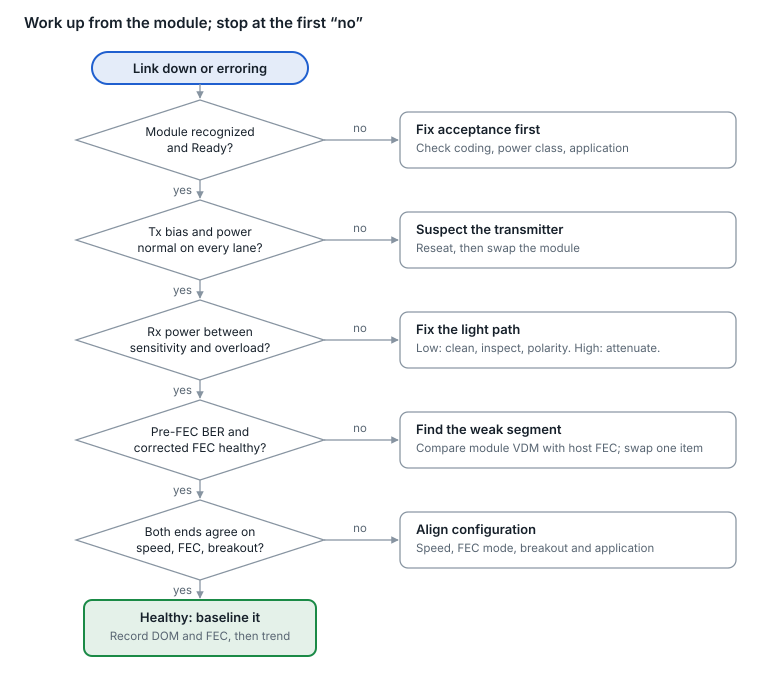
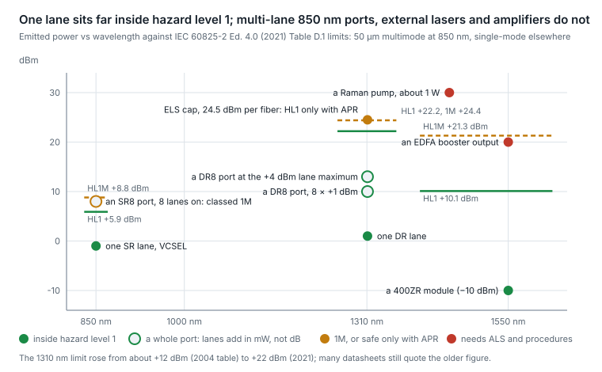

# 13. Troubleshooting and operations

Work the link from the glass upward and from the module toward the host. Most optical link problems are dirty or damaged connectors, the wrong fiber or polarity, or a mismatch in lane rate, FEC or application, not a dead laser.

## The layered method

1. **Is the module accepted?** Present, identified, in the Ready state, power class granted, a supported application selected. If not, nothing optical matters yet.
2. **Is light leaving?** Per-lane Tx bias and Tx power inside thresholds; no Tx fault or Tx disable. A lane with normal bias but low Tx power points to the laser or its coupling.
3. **Is light arriving?** Per-lane Rx power between the receiver's sensitivity and its overload point. Near-end Tx minus far-end Rx, lane by lane, estimates the path loss.
4. **Is the signal clean?** Media-side SNR and pre-FEC BER from the module (VDM), and the host's FEC counters and symbol-error histogram. Corrected errors rising over time means margin is draining.
5. **Do both ends agree?** Same speed, same lane rate and modulation, same FEC mode, matching breakout mode and application, link training on copper.
6. **Is it stable?** Flaps correlate with temperature, marginal Rx power, reflections, mechanical seating or firmware. Look at timestamps against module temperature and Rx power history.

<picture>
  <source media="(prefers-color-scheme: dark)" srcset="../figures/fig-53-dark.svg">
  
</picture>

*Figure 13.1 — troubleshooting flow · one decision per layer*

The order matters: each check assumes the ones above it passed, so a FEC problem is only worth chasing once power levels are known to be good.

## Symptom to cause

| Symptom | Most likely causes | First check |
| --- | --- | --- |
| Link down, Rx loss of signal on all lanes | Polarity (Tx into Tx), unplugged or wrong patch, fiber break | Far-end Tx power, then trace the path |
| Some lanes dark on a parallel optic | Dirty or damaged MPO fibers, wrong MPO polarity type, MPO-12 vs MPO-16 mix | Inspect the MPO end face, check trunk type |
| Link up, corrected FEC errors climbing | Dirty connector, marginal power, reflections (MPI), tight bend, weak host channel | Clean and inspect; compare module VDM with host FEC |
| Uncorrectable codewords, CRC errors | Margin exhausted on at least one segment | Find the worst lane in VDM; swap one element at a time |
| Rx power above the overload point | ER-, ZR-class or amplified optics on a short patch (IEEE DR, FR and LR optics are specified for a 0 dB channel) | Add an attenuator; never loop a long-reach optic back on itself unattenuated |
| Link flaps | Thermal limits, Rx power near sensitivity, firmware, loose cage latch | Correlate flap times with temperature and Rx power |
| Module not recognized or held in low power | Unsupported coding, power class beyond the port, unsupported application | Read module identity and state; check the host's support list |
| Breakout ports dead | Lane rate or modulation mismatch, port not split on the host, wrong application | Check the lane-matching rule ([section 6](06-grey-im-dd-optics.md)) |
| Copper link will not come up | Auto-negotiation or link-training mismatch; cable too long for the lane rate | Align negotiation settings on both ends |
| Coherent link down | Channel or frequency mismatch, mode mismatch (400ZR vs OpenZR+), low OSNR, wrong Tx power for the line system | Compare frequency and mode at both ends; read OSNR and CD estimates |

## Tools

- **Fiber inspection scope.** Inspect before you connect, every time, against the IEC 61300-3-35 pass/fail zones. Cleaning without inspecting is guessing.
- **Cleaning.** Dry-clean first with a click cleaner sized for the connector (LC or MPO), then inspect again. Wet-dry cleaning only for stubborn contamination.
- **Optical power meter and light source.** Measures real loss more accurately than DOM.
- **OTDR.** Locates breaks, bad splices and high-loss connectors on longer runs.
- **Visual fault locator.** A red laser that shows continuity and bends on short patches.
- **Module loopbacks and PRBS.** Isolate host channel vs optics without lab equipment.
- **Swap discipline.** Change one thing at a time (module, port, patch, trunk) and record the result. Two simultaneous swaps teach you nothing.

## Operational hygiene

- Baseline DOM and FEC values at turn-up, so later readings have something to be compared with.
- Trend corrected-FEC rates and symbol-error histograms, not just alarms; alarms fire after margin is gone.
- Keep caps on every unused port and patch end. Most contamination happens during moves, adds and changes.
- Track module firmware versions like any other software.
- Laser safety: never look into a fiber or port, and treat amplified DWDM systems as hazardous even when "nothing is lit".

## Optical power and laser safety: the numbers behind the rule

The rule in the list above, never look into a fiber or port, is right. An expert should also know where the real hazards sit, because the answer has shifted as ports add lanes and external lasers arrive.

**Classes and hazard levels.** IEC 60825-1 classifies the product; IEC 60825-2 classifies the fiber system by the power accessible at any point, as hazard levels 1, 1M, 2, 2M, 3R, 3B and 4. Class 1 and hazard level 1 mean safe to view even with the naked eye under reasonable conditions; 1M means safe to the naked eye but not through magnifying optics such as a loupe or an inspection microscope held to a bare fiber. The limit depends on wavelength because the eye's lens and vitreous absorb the longer wavelengths before they reach the retina: under IEC 60825-2 Ed. 4.0 (2021), built on IEC 60825-1:2014, hazard level 1 in single-mode fiber is about +22 dBm at 1310 nm and +10 dBm at 1550 nm (1M: about +24 and +21 dBm), while at 850 nm in 50 µm multimode, where the retina is exposed, hazard level 1 is +5.9 dBm (3.9 mW) and 1M +8.8 dBm (7.5 mW). The 1310 nm figure moved a long way between editions: the 2004 table gave about +12 dBm, which is the number still quoted in many module datasheets, so check which edition a label refers to ([Table D.1 values by edition](https://kingfisherfiber.com/support/instrument-conformance/optical-safety-standards/)).

**Where the power adds up.** A single DR lane launches +1 dBm nominal and at most +4 dBm, but an MPO carries eight transmit fibers: 8 × +1 dBm is +10 dBm and 8 × +4 dBm is +13 dBm through the ferrule. At 1310 nm that is still 9 dB below the 2021 hazard level 1, and the measurement aperture (7 mm at 100 mm) captures only a fraction of each fiber's divergent output; IEEE nonetheless assesses the worst-case combination of lanes on, and at 850 nm, where the limit is +5.9 dBm, an SR8 port at about +8 dBm total is why multi-lane multimode PMDs have been classified hazard level 1M rather than 1 ([802.3cd assessment](https://www.ieee802.org/3/cd/public/May17/king_3cd_02_0517.pdf)). The devices that cross a limit outright are a different class: an external laser source feeding a CPO package (the OIF ELSFP implementation agreement specifies power per wavelength per core in classes up to 26 dBm, targets hazard level 1, and limits any fiber to 24.5 dBm where an automatic power reduction loop acting within 250 ms, rather than an interlock, protects an open connector), an EDFA booster at +17 to +20 dBm, well above the +10 dBm level-1 limit at 1550 nm, and a Raman pump at +27 to +30 dBm, a Class 3B or 4 source that will damage connector end-faces and skin, not only eyes. A 400ZR module is tame by comparison at about −10 dBm (high-power ZR+ variants reach 0 to +1 dBm).

<picture>
  <source media="(prefers-color-scheme: dark)" srcset="../figures/fig-54-dark.svg">
  
</picture>

*Figure 13.2 — IEC 60825-2 Ed. 4.0 (2021) Table D.1 limits as cited in this subsection; emitted powers from IEEE PMD tables and typical amplifier figures · approximate*

**Mechanisms that keep it safe.**

- **Automatic laser shutdown (ALS, ITU-T G.664)** on amplified line systems: when a fiber breaks, the loss of the return signal turns the amplifier output down to a safe level within seconds and probes periodically for restoration. Automatic power reduction (APR) does the same for Raman pumps. Nothing of the kind exists in a grey pluggable, which keeps transmitting into an open connector.
- **Interlocks on external-laser ports.** High-power ELS connectors are keyed and their sources are designed to reduce power on an unmated or broken connection, the same loop ALS runs on a line system.
- **Signal detect and Tx disable** in pluggables are for link management, not safety: a module with its transmitter disabled is Class 1 by design in any case, and is not "safe because it is off" when the host re-enables it.

**Practice.** Inspect with a video scope, never a bare eye, and prefer scopes that image through the connector to loupes; cap unused ports and pigtails, since safety and cleanliness are the same habit; treat any amplifier, Raman pump, ELS or unknown long-haul fiber as hazardous even when the management system says the port is down, because the pump may be on while the data path is not; and remember that 1310 nm and 1550 nm light is invisible, so "no light" means nothing. Power meters, not eyes, are the instrument.

Sources: [IEC 60825-2 Table D.1 by edition](https://kingfisherfiber.com/support/instrument-conformance/optical-safety-standards/), [802.3cd hazard assessment](https://www.ieee802.org/3/cd/public/May17/king_3cd_02_0517.pdf), [OIF ELSFP 02.0](https://www.oiforum.com/wp-content/uploads/OIF-ELSFP-02.0.pdf), [400ZR launch power](https://www.oiforum.com/wp-content/uploads/OFC-2025-400ZR-White-Paper-4_17.pdf).

---

[← 12. Management and diagnostics](12-management-and-diagnostics.md) · [Contents](../README.md#contents) · [14. Link budgets made intuitive →](14-link-budgets-made-intuitive.md)
