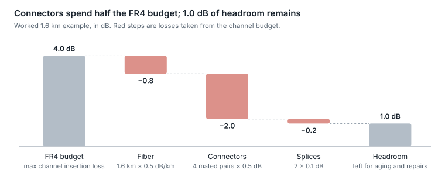
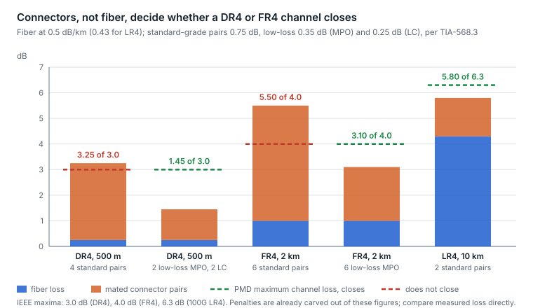

# 14. Link budgets made intuitive

A grey link closes when the weakest legal transmitter, minus every loss and penalty on the path, still lands above the weakest legal receiver's sensitivity, with margin left for aging and repairs. IEEE packages this as one number per PMD, the maximum channel insertion loss, so in practice the question is: does my measured or estimated path loss fit under it?

## The budget in one line

```math
\text{Margin} = P_{\text{Tx,min}} - \text{Sensitivity}_{\text{Rx}} - (\text{fiber loss} + \text{connector loss} + \text{splice loss}) - \text{penalties}
```

- **Fiber loss** = length × attenuation (about 0.4–0.5 dB/km in the O-band for budgeting; 3.5 dB/km at 850 nm on multimode).
- **Connector loss** = number of mated pairs × per-pair loss (budget 0.75 dB per standard-grade mated pair of any type (TIA-568.3), about 0.35 dB for low-loss MPO and 0.25 dB for low-loss LC; IEEE's channel figures assume 0.5 dB averages).
- **Penalties** = dispersion, reflections, transmitter quality (TDECQ) allowances, carved out of IEEE's power budget before the channel-loss figure is set, so never subtract them again when comparing a measured loss with that figure.
- **Overload** is the other edge: too much power saturates the receiver. Check the data sheet's overload and damage thresholds: IEEE DR, FR and LR modules are specified for a 0 dB channel, so a back-to-back loop is in spec; attenuators are for ER- and ZR-class optics, APD or SOA receivers and amplified links.

## Worked example: a 2 km 400G FR4 link

<p align="center"><picture>
  <source media="(prefers-color-scheme: dark)" srcset="../figures/fig-55-dark.svg">
  
</picture></p>

*Figure 14.1 — 400GBASE-FR4 worked example · assumptions under each step*

The lesson: at data-center distances, connectors, not fiber, consume the budget. Each extra patch-panel hop costs as much as a kilometer of fiber. A dirty connector can add several dB on its own, which is how a 1 dB-headroom link becomes an errored one.

## Measuring the real loss

- **Best:** an optical loss test set (light source and power meter) at turn-up.
- **Good enough to trend:** near-end Tx power minus far-end Rx power from DOM, lane by lane. Treat absolute values as ± a couple of dB, but trust changes over time and differences between lanes.
- **A single bad lane on a parallel optic** almost always means one dirty or damaged fiber position in an MPO, not a fiber-wide problem.

## Worked budgets: standard-grade against low-loss plant

The FR4 example above counts hops. This one puts the current TIA-568.3 grades to the three most common single-mode links, because connector grade is the difference between a design that closes and one that does not.

| Component | Standard grade | Low-loss hardware |
| --- | --- | --- |
| LC or SC mated pair | 0.75 dB maximum (TIA-568.3) | 0.25 dB typical maximum (vendor) |
| MPO mated pair | 0.75 dB maximum | 0.35 dB typical maximum |
| Fusion splice | 0.3 dB (budget) | 0.1 dB or less |
| OS2 fiber at 1310 nm | 0.5 dB/km planning, 0.35 typical | same |

- **400GBASE-DR4 over 500 m (3.0 dB allowed).** Fiber 500 m × 0.5 = 0.25 dB. A typical structured path has four mated MPO pairs (two patch panels, each with a jumper on both sides): at 0.75 dB that is 3.0 dB, 3.25 dB in total, over budget before anything is dirty. With low-loss hardware (two MPO pairs at 0.35 and two LC pairs at 0.25 through a breakout cassette) connectors cost 1.2 dB and the total is 1.45 dB: 1.55 dB of margin.
- **400GBASE-FR4 over 2 km (4.0 dB allowed).** Fiber 1.0 dB. Six mated pairs across two buildings' panels at 0.75 dB is 4.5 dB, 5.5 dB in total: it does not close. The same path with low-loss hardware (6 × 0.35 = 2.1 dB) totals 3.1 dB, with 0.9 dB to spare.
- **100GBASE-LR4 over 10 km (6.3 dB allowed).** At the 0.5 dB/km planning figure the fiber alone is 5.0 dB and two standard pairs make 6.5 dB, which does not close on paper; at a measured 0.43 dB/km it is 4.3 + 1.5 = 5.8 dB, which does. LR links are the one place where fiber, not connectors, dominates, and where the optical loss test, not the planning number, decides.

<p align="center"><picture>
  <source media="(prefers-color-scheme: dark)" srcset="../figures/fig-56-dark.svg">
  
</picture></p>

*Figure 14.2 — computed in this subsection from TIA-568.3 grades and IEEE maximum channel loss · five link cases*

**The rules that fall out.**

1. Count mated pairs first, then fiber. At DR and FR distances each standard-grade pair costs as much as 1.5 km of fiber.
2. Specify low-loss hardware for any 400G-and-up single-mode path that crosses more than two panels; it is cheaper than the margin it buys back.
3. IEEE's power budget already sets aside the dispersion, reflection and transmitter penalties for the PMD's reach (FR4: 7.8 dB budget, 3.8 dB of penalties); what is left, the maximum channel insertion loss, is what a measured loss is compared with directly, and adding penalties again double-counts. The 0 dB case is covered too: DR, FR and LR optics are specified to work back to back, so an attenuator is needed only for ER, ZR and amplified links.
4. Keep about 1 dB for aging and repair: a field splice after a cut adds 0.1–0.3 dB, and connector end-faces degrade with every mating cycle.
5. Multimode budgets are tighter than they look: 100 m of OM4 at 3.0 dB/km is only 0.3 dB, but the 1.8–1.9 dB budget must hold two pairs at 0.75 dB and still leave room for the modal-bandwidth penalty, which is why MMF structured cabling at 100G per lane is practically limited to two connections.

Sources: [channel loss and penalty allocations](https://grouper.ieee.org/groups/802/3/cu/public/cu_adhoc/cu_archive/cole_3cu_adhoc_050520_v4.pdf), [link-loss planning values](https://cablinginstall.com/testing/article/16469478/determining-optical-fiber-link-loss), [TIA-568.3 connector and splice values](https://my.fluke.com/en-us/article/KA-05286).

## The coherent version: an OSNR budget

Amplified coherent links are rarely limited by received power, because amplifiers restore it. They are limited by accumulated noise. The budget becomes: delivered OSNR (set by span count, span loss, amplifier noise figure and launch power) must exceed the transceiver's required OSNR plus penalties for filtering through ROADMs, nonlinearity and aging. Two intuitions carry most of it:

- Doubling the number of identical spans costs about 3 dB of OSNR.
- Raising launch power improves OSNR until fiber nonlinearity starts adding its own noise, so there is an optimum launch power, not a "more is better".

The link-budget instrument in Optics Bench lets you move each of these numbers and watch the headroom respond.

**A coherent budget in numbers.** For N identical spans, each amplifier adding noise set by its noise figure (NF) and the span loss it makes up,

```math
\text{OSNR}_{\text{dB}} \approx 58 + P_{\text{launch,dBm}} - L_{\text{span,dB}} - \text{NF}_{\text{dB}} - 10\log_{10} N
```

where 58 dB is the quantum ASE constant: the noise an ideal amplifier chain adds, hν × 12.5 GHz = −58 dBm in the 0.1 nm reference bandwidth at 1550 nm. Two cases. A single amplified 120 km span for 400ZR, with +1 dBm per channel launched by the booster, 0.2 dB/km plus 1 dB for connectors (25 dB) and a 5 dB preamplifier noise figure: 58 + 1 − 25 − 5 = 29 dB against the 26 dB a 400ZR receiver requires, 3 dB of margin before ROADM filtering (1–2 dB) and aging; the module's ±2,400 ps/nm dispersion tolerance caps it near 140 km in any case. The same arithmetic for eight 80 km spans (640 km and about 10,900 ps/nm, inside a 400G OpenZR+ module's 12,000 ps/nm): 58 + 1 − 17 − 5 − 9 = 28 dB against about 23.5 dB required with oFEC, 4.5 dB of margin, and a tenth span would cost another 1 dB before the dispersion limit is reached ([one module's published OSNR and dispersion tolerances](https://www.precisionot.com/wp-content/uploads/PRE-QSFP56DD-ZRPHT-Datasheet-5.0.pdf)). Doubling the span count costs 3 dB; raising launch power to +4 dBm buys 3 dB back, until nonlinear noise ([section 26](26-long-haul-coherent-transmission-how-it.md)) takes it away again.


---

[← 13. Troubleshooting and operations](13-troubleshooting-and-operations.md) · [Contents](../README.md#contents) · [15. Selection framework →](15-selection-framework.md)
