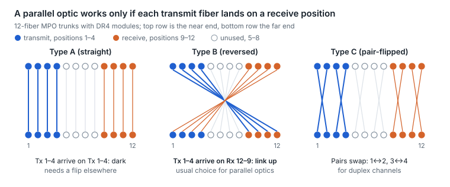
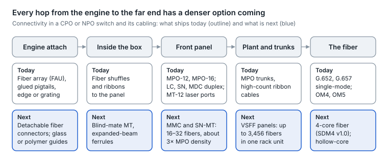
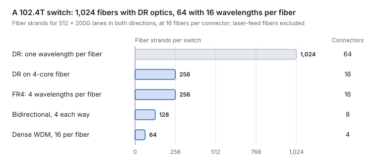

# 16. Fiber plant design

In an AI data center the fiber plant is a product in its own right: tens of thousands of MPO links whose polarity, bend radius, connector count and cleanliness decide whether the optics work on day one. One fiber maker estimates AI data centers need more than 10× the fiber of traditional ones ([Corning](https://www.corning.com/worldwide/en/the-progress-report/crystal-clear/optical-fiber-makes-artificial-intelligence-possible)).

## Topologies

- **Direct patch.** Module to module with one cable. Fewest connectors and lowest loss, but it does not scale and is hard to change.
- **Structured cabling.** Permanent MPO trunks between rows, ending in patch panels or cassettes, with short patch cords to the equipment. Every panel adds mated pairs, which spend the link budget ([section 14](14-link-budgets-made-intuitive.md)).
- **Interconnect vs cross-connect.** An interconnect patches equipment directly to the trunk; a cross-connect adds a second panel so moves happen without touching the trunk, at the cost of more connectors.
- **Breakout at the panel.** Cassettes or harnesses split MPO trunks into duplex LC or VSFF ports, which is how DR4 and DR8 breakouts are usually built ([section 6](06-grey-im-dd-optics.md)).

## MPO polarity: making transmit meet receive

<picture>
  <source media="(prefers-color-scheme: dark)" srcset="../figures/fig-57-dark.svg">
  
</picture>

*Figure 16.1 — MPO trunk polarity types · 12-fiber, DR4 positions*

- **Type A trunk (straight).** Position 1 lands on position 1; keys run up-to-down.
- **Type B trunk (reversed).** Position 1 lands on position 12; keys run up-to-up. This is the natural fit for parallel optics: a DR4's transmit fibers 1–4 arrive on the far module's receive fibers 9–12.
- **Type C trunk (pair-flipped).** Each adjacent pair swaps (1↔2, 3↔4 ...); used for duplex channels.
- **Methods A, B and C (TIA-568)** combine a trunk type with matching patch cords so that every duplex or parallel channel crosses over exactly once. Mixing trunk types or patch cords within a channel is the most common cause of a parallel link with every lane dark.
- **MPO-16** has an offset key so it cannot mate with MPO-12, and single-mode parallel links use angled (APC) ferrules ([section 6](06-grey-im-dd-optics.md)).

## Bend-insensitive fiber

ITU-T G.657 defines single-mode fibers that tolerate tight bends, which matters in dense trays and cassettes.

| Category | Minimum bend radius | Works with standard G.652.D fiber |
| --- | --- | --- |
| G.657.A1 | 10 mm | Yes |
| G.657.A2 | 7.5 mm | Yes |
| G.657.B2 (merged into A2 in the 2024 edition) | 7.5 mm | No |
| G.657.B3 | 5 mm | No |

Figures from a secondary summary of the recommendation ([source](https://samm.com/?p=4317)).

## Fiber density for AI clusters

- **Rollable ribbon cables** pack fibers loosely bonded in ribbons that fold into round cables: one maker offers 1,728 fibers in a 1.25-inch duct, 3,456 in 1.5-inch and 6,912 in 2-inch ([FlexRibbon](https://www.prysmian.com/en/markets/digital-solutions/telecom-networks/focus-on/flexribbontm)).
- **Thinner fiber.** 200 µm-coated fiber (vs the classic 250 µm) raises the count a conduit can hold by about 1.5× from the coating alone, up to 2× combined with rollable ribbon, and 160 µm is next ([analysis](https://www.sdxcentral.com/opinions/from-250-to-160-microns-why-fiber-diameter-is-becoming-a-critical-variable-in-ai-infrastructure-planning/)).
- **Multi-core fiber** multiplies count again without more strands ([section 17](17-fiber-frontiers-hollow-core-multi-core-and.md)).

## Cleanliness and records at scale

- Inspect every end face before connecting, including new patch cords out of the bag; MPO end faces need MPO-specific cleaners and scopes.
- Keep dust caps on every unused port and connector.
- Record for every link: trunk ID, trunk type and polarity method, panel positions, and turn-up loss test results. Those records turn a two-hour hunt into a two-minute lookup, and they seed the telemetry baselines in [section 24](24-fleet-telemetry-and-predictive-analytics.md).

## Fiber connectivity: today and next

AI fabrics multiply fiber. A 102.4 Tb/s switch with DR-type optics terminates over a thousand fibers, and CPO and NPO move the first connector from the module's face to the chip itself. Every hop from the engine to the far end now has a denser option on the way.

<picture>
  <source media="(prefers-color-scheme: dark)" srcset="../figures/fig-58-dark.svg">
  
</picture>

*Figure 16.2 — fiber connectivity · today and next, engine to far end*

**In use today**

| Connector or method | Fibers | Where it is used | Notes |
| --- | --- | --- | --- |
| LC duplex | 2 | Duplex pluggables (FR4, LR4) and patching | The long-time baseline |
| VSFF duplex (SN, MDC, CS) | 2 | Breakouts and dense patch panels | Several duplex ports in one LC's space |
| MPO-12 and MPO-16 | 12 or 16 | Parallel optics (DR4, DR8, SR8) and trunks | MPO-16 matches 8-lane modules; polarity matters (above) |
| MT-12 laser port | 12 (8 used) | External laser modules (ELSFP) | Polarization-maintaining fiber |
| Fiber array unit pigtails | Tens to hundreds | CPO and NPO engines | Bonded at the factory; edge or grating coupled ([section 25](25-silicon-photonics-and-optical-engines.md)) |
| High-fiber-count ribbon cable | Hundreds to thousands | Building and campus trunks | Pre-terminated or fusion-spliced |

**What is coming**

| Option | What it changes | Status, October 2026 |
| --- | --- | --- |
| MMC (TMT ferrule) | 16–32 fibers in about half an MPO's size, up to 3× MPO density, 250 µm pitch; an expanded-beam version mates blind and tolerates debris | Shipping from several suppliers, aimed at AI rows, NPO and CPO |
| SN-MT | 8 or 16 fibers in the SN duplex footprint, 2.7× the density of a 16-fiber MPO; up to 3,456 fibers in a 1RU panel, 64 fibers into an OSFP or QSFP-DD | New; target specifications; aimed at 800G, 1.6T and CPO |
| Detachable fiber-to-chip connectors | Replace glued pigtails so the engine and its fibers can be serviced separately; an edge-coupled glass-waveguide design was shown in September 2025, with a vertically coupled version in development | Demonstrations |
| Polymer waveguides on the package | 50 µm-pitch waveguides, with sub-20 µm in test, fit about six times as many fibers at a photonic chip's edge | Research prototype that passed stress tests (December 2024) |
| Bidirectional single fiber | Both directions on one fiber halve the fiber count | OCI MSA specification v1.0 ([section 27](27-standards-and-ecosystem-map.md)) |
| Multi-core fiber | Four cores per strand and per connector | SDM4 MSA v1.0, September 2026 ([section 17](17-fiber-frontiers-hollow-core-multi-core-and.md)) |
| Hollow-core fiber | Lower latency; needs its own connectors and splicing | Early hyperscale production ([section 17](17-fiber-frontiers-hollow-core-multi-core-and.md)) |

<picture>
  <source media="(prefers-color-scheme: dark)" srcset="../figures/fig-59-dark.svg">
  
</picture>

*Figure 16.3 — fibers per 102.4T switch · by optics type*

Connectors shrink the panel; wavelengths and cores shrink the fiber count. Moving from DR to 16 wavelengths per fiber cuts the strands for one switch from 1,024 to 64.

**AI networks: pros and cons**

| Option | Pros in an AI fabric | Cons in an AI fabric | Best fit |
| --- | --- | --- | --- |
| MPO-12 and MPO-16 | Mature and multi-vendor; every test and cleaning tool supports them | Large footprint; polarity and end-face cleaning at scale; limits panel density | Today's pluggable fabrics |
| VSFF multi-fiber (MMC, SN-MT) | About 2.7–3× MPO density; more fibers into modules and panels | Newer ecosystem with less mature test, inspection and cleaning tooling; two competing families | Dense AI rows, and NPO and CPO front panels |
| Detachable fiber-to-chip | Engine and fiber serviced separately; better assembly yield | Adds a connector's loss and contamination risk right at the chip | Next-generation CPO and NPO engines |
| Fewer fibers through WDM or bidirectional optics | 4–16× fewer fibers and connectors to clean | Mux loss, more lasers or wavelength-specific parts, no lane-level breakout | Fiber-scarce links and scale-up optical I/O |
| Multi-core or hollow-core fiber | Four cores per strand, or lower latency | New connectors, splicing, fan-outs and test methods | Duct-limited campuses; latency-bound training sites |

**Bottom line.** A dense AI row needs both levers: VSFF multi-fiber connectors at the panel today, and WDM, bidirectional or multi-core links as fiber counts grow with every switch generation.

Sources: [MMC connectors](https://www.corning.com/data-center/worldwide/en/home/solutions/mmc-connectors.html), [SN-MT connector](https://www.senko.com/product/sn-mt-connector/), [8-laser ELSFP datasheet](https://resource.naddod.com/files/2026-09-03/elsfp-mt12-8l-datasheet-018021.pdf), [detachable glass-waveguide connector](https://gf.com/?p=7246), [polymer waveguide CPO](https://optica-opn.org/home/industry/2024/december/ibm_announces_co-packaged_optics_to_turbocharge_ai). Fiber counts are arithmetic for 512 × 200G lanes.

---

[← 15. Selection framework](15-selection-framework.md) · [Contents](../README.md#contents) · [17. Fiber frontiers: hollow-core, multi-core and few-mode →](17-fiber-frontiers-hollow-core-multi-core-and.md)
