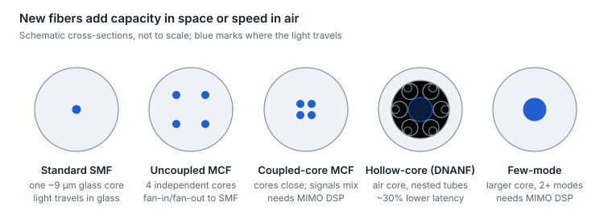

# 17. Fiber frontiers: hollow-core, multi-core and few-mode

Two new fiber types have left the lab. Hollow-core fiber guides light through air, cutting latency by roughly 30% while losing less light than glass. Multi-core fiber puts several cores in one standard-size strand, multiplying capacity per duct. Few-mode fiber remains mostly in research.

<picture>
  <source media="(prefers-color-scheme: dark)" srcset="../figures/fig-60-dark.svg">
  
</picture>

*Figure 17.1 — fiber cross-sections · schematic, not to scale*

## Hollow-core fiber (HCF)

**How it works.** The core is air. Thin glass membranes around it (nested antiresonant nodeless designs, NANF, and double-nested DNANF) reflect light back into the core by anti-resonance rather than total internal reflection, so almost none of the light travels in glass.

| Property | Standard SMF (G.652) | Hollow-core (DNANF) |
| --- | --- | --- |
| Propagation delay | \~4.9 µs/km (group index \~1.47) | \~3.3–3.4 µs/km (group index \~1.003) |
| Best reported loss | \~0.14 dB/km (record silica) | 0.091 dB/km at 1550 nm (2025 record) |
| Low-loss window | O to L bands with care | Under 0.2 dB/km across 1250–1730 nm |
| Chromatic dispersion at 1550 nm | \~17 ps/nm/km | \~2–4 ps/nm/km |
| Nonlinearity | Reference | Roughly 1,000× lower |
| Delay change with temperature | \~40 ps/km/K | \~2 ps/km/K |

Sources: [Nature Photonics, Sep 2025](https://www.nature.com/articles/s41566-025-01747-5), [coverage](https://physicsworld.com/a/new-hollow-core-fibres-break-a-40-year-limit-on-light-transmission/), [2026 review preprint](https://arxiv.org/abs/2606.23511) (not peer-reviewed; the dispersion, nonlinearity and thermal figures come from it). Headlines quote latency savings from 30% to 47% depending on how they are expressed; \~30% lower latency is the conservative figure.

**Why data centers care.**

- **Latency is distance.** At the same latency budget, HCF reaches about 45% farther, so AI campuses linked by HCF can sit farther apart and still behave like one cluster.
- **Stable delay.** Low thermal sensitivity keeps timing stable, which helps time distribution ([section 20](20-latency-and-timing.md)).
- **Wide, low-loss spectrum and low nonlinearity** leave room for more wavelengths and higher launch power.

**Deployment status (October 2026).**

- One hyperscaler reported 1,280 km of HCF carrying live traffic by September 2025, including hybrid cables with 32 hollow-core and 48 standard fibers between two data centers, and has announced a 15,000 km rollout supported by multiple fiber manufacturers ([IEEE Spectrum](https://spectrum.ieee.org/amp/hollow-core-fiber-2673997778), [rollout](https://fiberbroadband.org/2026/04/02/microsoft-scales-up-hollow-core-fiber-production/)).
- Other cloud and telecom deployments are reported in secondary sources.
- In July 2026 ITU-T Study Group 15 opened a work item for a technical report, "Hollow-core fibre technologies and systems", and liaised IEC SC86A; no Recommendation is in progress yet ([SG15 summary](https://www.itu.int/en/ITU-T/studygroups/2025-2028/15/Pages/exec_sum_2026-07.aspx)).

**What is still hard.** HCF needs its own connectors, splicers and test methods; every hollow-to-solid transition costs loss and must keep reflections very low; and production volume and cost are still scaling.

## Multi-core fiber (MCF)

- **Uncoupled MCF.** Each core is an independent fiber, spaced far enough apart that crosstalk is negligible. Standard transceivers attach through fan-in/fan-out devices or MCF-aware connectors. A 4-core fiber in the standard 125 µm cladding fits existing cable and connector dimensions; one 2023 result reached 0.155 dB/km with crosstalk below −60 dB per 100 km ([result](https://lightera.com/?p=1010783)).
- **Coupled-core MCF.** Cores sit close enough to couple, which improves density and lowers some impairments but requires MIMO DSP at the receiver, as in coherent systems.
- **Where it is deployed.** Subsea adoption began with a 2023 commitment to use two-core MCF on a trans-Pacific system; the first at-scale MCF transatlantic cable (24 pairs of two-core fiber) was announced in September 2026 for 2029 service ([announcement](https://cloud.google.com/blog/products/infrastructure/delivering-multi-core-fiber-technology-in-subsea-cables/)). In March 2026 four companies formed the SDM4 MSA to standardize 4-core fiber for short-reach O-band links inside and between AI data centers ([MSA](https://www.cablinginstall.com/data-center/press-release/55365671/corning-afl-sumitomo-and-terahop-form-msa-to-standardize-multicore-fiber-for-data-center-interconnects)); its v1.0 specification followed in September 2026, and in July 2026 ITU-T SG15 extended its G.650.1 revision to weakly coupled MCF geometry, with new WC-MCF Recommendations and test methods planned.
- **Why data centers care.** A 4-core fiber carries four times the links in the same strand and duct space, which attacks the fiber-count problem in [section 16](16-fiber-plant-design.md).

## Few-mode fiber and space-division multiplexing

Few-mode fiber carries several spatial modes in one larger core, each as a separate channel. Modes mix as they travel, so receivers need MIMO DSP to unscramble them. As of 2026 it lives in research and field testbeds rather than production networks ([testbed](https://www.vde-verlag.de/proceedings-en/456426093.html)). Space-division multiplexing (SDM) is the umbrella term for adding capacity in space (more cores or modes) rather than in wavelength or modulation.

## Comparison

| Fiber | What it improves | What it needs | Status, Oct 2026 |
| --- | --- | --- | --- |
| Standard SMF (G.652/G.657) | Baseline | Nothing new | Universal |
| Hollow-core | Latency, loss, nonlinearity, spectrum | New connectors, splicing, test methods | Early hyperscale production; ITU-T technical report in development |
| Uncoupled MCF | Capacity per strand and per duct | Fan-in/fan-out or MCF connectors | Subsea and early data-center use; MSA and ITU-T work started |
| Coupled-core MCF | Density, impairment averaging | MIMO DSP | Research and trials |
| Few-mode | Capacity per core | MIMO DSP, mode-matched components | Research and testbeds |

## AI networks: pros and cons

| Option | Pros in an AI fabric | Cons in an AI fabric | Best fit |
| --- | --- | --- | --- |
| Standard single-mode fiber | Universal and cheap; every connector, splice and test tool works | Light travels about 30% slower than in hollow-core, which limits how far apart sites can sit for synchronous training | Everything inside a building, and most links between buildings |
| Hollow-core fiber | About 30% lower latency per km, so sites can sit about 45% farther apart for the same latency budget; very low nonlinearity and a wide low-loss spectrum | New connectors, splicing and test methods; few suppliers; higher cost; early production | Multi-building or multi-site training clusters where the latency budget binds |
| Multi-core fiber (4-core) | Four cores per strand and per connector, easing duct and tray congestion; SDM4 MSA v1.0 published in September 2026 | Fan-in and fan-out devices, new connectors and an immature test ecosystem | Dense AI campuses where duct space, not distance, is the limit |

**Bottom line.** Hollow-core buys distance for latency-bound training, multi-core buys density for space-bound campuses, and standard single-mode fiber remains the answer everywhere else.

---

[← 16. Fiber plant design](16-fiber-plant-design.md) · [Contents](../README.md#contents) · [18. Advanced coherent and DCI →](18-advanced-coherent-and-dci.md)
