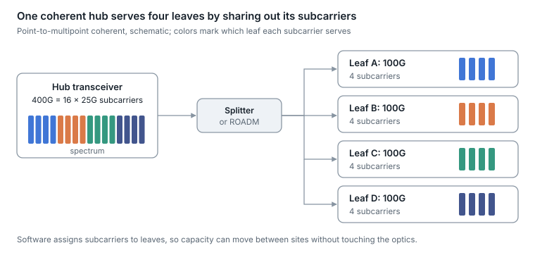

# 18. Advanced coherent and DCI

Beyond point-to-point ZR links, three ideas stretch coherent optics further: splitting one transceiver into independently routed subcarriers, using more of the fiber's spectrum, and managing transceivers and line systems through open data models.

## Point-to-multipoint coherent with digital subcarriers

<p align="center"><picture>
  <source media="(prefers-color-scheme: dark)" srcset="../figures/fig-61-dark.svg">
  
</picture></p>

*Figure 18.1 — point-to-multipoint coherent · schematic*

A coherent DSP can build its signal from many narrow Nyquist subcarriers instead of one wide carrier. If each subcarrier can be routed separately, one hub transceiver (for example 400G as 16 × 25G) can talk to several smaller leaf transceivers at once (for example four 100G leaves with four subcarriers each), over a passive splitter or a ROADM ([concept](https://convergedigest.com/infinera-announces-xr-optics/)).

- **Why it matters.** Metro and aggregation networks are hub-and-spoke by nature. Point-to-multipoint optics replace the intermediate aggregation boxes that would otherwise terminate many 100G links at the hub, and capacity can be re-assigned between leaves by software.
- **Status.** The Open XR Optics Forum publishes interoperable specifications: 400G first, then in September 2025 100G specifications for bidirectional single-fiber point-to-point, dual-fiber point-to-multipoint, and an overlay on passive optical networks ([forum update](https://convergedigest.com/ecoc25-open-xr-optics-forum-adds-100g-and-bidi-specs/)). Multiple vendors offer pluggables that support both modes; large-scale deployment is still emerging.

## More spectrum: C, Super C, L and beyond

| Band | Approximate usable width | Status |
| --- | --- | --- |
| Standard C (1530–1565 nm, 4.4 THz) | \~4 THz | Universal |
| Extended C | \~4.8 THz | Common in modern line systems |
| "Super C" | \~6 THz | Vendor-specific extension |
| C+L | \~10–12 THz | Deployed on long-haul and high-capacity DCI; L-band coherent pluggables sampling since 2025 |
| S+C+L and wider | 15.6 THz demonstrated; 37.6 THz across O to U bands in research | Research |

Sources: [band widths](https://www.lightreading.com/cable-technology/supersizing-the-c-band), [L-band ZR+ pluggables](https://www.businesswire.com/news/home/20250401570402/en), [S+C+L result](https://arxiv.org/abs/2407.12485), [O–U band result](https://www.nict.go.jp/en/press/2024/06/26-1.html).

Adding the L band roughly doubles capacity per fiber pair without new fiber, at the cost of L-band amplifiers, filters and transceivers. Bands beyond C+L need new amplifier types (for example thulium-doped amplifiers for the S band) and are not yet in deployed systems.

## Managing coherent optics and line systems with open models

When coherent pluggables live in routers (IP over DWDM), the optical layer is configured and monitored through the router's management interface. Two open model families do this:

- **OpenConfig.** `openconfig-terminal-device` and `openconfig-platform-transceiver` cover the transceiver; `openconfig-optical-amplifier` and `openconfig-wavelength-router` cover amplifiers and ROADMs.
- **Open ROADM MSA.** Common device, network and service models for multi-vendor ROADM networks; release 19.1.0 was published in July 2026 ([repository](https://github.com/OpenROADM/OpenROADM_MSA_Public)).

Example OpenConfig telemetry for a coherent link ([schema docs](https://openconfig.net/projects/models/schemadocs/yangdoc/openconfig-terminal-device.html)):

```
/components/component/optical-channel/state/frequency
/components/component/optical-channel/state/target-output-power
/components/component/optical-channel/state/chromatic-dispersion
/components/component/optical-channel/state/osnr
/terminal-device/logical-channels/channel/otn/state/pre-fec-ber/instant
/terminal-device/logical-channels/channel/otn/state/q-value
/terminal-device/logical-channels/channel/otn/state/esnr
/optical-amplifier/amplifiers/amplifier/state/actual-gain
```

These paths turn [section 8](08-coherent-optics-and-dci.md)'s physics into numbers you can trend: estimated CD tells you the fiber length the DSP sees, OSNR and ESNR show margin, and Q-factor and pre-FEC BER show how close the link sits to its FEC threshold.


---

[← 17. Fiber frontiers: hollow-core, multi-core and few-mode](17-fiber-frontiers-hollow-core-multi-core-and.md) · [Contents](../README.md#contents) · [19. Optical circuit switching →](19-optical-circuit-switching.md)
