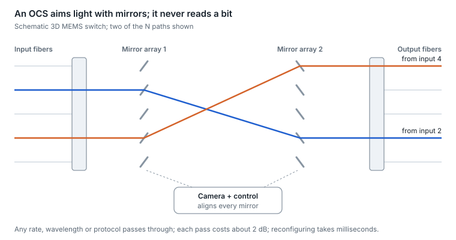

# 19. Optical circuit switching

An optical circuit switch (OCS) steers light from any input fiber to any output fiber with tilting mirrors or liquid crystals. It never looks at packets, so it carries any data rate, wavelength or protocol at very low power. The trade is speed: it reconfigures in milliseconds, so it rewires topology rather than forwarding traffic.

<picture>
  <source media="(prefers-color-scheme: dark)" srcset="../figures/fig-62-dark.svg">
  
</picture>

*Figure 19.1 — MEMS optical circuit switch · schematic*

## How a MEMS OCS works

The best-documented example is a 136 × 136 switch built from two arrays of 2D MEMS mirrors. Light from each input fiber hits a mirror in the first array, which tilts on two axes to aim it at a mirror in the second array, which aims it into the chosen output fiber. A camera watches the beams so one control loop can align every mirror. Insertion loss is typically under 2 dB, and return loss is typically −46 dB ([Apollo paper](https://arxiv.org/abs/2208.10041)).

## Why AI and cloud fabrics use OCS

- **Rate-agnostic.** The same switches have carried four generations of optics, 40G through 400G, because a mirror does not care what the light encodes.
- **Replace the spine.** One hyperscaler replaced its spine layer with OCS-connected aggregation blocks and reported about 30% lower capex and 41% lower power ([Jupiter paper](https://research.google/pubs/jupiter-evolving-transforming-googles-datacenter-network-via-optical-circuit-switches-and-software-defined-networking/)).
- **Reconfigurable topology.** A 4,096-chip AI system uses OCS to rewire its interconnect into the shape each job needs (for example a twisted 3D torus) and to route around failed hosts, with OCS and optics under 5% of system cost and under 3% of system power ([TPU v4 paper](https://arxiv.org/abs/2304.01433)).

## What OCS demands of the optics

- **Extra loss budget.** Every pass through the switch costs a couple of dB. Transceivers tuned for OCS links absorb up to 3 dB of extra loss while keeping 2 km or 6 km reach ([OCS optics](https://www.coherent.com/news/press-releases/optical-transceivers-for-optical-circuit-switch-applications)).
- **Circulators and bidirectional links.** A circulator lets transmit and receive share one fiber, roughly halving the switch ports and fibers needed per link.
- **WDM transceivers.** Multi-wavelength optics (CWDM4-class) put more bandwidth through each switch port than parallel optics would.
- **Low reflections and fast re-link.** Reflections from the switch path add MPI noise, and every reconfiguration forces the link to retrain, so CDR lock and link bring-up time become part of the design.

## Technologies and market

| Technology | How it switches | Notes |
| --- | --- | --- |
| 3D MEMS mirrors | Tilting micro-mirrors | Most deployed; 300 × 300 products announced for AI clusters |
| Liquid crystal | Polarization steering, no moving parts | 300 × 300 product announced in 2024 |
| Piezoelectric beam steering | Actuated collimators | Specialist products |
| Robotic patch panel | A robot moves fiber connectors | Slow; for automation and reconfiguration, not dynamic switching |
| Silicon photonics | On-chip switch matrices | Emerging |

One analyst firm forecast a $2.5B OCS market by 2029 in December 2025 and raised that outlook by more than 40% in February 2026, but notes that outside one hyperscaler, OCS was still at proof-of-concept and trial stage in early 2026 ([forecast](https://www.fibre-systems.com/article/ai-drives-ocs-market-forecast-surge-25bn), [update](https://cignal.ai/2026/02/googles-ai-buildout-drives-higher-optical-circuit-switching-forecast/)). Demonstrations at OFC 2026 paired 300 × 300 MEMS switches with standard optics for AI scale-up networks.

## AI networks: pros and cons

| Option | Pros in an AI fabric | Cons in an AI fabric | Best fit |
| --- | --- | --- | --- |
| OCS layer in place of the electrical spine | About 30% lower capex and 41% lower power in one hyperscaler's fabric; rate-agnostic, so it survives optics upgrades; rewires topology per job and routes around failed hosts | Reconfigures in milliseconds, so it cannot switch packets; insertion loss eats optical budget and needs optics built for it; still at trial stage outside one hyperscaler in early 2026; needs SDN control and planning | Large single-operator AI fabrics with predictable, job-shaped traffic |
| Electrical packet spine | Per-packet load balancing and any-to-any connectivity; standard operations and tooling | Power and optics for every spine port; upgraded with each lane-rate generation | The default, and multi-tenant or general-purpose fabrics |

**Bottom line.** OCS pays off for operators who control the whole stack and can schedule topology around jobs; everyone else keeps a packet spine and watches the trials.

---

[← 18. Advanced coherent and DCI](18-advanced-coherent-and-dci.md) · [Contents](../README.md#contents) · [20. Latency and timing →](20-latency-and-timing.md)
