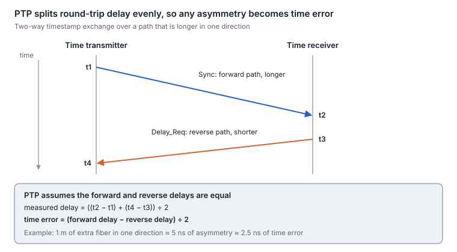

# 20. Latency and timing

Optics add latency in two ways: propagation, about 5 ns per meter of standard fiber, and processing in FEC and DSPs, from a few ns (an inner code) through about 100 ns (KP4) to microseconds (coherent DSP plus soft-decision FEC). For time synchronization the problem is different: what matters is not how long the path is, but whether it is equally long in both directions.

## A latency budget

| Element | Added latency | Equivalent fiber |
| --- | --- | --- |
| Standard single-mode fiber | \~4.9–5 µs per km (\~5 ns per m) | — |
| Hollow-core fiber | \~3.3–3.4 µs per km | \~30% less than SMF |
| RS(544,514) KP4 FEC | \~100 ns | \~20 m |
| 802.3dj inner FEC with interleaver | \~15 ns | \~3 m |
| 800LR concatenated FEC | \~55 ns (end-to-end target under 300 ns) | \~11 m |
| PAM4 DSP in a retimed module | Not consistently published; LPO removes it | — |
| Coherent ZR-class DSP and soft-decision FEC | Well above IM-DD; check the module datasheet | — |

Sources: [KP4 latency](https://www.ieee802.org/3/dj/public/23_01/23_0206/wangz_3dj_01a_230206.pdf), [inner FEC latency](https://www.ieee802.org/3/dj/public/24_01/he_3dj_01_2401.pdf), [800LR](https://www.oiforum.com/wp-content/uploads/OFC2023_OIF_800ZR_800LR_Josef-Berger.pdf), [800LR target](https://www.ieee802.org/3/dj/public/23_05/williams_3dj_01a_2305.pdf).

Inside a data center, FEC and DSP latency can rival propagation: 100 ns of FEC equals 20 m of fiber. That is why AI scale-up fabrics, which are latency-sensitive and short, care about lighter FEC, LPO and CPO.

## Frequency and time over optics

- **SyncE (frequency).** Each link's transmit clock is traced to a reference, and the receiver locks to the clock it recovers from the line, passing frequency hop by hop. Quality levels travel in ESMC messages ([overview](https://documentation.nokia.com/srlinux/25-3/books/network-synchronization/synchronous-ethernet.html)).
- **PTP (IEEE 1588, time).** Two devices exchange timestamped messages in both directions and assume the forward and reverse delays are equal. Any difference, the asymmetry, appears as a time offset of half the asymmetry.

<picture>
  <source media="(prefers-color-scheme: dark)" srcset="../figures/fig-63-dark.svg">
  
</picture>

*Figure 20.1 — PTP two-way exchange · asymmetric path*

## Where asymmetry hides in optical links

| Source | Size of the effect |
| --- | --- |
| Length mismatch in a duplex fiber pair | \~2.5 ns of time error per meter of mismatch |
| BiDi optics (different wavelength each way) | 1310/1550 nm pairs: \~1.6–2.5 ns of delay difference per km |
| Module DSP and FEC | Transmit and receive latency can differ inside 50G-plus modules |
| Amplifiers and dispersion compensators | Can add hundreds of ns on long-haul paths |

Sources: [asymmetry figures](https://wsts.atis.org/wp-content/uploads/2025/04/6.-Challenges-of-Engineering-Optical-Networks-High-Accuracy-Karim-Traore.pdf), [module contributions](https://wsts.atis.org/wp-content/uploads/2025/05/WSTS25_HighSpeedInterfaces-Challenges_StefanoRuffini_FINAL.pdf).

For scale, the ITU-T G.8273.2 boundary-clock classes allow constant time error of 50 ns (class A), 20 ns (class B) and 10 ns (class C) ([summary](https://calnexsolutions.atlassian.net/wiki/spaces/GDW/pages/10027019/ITU-T+G.8273.2+T-BC+and+T-TSC+One-Page+Summary)). A 4-meter patch-cord mismatch alone uses the whole class C budget. Industry groups have proposed storing calibrated transmit and receive delays in module memory so hosts can compensate.

---

[← 19. Optical circuit switching](19-optical-circuit-switching.md) · [Contents](../README.md#contents) · [21. Link encryption and physical-layer security →](21-link-encryption-and-physical-layer-security.md)
