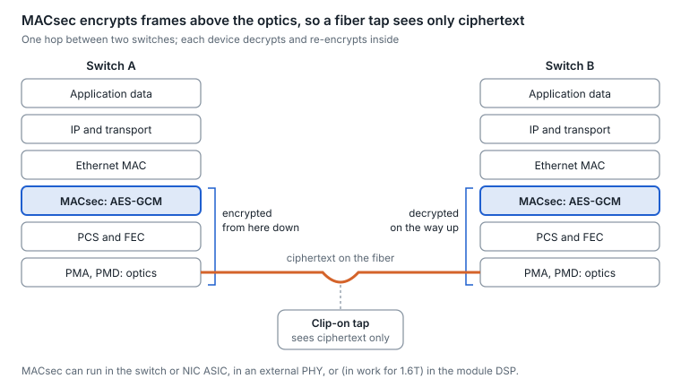

# 21. Link encryption and physical-layer security

MACsec encrypts and authenticates Ethernet frames hop by hop at line rate, protecting what crosses the fiber between two devices. It does not stop anyone from tapping the fiber; it makes what they capture useless.

<picture>
  <source media="(prefers-color-scheme: dark)" srcset="../figures/fig-64-dark.svg">
  
</picture>

*Figure 21.1 — MACsec in the Ethernet stack · one hop*

## MACsec in brief

- **Standard.** IEEE 802.1AE defines the frame protection; keys are negotiated by the MACsec Key Agreement protocol (MKA, part of IEEE 802.1X).
- **Ciphers.** AES-GCM with 128- or 256-bit keys. The extended packet number (XPN) suites raise the frame counter to 2⁶⁴ so high-rate links do not rekey every few seconds: with small frames a 32-bit packet number wraps in about 5 minutes at 10G, under 30 s at 100G and about 7 s at 400G ([802.1AEbw](https://1.ieee802.org/security/802-1aebw/)).
- **Overhead.** A security tag and an integrity check value add 24–32 bytes per frame: about 2% of goodput at 1,500-byte frames but 20–30% at minimum-size frames (a 64-byte frame occupies 84 bytes on the wire, 116 with MACsec), which is why MACsec-heavy fabrics care about average frame size.
- **Scope.** Hop by hop: each device decrypts, forwards and re-encrypts, so traffic is in clear inside each switch.

## Where encryption runs at 800G and 1.6T

| Location | How | Notes |
| --- | --- | --- |
| Switch or NIC ASIC | Inline MACsec engines on the ports | Simplest when the silicon supports line rate on every port |
| External PHY or retimer | MACsec in the PHY chip | A 1.6T PHY with 256-bit MACsec was announced in 2022 to offload the ASIC ([announcement](https://www.lightwaveonline.com/optical-tech/electronics/article/14287539/marvell-sampling-5-nm-alaska-c-x9340p-secure-16t-ethernet-phy)) |
| Pluggable module DSP | MACsec inside the optic | OIF launched a project in May 2026 to write a technical white paper on MACsec support in 1.6T pluggables, driven by hyperscalers deploying shallow-buffer switches at every tier ([OIF](https://www.businesswire.com/news/home/20260604899827/en/OIF-Q2-Meeting-Advances-Management-for-Path-Startup-Encryption-Near-Package-Optics-and-High-Density-Connector-Interfaces)) |
| Coherent DCI modules | AES-256-GCM in the coherent module | Used for data-center interconnect, including a 2025 QKD demonstration |

## Physical threats to the fiber

- **Tapping.** Bending a fiber tighter than its minimum bend radius leaks a little light, and a clip-on coupler can collect it without breaking the link. The victim sees only a small drop in received power.
- **Detection.** Watch for unexplained steps in per-lane Rx power on a stable link ([section 24](24-fleet-telemetry-and-predictive-analytics.md)), use OTDR or distributed fiber sensing to locate events, and keep physical security on panels and pathways. Research using machine learning on fiber-monitoring data flagged anomalies with about 97% F1 score, classified clip-on taps at about 98% accuracy and located them within about 0.2 m, on a laboratory testbed ([study](https://arxiv.org/pdf/2204.07059)).
- **Quantum key distribution (QKD).** Uses single photons to distribute keys with eavesdropping detection. A December 2025 demonstration ran QKD over 21.8 km of live commercial fiber between data centers, feeding AES-256-GCM encryption at 800G; it remains early-stage ([demo](https://quantumcomputingreport.com/quantum-corridor-and-toshiba-demonstrate-first-cross-state-qkd-over-live-commercial-fiber-network/)).

## AI networks: pros and cons

| Option | Pros in an AI fabric | Cons in an AI fabric | Best fit |
| --- | --- | --- | --- |
| Encrypt every hop (MACsec in switch and NIC silicon) | Protects against taps anywhere, including inside shared or colocated facilities; runs at line rate in current silicon | Adds power and some latency per port; key management across tens of thousands of links; not every switch supports it at full rate, which is why the OIF began a white paper on MACsec in 1.6T pluggables in May 2026 | Shared or colocated facilities, and regulated workloads |
| Encrypt only links that leave the building | Keeps cost, power and latency off the latency-sensitive back-end fabric while protecting the links most exposed to tapping | In-building fiber relies on physical security alone | Back-end fabrics inside a single, physically secure hall |

**Bottom line.** Encrypt wherever fiber leaves your physical control; inside a secure hall, weigh per-hop MACsec against its power, latency and key-management cost.

---

[← 20. Latency and timing](20-latency-and-timing.md) · [Contents](../README.md#contents) · [22. Test and measurement →](22-test-and-measurement.md)
