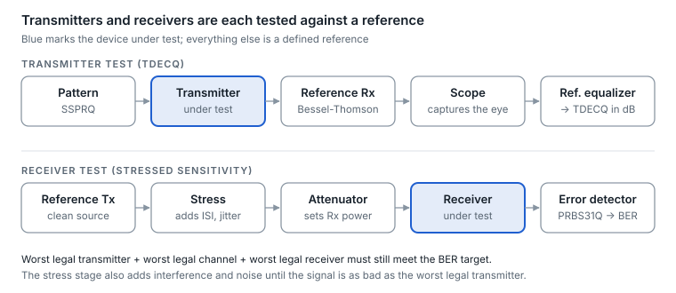
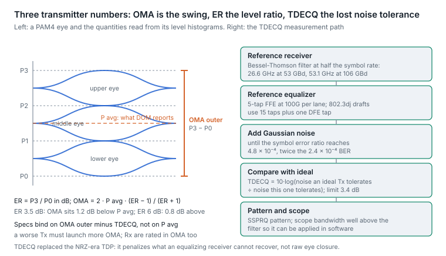
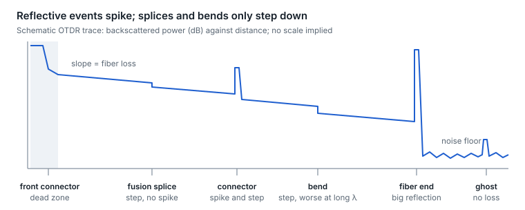

# 22. Test and measurement

Every number on an optics datasheet comes from a defined test: a specific pattern, reference receiver and reference equalizer. Knowing those definitions tells you what a spec promises and what it does not.

## Test patterns

| Pattern | Length | Used for |
| --- | --- | --- |
| PRBS7, PRBS9 | 127 / 511 bits | Quick NRZ checks, loopback tests |
| PRBS31 | 2³¹ − 1 bits | NRZ BER testing; long and stressful |
| PRBS13Q | 8,191 symbols | PAM4 checks; easy to capture, mild stress |
| PRBS31Q | 2³¹ − 1 symbols | PAM4 BER testing; stressful but too long to capture whole |
| SSPRQ | 65,535 symbols | PAM4 transmitter tests such as TDECQ; a short pattern built from PRBS31 segments to keep the stress |
| QPRBS13 | 31,096 bits | PAM4 backplane (Clause 94) testing |

Sources: [802.3bs pattern discussion](https://grouper.ieee.org/groups/802/3/bs/public/adhoc/logic/apr28_16/anslow_01_0416_logic.pdf), [pattern definitions](https://helpfiles.keysight.com/csg/d9300a/Help/Infiniium-UG/Content/Topics/Signals/Provided_PAM4_Pattern_Files.htm). PAM4 patterns are Gray-coded.

## Transmitter and receiver tests

<p align="center"><picture>
  <source media="(prefers-color-scheme: dark)" srcset="../figures/fig-65-dark.svg">
  
</picture></p>

*Figure 22.1 — transmitter and receiver test benches · simplified*

- **Transmitter (TDECQ).** The transmitter sends SSPRQ through a reference receiver (a 4th-order Bessel-Thomson filter) into a sampling scope, and software applies a reference equalizer, then adds Gaussian noise until the symbol error ratio reaches the target (4.8 × 10⁻⁴); TDECQ is the dB shortfall in tolerable noise against an ideal transmitter. At 100G per lane that equalizer is a 5-tap FFE; for 200G per lane, 802.3dj drafts use a 15-tap FFE, with later draft text adding one DFE tap ([200G reference equalizer](https://www.ieee802.org/3/dj/public/23_11/welch_3dj_02b_2311.pdf), [draft discussion](https://www.ieee802.org/3/dj/public/26_09/zivny_3dj_01_2609.pdf)).
- **Receiver (stressed receiver sensitivity).** A reference transmitter is deliberately impaired with ISI, jitter, interference and noise until its signal is as bad as the worst legal transmitter; the receiver under test must still reach the target BER ([concept](https://www.ieee802.org/3/cd/public/Jan18/schube_3cd_01a_0118.pdf)).
- **The pairing is the point.** A link is guaranteed because the worst legal transmitter, after the worst legal channel, still meets the worst legal receiver. A module that passes TDECQ with little margin may still work today, but it has spent margin the rest of the link was counting on.

## OMA, extinction ratio and TDECQ: reading a transmitter's numbers

Three numbers describe a PAM4 transmitter, and they are easy to confuse with the one DOM reports.

**Average power is what DOM reports; OMA is what the link needs.** A receiver decides on the swing between levels, not on the average. Outer optical modulation amplitude is the difference between the top and bottom levels, P3 − P0, and it relates to average power through the extinction ratio ER = P3 / P0:

```math
\text{OMA}_{\text{outer}} = 2\,P_{\text{avg}}\,\frac{\text{ER}-1}{\text{ER}+1}
```

At the IEEE single-mode minimum ER of 3.5 dB (3.0 dB for SR PAM4 optics) the OMA is 1.2 dB below the average power; at 6 dB it is 0.8 dB above it. Two modules showing the same DOM transmit power can therefore differ by 2 dB in the quantity the far receiver cares about, and a transmitter that passes on "Tx power" can fail on OMA, which is why every transmitter and receiver limit in the standard is written in OMA.

**TDECQ: the noise tolerance a transmitter gives away.** Transmitter and dispersion eye closure quaternary asks a precise question. Through a reference receiver (a fourth-order Bessel-Thomson filter at half the symbol rate: 26.6 GHz for 53 GBd, 53.1 GHz for 106 GBd) and a reference equalizer (a 5-tap FFE at 100G per lane; 15 taps plus one DFE tap in the 802.3dj drafts for 200G per lane), how much Gaussian noise can be added to this transmitter's signal before the symbol error ratio reaches the target (4.8 × 10⁻⁴ for the 100G-per-lane PMDs, twice the 2.4 × 10⁻⁴ BER because a PAM4 symbol carries two bits; the 802.3dj inner-FEC PMDs use a higher target because the concatenated code tolerates a worse raw error ratio), compared with an ideal transmitter of the same OMA? That ratio in dB is TDECQ, and the limit is 3.4 dB for most 100G-per-lane PMDs (3.9 dB for 800GBASE-LR4, 4.5 dB for SR8). The equalizer is in the definition on purpose: eye closure that a receiver's equalizer can recover does not count, and closure that it cannot (noise, nonlinearity, jitter, residual ISI beyond the tap span) does. The pattern is SSPRQ, a short sequence chosen to exercise the worst PAM4 transitions, and the scope's bandwidth must exceed the filter's so that the filter can be applied numerically.

<p align="center"><picture>
  <source media="(prefers-color-scheme: dark)" srcset="../figures/fig-66-dark.svg">
  
</picture></p>

*Figure 22.2 — IEEE 802.3 Clause 121/124 TDECQ method and the OMA–ER relation · PAM4 eye, schematic*

**How the three interlock in the standard.** The transmitter must launch at least a minimum OMA, and separately at least a minimum of OMA minus TDECQ; a transmitter with a worse TDECQ must launch more OMA to compensate, up to its maximum. The receiver's stressed sensitivity is measured with a signal whose stressed eye closure (SECQ) equals the TDECQ limit. Put together, the chain "minimum OMA at the TDECQ limit, minus the maximum channel loss, meets the stressed sensitivity measured at that same SECQ" is the guarantee behind the reach figure, with only 0.1–0.8 dB left over (DR4: −2.2 + 3.4 − 3.0 = −1.8 against −1.9 dBm). An optic that reports a TDECQ of 3.3 dB is compliant; it has also spent the whole allowance that the receiver, the fiber and the connectors were assuming would be shared.

**What replaced what.** NRZ-era optics were judged by transmitter and dispersion penalty (TDP) and an eye mask; PAM4 dropped the mask because a PAM4 eye through a real receiver is never open without equalization, and replaced TDP with TDECQ (the Q is for quaternary). Other transmitter numbers that still matter: relative intensity noise (RIN, in dB/Hz, with an OMA-referenced variant in the PMD tables), side-mode suppression ratio (SMSR, at least 30 dB, so that a DFB is single-wavelength), and the transmitter's wavelength and drift, which decide whether a WDM lane stays in its box ([section 6](06-grey-im-dd-optics.md)).

Sources: [TDECQ method](https://www.ieee802.org/3/bs/public/16_05/king_3bs_01a_0516.pdf), [reference equalizer](https://www.ieee802.org/3/cd/public/Jan18/zivny_3cd_01a_0118.pdf), [802.3dj TECQ and TDECQ equalizer](https://www.ieee802.org/3/dj/public/25_09/mi_3dj_02_2509.pdf), [SR8 extinction ratio and TDECQ](https://img-en.fs.com/file/datasheet/osfp-sr8-400g-datasheet.pdf).

## In the lab and in the field

| Instrument | What it answers |
| --- | --- |
| BERT (pattern generator and error detector) | What is the BER, lane by lane? |
| Sampling oscilloscope | Eye quality, TDECQ, OMA, extinction ratio |
| Optical spectrum analyzer | Wavelengths, side-mode suppression, OSNR |
| Power meter and light source | True link loss |
| OTDR | Where the loss and reflections are along the fiber |
| Inspection scope | Is the end face clean and undamaged? |

In the field, a module's built-in PRBS generator, checker and loopbacks ([section 12](12-management-and-diagnostics.md)) stand in for a BERT.

## Reading an OTDR trace

<p align="center"><picture>
  <source media="(prefers-color-scheme: dark)" srcset="../figures/fig-67-dark.svg">
  
</picture></p>

*Figure 22.3 — OTDR trace events · schematic*

An OTDR sends light pulses and plots the light scattered back over distance. The trace slopes down with fiber attenuation; events interrupt it ([application note](https://www.exfo.com/contentassets/7e4d240b6717415283238de7dcec35ba/exfo_anote194_otdr-fundamentals_en.pdf)).

- **Reflective events** (spike plus step): connectors, mechanical splices, breaks and the open fiber end.
- **Non-reflective events** (step only): fusion splices and bends. Bends lose more at longer wavelengths, so testing at two wavelengths separates bends from splices.
- **Dead zones.** After a strong reflection the detector is blinded: the event dead zone is the minimum distance to see a second event; the attenuation dead zone is the distance until loss can be measured again. A launch fiber moves the first connector out of the dead zone, and a receive fiber lets you measure the last one.
- **Ghosts.** Echoes between strong reflections appear at multiples of a real event's distance, with no loss. Index-matching gel, shorter pulses or lower power, and a range of 1.5–2× the fiber length help expose them, since a ghost then lands beyond the fiber end where no real event can be ([ghost events](https://stl.tech/wp-content/uploads/2023/04/Ghost_events_in_Optical_Time-_New.pdf)).


---

[← 21. Link encryption and physical-layer security](21-link-encryption-and-physical-layer-security.md) · [Contents](../README.md#contents) · [23. Interoperability, qualification and reliability →](23-interoperability-qualification-and.md)
