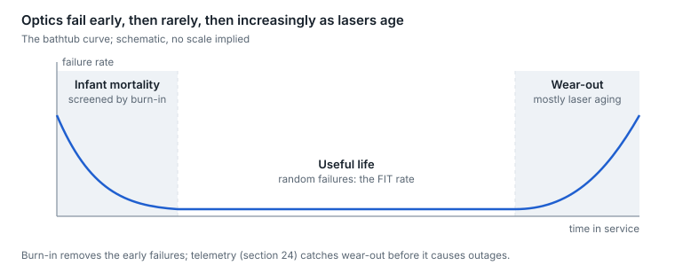

# 23. Interoperability, qualification and reliability

An optic that meets its datasheet can still fail in your network. Temperature grade, environmental qualification, burn-in, firmware and host compatibility decide how it behaves in a hot switch for five years.

## The bathtub curve

<p align="center"><picture>
  <source media="(prefers-color-scheme: dark)" srcset="../figures/fig-68-dark.svg">
  
</picture></p>

*Figure 23.1 — bathtub curve · schematic*

Failure rate over a population's life has three phases: early failures from manufacturing defects (screened out by burn-in), a long flat period of random failures (the number a FIT rate describes), and a rising wear-out phase, which for optics is mostly laser aging.

## Temperature grades

| Grade | Case temperature | Typical use |
| --- | --- | --- |
| Commercial | 0 to 70 °C | Data-center switches with controlled airflow |
| Extended | Varies by vendor (typically up to 85 °C) | Harsher indoor sites |
| Industrial | −40 to 85 °C | Outdoor cabinets, mobile and edge sites |

The rating is module case temperature, not room temperature. A commercial module in a poorly cooled port can exceed 70 °C in a 25 °C room ([grades](https://www.juniper.net/documentation/us/en/hardware/coherent-optics-cables-guide/optics-coherent/topics/topic-map/form-factors.html)).

## Environmental qualification (Telcordia GR-468)

GR-468 is the common reliability standard for optoelectronic devices. One vendor's 400G DR4 report shows how it is applied ([report](https://img-en.fs.com/file/report/qdd-dr4-400g-si-reliability-test-report.pdf), [test categories](https://espec.com/na/applications/family/telecordia_gr-468)):

| Test | Example condition |
| --- | --- |
| Mechanical shock | 500 g, 1 ms |
| Vibration | 20 g, 20–2,000 Hz |
| Thermal shock | Screening temperature cycling is −40 to 70 or 85 °C for 20 cycles; GR-468 thermal shock proper is 0 to 100 °C liquid to liquid (MIL-STD-883 Method 1011), and qualification cycling runs 100–1,000 cycles |
| Temperature cycling | −40 to 70/85 °C, hundreds of cycles |
| Damp heat | 85 °C and 85% relative humidity |
| High-temperature operating life | 2,000 hours at 70 °C case |
| ESD | Handling robustness |

## FIT, MTTF and what they mean for a fleet

FIT is failures per billion device-hours; in the flat part of the bathtub, MTTF = 10⁹ ÷ FIT hours ([definition](https://docs.broadcom.com/doc/AV02-3650EN)). Fleet arithmetic makes it concrete:

```math
\text{Expected failures per year} = N_{\text{modules}} \times 8{,}760 \times \text{FIT} \times 10^{-9}
```

At an illustrative 100 FIT, a 100,000-module fleet expects about 88 failures a year, nearly two a week. In an AI cluster, each one can interrupt a training job, which is why [section 24](24-fleet-telemetry-and-predictive-analytics.md)'s early-warning telemetry matters.

## Third-party optics and compatibility

- **Coding.** Hosts read vendor name, part number and compliance codes from the module's memory map ([section 12](12-management-and-diagnostics.md)) and may refuse, warn on, or fully support a module based on them.
- **Firmware.** Modules run firmware that is upgraded through CMIS; module firmware versions belong in change control.
- **Interop events.** Industry plugfests and OIF interoperability demonstrations test multi-vendor combinations before they reach networks.

## Qualifying a new optic for a fleet

- [ ] Host accepts the module, power class and every application (speed and breakout mode) you will use
- [ ] Multi-hour PRBS or traffic soak shows the expected pre-FEC BER on every lane, against several host ports
- [ ] Worst-case thermal: hottest port, lowest fan speed, highest inlet temperature
- [ ] DOM readings checked against a power meter
- [ ] Firmware upgrade and rollback work in place
- [ ] Breakout and interop tested against the far-end optics actually deployed
- [ ] LPO or LRO modules qualified per host and module pairing
- [ ] Baselines recorded so fleet telemetry starts from known-good values


---

[← 22. Test and measurement](22-test-and-measurement.md) · [Contents](../README.md#contents) · [24. Fleet telemetry and predictive analytics →](24-fleet-telemetry-and-predictive-analytics.md)
