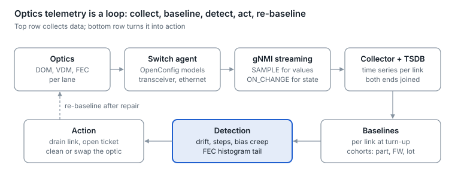

# 24. Fleet telemetry and predictive analytics

At fleet scale, optics are run on data: stream every module's diagnostics and FEC counters, baseline every link at turn-up, and act on trends before a link flaps. Absolute DOM values are only accurate to a few dB, but changes against a link's own baseline are precise and early.

<p align="center"><picture>
  <source media="(prefers-color-scheme: dark)" srcset="../figures/fig-69-dark.svg">
  
</picture></p>

*Figure 24.1 — optics telemetry loop · schematic*

## What to collect

| Signal | OpenConfig path | Subscription | Why |
| --- | --- | --- | --- |
| Per-lane Rx power | `/components/component/transceiver/physical-channels/channel/state/input-power/instant` | SAMPLE | Contamination, bends, fiber faults, taps |
| Per-lane Tx power | `.../physical-channels/channel/state/output-power/instant` | SAMPLE | Transmitter health |
| Per-lane laser bias | `.../physical-channels/channel/state/laser-bias-current/instant` | SAMPLE | Laser aging |
| Module pre-FEC BER | `/components/component/transceiver/state/pre-fec-ber` | SAMPLE | Optical-segment margin |
| Port FEC counters | `/interfaces/interface/ethernet/state/counters/fec-corrected-blocks` and `fec-uncorrectable-blocks` | SAMPLE | End-to-end margin and frame loss |
| Port pre-FEC BER | `/interfaces/interface/ethernet/state/pre-fec-ber` | SAMPLE | Margin seen by the host |
| Link state | `/interfaces/interface/state/oper-status` | ON\_CHANGE | Flaps |
| Coherent quality | `/terminal-device/logical-channels/channel/otn/state/q-value`, `esnr`, `pre-fec-ber` | SAMPLE | DCI margin ([section 18](18-advanced-coherent-and-dci.md)) |

Sources: [openconfig-platform-transceiver](https://raw.githubusercontent.com/openconfig/public/master/release/models/platform/openconfig-platform-transceiver.yang), [openconfig-if-ethernet](https://raw.githubusercontent.com/openconfig/public/master/release/models/interfaces/openconfig-if-ethernet.yang) (FEC counters and pre-FEC BER were added in late 2025). Power and bias leaves also offer avg, min and max.

**Subscription modes.** gNMI streams with SAMPLE (at a fixed interval, optionally suppressing unchanged values with a heartbeat) or ON\_CHANGE (on events) ([gNMI spec](https://raw.githubusercontent.com/openconfig/reference/master/rpc/gnmi/gnmi-specification.md)). A reasonable starting point is analog values every 30–60 s, FEC counters every 10–30 s, and link state on change. An example with the open-source gnmic client:

```
gnmic -a leaf1:6030 subscribe --mode stream --stream-mode sample --sample-interval 30s \
  --path /interfaces/interface/ethernet/state/counters/fec-corrected-blocks
```

## Signals that predict failures

| Pattern | Likely cause | Action |
| --- | --- | --- |
| Laser bias rising while Tx power holds steady | Laser aging: the control loop pushes more current for the same light | Schedule a swap before end of life |
| Rx power steps down on one lane after maintenance | Contaminated or damaged connector | Inspect and clean that path |
| Slow Rx power drift on many links sharing a trunk | Fiber plant: bend, crushed cable, cassette | Inspect the shared path |
| Pre-FEC BER rising with Rx power steady | Transmitter quality, reflections (MPI), or host channel | Compare both ends; swap one element |
| Corrected FEC bursts that track temperature | Thermal or airflow limit | Check fans, port placement, grade |
| Flaps with clean optics and steady power | Firmware, host SerDes or power | Check firmware cohorts and host logs |
| Unexplained small Rx power drop on a stable, untouched link | Possible tap or physical disturbance | Investigate ([section 21](21-link-encryption-and-physical-layer-security.md)) |

## Making it predictive

- **Baseline every link at turn-up**, per lane and both ends, and alert on change rather than absolute value.
- **Compare cohorts.** Group by part number, vendor, firmware and manufacturing lot; one bad batch shows up as a cohort trend long before individual alarms.
- **Correlate.** Both ends of a link, links sharing a trunk or panel, and links on the same switch tell you whether the cause is the module, the fiber or the host.
- **Watch the FEC histogram tail** ([section 5](05-forward-error-correction.md)): codewords drifting toward the correction limit are the earliest sign of lost margin.
- **Automate the response.** In AI fabrics, drain a degrading link before it flaps and stalls a training job, then schedule cleaning or a swap during a quiet window.


---

[← 23. Interoperability, qualification and reliability](23-interoperability-qualification-and.md) · [Contents](../README.md#contents) · [25. Silicon photonics and optical engines →](25-silicon-photonics-and-optical-engines.md)
