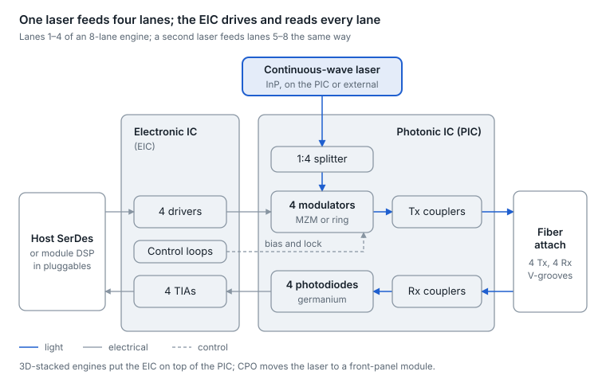
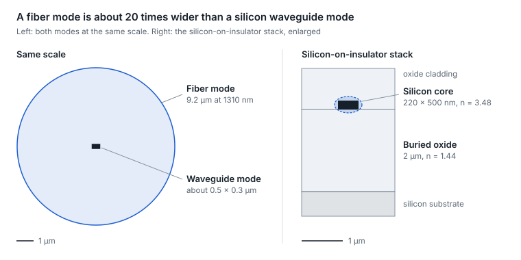
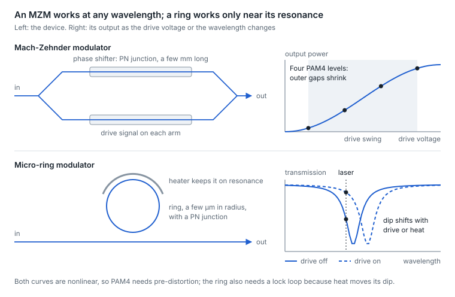
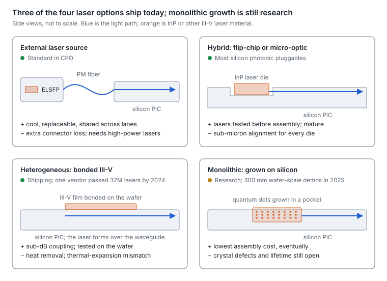
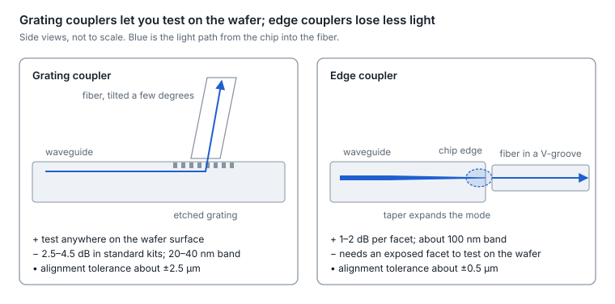
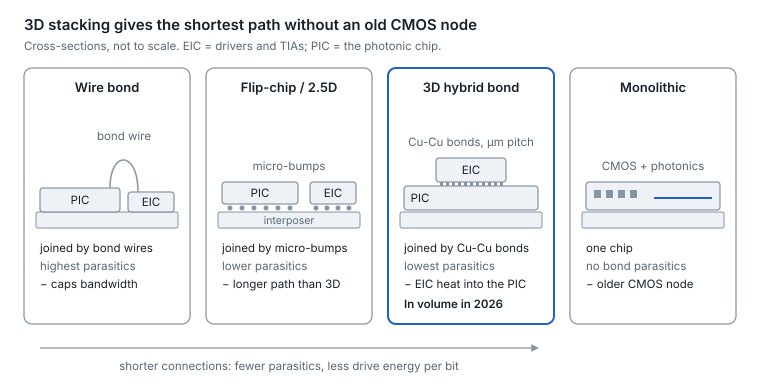
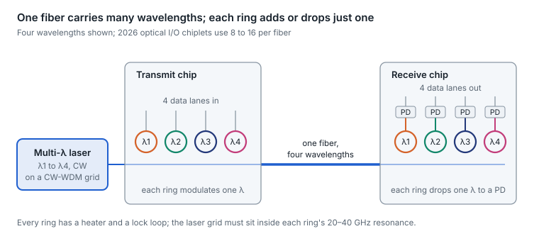

# 25. Silicon photonics and optical engines

An optical engine is the part of every optical link that turns electrical lanes into light and back: a photonic chip, the electronics that drive and read it, a light source and a fiber attach, built as one subassembly. [Section 10](10-optics-packaging-pluggable-lpo-xpo-npo-and.md) covers where the engine sits; this section covers what is inside it, and why those choices show up in power, reliability and troubleshooting.

Most engines built in 2026 are silicon photonic. An analyst firm expects modules using silicon photonic modulators to pass half of transceiver sales in 2026, up from 10% in 2018 and a third in 2024 ([LightCounting](https://www.lightcounting.com/research-note/november-2025-the-year-of-silicon-photonics-2026-436)). The reason is manufacturing: the optical circuit is built on CMOS-style wafers, one laser can feed several lanes, and every die can be tested before assembly.

<picture>
  <source media="(prefers-color-scheme: dark)" srcset="../figures/fig-70-dark.svg">
  
</picture>

*Figure 25.1 — optical engine anatomy · one laser group of four lanes*

Read the transmit path left to right and the receive path right to left. Each part has a subsection below: lasers, modulators, couplers and fiber attach, and the electronic IC.

## Why silicon, and what it cannot do

Silicon photonics borrows CMOS manufacturing: the same wafers, lithography and process control, so thousands of identical optical circuits come off one 200 or 300 mm wafer. The price is four physical gaps, and every engine design is a set of workarounds for them.

- **The platform.** Silicon-on-insulator (SOI): a 220 nm silicon layer on about 2 µm of buried oxide, with single-mode waveguides about 450–500 nm wide ([foundry review](https://www.photonics.intec.ugent.be/download/pub_4422.pdf)). Silicon's refractive index (3.48) is far above the oxide's (1.44), so light is held tightly and a waveguide can turn a corner in a few micrometers. That density is the platform's main strength.
- **Gap 1: no laser.** Silicon has an indirect bandgap, so it emits light very inefficiently ([review](https://www.nature.com/articles/s44310-024-00024-7)). Every engine borrows its light from an indium phosphide (InP) laser, attached in one of four ways (see lasers, below).
- **Gap 2: no fast linear electro-optic effect.** Silicon's crystal is centrosymmetric, so it has no Pockels effect. Modulators instead move free carriers, and 10¹⁷ carriers per cm³ shift the index by only about 10⁻⁴ ([modulator review](https://www.photonics.intec.ugent.be/download/pub_4619.pdf)). A weak effect means long devices or resonant ones, and several volts of drive.
- **Gap 3: transparent at 1310 and 1550 nm.** Silicon cannot detect the light it guides, so photodiodes use germanium grown on the silicon.
- **Gap 4: heat moves everything.** Silicon's index changes by about 1.86 × 10⁻⁴ per kelvin, roughly 18 times the oxide's ([thermal study](https://www.ee.columbia.edu/~kishore/publications/NP_2013.pdf)). Broadband devices barely notice; resonant devices drift about 0.1 nm per kelvin and need heaters and control loops.

One more mismatch shapes the whole engine. The guided mode is about 0.5 × 0.3 µm, while standard single-mode fiber's mode is 9.2 µm across at 1310 nm ([coupling review](https://www.mdpi.com/2076-3417/6/12/426), [fiber spec](https://www.thelightconnection.com/pdf/CorningUltra.pdf)). Bridging that 20-fold gap is the coupling problem.

<picture>
  <source media="(prefers-color-scheme: dark)" srcset="../figures/fig-71-dark.svg">
  
</picture>

*Figure 25.2 — fiber mode vs silicon waveguide · left panel to scale*

At the same scale the waveguide's light is a speck inside the fiber's. The high index contrast that makes silicon circuits dense is the same thing that makes coupling to fiber hard.

Silicon is one of four photonic platforms, and real engines often combine them.

| Platform | What it does well | What it lacks | Where it is used in 2026 |
| --- | --- | --- | --- |
| Silicon (SOI) | CMOS-scale wafers, dense circuits, germanium detectors, wafer-level test | Lasers; modulators much beyond 100 GHz | DR4/DR8 pluggables, NPO and CPO engines, optical I/O |
| Indium phosphide (InP) | Lasers, EMLs, optical amplifiers, modulators beyond 100 GHz | Small, costly wafers; less integration | The light source for every platform; EML transceivers; coherent |
| Silicon nitride on silicon | Low loss (below 0.5 dB/cm for LPCVD nitride), low thermal drift | Passive only | Filters, multiplexers and low-loss routing layers |
| Thin-film lithium niobate (TFLN) | Pockels effect: more than 100 GHz at low drive voltage | Young supply chain | 200G–400G-per-lane modulators; coherent |

Sources: [foundry platform review](https://scispace.com/pdf/review-of-silicon-photonics-technology-and-platform-4facnumzua.pdf), [InP EML above 110 GHz](https://www.ieee802.org/3/ad_hoc/E4AI/public/25_0624/xu_e4ai_01_250624.pdf), [TFLN at 140 GHz](https://www.ofcconference.org/news-media/exhibitor-news/ciena,-hyperlight,-and-mcgill-university-achieve-first-3-2tb-s,-448gb-s-per-lane-imdd-2km-transmissi).

## The building blocks

A photonic IC is built from a small library of devices, most of them passive. Foundries ship them as characterized cells in a process design kit, and an engine designer mostly wires them together.

| Block | Job in an engine | Typical figure | Watch-out |
| --- | --- | --- | --- |
| Strip and rib waveguides | Route light between devices | 1–2 dB/cm (strip); 0.7–1 dB/cm (rib) | Negligible over the few millimeters of a DR engine |
| Splitters (Y-junction, MMI, directional coupler) | Share one laser across lanes; form modulator arms | Under 0.3 dB excess loss for a good Y-junction | Each 1:2 split also halves the light per lane (3 dB) |
| Wavelength multiplexers (AWG, echelle grating, cascaded Mach-Zehnder) | Combine CWDM or LAN-WDM lanes onto one fiber | 1.5–2.6 dB insertion loss in published designs | FR and LR engines pay it twice (mux and demux); DR engines skip it |
| Polarization splitter-rotator | Turn the fiber's random polarization into the chip's single mode | 1.2–1.5 dB insertion loss | Needed on receive, because SOI waveguides are strongly polarization-dependent |
| Thermo-optic phase shifter (heater) | Bias MZMs, lock rings, trim filters | About 20–25 mW per π of phase shift | Microseconds, not picoseconds: for tuning, never for data |
| Germanium photodiode | Detect light | 0.8–1.0 A/W at 1310 nm (the quantum limit is 1.06 A/W), typically 0.7–1.0 A/W at 1550 nm; 50–70 GHz in foundry kits | Bandwidth and dark current set the receive limit |
| Monitor photodiode (tap) | Feed the bias, lock and power control loops | Taps a small fraction of the light | Source of the per-lane telemetry an engine reports |

Sources: [foundry review](https://www.photonics.intec.ugent.be/download/pub_4422.pdf), [foundry efforts review](https://oar.a-star.edu.sg/storage/g/gzk7y2r1w7/review-of-silicon-photonics-foundry-efforts.pdf), [Y-junction](https://www.arxiv.org/pdf/2301.04045), [AWG](https://photonics.intec.ugent.be/download/pub_2972.pdf), [echelle](https://www.mdpi.com/2079-9292/8/6/687), [splitter-rotator](https://www.mdpi.com/2073-4352/11/10/1170), [phase shifters](https://link.springer.com/article/10.1007/s12200-022-00012-9), [germanium photodiodes](https://www.nature.com/articles/s41566-021-00893-w).

A DR engine is the simplest circuit: one laser split across several modulators, each with its own output fiber, and one photodiode per receive fiber. An FR4 engine adds a multiplexer and a demultiplexer. Coherent engines add the IQ modulator and 90° hybrid from [section 8](08-coherent-optics-and-dci.md), which are often built in silicon too.

## Modulators: Mach-Zehnder, ring, EAM and TFLN

The modulator sets an engine's bandwidth, drive voltage, size and temperature behavior, and 2026 products split along it. Mach-Zehnders dominate pluggables and one CPO family; micro-rings drive another CPO family and most optical I/O chiplets; electro-absorption modulators appear where III-V material is bonded onto silicon; thin-film lithium niobate is the bandwidth bet for 400G per lane.

- **Mach-Zehnder modulator (MZM).** Light splits into two arms, a reverse-biased PN junction in each arm shifts its phase, and the arms recombine and interfere, turning phase into amplitude. Because silicon's effect is weak, the arms are a few millimeters long: one foundry kit lists a Vπ of 5.9 V for a 4 mm device and 29–40 GHz of bandwidth ([platform review](https://scispace.com/pdf/review-of-silicon-photonics-technology-and-platform-4facnumzua.pdf)). Long devices need traveling-wave electrodes, and the drive swing exceeds what advanced CMOS supplies deliver, so drivers often use SiGe processes. The reward is a broadband, temperature-tolerant device that works at any wavelength in the band. With on-chip equalization, one 2025 result reached 90 GHz for 200G per lane ([OFC 2025](https://opg.optica.org/abstract.cfm?uri=OFC-2025-M2K.1)).
- **Micro-ring modulator (MRM).** A ring a few to ten micrometers in radius sits beside a bus waveguide. At resonance, light couples into the ring and the bus transmission dips; a PN junction in the ring shifts the resonance, so a laser parked on the dip's slope sees large intensity changes. Rings are tiny (a few hundred µm²) with only a few femtofarads of capacitance, so modulation costs a few femtojoules per bit ([ring result](https://pmg.mit.edu/documents/J.LightwaveTechnol.Timurdogan-1.pdf)), and research devices exceed 110 GHz ([2025 result](https://arxiv.org/pdf/2509.01555)). Each ring acts on one wavelength only, which makes dense WDM natural: several rings on one bus, each tuned to its own wavelength. The cost is temperature: the resonance moves about 0.1 nm per kelvin, and a drift of more than about 1 K can break the link without a heater and a feedback lock ([thermal study](https://www.ee.columbia.edu/~kishore/publications/NP_2013.pdf)).
- **Electro-absorption modulator (EAM).** An electric field shifts a material's absorption edge, so the device absorbs more or less light at the laser's wavelength. Germanium-silicon EAMs are compact and reach about 50 GHz but work in the C and L bands ([GeSi EAM](https://eprints.soton.ac.uk/416682/2/oe_26_6_6663.pdf), [review](https://www.photonics.intec.ugent.be/download/pub_5289.pdf)); O-band EAMs use III-V quantum wells bonded onto silicon. The absorption edge moves with temperature, about 0.8 nm/°C in one GeSi study ([study](https://biblio.ugent.be/publication/01KRZPK8C88WHM2YGC8B94JC15)).
- **Thin-film lithium niobate (TFLN).** Lithium niobate has the Pockels effect that silicon lacks, so a thin film bonded onto an insulator or onto silicon gives a fast, linear, low-voltage MZM. A 2025 demonstration used 140 GHz TFLN modulators for 8 × 448G over 2 km ([OFC 2025](https://www.ofcconference.org/news-media/exhibitor-news/ciena,-hyperlight,-and-mcgill-university-achieve-first-3-2tb-s,-448gb-s-per-lane-imdd-2km-transmissi)). Its manufacturing base is younger than silicon's or InP's.

<picture>
  <source media="(prefers-color-scheme: dark)" srcset="../figures/fig-72-dark.svg">
  
</picture>

*Figure 25.3 — Mach-Zehnder vs micro-ring · device and transfer curve*

The MZM's curve depends only on drive voltage, so it works at any wavelength. The ring's dip sits at one wavelength, and heat moves it the same way the data signal does; a drift of about 1 K is enough to break the link, which is why every ring needs a lock loop.

| Modulator | Size | Bandwidth | Drive | Temperature behavior | Wavelengths | Used in |
| --- | --- | --- | --- | --- | --- | --- |
| Silicon MZM | Millimeters | 30–50 GHz in foundry kits; 90 GHz with equalization (record) | Several volts; SiGe drivers common | Tolerant | Any in the band | Most pluggables; one CPO family |
| Micro-ring | About 10 µm radius | Over 110 GHz in research; 200G PAM4 in production | About 2 V peak-to-peak | Drifts about 0.1 nm/K; needs a lock loop | One per ring, so WDM-friendly | One CPO family; optical I/O |
| EAM (GeSi, or III-V on silicon) | Tens of micrometers | About 50 GHz (GeSi); 400G-per-lane III-V demos | About 2 V peak-to-peak | Absorption edge moves about 0.8 nm/°C | GeSi: C/L band; III-V: O-band | III-V-on-silicon DR8 PICs; optical I/O |
| TFLN | Millimeters | Over 100 GHz (140 GHz demo) | Low Vπ | Stable | Any in the band | 400G-per-lane candidates; coherent |

Both MZMs and rings are nonlinear: an MZM follows a cosine and a ring follows its resonance curve, so PAM4's outer levels compress unless the driver or DSP pre-distorts them. That is the level-linearity (RLM) failure from [section 2](02-signaling-and-modulation.md), created inside the engine.

**Try it:** the Modulators tab of the Optics Bench lab puts an MZM and a ring side by side. Move the bias, drive swing, laser offset and temperature, switch the ring's lock off, and watch the four light levels, OMA and RLM respond.

## Getting light onto the chip: lasers

Every silicon engine gets its light from an InP laser. How that laser is attached decides coupling loss, thermal design, whether the laser can be tested before assembly, and what gets replaced in the field. There are four approaches; 2026 products mostly use the first two, and heterogeneous lasers also ship.

<picture>
  <source media="(prefers-color-scheme: dark)" srcset="../figures/fig-73-dark.svg">
  
</picture>

*Figure 25.4 — laser integration · four approaches*

Moving down and right, the laser gets closer to the waveguide: less coupling loss and assembly, but more heat in the chip and less freedom to test or replace the laser on its own.

| Approach | How it works | Strengths | Weaknesses | Status in 2026 |
| --- | --- | --- | --- | --- |
| External laser source | Laser in its own module, often a front-panel ELSFP; light arrives over polarization-maintaining fiber | Cool location; replaceable; testable alone; shareable across lanes | Extra connector and fiber loss; needs high-power lasers; eye-safety controls | Standard in CPO; defined by the OIF ELSFP agreement |
| Hybrid (flip-chip or micro-optic) | Known-good InP laser die placed beside or on the PIC, butt-coupled or coupled through lenses | Lasers tested before assembly; mature process | Sub-micron alignment for every die | Most silicon photonic pluggables; tens of millions of units a year |
| Heterogeneous | III-V material bonded onto the silicon wafer, then patterned into lasers aligned to the waveguides | Sub-dB coupling; wafer-level test; many lasers per chip | Heat removal and thermal-expansion mismatch | Shipping: one vendor reported over 32M on-chip lasers by mid-2024; another platform passed GR-468 in 2025 |
| Monolithic | Laser material, often quantum dots, grown directly on silicon | Lowest assembly cost, eventually | Crystal defects and lifetime still being solved | Research and development: 300 mm wafer-scale demos in 2025 |

Sources: [integration review](https://www.nature.com/articles/s41467-024-44750-0), [heterogeneous volumes](https://www.intc.com/news-events/press-releases/detail/1699/intel-demonstrates-first-fully-integrated-optical-io), [GR-468 qualification](https://www.semiconductor-today.com/news_items/2025/mar/openlight-260325.shtml), [300 mm lasers](https://www.imec-int.com/en/press/first-full-wafer-scale-fabrication-electrically-pumped-gaas-based-nano-ridge-lasers-300-mm), [quantum-dot lasers](https://www.semiconductor-today.com/news_items/2025/jul/ucsb-140725.shtml).

- **One laser, several lanes.** A continuous-wave laser can be split across lanes, which is silicon's structural advantage over one-EML-per-lane designs. 800G DR8 PICs use 2 lasers for 8 lanes ([product](https://credosemi.com/products/silicon-photonics/carmel8/)); 1.6T DR8 designs use 1 to 4 lasers ([MZM design](https://credosemi.com/products/silicon-photonics/oz8/), [EAM design](https://openlightphotonics.com/newsroom/openlight-announces-sample-availability-of-its-first-1-6tb-dr8-dfb-based-photonic-integrated-circuit), [TFLN design](https://www.businesswire.com/news/home/20260316857906/en/HyperLight-Demonstrates-Low-Power-1.6T-DR8-TFLN-based-Reference-Transceiver-Assembled-by-TFC)); and one CPO switch feeds 4 transmit lanes from each laser ([developer blog](https://developer.nvidia.com/blog/how-industry-collaboration-fosters-nvidia-co-packaged-optics)).
- **Sharing needs power.** Each 1:2 split halves the light per lane, so shared lasers are high-power parts: 100 mW uncooled or 300 mW cooled DFBs for pluggables ([laser](https://www.coherent.com/news/press-releases/coherent-introduces-1300nm-high-power-dfb-lasers)), and 400 mW-class lasers at 50–55 °C for CPO ([CPO laser](https://www.coherent.com/news/press-releases/coherent-samples-low-noise-400mw-cw-lasers)).
- **ELSFP.** The OIF's ELSFP-02.0 (January 2025) defines the front-panel laser module: a blind-mate MT-ferrule connector carrying 4 or 8 polarization-maintaining fibers, power classes from 11 to 26 dBm per wavelength per fiber, 1311 nm or CWDM4 wavelengths, and eye-safety rules that cut power within 250 ms if an unprotected optical path opens ([spec](https://www.oiforum.com/wp-content/uploads/OIF-ELSFP-02.0.pdf)). A separate OIF agreement (September 2024) manages ELSFPs through CMIS ([OIF agreements](https://www.oiforum.com/technical-work/implementation-agreements-ias/)).
- **Multi-wavelength sources.** Ring-based dense WDM needs many precisely spaced wavelengths, because a ring's resonance is only 20–40 GHz wide ([feature](https://compoundsemiconductor.net/article/112506/Super-fast_optical_interconnects/feature)). The CW-WDM MSA (2021) defines 8-, 16- and 32-wavelength O-band grids for such sources ([release](https://www.semiconductor-today.com/news_items/2021/jun/cw-wdm-080621.shtml)). 2026 products include a 16-wavelength source built to that MSA ([product](https://ayarlabs.com/supernova/)) and an 8-wavelength comb ELSFP with more than 1 W of output ([report](https://thedatacenterengineer.com/news/ai-data-center-networks-xscape-launches-8-wavelength-elsfp-laser-module/)).
- **Why lasers move away from heat.** Laser wear-out speeds up with temperature. One published model uses an activation energy of 0.5 eV, which works out to roughly 1.6–1.9× faster aging per 10 °C ([model](https://ee.stanford.edu/~jmk/pubs/ext.vs.integ.light.sources.jlt.4-21.pdf)); the familiar "halves every 10 °C" rule is not universal ([analysis](https://www.electronics-cooling.com/2017/08/10c-increase-temperature-really-reduce-life-electronics-half/)). Putting the laser in a cool front-panel module, away from a switch ASIC, is the CPO answer.

## Getting light off the chip: fiber coupling

Matching a 9 µm fiber mode to a sub-micron waveguide is where silicon engines lose the most light, and where assembly yield is won or lost. Two coupler types exist; they trade testability against loss and bandwidth.

<picture>
  <source media="(prefers-color-scheme: dark)" srcset="../figures/fig-74-dark.svg">
  
</picture>

*Figure 25.5 — grating vs edge coupler · side views*

A grating coupler sends light up out of the chip's surface, so a probe can reach it anywhere on the wafer. An edge coupler sends light straight out of the chip's side through a taper, losing less light over a wider band but needing the fiber aligned five times more precisely.

|  | Grating coupler | Edge coupler |
| --- | --- | --- |
| How it works | An etched grating diffracts light up out of the chip toward a fiber tilted a few degrees from vertical | A taper at the chip's edge expands the mode to match a fiber held in a V-groove |
| Loss per coupler | About 2.5–4.5 dB in standard foundry kits; under 1 dB in optimized designs | About 1–2 dB per facet in foundry kits; under 1 dB in optimized designs |
| Optical bandwidth | Roughly 20–40 nm (1 dB) | About 100 nm |
| Polarization | Sensitive; 2D gratings handle both polarizations | Largely insensitive |
| Alignment tolerance (1 dB penalty) | About ±2.5 µm | About ±0.5 µm at a bare facet; ±1–2 µm with a spot-size converter |
| Wafer-level test | Yes, anywhere on the surface | Needs an exposed facet; automated edge-coupled wafer test now exists |

Sources: [foundry review](https://www.photonics.intec.ugent.be/download/pub_4422.pdf), [coupling review](https://www.mdpi.com/2076-3417/6/12/426), [edge coupler](https://www.mdpi.com/2076-3417/10/4/1538), [grating coupler](https://www.arxiv.org/pdf/2506.19242).

- **Fiber attach.** Fibers sit in glass V-groove arrays at 127 or 250 µm pitch, fixed with UV-cured, index-matched epoxy ([coupling review](https://www.mdpi.com/2076-3417/6/12/426)). In CPO, budget about 1 dB per V-groove joint and about 1 dB more for a detachable joint ([foundry quote](https://semiengineering.com/co-packaged-optics-reaches-power-efficiency-tipping-point/)).
- **Detachable connectors.** Permanent pigtails made CPO assembly fragile and engines hard to rework, so 2025–26 brought detachable fiber-to-chip connectors: glass-waveguide edge couplers that drop into the chip's V-grooves ([announcement](https://gf.com/news-and-events/news/globalfoundries-and-corning-collaborate-to-deliver-detachable-fiber-connector-solutions-to-scale-next-generation-optical-connectivity/)), expanded-beam connectors with under 1.5 dB loss after re-insertion ([announcement](https://www.senko.com/senko-collaborates-with-lightmatter-on-detachable-connectivity-to-the-pic-for-3d-co-packaged-optics/)), and connectors carrying up to 50 fibers at 127 µm pitch ([product](https://www.molex.com/en-us/products/optical-solutions/teraverse-detachable-optical-chiplet-connectors)).
- **Yield.** In one research study, edge couplers lost about 1.5 dB per fiber and optical assembly yield was 75.5% ([study](https://www.imec-int.com/en/articles/interfacing-silicon-photonics-high-density-co-packaged-optics)). Every engine multiplies the yields of its dies and fibers, which is why test before assembly matters (see manufacturing, below).

## Inside an optical engine

An engine joins four things: the photonic IC (PIC), the electronic IC (EIC), the light source and the fiber attach. The PIC carries modulators, photodiodes, couplers, heaters and monitor taps. The EIC carries modulator drivers, transimpedance amplifiers (TIAs) and the control loops that hold modulator bias, ring lock and laser power. How the EIC meets the PIC decides much of the engine's energy per bit.

<picture>
  <source media="(prefers-color-scheme: dark)" srcset="../figures/fig-75-dark.svg">
  
</picture>

*Figure 25.6 — EIC-to-PIC integration · four stack-ups*

- **Monolithic.** Transistors and photonics share one chip. One 45 nm-class platform does this at 0.5 Tb/s per fiber ([platform](https://investors.gf.com/news-releases/news-release-details/globalfoundries-announces-next-generation-silicon-photonics)). There are no bond parasitics, but the electronics are tied to an older CMOS node.
- **Wire bond.** EIC beside PIC, joined by bond wires. Simple and cheap, but each wire's inductance limits bandwidth and costs drive energy ([packaging comparison](https://www.signalintegrityjournal.com/articles/3659-co-packaged-optics-cpo-evaluating-different-packaging-technologies)).
- **Flip-chip or 2.5D.** The EIC is flipped onto the PIC, or both sit on an interposer, joined by micro-bumps. Shorter connections cut the parasitics.
- **3D hybrid bonding.** The EIC is bonded face-to-face onto the PIC with copper-to-copper bonds at micrometer pitch, the lowest-parasitic option. The catch is that EIC heat flows straight into the photonics, which matters for rings ([packaging comparison](https://www.signalintegrityjournal.com/articles/3659-co-packaged-optics-cpo-evaluating-different-packaging-technologies), [analysis](https://semiengineering.com/photonics-forces-a-chiplet-rethink/)). One foundry's 3D-stacked engine platform entered volume production in 2026, and both major CPO switch families build on it ([report](https://www.trendforce.com/news/2026/04/01/news-silicon-photonics-race-intensifies-as-tsmc-targets-2026-coupe-production-samsung-eyes-2029-cpo-turnkey/), [product](https://investors.broadcom.com/news-releases/news-release-details/broadcom-announces-tomahawkr-6-davisson-industrys-first-1024)).

**Where the energy goes.** One vendor's published model splits link energy as below ([paper](https://arxiv.org/html/2510.15893v1)). It is a model from a CPO vendor, not a measurement, but its shape matches product claims: the module's DSP disappears first, then 3D stacking shrinks everything else.

| Architecture | Host SerDes (pJ/bit) | Module or engine (pJ/bit) | Laser (pJ/bit) | Total (pJ/bit) |
| --- | --- | --- | --- | --- |
| Retimed pluggable | 5 | 16 | Inside the module | 21 |
| LPO | 5 | 8 | Inside the module | 13 |
| 2.5D CPO | 5 | 4.7 | 2.3 | 12 |
| 3D-stacked CPO | 2 | 1.2 | 1.1 | 4.3 |

Product claims land in the same range. One MZM-based 51.2T CPO switch claims 5.5 W per 800G (about 6.9 pJ/bit) against 14 W for pluggables, and its 102.4T successor claims 3.5 W per 800G (about 4.4 pJ/bit) ([product brief](https://docs.broadcom.com/doc/th5-51.2t-bailly-cpo), [analysis](https://www.nextplatform.com/connect/2025/10/17/the-third-time-will-be-the-charm-for-broadcom-switch-co-packaged-optics/1635588)). The light itself is not free: one design study puts an external laser source at about 18 W per 6.4T, about 70% of it in laser chips and their coolers at roughly 30% wall-plug efficiency ([study](https://link.springer.com/article/10.1007/s12200-022-00055-y)).

- **Control loops are part of the engine.** MZMs need bias control, rings need lock loops (a monitor photodiode plus a heater driven by the EIC), and lasers need power control. These loops are also where engine telemetry comes from.
- **Cooling.** In CPO the engines share a package with a switch ASIC, and production systems liquid-cool both ([developer blog](https://developer.nvidia.com/blog/how-industry-collaboration-fosters-nvidia-co-packaged-optics)).

## Engines in 2026 products

Pluggables and CPO switches now combine the same building blocks in different ways. Two CPO families are in or entering volume: an MZM-based family from a switch-silicon vendor and a ring-based family from a GPU vendor. Their 2026 generations both use 3D-stacked engines from the same foundry; they differ mainly in the modulator ([analyst note](https://www.lightcounting.com/research-note/march-2025-nvidias-cpo-is-the-first-step-in-a-long-journey-395)).

| Product | Engines | Lanes | Modulator | Light source | Claimed power | Status |
| --- | --- | --- | --- | --- | --- | --- |
| 800G DR8 pluggable PIC | 1 × 800G | 8 × 100G | MZM | 2 lasers on the PIC | — | Product |
| 1.6T DR8 pluggable PIC (silicon) | 1 × 1.6T | 8 × 200G | MZM | 2 CW lasers | — | Product |
| 1.6T DR8 PIC (III-V on silicon) | 1 × 1.6T | 8 × 200G | EAM | 4 DFB lasers plus 8 optical amplifiers | Under 2.7 W for the PIC | Sampling since March 2025 |
| 1.6T DR8 reference design (TFLN) | 1 × 1.6T | 8 × 200G | TFLN MZM | 1 laser | 20 W, fully retimed module | Demonstrated March 2026 |
| 51.2T CPO switch (MZM family) | 8 × 6.4T | 64 × 100G per engine | MZM | Front-panel laser modules | 5.5 W per 800G vs 14 W pluggable | Deployed |
| 102.4T CPO switch (MZM family) | 16 × 6.4T, 3D-stacked | 200G lanes | MZM | Field-replaceable ELSFPs | 3.5 W per 800G | Sampling since October 2025 |
| 102.4T CPO Ethernet switch (ring family) | 32 × 3.2T per ASIC | 16 Tx + 16 Rx × 200G per engine | Micro-ring | 16 laser modules of 8 lasers; 4 lanes per laser | 9 W per 1.6T port vs 30 W pluggable | Full production August 2026 |
| 115.2T InfiniBand CPO system (ring family) | 4 ASICs, each 6 subassemblies of three 1.6T engines | 8 × 200G per engine | Micro-ring | 18 laser modules | 3.95 kW vs 7.0 kW for a standard switch | Customer deliveries 2026 |

Sources: [800G PIC](https://credosemi.com/products/silicon-photonics/carmel8/), [1.6T silicon PIC](https://credosemi.com/products/silicon-photonics/oz8/), [III-V PIC](https://openlightphotonics.com/newsroom/openlight-announces-sample-availability-of-its-first-1-6tb-dr8-dfb-based-photonic-integrated-circuit), [TFLN reference](https://www.businesswire.com/news/home/20260316857906/en/HyperLight-Demonstrates-Low-Power-1.6T-DR8-TFLN-based-Reference-Transceiver-Assembled-by-TFC), [51.2T brief](https://docs.broadcom.com/doc/th5-51.2t-bailly-cpo), [102.4T MZM switch](https://investors.broadcom.com/news-releases/news-release-details/broadcom-announces-tomahawkr-6-davisson-industrys-first-1024), [ring-family engines](https://developer.nvidia.com/blog/how-industry-collaboration-fosters-nvidia-co-packaged-optics), [ring-family production](https://www.storagereview.com/news/nvidia-spectrum-x-ethernet-photonics-enters-full-production-with-4x-fewer-lasers-and-a-five-vendor-cpo-supply-chain), [customer system](https://lambda.ai/blog/unbox-one-of-nvidias-first-co-packaged-optics-samples-with-lambda). Power figures are vendor claims.

- **Read the laser counts.** The ring family's "4× fewer lasers" claim is made at data-center level against legacy designs with one laser per lane; per engine it means 8 lasers in each external module serving 32 transmit lanes ([developer blog](https://developer.nvidia.com/blog/how-industry-collaboration-fosters-nvidia-co-packaged-optics)).
- **Socketed engines.** An MSA formed in March 2026 defines a socketed 6.4T engine with 32 × 200G electrical lanes and a roadmap to 12.8T and 448G lanes ([MSA](https://convergedigest.com/open-cpx-msa-pluggable-optical-engine-architecture/)). The OIF's NPO project ([section 10](10-optics-packaging-pluggable-lpo-xpo-npo-and.md)) defines 6.4T and 12.8T engine modules with liquid cooling and laser-source definitions ([OIF meeting report](https://www.lightwaveonline.com/directory/subsystems/optical-transceivers-transponders/press-release/55382412/oif-oif-q2-meeting-advances-management-for-path-startup-encryption-near-package-optics-and-high-density-connector-interfaces)).
- **Volume.** An analyst firm reported in July 2026 that both CPO families are starting volume ramps, with broad volume expected in 2027–28 ([TrendForce](https://www.trendforce.com/presscenter/news/20260727-13151.html)).

## Optical I/O chiplets for scale-up

Optical I/O puts the engine inside the accelerator's package, so GPU-to-GPU and GPU-to-memory links leave the package as light. The goal is copper-like energy and latency with fiber's reach, so a scale-up domain can grow past one rack. These engines differ from switch CPO in three ways: many slower wavelengths per fiber instead of a few fast lanes, a UCIe die-to-die interface instead of a long-reach SerDes, and little or no FEC so that latency stays in nanoseconds.

<picture>
  <source media="(prefers-color-scheme: dark)" srcset="../figures/fig-76-dark.svg">
  
</picture>

*Figure 25.7 — ring-based dense WDM link · four wavelengths*

- **Ring-based dense WDM.** A multi-wavelength laser feeds a bus of micro-rings, each modulating one wavelength; at the far end, drop rings each pick one wavelength onto a photodiode. One UCIe optical chiplet carries 8 Tb/s using a 16-wavelength external laser ([announcement](https://ayarlabs.com/news/ayar-labs-unveils-worlds-first-ucie-optical-chiplet-for-ai-scale-up-architectures/)); its 2025 engineering validation reported more than 5 dB of margin across hundreds of links and no BER change from 30 to 80 °C ([validation](https://ayarlabs.com/blog/lets-get-serious-teraphy-optical-engine-passes-the-test-for-ai-scale-up-at-volume/)). Another vendor reports 1.6 Tb/s per fiber from 16 wavelengths of 112G PAM4 ([announcement](https://lightmatter.co/press-release/lightmatter-achieves-record-1-6-tbps-per-fiber-to-accelerate-ai-optical-interconnect/)).
- **EAM-based fabric.** One design uses EAMs, chosen for thermal stability, at about 2.4 pJ/bit for electronics plus 0.7 pJ/bit for the laser, and 16 Tb/s per chiplet ([details](https://convergedigest.com/marvell-bets-big-on-optical-scale-up-acquires-celestial-ai-for-photonic-fabric/)). A large DSP vendor bought the company for $3.25B upfront, closing in February 2026, and expects revenue from fiscal 2028 ([announcement](https://investor.marvell.com/news-events/press-releases/detail/1000/marvell-to-acquire-celestial-ai-accelerating-scale-up-connectivity-for-next-generation-data-centers), [close](https://investor.marvell.com/news-events/press-releases/detail/1005/marvell-completes-acquisition-of-celestial-ai)).
- **Photonic interposers.** A 3D active photonic interposer offers 114 Tb/s over 256 fibers with 8-wavelength WDM ([announcement](https://lightmatter.co/press-release/lightmatter-unveils-passage-m1000-photonic-superchip-worlds-fastest-ai-interconnect/)).
- **Standards and forecasts.** The UALink consortium says optical reach extension needs only PHY-level changes ([white paper](https://ualinkconsortium.org/wp-content/uploads/2026/01/UALink_White_Paper_Publication_Candidate_FINAL_VERSION.pdf)). The OCI MSA, formed in March 2026, has published a 200G-per-direction bidirectional optical PHY for scale-up links, built on ring modulators and external lasers ([section 27](27-standards-and-ecosystem-map.md)). An OCP initiative launched in August 2026 is writing open optical engine specifications aimed below 5 pJ/bit, with a base specification due in Q4 2026 ([report](https://www.techtimes.com/articles/324563/20260815/co-packaged-optics-standard-gets-q4-deadline-ocp-blueprint-targets-wasted-ai-compute.htm)). One analyst firm expects only 10–15% of scale-up interconnects to move to NPO or CPO by 2030–31, so copper keeps most in-rack links ([LightCounting](https://www.lightcounting.com/newsletter/en/may-2026-silicon-photonics-lpolro-and-npocpo-377)).

Product figures in this subsection are vendor claims.

## Manufacturing, test and yield

Silicon photonics promises semiconductor economics, and in 2026 the constraint moved from technology to capacity. An analyst firm named optical engine yield, silicon photonics fab precision and 2.5D/3D packaging capacity as the bottlenecks for CPO ([TrendForce](https://www.trendforce.com/presscenter/news/20260727-13151.html)).

- **Foundries and design kits.** Commercial foundries offer process design kits (PDKs) with characterized modulators, germanium photodiodes, couplers and V-grooves on 200 and 300 mm wafers ([300 mm kit](https://www.cmc.ca/globalfoundries-fotonix-45spclo/)). Capacity grew sharply in 2026: one foundry entered 300 mm high-volume production in March and plans to more than quadruple output by 2027 ([announcement](https://www.globenewswire.com/news-release/2026/03/09/3251525/0/en/STMicroelectronics-enters-high-volume-production-of-its-industry-leading-silicon-photonics-platform-to-support-AI-infrastructure-demand.html)), another committed about $3B to 300 mm silicon photonics ([report](https://www.techtimes.com/articles/320470/20260714/tower-semiconductor-commits-3-billion-silicon-photonics-japan-backs-bet.htm)), and a third licensed a 300 mm research platform with ring modulators and GeSi EAMs, with risk production in 2026–27 ([announcement](https://www.umc.com/en/News/press_release/Content/technology_related/20251208)).
- **Test before assembly.** Grating couplers let a prober test every die optically before dicing, and edge-coupled wafer test is now automated at about 1.5 dB per facet and under 5 s per die ([vendor](https://www.formfactor.com/blog/2025/redefining-wafer-test-fully-automated-edge-coupling-for-silicon-photonics/)). Early test matters because an engine stacks a PIC, an EIC, lasers and fibers: one bad part scraps the assembly, and in CPO it can scrap a switch package. That is the argument for known-good die, detachable fibers and external lasers.
- **Process variation.** Waveguide width variation of about 5 nm and thickness variation of about 2 nm can move a ring's resonance by 2–12 nm, which heaters must then pull back, up to about 9 nm ([study](https://www.engr.colostate.edu/~mnikdast/files/papers/Mahdi_C30.pdf)). MZMs are far more tolerant of the same variation.
- **Where the money goes.** One analyst firm puts packaging and assembly at about 25% of a datacom pluggable's value and about 50% of a CPO engine's in 2026–27, falling to about 35% by 2031 ([secondary report](https://anysilicon.com/news/photonics-packaging-heads-toward-a-14-4-billion-market-by-2031/)).
- **Market.** Silicon photonics was about a third of a $4B optical chip market in 2025 and is forecast at 42% of $15B by 2031, while InP lasers fall from 58% to 46% of it ([LightCounting](https://www.lightcounting.com/newsletter/en/may-2026-silicon-photonics-lpolro-and-npocpo-377)).

## Limits and next steps: 400G per lane

400G per lane roughly doubles the bandwidth a modulator must deliver, and silicon's weak electro-optic effect makes that the platform's hardest test. As of October 2026 no technology has won, and IEEE P802.3dv had not chosen a modulation format ([study group status](https://www.itu.int/en/ITU-T/Workshops-and-Seminars/2026/0711/Documents/1%20-%20Kent%20Lusted.pdf)).

- **What each format asks.** One IEEE contribution compared PAM4 at 212.5 GBd (106 GHz Nyquist), PAM6 at 170 GBd (85 GHz) and PAM8 at 141.7 GBd (71 GHz); PAM8 tolerated multipath interference about 7 dB worse than PAM4 ([contribution](https://www.ieee802.org/3/ad_hoc/E4AI/public/25_0624/xu_e4ai_01_250624.pdf)). An industry panel called PAM4 feasible and the simplest, lowest-power choice ([panel](https://ethernetalliance.org/wp-content/uploads/2025/12/All_TEF_Panel3_2512.pdf)).

| Technology | Best evidence as of October 2026 | Status |
| --- | --- | --- |
| Silicon MZM | 400G PAM4 post-deadline paper at OFC 2026; a 420G PAM4 eye on a production foundry MZM | Demonstrations; the foundry says it extends silicon "another generation" |
| InP EML | Over 110 GHz bandwidth; a 400G-per-lane DSP shown with EMLs; 1.6T DR4 prototypes (March 2026) | Prototypes; one laser vendor calls it the most commercially viable for volume |
| III-V-on-silicon EAM | 400G PAM4 at 2.25 V peak-to-peak, bandwidth to 100 GHz | Demonstration |
| TFLN | 140 GHz modulators; 8 × 448G over 2 km (2025); 400G-per-lane PICs offered (2026) | Early products |
| Barium titanate (BTO) on silicon | 4 × 448G (net 1.6T DR4) on a commercial silicon platform | Research demonstration |
| Thin-film lithium tantalate | Over 110 GHz with Vπ of 1.35 V | Research demonstration |
| Plasmonic | Up to 250 GHz reported; 100 GBd PAM4 at 0.7 V | Research |

Sources: [OFC 2026 post-deadline papers](https://ofc-web-afd-e8csdte4dubnfvfu.z02.azurefd.net/ofc/media/images/documents/2026/ofc_2026_pdp_guide.pdf), [silicon 420G](https://convergedigest.com/tower-semiconductor-and-coherent-demo-400g-lane-in-sipho/), [400G DSP with EML](https://convergedigest.com/broadcom-debuts-3nm-400g-lane-optical-dsp/), [EML prototypes](https://investor.lumentum.com/financial-news-releases/news-details/2026/Lumentum-Demonstrates-Industry-Leading-Technologies-and-Products-for-Scale-Out-Scale-Up-and-Scale-Across-AI-Infrastructure-at-OFC-2026/default.aspx), [III-V EAM](https://openlightphotonics.com/newsroom/electro-optics-openlight-showcased-400g-per-lane-iii-v-silicon-photonics-at-ofc-2026), [modulator panel](https://www.simpletechtrend.com/en/post/ofc2026-400g-lane-optical-modulators-siph-inp-panel-en), [TFLN 2025](https://www.ofcconference.org/news-media/exhibitor-news/ciena,-hyperlight,-and-mcgill-university-achieve-first-3-2tb-s,-448gb-s-per-lane-imdd-2km-transmissi), [TFLN PICs](https://www.businesswire.com/news/home/20260317190165/en/HyperLight-Introduces-400G-per-lane-PICs-on-its-TFLN-Chiplet-Platform-for-Next-Generation-AI-Interconnects), [BTO](https://dca.fi/from-metal-oxide-mbe-to-terabit-scale-silicon-photonics/), [plasmonic review](https://www.mdpi.com/2304-6732/12/5/429).

- **Rings scale by wavelength, not by baud.** One foundry's roadmap takes ring engines from 200G per lane at 0.5 Tb/s per millimeter of chip edge in 2026 to 400G with several wavelengths per fiber at 4 Tb/s per millimeter by 2030 ([roadmap report](https://www.tomshardware.com/tech-industry/artificial-intelligence/co-packaged-optics-cpo-foundry-roadmaps-breaking-down-tsmc-intel-samsung-and-globalfoundries-approach-to-next-generation-scale-up-connectivity)).
- **Energy roadmaps.** Another foundry targets engines at about 5 pJ/bit in 2027 and about 2 pJ/bit by 2029 as it moves from thermo-compression to hybrid bonding (same report).

## AI networks: pros and cons

| Option | Pros in an AI fabric | Cons in an AI fabric | Best fit |
| --- | --- | --- | --- |
| Silicon photonics | One continuous-wave laser can feed several lanes (1 to 4 lasers for a 1.6T DR8); wafer-scale test and CMOS-scale volume; the same platform serves pluggables, LPO, NPO and CPO; almost all 1.6T DR-type optics shipping in 2026 use it | Needs an attached or external InP laser; coupling loss at the fiber; silicon modulators are stretched at 400G per lane, so TFLN, BTO and EAM add-ons are candidates | 1.6T DR8 pluggables and CPO or NPO engines |
| InP EML | Over 110 GHz of bandwidth; proven at 200G per lane and shown in 400G-per-lane prototypes; strong for FR and LR | One laser per lane; smaller, costlier wafers | FR4 and LR4, and early 400G-per-lane modules |
| Multimode VCSEL | Lowest cost and power; relaxed alignment | Multimode reach only, about 30 m at 1.6T | In-row links and active optical cables |

**Bottom line.** Silicon photonics is the AI volume platform because one laser serves several lanes and the same engine scales into CPO and NPO; EMLs hold the longer-reach and first 400G-per-lane slots.

## What it means in operations

Silicon photonic engines change fault patterns in three ways: lasers are shared, resonant modulators depend on control loops, and in CPO the field-replaceable unit shrinks to the laser module.

- **Shared lasers create correlated failures.** When one laser feeds four lanes, a failing laser or a dirty laser-input connector degrades all four together. Group lane alarms by the laser that feeds them before chasing lanes one at a time. In a DR8 pluggable with two lasers, one failure takes out half the module, which in a 2 × 800G breakout is a whole port.
- **Control loops create temperature-linked faults.** A ring that loses its lock drops its lane at once, and lock loss tends to follow fast thermal events such as fan, coolant or load swings. Where the engine exposes heater power, lock state and monitor-photodiode values, trend them the way [section 24](24-fleet-telemetry-and-predictive-analytics.md) trends laser bias.
- **Telemetry moves.** In CPO, laser bias, temperature and output power live in the ELSFP, managed through CMIS ([section 12](12-management-and-diagnostics.md)), while the engine reports per-lane receive power and loop status. Correlating the two needs the map of which laser feeds which lanes.
- **Eye safety.** ELSFP power classes reach 26 dBm, about 400 mW, per wavelength per core, and the agreement caps a fiber at 24.5 dBm under automatic power reduction to stay at IEC 60825-2 Hazard Level 1. Treat external laser ports with the care given to amplified DWDM systems ([section 13](13-troubleshooting-and-operations.md)).

A field guide to engine faults, using the packaging options from [section 10](10-optics-packaging-pluggable-lpo-xpo-npo-and.md):

| Fault | Typical symptom | Pluggable | NPO | CPO |
| --- | --- | --- | --- | --- |
| Laser aging or failure | Bias climbs, then transmit power falls on every lane that laser feeds | Replace the module | Replace the engine module or its external laser | Hot-swap the ELSFP |
| Dirty or damaged laser-input connector | Transmit power drops on every lane fed through it while laser bias stays normal | Internal; not serviceable | Clean, then replace | Clean, then hot-swap the ELSFP |
| Ring or bias lock loss | One lane drops or flaps around thermal events | Replace the module if it recurs | Replace the engine module if it recurs | Usually re-locks; a persistent fault means a board or switch repair |
| Fiber-attach degradation | One lane's received power falls steadily at the far end while the transmitter's monitors look normal | Replace the module | Replace the engine module | Board or switch repair; engines are not field-replaceable |
| Driver or TIA failure | One lane is dead while its optical power is normal | Replace the module | Replace the engine module | Board or switch repair |

---

[← 24. Fleet telemetry and predictive analytics](24-fleet-telemetry-and-predictive-analytics.md) · [Contents](../README.md#contents) · [26. Long-haul coherent transmission: how it works and what limits it →](26-long-haul-coherent-transmission-how-it.md)
