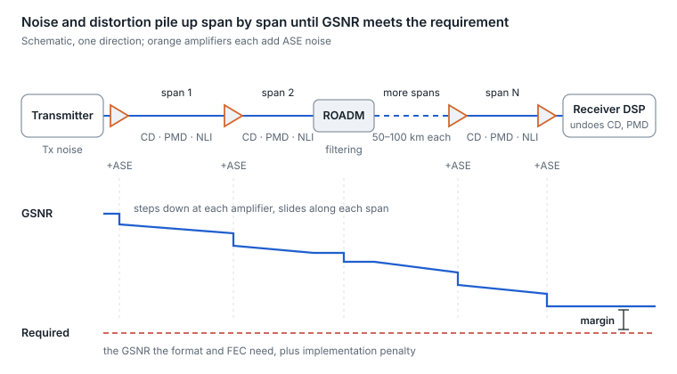
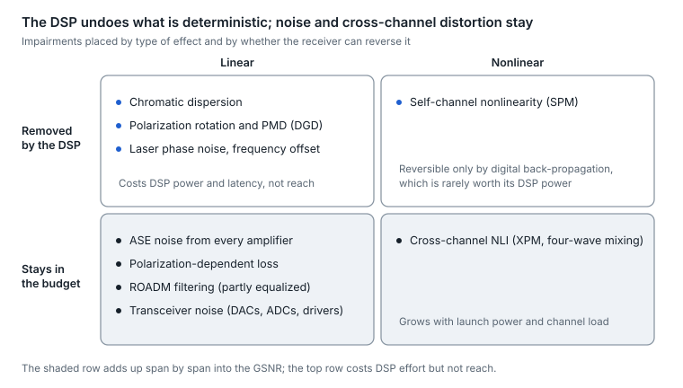
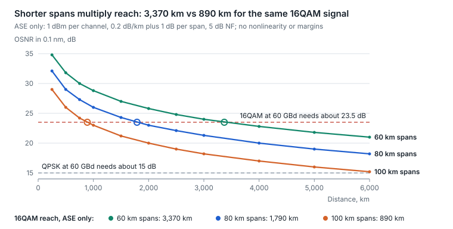
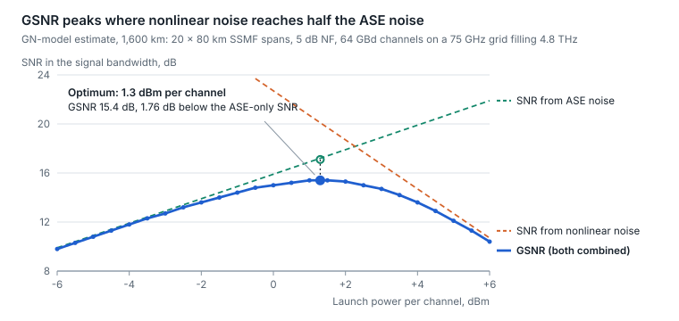
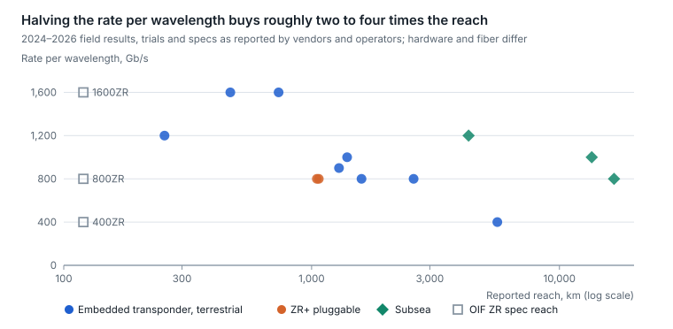
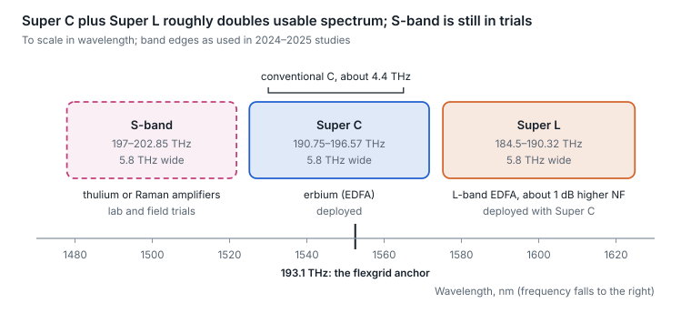

# 26. Long-haul coherent transmission: how it works and what limits it

A long-haul coherent link is a noise budget. Every amplifier adds noise, every milliwatt of launch power adds nonlinear distortion in the fiber, and the receiver's DSP undoes almost everything else. Reach ends where the generalized signal-to-noise ratio (GSNR) at the receiver falls below what the chosen modulation format and FEC need. [Section 8](08-coherent-optics-and-dci.md) covers the coherent transceiver and [section 18](18-advanced-coherent-and-dci.md) its newer features; this section follows the light through a line system hundreds to thousands of kilometers long.

<p align="center"><picture>
  <source media="(prefers-color-scheme: dark)" srcset="../figures/fig-77-dark.svg">
  
</picture></p>

*Figure 26.1 — long-haul link anatomy · schematic, GSNR qualitative*

Read the chain left to right. The DSP removes dispersion and polarization effects at the far end, but the noise added at each amplifier and the distortion added in each span stay in the signal, so GSNR only falls.

## Reach classes

The same physics applies from 80 km to 16,000 km; what changes is how many amplified spans the noise accumulates over, and therefore which transceiver and format fit. Class boundaries are conventions that vary by operator.

| Class | Typical distance | Amplified spans | Line system | Typical transceiver |
| --- | --- | --- | --- | --- |
| Data center interconnect | Up to about 120 km | 0–1 | Booster and pre-amplifier, or none | 400ZR, 800ZR and 1600ZR pluggables ([section 8](08-coherent-optics-and-dci.md)) |
| Metro and regional | Up to about 1,000 km | A few to about 12 | EDFAs, ROADMs | ZR+ pluggables; 800G ZR+ has been shown over about 1,000–1,070 km |
| Long haul | About 1,000–3,000 km | About 12–40 | EDFAs, often with Raman | Embedded transponders; ZR+ at lower rates |
| Ultra-long haul | Beyond about 3,000 km | 40 or more | Raman, low-loss or large-area fiber | Embedded transponders with heavily shaped or QPSK-class formats |
| Submarine | About 6,000–16,000 km | About 100 or more repeaters | Shore-powered repeaters every 50–100 km | Submarine line terminal equipment (SLTE) |

Sources: [800G ZR+ field trial](https://www.arelion.com/about-us/press-releases/arelion-cisco-field-trial), [800G ZR+ product](https://www.ciena.com/products/wavelogic/wavelogic-6/wavelogic-6-nano), [repeater spacing review](https://www.mdpi.com/2673-4001/3/2/15), [repeater spacing study](https://www.arxiv.org/pdf/2401.16997), [16,608 km subsea result](https://www.rcrwireless.com/20260320/network-infrastructure/ciena-meta).

## What the DSP can undo, and what it cannot

Coherent detection hands the DSP the full optical field, so any impairment that is linear and either fixed or slowly changing can be calculated and reversed. What the DSP cannot reverse is noise and cross-channel nonlinear distortion; those add up span by span and set the reach.

<p align="center"><picture>
  <source media="(prefers-color-scheme: dark)" srcset="../figures/fig-78-dark.svg">
  
</picture></p>

*Figure 26.2 — impairment map · linear vs nonlinear, removed vs kept*

| Impairment | Where it comes from | Typical scale | What the DSP does | What it costs |
| --- | --- | --- | --- | --- |
| Chromatic dispersion (CD) | Fiber; about 16.7–17 ps/nm/km at 1550 nm | About 17,000 ps/nm per 1,000 km | A static equalizer removes it. Embedded DSPs tolerate ±150,000–350,000 ps/nm; a 400ZR module ±2,400 ps/nm | DSP power and latency grow with the dispersion to undo |
| Polarization-mode dispersion (DGD) | Random fiber birefringence that drifts over time | A few ps over 1,000 km of modern fiber | An adaptive polarization equalizer tracks it. Tolerances run from about 10 ps (400ZR) to 64 ps (embedded) | Small, unless the fiber moves fast |
| Polarization-dependent loss (PDL) | Amplifiers, ROADMs and other components | Fractions of a dB per element | Cannot be undone, because signal and noise are lost unequally | An SNR penalty; 400ZR allows 4 dB of PDL for a 2 dB penalty |
| Laser phase noise and frequency offset | Transmit laser and local oscillator | About 100 kHz linewidth lasers for 400G-class modems | Carrier recovery tracks it | Denser formats need quieter lasers |
| ROADM filtering | Each wavelength-selective switch narrows the passband | Penalty grows with every pass | The equalizer partly restores the edges | Enhanced noise; plan the number of passes |
| ASE noise | Every optical amplifier | Sets the OSNR (next subsection) | Nothing | Accumulates with span count |
| Nonlinear interference (NLI) | Kerr effect in the fiber; grows with the cube of launch power | Sets the launch-power ceiling | The self-channel part could be back-propagated at high DSP cost; the cross-channel part acts as noise | Caps useful launch power |

Sources: [fiber parameters](https://arxiv.org/pdf/1402.3528), [fiber PMD spec](https://csmedia.corning.com/media/worldwide/coc/documents/Fiber/product-information-sheets/PI-1424-AEN.pdf), [embedded DSP tolerances](https://www.cisco.com/c/en/us/products/collateral/optical-networking/network-convergence-system-1000-series/datasheet-c78-743956.html), [400ZR and ZR+ tolerances](https://www.juniper.net/documentation/ke-apps/hct/optStdParams/stdHtml/JCO400-QDD-ZR-M-HP.html), [100 kHz laser](https://www.lumentum.com/en/products/micro-itla-tunable-laser-100-khz), [filtering penalties](https://research.tue.nl/en/publications/on-the-mitigation-of-optical-filtering-penalties-originating-from/).

## Noise: amplifiers, span loss and OSNR

Each amplifier gives back the power its span took and adds amplified spontaneous emission (ASE) noise in proportion to its gain and noise figure. Identical spans add equal noise, so OSNR falls by 3 dB every time the number of spans doubles. For a chain of identical spans, measured in a 0.1 nm (12.5 GHz) reference bandwidth:

```math
\text{OSNR}_{0.1\,\text{nm}} \approx 58 + P_{\text{ch}} - L_{\text{span}} - \text{NF} - 10\log_{10} N_{\text{spans}}
```

Here P is the launch power per channel in dBm, L the span loss and NF the amplifier noise figure in dB. The 58 is −10·log₁₀(hν·B\_ref / 1 mW) with B\_ref = 12.5 GHz (0.1 nm at 1550 nm): the quantum reference in the measurement bandwidth, not any amplifier's noise floor; the amplifier's own excess noise enters through NF ([derivation](https://grouper.ieee.org/groups/802/3/cn/public/18_11/lyubomirsky_3cn_01a_1118.pdf)).

**Worked example.** 80 km spans at 0.2 dB/km plus 1 dB of connectors give 17 dB of span loss. With 5 dB amplifiers and 1 dBm per channel, one span delivers 58 + 1 − 17 − 5 = 37 dB OSNR. Twenty spans (1,600 km) cost 10·log₁₀ 20 = 13 dB, leaving 24 dB. For comparison, one 400G-class module datasheet asks for about 15 dB for QPSK at 60 GBd and 23.5 dB for 16QAM ([datasheet](https://www.juniper.net/documentation/ke-apps/hct/optStdParams/stdHtml/JCO400-QDD-ZR-M-HP.html)), before nonlinearity takes its share.

<p align="center"><picture>
  <source media="(prefers-color-scheme: dark)" srcset="../figures/fig-79-dark.svg">
  
</picture></p>

*Figure 26.3 — OSNR vs distance · computed from the formula above, ASE only*

The levers, in order of how directly they buy OSNR:

- **Span loss counts dB for dB.** Stretching 80 km spans to 100 km adds 4 dB of loss per span and saves only 1 dB through fewer spans over 1,600 km, a net loss of 3 dB. Where amplifier sites can be placed, shorter spans win.
- **Amplifier noise figure counts dB for dB.** EDFAs run at about 4.5–6 dB, lowest at high gain; L-band amplifiers run about 1 dB worse than C-band ([GNPy amplifier models](https://gnpy.readthedocs.io/en/master/amplifier_models_description.html), [C+L study](https://arxiv.org/pdf/2407.14401)).
- **Raman amplification spreads the gain through the fiber.** Pumping the fiber itself amplifies the signal before it reaches its weakest point, for an effective noise figure of about −2 to 0 dB and about 6 dB more OSNR in a Raman-plus-EDFA hybrid, by one vendor's figures. It is unforgiving of the plant: a −21 dB reflection adds 3 dB to the equivalent noise figure, and 1 dB of connection loss costs 4 dB of Raman gain ([Raman app note](https://bxin.cisco.com/c/en/us/support/docs/optical-networking/ons-15454-m6-multiservice-transport-platform-mstp/212834-practical-aspects-of-raman-amplifier.pdf), [Raman test guide](https://www.exfo.com/contentassets/a68e697e9ff0420297cc9e04de1019fb/exfo_wpaper072_is-your-network-ready-for-raman-amplifiers_en.pdf)).
- **Low-loss, large-area fiber helps twice.** ITU-T G.654.E fiber (about 0.16–0.17 dB/km, 110–125 µm² effective area) lowers span loss and nonlinearity; vendors claim 2–4 dB more OSNR per span and roughly twice the reach for some formats ([G.654.E white paper](https://global-sei.com/fttx/optical-fibers/resource/pdf/TR-23076A_White%20Paper_ITU-T%20G.654.E%20fiber,%20PureAdvance.pdf)).
- **Launch power counts dB for dB, until it doesn't.** The next subsection explains the ceiling.

## The nonlinear ceiling: launch power and GSNR

Raising launch power raises OSNR dB for dB, but glass's refractive index rises slightly with light intensity (the Kerr effect). Each channel then distorts itself (self-phase modulation) and its neighbors (cross-phase modulation, four-wave mixing). In uncompensated coherent links this nonlinear interference behaves like extra Gaussian noise whose power grows with the cube of launch power, which is what the Gaussian-noise (GN) model captures. GSNR combines both noise sources:

```math
\frac{1}{\text{GSNR}} = \frac{1}{\text{SNR}_{\text{ASE}}} + \frac{1}{\text{SNR}_{\text{NLI}}}, \qquad P_{\text{NLI}} = \eta\,P^{3}
```

SNR from ASE rises 1 dB per dB of launch power; SNR from NLI falls 2 dB per dB. GSNR therefore peaks at an optimum launch power, where NLI is half the ASE. At that point GSNR sits 1.76 dB below the ASE-only figure, and the curve is flat enough that a 1 dB error in the NLI estimate moves the optimum power or the reach by only about a third of a dB ([GN model paper](https://arxiv.org/pdf/1402.3528), [3 dB rule](https://arxiv.org/pdf/2407.08309)).

<p align="center"><picture>
  <source media="(prefers-color-scheme: dark)" srcset="../figures/fig-80-dark.svg">
  
</picture></p>

*Figure 26.4 — GSNR vs launch power · GN-model estimate for one example link*

Below the optimum the link is noise-limited and more power helps; above it, every extra dB of launch power costs two dB of nonlinear SNR and GSNR falls. The Optics Bench lab's long-haul instrument lets you move each parameter and watch the curve shift.

- **Where the optimum lands.** It depends on symbol rate, fiber, band and channel load. Published optima range from about −2 dBm per channel at 32 GBd on 75 km G.652.D spans to +2 to +8 dBm per channel at 100 GBd in a 12 THz C+L system ([32 GBd study](https://iris.polito.it/bitstream/11583/2933953/3/optical_power_control_cls__ofc2021.pdf), [C+L study](https://arxiv.org/pdf/2407.14401)). Line systems set per-channel power targets rather than leaving it to each transceiver.
- **Noise figure matters less than it seems.** Because NLI pushes back, the optimized GSNR improves by only about two-thirds of any noise-figure gain: 3 dB lower NF buys about 2 dB of GSNR ([scaling rules](https://xtera.com/wp-content/uploads/2017/05/Performance-Scaling-Rules-for-Raman-Amplification-in-Coherent-Transmission-Systems-Xtera-September-2015.pdf)).
- **Large-area fiber raises the ceiling.** Spreading the same power over 125 µm² instead of 80 µm² weakens the Kerr effect; one fiber vendor claims a 1.5 dB higher nonlinear limit ([fiber datasheet](https://fiber-optic-catalog.ofsoptics.com/documents/pdf/TeraWave-ULL-Single-mode-fiber-162-web.pdf)).
- **Planning tools model it.** GN-model planners such as the open-source GNPy (Telecom Infra Project) predict GSNR per channel; in a multi-operator validation they landed within 1 dB of measurement in 90% of 500 cases and placed the optimum power within 0.5 dB ([validation](https://iris.polito.it/bitstream/11583/2826672/1/JOCN_GNPy.pdf), [GNPy](https://gnpy.readthedocs.io/en/master/)).

## Trading capacity for reach: format, baud, shaping and FEC

At a given GSNR, the transceiver chooses how many bits each symbol carries. Fewer bits per symbol tolerate more noise and reach farther; probabilistic constellation shaping (PCS, [section 2](02-signaling-and-modulation.md)) turns that choice from a few fixed steps into a continuous dial.

- **Format costs OSNR.** At the same 60 GBd, one datasheet needs about 15 dB OSNR for QPSK, 20 dB for 8QAM and 23.5 dB for 16QAM. Doubling the symbol rate at the same format costs 3 dB: QPSK needs 12 dB at 30 GBd, 15 dB at 60 GBd and 18 dB at 118 GBd ([400G-class datasheet](https://www.juniper.net/documentation/ke-apps/hct/optStdParams/stdHtml/JCO400-QDD-ZR-M-HP.html), [800G-class datasheet](https://www.juniper.net/documentation/ke-apps/hct/optStdParams/stdHtml/JCO800-QDD-ZR-M-HP.html)).
- **Shannon sets the ceiling.** A dual-polarization channel can carry at most about 2 × baud × log₂(1 + SNR) bits per second. Uniform QAM gives up to 1.53 dB of that; shaping recovers about 1 dB in practice, and modern modems sit within a couple of dB of the linear Shannon limit ([shaping](https://intechopen.com/chapters/77430), [gap to Shannon](https://gazettabyte.com/?p=142737)).
- **Flex-rate turns margin into capacity.** Modern embedded modems adjust shaping and baud to fit each path, from 200G to 1.6T on one 200 GBd engine, so a short, clean path carries more than a long one on the same hardware ([200 GBd engine](https://gazettabyte.com/tag/wavelogic-6-extreme)).
- **FEC sets the threshold.** Stronger codes accept a worse raw BER at the cost of overhead:

| FEC | Used by | Overhead | Pre-FEC BER threshold | Net coding gain |
| --- | --- | --- | --- | --- |
| CFEC | 400ZR | About 15% | 1.25 × 10⁻² | 10.8 dB |
| oFEC | OpenZR+, ZR+ modes | About 15% | 2.0 × 10⁻² | 11.1–11.6 dB |
| Proprietary soft-decision FEC | Embedded transponders | Up to about 27% | Up to about 3.75 × 10⁻² | About 11.5–12 dB |

Sources: [CFEC](https://www.lightwaveonline.com/optical-tech/transmission/article/14280465/what-is-fec), [oFEC](https://www.cablelabs.com/?p=20531), [embedded SD-FEC](https://www.cisco.com/c/en/us/products/collateral/optical-networking/network-convergence-system-1000-series/datasheet-c78-743956.html).

<p align="center"><picture>
  <source media="(prefers-color-scheme: dark)" srcset="../figures/fig-81-dark.svg">
  
</picture></p>

*Figure 26.5 — rate per wavelength vs reach · reported results, log distance scale*

Sources for the plotted points: [200 GBd field results](https://www.ciena.com/insights/blog/2025/1.6-tbs-is-here-what-it-means-for-networks-and-the-industry), [3 × 800G trial](https://convergedigest.com/windstream-and-ciena-complete-first-3x800g-trial-using-wavelogic-6-extreme/), [130 GBd trial](https://nokia.com/customer-success/nokia-and-ote-group-set-dual-world-record-optical-transmission-rates-over-ultra-long-distances), [140 GBd field result](https://totaltele.com/zayo-achieves-record-breaking-1-tb-s-transmission-on-live-north-american-network-with-infineras-ice7-coherent-optical-solution/), [400G QPSK trial](https://www.mobileworldlive.com/?p=399072), [800G ZR+ trial](https://www.arelion.com/about-us/press-releases/arelion-cisco-field-trial), [800G ZR+ demo](https://www.ciena.com/products/wavelogic/wavelogic-6/wavelogic-6-nano), [subsea 4,300 km](https://www.bw-digital.com/news-and-updates/hawaiki-clocks-new-speed-record-with-cienas-wavelogic-6-extreme/), [subsea 16,608 km](https://www.rcrwireless.com/20260320/network-infrastructure/ciena-meta). A next generation of 2.4T- and 3.2T-capable embedded transponders was announced in March 2026, sampling mid-2027 with general availability in the second half of 2027 ([announcement](https://www.nokia.com/about-us/news/releases/2026/03/16/nokia-launches-suite-of-application-optimized-optical-solutions-for-ai-era-networks)).

Terrestrial and subsea points are not directly comparable: submarine systems are engineered end to end for their one route, with fixed repeaters and tuned power.

## Line systems: ROADMs, flexgrid, bands and Raman

The line system is everything between the transceivers: multiplexers, amplifiers, ROADMs and the fiber. It decides how many wavelengths fit, how they are routed, and how much noise and filtering each one collects.

- **ROADMs route wavelengths without converting them to electrical.** Wavelength-selective switches (WSS) add, drop or pass each channel. Colorless, directionless and contentionless (CDC) add/drop lets any transceiver use any wavelength toward any direction. Every pass through a WSS narrows the channel slightly; one study kept the penalty under 1 dB through 14 filters at 32 GBd only with mitigation ([filtering study](https://research.tue.nl/en/publications/on-the-mitigation-of-optical-filtering-penalties-originating-from/)), so long routes through many nodes need wider slots or fewer passes.
- **Flexgrid fits the slot to the signal.** ITU-T G.694.1 places center frequencies at 193.1 THz + n × 6.25 GHz with slot widths in multiples of 12.5 GHz ([RFC 7699](https://datatracker.ietf.org/doc/html/rfc7699)). A 400ZR signal fits 75 GHz, 800ZR about 150 GHz, and a 200 GBd 1.6T signal a 200 GHz channel, of which 24 fill an extended C-band ([200 GBd engine](https://www.ciena.com/insights/blog/2025/1.6-tbs-is-here-what-it-means-for-networks-and-the-industry)).
- **More band, more capacity.** Conventional C-band is about 4 THz, extended C about 4.8 THz, Super C about 6 THz, and Super C plus Super L about 12 THz; Super C+L meshes and 12 THz trials were in service or trial in 2025–26 ([band widths](https://www.lightreading.com/cable-technology/supersizing-the-c-band), [Super C+L mesh](https://suboptic.org/news/turkcell-deploys-europe-s-largest-super-c-l-ason-mesh-network-in-partnership-with-huawei)). The S-band, below 1530 nm, needs thulium-doped or Raman amplifiers; a 15 THz S+C+L system ran 1,552 km in the lab in 2025, but no commercial S-band long-haul deployment had been reported ([S+C+L loop](https://arxiv.org/abs/2507.21865)).
- **Raman and hybrid amplification.** Backward-pumped Raman gain plus an EDFA is common on long spans; in the S+C+L experiment, adding Raman raised net throughput from 88.8 to 92.8 Tb/s (same source).
- **Open line systems.** When the line system and transceivers come from different vendors, each wavelength is an “alien wavelength” on the line, and the contract between them is GSNR. The Open ROADM MSA showed multi-vendor 800G pluggables with shaping across a ROADM link in 2025 ([Open ROADM demo](https://convergedigest.com/open-roadm-msa-demos-multi-vendor-800g-pluggables/)).

<p align="center"><picture>
  <source media="(prefers-color-scheme: dark)" srcset="../figures/fig-82-dark.svg">
  
</picture></p>

*Figure 26.6 — optical bands · to scale in wavelength*

Band edges: [Super C and Super L](https://arxiv.org/pdf/2407.14401), [S-band](https://arxiv.org/pdf/2407.08309). Each band needs its own amplifier type, so adding a band adds a parallel amplifier chain at every site.

## Margins and planning

A link planned to the exact GSNR it needs today fails as amplifiers age, fiber gets cut and spliced, and models prove optimistic. Planners therefore hold dB in reserve. The values below come from one widely cited operator study and from GNPy's examples; real allocations vary by operator.

| Margin | What it covers | Example value |
| --- | --- | --- |
| Amplifier aging | Noise figure drifting up over life | 0.7 dB |
| Transponder aging | Transmitter and receiver degradation | 0.5 dB |
| Fast variations | Polarization, PDL and temperature swings | 0.4 dB |
| Filter aging | Each ROADM filter | 0.05 dB per filter |
| Fiber repairs | Extra loss from splices after cuts | 1.1 dB for 600 km over 10 years (about four cuts) |
| Nonlinear-model uncertainty | Error in the NLI estimate | 1.5–3 dB |
| System or design margin | Everything else | Under 2 dB; GNPy examples use 2 dB |

Sources: [low-margin design study](https://www.pointurier.org/research/publications/journal/pointurier_jocn_2017.pdf), [GNPy parameters](https://gnpy.readthedocs.io/en/v2.12/_sources/json.rst.txt).

The same study's example network starts life with about 6 dB of margin and argues that unused margin is unsold capacity. Flex-rate transceivers and DSP-reported SNR let operators run a higher rate today and step down only when measured margin shrinks.

## Submarine systems

Undersea links follow the same physics with one extra constraint: every repeater is powered over the cable's copper conductor from the shore, so total electrical power is fixed.

- **Repeaters every 50–100 km.** One review gives 75–100 km; one recent cable averages 84 km ([review](https://www.mdpi.com/2673-4001/3/2/15), [cable study](https://www.arxiv.org/pdf/2401.16997)). Power-feed equipment moved from 15 kV to 18 kV, about 20% more power ([power feed](https://totaltele.com/first-key-to-unlocking-32-fiber-pair-systems-18kv-power-feeding-solution-leads-sdm-system-revolution/)).
- **Power-limited design favors more fiber pairs.** Capacity rises only logarithmically with SNR but linearly with the number of fiber pairs, so space-division multiplexing (SDM) cables run more pairs at lower power each; about 24 pairs was the near-term optimum in one 2019 analysis ([SDM analysis](https://lightera.com/wp-content/uploads/2021/12/submarineSDM_subOptic_v7.pdf)). Cables announced in 2025–26 carry 20–24 pairs, and one uses 24 pairs of two-core fiber for about 1 Pb/s over about 7,000 km ([announcement](https://engineering.fb.com/2026/09/21/connectivity/petal-petabit-transoceanic-subsea-cable/)).
- **Open cables are specified by GSNR.** Rating the wet plant by GSNR rather than by a transponder lets any submarine line terminal light it, and spectrum sharing gives each tenant a “virtual fiber pair” with its own terminal equipment ([open cable paper](https://research.google/pubs/the-subsea-fiber-as-a-shannon-channel/), [spectrum sharing](https://www.ciena.com/insights/what-is/What-Is-Spectrum-Sharing.html)).
- **2025–26 results.** 800G per wavelength over 16,608 km at 18 Tb/s per fiber pair, and 20 Tb/s per pair over 10,000 km on a 20-pair trans-Pacific cable, by vendor and operator reports ([16,608 km](https://www.rcrwireless.com/20260320/network-infrastructure/ciena-meta), [10,000 km](https://ribboncommunications.com/company/media-center/press-releases/seren-juno-and-ribbon-achieve-20tbps-transmission-10000-km-juno-trans-pacific-cable)).

## Standards that govern long-haul coherent

No single standard defines a long-haul link. ITU-T defines the fiber, the grid and the framing; OIF and the MSAs define interoperable transceivers; Open ROADM defines how multi-vendor line systems and transponders work together. Embedded long-haul transponders themselves remain proprietary at the line side.

| Standard | Body | What it defines | Status, October 2026 |
| --- | --- | --- | --- |
| G.652, G.654 (incl. G.654.E) | ITU-T | Standard single-mode and large-area, low-loss fiber | 08/2024 editions |
| G.694.1 | ITU-T | DWDM grid and flexgrid: 6.25 GHz center steps, 12.5 GHz slot widths | 10/2020 |
| G.698.1, G.698.2, G.698.4 | ITU-T | DWDM application codes for single-channel interfaces, including the amplified “black link” and port-agnostic bidirectional DWDM | 06/2023, 11/2018, 05/2025 |
| G.709 and G.709.x (FlexO) | ITU-T | OTN framing and FlexO interfaces; a G.709.6 revision adding a 1.6T long-reach interface on the same optical interface as OIF 1600ZR+ was consented in July 2026, and G.698.2 is under revision for 800G and beyond-1T applications | G.709 with Amendment 4 (07/2025); G.709.6 revision in approval |
| G.977.1 | ITU-T | Transversely compatible submarine DWDM | 10/2020 |
| 400ZR, 800ZR, 1600ZR | OIF | Interoperable coherent pluggables for amplified links up to about 120 km | 400ZR 3.0 and 800ZR 1.0 (Oct 2024); 1600ZR 1.0 (Sep 2026) |
| 800LR | OIF | Single-wavelength coherent for unamplified campus links | 1.0 (Apr 2025) |
| 1600ZR+ | OIF | Longer-reach 1.6T pluggable | Project since Jan 2024; no agreement published |
| C-CMIS | OIF | CMIS extensions for coherent modules (tuning, CD, OSNR and SNR reporting) | 01.5 (Sep 2026) |
| OpenZR+ | MSA | Multi-rate ZR+ modes with oFEC for metro and regional | v3.0 (Sep 2023) |
| Open ROADM | MSA | Interoperable ROADM, transponder and pluggable optical specs plus YANG device models | Release 19.1.0 (Jul 2026) |
| 802.3ct; P802.3cw | IEEE | 100G Ethernet over DWDM; 400G over DWDM | 802.3ct approved 2021; P802.3cw withdrawn May 2024 |

Sources: [ITU-T G.652](https://www.itu.int/rec/T-REC-G.652), [G.654](https://www.itu.int/rec/T-REC-G.654), [G.694.1](https://www.itu.int/rec/T-REC-G.694.1), [G.698.1](https://www.itu.int/rec/T-REC-G.698.1), [G.698.2](https://www.itu.int/rec/T-REC-G.698.2), [G.698.4](https://www.itu.int/rec/T-REC-G.698.4), [G.709](https://www.itu.int/rec/T-REC-G.709), [SG15 July 2026](https://www.itu.int/en/ITU-T/studygroups/2025-2028/15/Pages/exec_sum_2026-07.aspx), [G.977.1](https://www.itu.int/rec/T-REC-G.977.1), [OIF agreements](https://www.oiforum.com/technical-work/implementation-agreements-ias/), [1600ZR](https://www.semiconductor-today.com/news_items/2026/sep/oif-100926.shtml), [1600ZR+](https://www.oiforum.com/technical-work/hot-topics/1600g-coherent/), [OpenZR+](https://openzrplus.org/documents/), [Open ROADM](https://github.com/OpenROADM/OpenROADM_MSA_Public), [802.3ct](https://www.ieee802.org/3/ct/index.html), [P802.3cw](https://www.ieee802.org/3/cw/index.html). [Section 27](27-standards-and-ecosystem-map.md) has the full standards catalog.

## What it means in operations

A coherent receiver is also a line-monitoring instrument: its DSP estimates the physics it undid. Trend these values per wavelength (sections 18 and 24 list the telemetry paths) and read changes against this table.

| Reading | What it measures | A change usually means |
| --- | --- | --- |
| Chromatic dispersion estimate (ps/nm) | The fiber length crossed, at about 17 ps/nm per km | A step change means the path changed: a protection switch or reroute |
| DGD estimate (ps) | Polarization-mode dispersion on the route | Fast swings point to mechanically disturbed fiber, such as aerial spans |
| OSNR estimate | ASE noise from the amplifier chain | A drop points to an amplifier fault, or extra span loss from a bad splice or a bend |
| SNR or ESNR (electrical) | Everything the receiver sees: ASE, NLI, filtering and transceiver noise | ESNR falling while OSNR holds points to nonlinearity or filtering: power set too high, new neighbor channels, or more ROADM passes |
| Pre-FEC BER and Q | Distance to the FEC threshold | The margin to trend; converts to Q as below |
| Launch and received power per channel | The power profile along the line | Tilt or a dirty connector; a drop in Raman gain on Raman spans |
| Frequency offset | Transmit laser against local oscillator | A slow trend means a laser drifting with age |

```math
Q_{\text{dB}} = 20\log_{10}\!\left(\sqrt{2}\;\operatorname{erfc}^{-1}(2\cdot\text{BER})\right)
```

A pre-FEC BER of 2 × 10⁻² (the oFEC threshold) is a Q of about 6.3 dB, and 1.25 × 10⁻² (CFEC) about 7.0 dB. A wavelength reporting Q = 9 dB on oFEC therefore has about 2.7 dB of margin, and that number, trended over months, is what tells you whether a route can take a higher rate or is heading for trouble.


---

[← 25. Silicon photonics and optical engines](25-silicon-photonics-and-optical-engines.md) · [Contents](../README.md#contents) · [27. Standards and ecosystem map →](27-standards-and-ecosystem-map.md)
