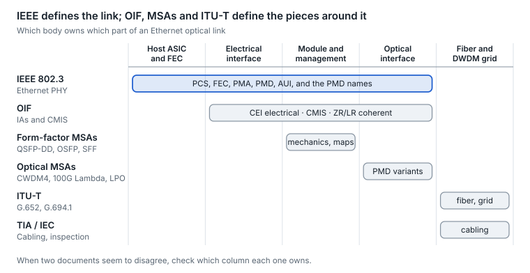

# 27. Standards and ecosystem map

IEEE 802.3 defines what an Ethernet link must do, the OIF defines electrical interfaces, coherent profiles and the module management interface, and MSAs define the modules themselves plus the reach variants IEEE did not. When two documents seem to disagree, check which of the three layers each one owns.

<picture>
  <source media="(prefers-color-scheme: dark)" srcset="../figures/fig-83-dark.svg">
  
</picture>

*Figure 27.1 — standards ownership map · simplified*

| Body | Owns | Key documents |
| --- | --- | --- |
| IEEE 802.3 | Ethernet PHYs: PCS, FEC, PMA, PMD, AUI, names like 400GBASE-DR4 | 802.3ba/bm (40/100G), bs/cd/cm/cu/ck/db/df (200G–800G), dj (200G lanes), dv (400G lanes, PAR approved Sep 2026) |
| OIF | CEI electrical interfaces; coherent IAs; CMIS; co-packaging and external lasers | CEI-112G/224G, 400ZR, 800ZR, 800LR, 1600ZR, CMIS 5.x, ELSFP, RTLR |
| QSFP-DD MSA | QSFP-DD / DD800 / DD1600 mechanics, electrical, thermal | QSFP-DD rev 7.1 |
| OSFP MSA | OSFP, OSFP1600, OSFP-RHS, OSFP-XD | OSFP rev 5.22, OSFP-XD rev 1.11 |
| SNIA SFF TA | SFP and QSFP mechanics and management maps | SFF-8472, SFF-8636, SFF-8024 |
| Optical MSAs | Reach and wavelength variants | CWDM4, PSM4, 100G Lambda (FR/LR/ER), 400G-FR4, OpenZR+, LPO, Open ROADM |
| ITU-T | Fiber types, DWDM grids, optical transport | G.652 fiber, G.694.1 grid, G.709 OTN, G.698.2 |
| TIA / ISO / IEC | Cabling and connector cleanliness | TIA-568 (fiber grades, polarity), IEC 61300-3-35 (end-face inspection) |

## IEEE 802.3 projects that shaped today's optics

| Project | What it added | Approved |
| --- | --- | --- |
| 802.3ba | 40G and 100G Ethernet (10G and 25G-era lanes) | 2010 |
| 802.3bm | 100G with 25G lanes: SR4, CAUI-4 | 2015 |
| 802.3bs | 200G and 400G Ethernet, PAM4, RS(544,514) | 2017 |
| 802.3cd | 50G-per-lane PAM4 for 50G, 100G, 200G | 2018 |
| 802.3cm | 400G over multimode: SR8, SR4.2 | 2020 |
| 802.3cu | 100G per wavelength on SMF: FR1, LR1, 400G FR4, LR4-6 | Feb 2021 |
| 802.3ct | 100G Ethernet over DWDM (coherent) | Jun 2021 |
| 802.3ck | 100G-per-lane electrical: AUIs, CR, KR | Sep 2022 |
| 802.3db | 100G per lane on multimode: VR, SR | Sep 2022 |
| 802.3df | 800G Ethernet with 100G lanes | Feb 2024 |
| 802.3cw | 400G ZR over DWDM | Withdrawn, May 2024 |
| 802.3dk | Bidirectional optical access PHYs above 50 Gb/s | Mar 2026 |
| 802.3dj | 200G per lane; 800G and 1.6T; coherent 800G LR1/ER1 | Not yet approved; RevCom targeted Dec 2026 |
| P802.3ds | 200G per lane over multimode fiber | PAR Dec 2025; RevCom expected Aug 2027 |
| P802.3dv | 400G per lane: 400G, 800G and 1.6T over electrical links and SMF up to 500 m | PAR approved 25 Sep 2026; submission for approval projected Sep 2029 |

Dates for cu, ck, db, df and cw come from the IEEE project pages ([cu](https://www.ieee802.org/3/cu/index.html), [ck](https://www.ieee802.org/3/ck/index.html), [db](https://www.ieee802.org/3/db/index.html), [df](https://ieee802.org/3/df/), [cw](https://www.ieee802.org/3/cw/index.html)); earlier years are approximate.

## Standards catalog, October 2026

Every body and agreement that shapes an optical link, with its latest version. IEEE projects are in the table above; long-haul items are explained in [section 26](26-long-haul-coherent-transmission-how-it.md). “Project” means work under way with no published document yet.

**OIF implementation agreements**

| Agreement | What it defines | Latest, October 2026 |
| --- | --- | --- |
| 400ZR | Interoperable 400G coherent pluggable, up to about 120 km amplified | 3.0 (Oct 2024) |
| 800ZR | 800G coherent pluggable, amplified DWDM | 1.0 (Oct 2024) |
| 800LR | 800G single-wavelength coherent for unamplified campus links | 1.0 (Apr 2025) |
| 1600ZR | 1.6T coherent pluggable, amplified DWDM up to 120 km | 1.0 (Sep 2026) |
| 1600ZR+ | Longer-reach 1.6T coherent pluggable | Project since Jan 2024 |
| CEI (Common Electrical I/O) | Chip-to-module and chip-to-chip electrical lanes | CEI-05.3 (Jul 2025); CEI-224G XSR, VSR, MR, LR and linear projects under way; CEI-448G VSR and LR projects since Feb 2026, first interoperability demos at ECOC 2026 |
| CMIS | Module management for 400G and up | 5.4 (May 2026); CMIS-LT out-of-band link training approved Sep 2026; path start-up supplement begun Q2 2026 |
| C-CMIS | CMIS extensions for coherent modules | 01.5 (Sep 2026) |
| ELSFP | Front-panel external laser module for CPO | 02.0 (Jan 2025) |
| 3.2T co-packaged module | First co-packaged optics module definition | 01.0 (Mar 2023) |
| 12.8T / 6.4T NPO module | Near-packaged optics modules at 200G per lane | Project since Q2 2026 |
| 112G RTLR | Retimed transmitter, linear receiver interface | 01.0 (Oct 2025) |
| High-density connector framework | Connector interfaces for dense optics | Approved Q2 2026 |

**ITU-T recommendations**

| Recommendation | What it defines | Latest |
| --- | --- | --- |
| G.652, G.654, G.657 | Standard, cut-off-shifted (incl. G.654.E) and bend-insensitive single-mode fiber | 08/2024 |
| G.694.1 / G.694.2 | DWDM flexgrid / CWDM grid | 10/2020 / 12/2003 |
| G.698.1, G.698.2, G.698.4 | DWDM application codes, amplified black link, port-agnostic bidirectional DWDM | 06/2023, 11/2018, 05/2025 |
| G.709 and G.709.x (FlexO) | OTN framing; FlexO interfaces up to 1.6T | G.709 Amd 4 (07/2025); G.709.3 Amd 1 approved Aug 2026; G.709.1, G.709.6 revisions and new G.709.7 consented Jul 2026 |
| G.977.1 | Transversely compatible submarine DWDM | 10/2020 |
| G.8273.2 / G.8275.1 | Boundary-clock timing performance / full-timing-support PTP profile | 2023 + Amd 2 (11/2025) / 02/2026 |
| Hollow-core fiber | Technical report on hollow-core technologies | Approved Jul 2026; further work agreed |
| Multi-core fiber | Weakly coupled multi-core fiber recommendations | Under study, targeted 2028 |

**MSAs and industry groups**

| Group | What it defines | Latest |
| --- | --- | --- |
| QSFP-DD MSA | QSFP-DD, DD800 and DD1600 modules | Hardware rev 7.1 (Jun 2024) |
| OSFP MSA | OSFP and OSFP-XD (16 lanes, up to 3.2T) | OSFP 5.22 (Aug 2025); OSFP-XD 1.11 (Nov 2025) |
| XPO MSA | 12.8T liquid-cooled pluggable, up to 400 W | Announced Mar 2026; specification release not confirmed |
| LPO MSA | Linear pluggable optics | 100G-DR-LPO (Mar 2025); 400G-FR4-LPO (Sep 2025); no 200G-per-lane spec yet |
| 100G Lambda MSA | 100G-per-wavelength FR, LR, ER and 400G FR4, LR4 variants | Multiple documents; no dates published |
| OpenZR+ MSA | Multi-rate ZR+ coherent with oFEC | v3.0 (Sep 2023) |
| Open ROADM MSA | Multi-vendor ROADM, transponder and pluggable specs, YANG models | Release 19.1.0 (Jul 2026) |
| CW-WDM MSA | 8-, 16- and 32-wavelength O-band laser grids | Rev 1.0 (Jun 2021) |
| SDM4 MSA | 4-core fiber in standard 125 µm cladding | v1.0 (Sep 2026) |
| Open CPX MSA | Socketed optical engine for NPO and CPO | Formed Mar 2026; specification published 17 Sep 2026 (6.4T and 7.2T sockets at 200G per lane, internal or external lasers, liquid-cooling and management specs) |
| OCI MSA | Optical Compute Interconnect: open optical PHY for AI scale-up | 200G-OCI PHY specification v1.0 (2026) |
| OCP Open Silicon Photonics for AI Systems | Open CPO and NPO engine and system specs | White paper published; first specs due Q4 2026 |
| UALink Consortium | Accelerator scale-up interconnect | 200G 1.0 (Apr 2025); 2.0 specification suite (spring 2026) |
| Ultra Ethernet Consortium | Ethernet transport for AI and HPC | 1.0 (Jun 2025); 1.1 (Oct 2026) |
| OCP ESUN / SUE | Ethernet for scale-up networks / Scale-Up Ethernet | ESUN requirements base spec 1.0 (Feb 2026), 1.1 (Oct 2026); SUE 1.0 (Sep 2025) |

**Cabling, reliability and management**

| Document | Body | What it defines | Latest |
| --- | --- | --- | --- |
| SFF-8024, SFF-8636 | SNIA SFF | Module identifiers and code tables; QSFP management map | Rev 4.14 (Jun 2026); rev 2.12 (Apr 2026) |
| TIA-568.3-E | TIA | Optical fiber cabling components, including polarity methods | 2022 |
| IEC 61300-3-35 | IEC | Connector end-face visual inspection | Ed. 3.0 (Sep 2022) |
| IEC 61753-1 | IEC | Performance standards for fiber-optic devices | Ed. 2.0 (2018) |
| GR-468-CORE | Telcordia | Reliability qualification of optoelectronic devices | Issue 2 (date not verified) |
| OpenConfig | Industry | Vendor-neutral YANG models for configuration and telemetry | Models versioned individually |

Sources: [OIF agreements](https://www.oiforum.com/technical-work/implementation-agreements-ias/), [1600ZR](https://www.semiconductor-today.com/news_items/2026/sep/oif-100926.shtml), [CEI-224G](https://www.oiforum.com/technical-work/hot-topics/common-electrical-i-o-cei-224g/), [OIF Q2 2026](https://www.businesswire.com/news/home/20260604899827/en/OIF-Q2-Meeting-Advances-Management-for-Path-Startup-Encryption-Near-Package-Optics-and-High-Density-Connector-Interfaces), [NPO project](https://convergedigest.com/oifsnew-projects-autonomous-path-startup-1-6t-macsec-and-12-8t-npo/), [SG15 July 2026](https://www.itu.int/en/ITU-T/studygroups/2025-2028/15/Pages/exec_sum_2026-07.aspx), [G.8273.2](https://www.itu.int/rec/T-REC-G.8273.2), [G.8275.1](https://www.itu.int/rec/T-REC-G.8275.1), [multi-core work item](https://www.itu.int/ITU-T/workprog/wp_item.aspx?isn=22323), [OSFP MSA](https://osfpmsa.org/specification.html), [XPO MSA](https://convergedigest.com/xpo-msa-introduces-12-8-tbps-pluggable-optics/), [LPO MSA](https://www.lpo-msa.org/home/news.html), [100G Lambda MSA](http://100glambda.com/specifications), [OpenZR+](https://openzrplus.org/documents/), [Open ROADM](https://github.com/OpenROADM/OpenROADM_MSA_Public), [CW-WDM MSA](https://cw-wdm.org/specifications/), [SDM4 MSA](https://fiberbroadband.org/2026/09/17/industry-leaders-complete-sdm4-multicore-fiber-msa-and-release-1-0-technical-specification/), [Open CPX](https://www.financialcontent.com/article/bizwire-2026-8-31-credo-joins-open-cpx-msa-organization), [OCI MSA](https://www.oci-msa.org), [OCP workstream](https://www.sdxcentral.com/news/industry-giants-unite-to-define-open-co-packaged-optics-for-next-gen-ai-infrastructure/), [UALink](https://www.storagenewsletter.com/2026/05/05/ultra-accelerator-link-consortium-publishes-four-specifications-defining-innetwork-compute-chiplets-manageability-and-200g-performance), [UEC](https://ultraethernet.org/specification), [ESUN](https://www.opencompute.org/documents/ocp-esun-network-operator-requirements-base-specification-rev-1-0-final-pdf/), [SUE](https://www.opencompute.org/documents/ocp-sue-spec-final-pdf-1/), [SNIA SFF](https://www.snia.org/technology-communities/sff/specifications), [TIA-568.3-E](https://tiaonline.org/?p=29364), [IEC 61300-3-35](https://webstore.iec.ch/en/publication/64254), [IEC 61753-1](https://webstore.ansi.org/standards/iec/iec61753ed2018), [GR-468](https://macom.com/quality-reliability/telcordia-standards), [OpenConfig](https://github.com/openconfig/public/releases), [IEEE 802.3 projects](https://www.ieee802.org/3/index.html), [P802.3ds](https://www.ieee802.org/3/ds/P802.3ds_PAR.pdf), [802.3dk](https://www.ieee802.org/3/dk/index.html), [P802.3dv PAR](https://www.ieee802.org/3/dv/P802.3dv_PAR.pdf), [802.3dj status](https://grouper.ieee.org/groups/802/email/stds-802-lmsc/msg01115.html).

## OCI MSA: an optical PHY for AI scale-up

The Optical Compute Interconnect (OCI) MSA, formed in March 2026 by six accelerator, switch-silicon and hyperscale companies, defines an open optical PHY for links between AI accelerators and scale-up switches ([formation](https://www.businesswire.com/news/home/20260312254951/en/Optical-Scale-up-Consortium-Established-to-Create-an-Open-Specification-for-AI-Infrastructure-Led-by-Founding-Members-AMD-Broadcom-Meta-Microsoft-NVIDIA-and-OpenAI)). It takes a different path from Ethernet's 200G-per-lane PAM4: many slower NRZ wavelengths on one fiber, built into silicon rather than into a module.

- **First specification.** 200G-OCI PHY v1.0 runs 4 wavelengths × 53.125 GBd NRZ per direction (212.5 Gb/s), bidirectionally on a single fiber: forward at 1308.0–1314.9 nm, reverse at 1327.7–1334.8 nm ([specification write-up](https://convergedigest.com/?p=110366)).
- **Reach and build.** Deployments target under 100 m with a link budget good to about 500 m. The reference design uses silicon photonics with micro-ring modulators and OIF ELSFP external lasers ([section 25](25-silicon-photonics-and-optical-engines.md)), managed through CMIS 5.3 with OCI extensions (same source).
- **Roadmap.** A second generation doubles to 400 Gb/s per direction (up to 800 Gb/s per fiber), with 3.2 Tb/s per fiber on the longer roadmap; form factors include pluggable, on-board, co-packaged and chiplet optics ([OCI MSA](https://www.oci-msa.org)).
- **Protocols on top.** It is a PHY: UALink can run over it, and reports describe it carrying vendor scale-up protocols as well ([report](https://www.3dtested.com/tech-industry/artificial-intelligence/amd-broadcom-and-nvidia-join-hyperscalers-to-define-optical-scale-up-interconnect-of-the-future-for-ai-clusters-meta-microsoft-and-openai-to-benefit-as-speeds-eventually-scale-to-3-2-tb-s)).

## How the pieces depend on each other

- The **lane rate** is set first, jointly by IEEE (Ethernet electrical and optical PMDs) and the OIF (CEI electrical specs that SerDes vendors design to).
- **Form-factor MSAs** then define cages and modules with enough lanes and cooling for that rate.
- **Optical MSAs** fill reach gaps quickly, and IEEE often standardizes a similar PMD later (400G-FR4 began as an MSA).
- **CMIS** ties host and module together operationally, regardless of which PMD is inside.

---

[← 26. Long-haul coherent transmission: how it works and what limits it](26-long-haul-coherent-transmission-how-it.md) · [Contents](../README.md#contents) · [28. Roadmap as of October 2026 →](28-roadmap-as-of-october-2026.md)
