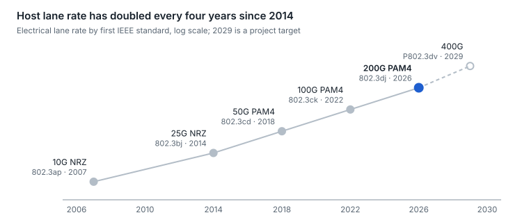

# 28. Roadmap as of October 2026

200G-per-lane PAM4 is the volume generation: 800G and 1.6T modules on 102.4 Tb/s switches. Coherent pluggables reached 1.6T on paper in September 2026, and the next two big decisions are how to signal 400G per lane and how far co-packaged optics displaces pluggables.

<picture>
  <source media="(prefers-color-scheme: dark)" srcset="../figures/fig-84-dark.svg">
  
</picture>

*Figure 28.1 — IEEE 802.3 project records · approval years; 802.3dj in final ballot, P802.3dv targeted*

Optical lanes tend to lead electrical ones: 100G-per-wavelength optics (400GBASE-DR4, 100GBASE-DR) were standardized in 2017–2018, four years before 100G electrical lanes.

| Area | In volume today | Standardized or published | What comes next |
| --- | --- | --- | --- |
| Switch silicon | 51.2T and 102.4T (512 × 200G) | — | 400G-lane SerDes |
| IM-DD pluggables | 800G; 1.6T OSFP ramping (10M+ units expected in 2026) | IEEE 802.3dj in final ballot; OSFP1600, QSFP-DD1600, OSFP-XD specs | 3.2T as 16 × 200G or 8 × 400G; 400G per lane (P802.3dv, \~2029) in the 16-lane USFP form factor announced in October 2026 |
| Linear optics | 800G LPO in selected fabrics | LPO MSA 100G-lane DR (Mar 2025) and 400G-FR4-LPO (Sep 2025); OIF 112G RTLR (2025) | Linear and half-retimed designs at 200G per lane |
| Co-packaged optics | 51.2T deployed; 102.4T CPO switches in production (Aug 2026) | OIF ELSFP v2.0 | Second-source 102.4T CPO switches in production from Q1 2027; broader multi-vendor supply; optics for scale-up |
| Dense pluggables and NPO | NPO pilots and first cloud deployments; XPO demos | XPO MSA announced (Mar 2026); OIF 12.8T NPO module project (May 2026) | 12.8T liquid-cooled XPO modules; wider NPO deployment from \~2027 |
| Silicon photonics and engines | Silicon photonic modulators in over half of transceiver sales (2026 forecast); 3D-stacked engines entering volume | OIF ELSFP 2.0 and 3.2T CPO module agreement; CW-WDM MSA; socketed 6.4T engine MSA (Mar 2026) | 300 mm capacity ramps; OCP open engine specs (Q4 2026); silicon MZM vs TFLN vs EML at 400G per lane (TFLN transmitter PICs at 448G per lane demonstrated at ECOC 2026) |
| Optical I/O for scale-up | Chiplets past engineering validation; funding raised for volume production (2026) | UCIe die-to-die interface; UALink allows optical PHYs; OCI MSA 200G-OCI PHY v1.0 ([section 27](27-standards-and-ecosystem-map.md)) | First accelerator packages with optical I/O; one forecast puts 10–15% of scale-up links on NPO or CPO by 2030–31 |
| New fiber types | Hollow-core in early hyperscale production (1,280 km live by Sep 2025) | ITU-T hollow-core technical report work item opened (Jul 2026); SDM4 multi-core MSA 1.0 (Sep 2026) | 15,000 km hollow-core rollout announced; a 532 km unrepeatered hollow-core transmission record (ECOC 2026); 4-core fiber in AI campuses |
| Optical switching | OCS in production at one hyperscaler; trials elsewhere | — | 300 × 300 MEMS and liquid-crystal switches for AI fabrics |
| Link security | Line-rate MACsec in switch silicon and PHYs | OIF 1.6T pluggable MACsec profile project (May 2026) | Encryption inside 1.6T modules |
| Coherent | 400ZR and OpenZR+ mainstream in DCI; 800ZR+ in first large-scale deployment | 800ZR (Oct 2024), 800LR (Apr 2025), 1600ZR (Sep 2026) | 1600ZR+ for long reach; coherent-lite vs PAM4 for 2–10 km |
| Long-haul line systems | Embedded transponders up to 1.6T per wavelength at about 200 GBd; Super C plus Super L line systems | ITU-T G.694.1 flexgrid; Open ROADM 19.1; 1600ZR (Sep 2026) | 2.4T–3.2T embedded engines (2027); 1600ZR+; S-band beyond trials ([section 26](26-long-haul-coherent-transmission-how-it.md)) |
| Copper | AEC in-rack at 200G per lane | 802.3dj CR (≥ 1 m) | Copper vs optics for multi-rack scale-up |
| Management | CMIS everywhere 400G+ | CMIS 5.4 (May 2026); OIF CMIS-LT link training and C-CMIS 1.5 (Sep 2026) | Richer telemetry for fleet-scale reliability |
| Supply chain | EML and CW laser capacity sold out through 2027–2029 at leading suppliers; 200G EMLs over a quarter of EML revenue; AI back-end switch spending passed front-end in 2Q26 | — | New laser fabs take about three years; quantum-dot and comb lasers, external laser sources and silicon photonics to spread the laser count per bit |

## What to watch over the next 12–18 months

- **802.3dj approval.** Submission to the IEEE standards board was targeted for October 2026, for approval at the December 2026 RevCom meeting; final publication fixes the 200G-lane PMDs that early modules were built against.
- **PAM4 vs PAM6 at 400G per lane.** The modulation choice in P802.3dv decides component bandwidth targets for the next decade.
- **Coherent-lite vs PAM4 at 2–10 km.** If 200G-lane PAM4 LR4 holds up, coherent stays outside the building; if not, coherent moves into the campus.
- **CPO field data.** Serviceability and failure rates from the first large CPO deployments will decide whether pluggables keep the switch faceplate at 400G per lane.
- **Scale-up goes optical.** As GPU pods outgrow a rack, copper's \~1 m reach at 200G per lane forces optics into the scale-up domain, the largest new optics market in view.
- **XPO vs NPO vs CPO.** Whether faceplate density at 3.2T and beyond is solved by bigger liquid-cooled pluggables or by moving optics next to the ASIC ([section 10](10-optics-packaging-pluggable-lpo-xpo-npo-and.md)).
- **Laser supply.** EML and pump-laser capacity at the largest suppliers is sold out into 2028–2029 and new fabs take about three years, so module lead times, not switch silicon, may pace 1.6T and CPO ramps; silicon photonics and external laser sources, which spread one laser over several lanes, are the structural answer.
- **Back-end over front-end.** AI back-end switch sales passed front-end data-center switching in 2Q26, so the optics roadmap is now set by accelerator fabrics (scale-out at 200G per lane today, scale-up moving to optics) rather than by front-end refresh cycles.

---

[← 27. Standards and ecosystem map](27-standards-and-ecosystem-map.md) · [Contents](../README.md#contents) · [29. Glossary →](29-glossary.md)
